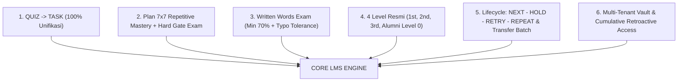

# TopsCore — Master Plan: Vocab 7×7 & Level Progression System

**Status:** ✅ 100% IMPLEMENTED & ARCHIVED (SELESAI)  
**Created:** 2026-11-03  
**Owner:** Product Owner (Mr. Top)  
**Agent:** Antigravity  

---

## 1. Executive Summary & Visi Operasional

Dokumen ini merupakan **satu-satunya dokumen rencana induk (Single Canonical Master Plan)** yang menggabungkan seluruh arsitektur sistem latihan kosakata **Plan 7×7**, sistem penjenjangan akademik **Level Progression System (NEXT, HOLD, RETRY, REPEAT)**, **Cumulative Retroactive Access**, dan **Multi-Tenant Scoping (Institusi & Program)** untuk menyambut **Batch 134 (2nd Level)** dan **Batch 135 (1st Level)**, serta mengelola **Alumni (Batch 133 & Wisudawan Mendatang)**.

### 6 Pilar Arsitektur Utama:



---

## 2. Spesifikasi Detail 6 Pilar

### 2.1 Unifikasi Terminologi Penuh: QUIZ $\rightarrow$ TASK (Zero-Exception Policy)

Menghapus seluruh istilah "Quiz" tanpa terkecuali di seluruh kode frontend, backend, template, label UI, badge, database, dan dokumentasi:

| Konteks | Sebelum (Legacy) | **Sesudah (Official TopsCore Standard)** |
| :--- | :--- | :--- |
| **Kategori Ujian Harian** | Quiz | **Task** |
| **Judul Tes (Shell Title)** | `3rd Vocabulary A1 Words Quiz` | `3rd Vocabulary A1 Words Task` |
| **Shell Code** | `*-QUIZ` / `*-QUIZ-*` | `*-TASK` / `*-TASK-*` |
| **Nilai DB `test_type` / `category`** | `'quiz'`, `'QUIZ'`, `'VOCAB_QUIZ'` | `'task'`, `'TASK'`, `'VOCAB_TASK'`, `'PHRASE_TASK'` |
| **Badge UI / Filter** | `Quizzes`, `Quiz Master` | `Tasks`, `Task Progress` |
| **Tombol Aksi** | `Start Quiz`, `Retake Quiz` | `Start Task`, `Retake Task` |
| **Hirarki Produk (AGENTS.md)** | `Tests (Quizzes & Exams)` | `Tests (Tasks & Exams)` |

---

### 2.2 Sistem Repetisi 7×7 Task & Hard Gate Exam

Setiap topik Task kosakata wajib diselesaikan minimal **7 kali dengan skor $\ge 70\%$ per attempt** untuk dinyatakan *Complete* (Hijau):

```text
Attempt 1: Skor 65%  ---> GAGAL (< 70%)   ---> Counter: 0/7 (Warna Merah E)  ---> Exam TERKUNCI 🔒
Attempt 2: Skor 80%  ---> LULUS (>= 70%)  ---> Counter: 1/7 (Warna Orange D) ---> Exam TERKUNCI 🔒
Attempt 3: Skor 72%  ---> LULUS (>= 70%)  ---> Counter: 2/7 (Warna Orange D) ---> Exam TERKUNCI 🔒
Attempt 4: Skor 50%  ---> GAGAL (< 70%)   ---> Counter: 2/7 (Tidak bertambah)---> Exam TERKUNCI 🔒
Attempt 5: Skor 95%  ---> LULUS (>= 70%)  ---> Counter: 3/7 (Warna Kuning C) ---> Exam TERKUNCI 🔒
Attempt 6: Skor 78%  ---> LULUS (>= 70%)  ---> Counter: 4/7 (Warna Kuning C) ---> Exam TERKUNCI 🔒
Attempt 7: Skor 85%  ---> LULUS (>= 70%)  ---> Counter: 5/7 (Warna Lime B)   ---> Exam TERKUNCI 🔒
Attempt 8: Skor 88%  ---> LULUS (>= 70%)  ---> Counter: 6/7 (Warna Lime B)   ---> Exam TERKUNCI 🔒
Attempt 9: Skor 100% ---> LULUS (>= 70%)  ---> Counter: 7/7 (Warna Hijau A)  ---> Exam TERBUKA ✅🔓
```

* **Target Lulus:** 7 attempt dengan skor **≥ 70%** pada tiap attempt. Attempt < 70% diabaikan dari counter.
* **Batas Maksimum Attempt:** **Unlimited**.
* **Hard Gate Exam:** Tombol Exam **terkunci rapat 🔒** sampai seluruh Task topik tersebut berstatus `7/7 Complete` (Hijau).
* **Palet Warna 5-Tier Gamifikasi (Sesuai Skala Nilai TopsCore):**
  
  | Attempt Lulus Valid | Tingkat Grade | Label Warna | Kode Hex Resmi | CSS Variable |
  | :---: | :---: | :---: | :---: | :---: |
  | **0/7** | **Grade E** | Pure Red (Belum Mengambil / 0) | `#FF0000` | `var(--grade-e)` |
  | **1/7 & 2/7** | **Grade D** | Dark Orange | `#FF8C00` | `var(--grade-d)` |
  | **3/7 & 4/7** | **Grade C** | Pure Yellow | `#FFFF00` | `var(--grade-c)` |
  | **5/7 & 6/7** | **Grade B** | Electric Lime | `#95ff00` | `var(--grade-b)` |
  | **7/7 ✅** | **Grade A / ★** | Pure Green (Star Glow) | `#00c000` | `var(--grade-star)` |

* **Query Realtime Counter:**
  ```sql
  SELECT COUNT(id) FROM attempts 
  WHERE test_id = :test_id 
    AND student_id = :student_id 
    AND (effective_score >= 70 OR percentage >= 70)
    AND status IN ('submitted', 'auto_submitted', 'evaluated');
  ```

---

### 2.3 Exam Words: Written Mode + Ambang Lulus 70%

* **Format Soal:** Bahasa Indonesia (Indonesian prompt) $\rightarrow$ Jawaban Siswa: Text Input (mengetik Bahasa Inggris).
* **Toleransi Ejaan (Rule 2.13 Written Mode):**
  - *Exact Match:* 1.0 pt
  - *Typo Ringan (Damerau-Levenshtein $\le 2$ char):* 0.5 pt partial credit
  - *Word Form / Root Match (stem $\ge 5$):* 0.5 pt partial credit
  - *Pronoun Substitution / Semantic Mismatch:* 0.0 pt
* **Ambang Lulus Minimum (Passing Grade):** **≥ 70%**.
  - Wajib lulus Exam Words ≥ 70% sebelum sistem membuka gembok sequential ke **Exam Phrases**.
  - Wajib lulus seluruh Exam Theme A ≥ 70% sebelum sistem membuka gembok inter-theme ke **Theme B**.

---

### 2.4 Struktur Kurikulum: Level 2 (Words-Only) vs Level 3 (Words & Phrases Terpisah)

| Tingkat Kelas | Target Level | Komposisi Materi | Struktur Ujian (Exam) | Mekanisme Prasyarat |
| :--- | :--- | :--- | :--- | :--- |
| **2nd Vocabulary** | `2nd Level` (Batch 134) | **Words-Only** *(Fokus kosakata dasar tanpa frasa)* | 1 Exam per Tema: **Words Exam (Written)** | Bebas beban frasa. Siswa fokus menghafal kata dasar. |
| **3rd Vocabulary** | `3rd Level` (Lanjutan) | **Words & Phrases (Terpisah)** | 2 Exam terpisah per Tema:<br>1. **Words Exam (Written)**<br>2. **Phrases Exam (Dropdown)** | **Sequential Prerequisite:** Siswa wajib lulus Words Exam $\ge 70\%$ baru sistem membuka gembok Phrases Exam. |

---

### 2.5 Arsitektur 4 Level Resmi & Kebijakan Akses Kumulatif (Cumulative Retroactive Access)

Tabel `levels` resmi disederhanakan menjadi 4 tingkatan standar:

| `level_number` | Tampilan (*Display Name*) | Deskripsi (*Description*) | Penempatan & Hak Akses Kumulatif |
| :---: | :---: | :--- | :--- |
| **`1`** | **`1st`** | **`1st Level`** | Siswa tingkat dasar (e.g. Batch 135 CEC). **Akses:** Kelas **Level 1**. |
| **`2`** | **`2nd`** | **`2nd Level`** | Siswa tingkat menengah (e.g. Batch 134 CEC). **Akses Kumulatif:** Kelas **Level 2** + bebas membuka kembali kelas **Level 1** untuk review/drill. |
| **`3`** | **`3rd`** | **`3rd Level`** | Siswa tingkat lanjut (Words & Phrases). **Akses Kumulatif:** Kelas **Level 3** + bebas membuka kembali kelas **Level 2** dan **Level 1**. |
| **`0`** | **`Alumni`** | **`Completed`** | **Lulusan / Tamat**: Tanpa kelas aktif, **Universal Access** bebas akses seluruh kelas (**Level 1, 2, 3**) seumur hidup via tombol *Class*, badge prestise `ALUMNI - [Program] - [Batch]` + Topi Wisuda 🎓 di foto profil. |

#### Logika Query Filter Kumulatif:
```sql
-- Mengambil kelas yang boleh diakses siswa aktif:
SELECT * FROM classes 
WHERE program_id = :student_program_id 
  AND level_number <= :student_level_number;

-- Untuk Alumni (Level 0), bypass filter level:
SELECT * FROM classes 
WHERE program_id = :student_program_id;
```

---

### 2.6 Empat Aksi Lifecycle Siswa (NEXT - HOLD - RETRY - REPEAT)

Tutor dan Admin (Mr. Top) mengelola status dan pergerakan siswa di **Student Roster (`admin.html#students`)**:

| Istilah Aksi | Kondisi Syarat | Aksi Sistem | Keterangan |
| :--- | :--- | :--- | :--- |
| **`NEXT`** | Siswa lulus **semua Exam** di kelas aktif pada level saat ini dengan nilai **$\ge 70\%$**. | Mengubah `students.level_id` ke level berikutnya ($1 \rightarrow 2 \rightarrow 3 \rightarrow \text{Alumni}$). | Tombol aksi kenaikan aktif di baris siswa dan toolbar massal `🚀 NEXT (Promote All Eligible)`. |
| **`HOLD`** | Siswa mendapat nilai $< 70\%$ pada salah satu ujian, atau belum menuntaskan syarat 7×7 Task. | Tombol kenaikan terkunci 🔒. Siswa tertahan di level saat ini. | Menunggu ujian remidi (maksimal nilai cap 60%) atau dispensasi **Skor F (Forgiven)**. |
| **`RETRY`** | Siswa ingin mengulang ujian/drill yang belum tuntas di level saat ini. | Siswa tetap berada di level yang sama untuk mengulang drill & ujian. | Pengerjaan attempt dicatat ulang, nilai tertinggi (*Highest Score*) tetap dipertahankan. |
| **`REPEAT`** | Siswa mengulang level dari awal, atau Alumni yang telah **`Completed`** namun ingin mendaftar ulang / ikut belajar kembali. | Tutor memilih level masuk kembali (`1st`, `2nd`, atau `3rd`). | Arsip kelulusan pertama tetap aman di riwayat; siswa aktif kembali di level pilihannya. |

---

### 2.7 Mekanisme Pindah Angkatan (Transfer Batch)

Ketika seorang siswa berhenti di sebuah batch (misal **Batch 123**) lalu melanjutkan kembali di batch berikutnya (misal **Batch 124**):

1. **Pilih Batch Baru:** Mengubah `Assigned Batch` dari `Batch 123` $\rightarrow$ `Batch 124`.
2. **Sinkronisasi Level:**
   - **`Inherit Batch Level` (Rekomendasi Default):** Level siswa otomatis mengikuti level yang sedang berjalan di Batch 124.
   - **`Keep Current Level` (Kustom):** Siswa tetap di level lamanya jika batch baru memiliki level yang berbeda.
3. **Status Keaktifan:**
   - Saat berhenti di Batch 123: Status dapat di-set `Inactive / Suspended (HOLD)`.
   - Saat masuk ke Batch 124: Status di-set kembali menjadi `Active`.
4. **Riwayat Nilai:** Seluruh rekam jejak pengerjaan Task dan Exam di Batch 123 tetap tersimpan di riwayat pengerjaan siswa tanpa hilang.

---

### 2.8 Mekanisme Remedial (60%ᴿ) & Skor F (Forgiven ᶠ)

Untuk menjamin keaslian data nilai dan kepatuhan terhadap Rule 2.10:

1. **Remedial (Superskrip R Kuning Grade C — Skor Di-Cap di 60%):**
   - **Skor Maksimal (Hard Cap):** Nilai pengerjaan ulang remedial **wajib di-cap maksimal 60%**, meskipun hasil pengerjaan murni siswa lebih tinggi (misalnya siswa mendapat nilai 85% atau 100%, sistem tetap mengunci nilai efektifnya di angka 60%).
   - **Tampilan Nilai:** Disematkan superskrip **`60%ᴿ`** (atau `60%<sup>R</sup>`) dengan warna **Kuning Grade C** (`#FFFF00` / `var(--grade-c)`).
   - **Kelulusan Level Up:** Meskipun nilai normal membutuhkan $\ge 70\%$, sistem secara khusus mengakui status **`60%ᴿ`** sebagai **Sah Meloloskan Prasyarat Ujian** untuk membuka aksi **`NEXT`**.
2. **Skor F / Forgiven (Superskrip F Merah Grade E — Nilai Asli + Administrative Waiver):**
   - **Integritas Nilai Asli:** Nilai murni siswa yang gagal (misal `55%`) **tetap tersimpan apa adanya pada nilai aslinya** di database dan rapor tanpa dinaikkan angkanya.
   - **Tampilan Nilai:** Disematkan superskrip **`55%ᶠ`** (atau `55%<sup>F</sup>`) dengan warna **Merah Grade E** (`#FF0000` / `var(--grade-e)`), menunjukkan bahwa secara akademis nilai ini tidak lulus, namun diberikan **waiver administratif** untuk lanjut.
   - **Kelulusan Level Up:** Sistem mengakui dispensasi **`55%ᶠ`** sebagai **Waiver Sah** untuk membuka aksi **`NEXT`**.
   - **Hak Prerogatif Mr. Top:** Hanya **Admin Utama (Mr. Top)** yang dapat memberikan Skor F. Setiap pemberian wajib mencantumkan alasan tertulis di form modal dan tercatat permanen di `audit_logs`.
3. **Pengerjaan 7×7 Task (Bebas Tanpa Jeda / Instan):**
   - Tidak ada batasan cooldown/jeda waktu. Siswa dapat mengulang Task secara mandiri kapan pun untuk mempercepat repetisi drill hingga mencapai `7/7 Complete`.
4. **Evaluasi NEXT pada Akses Kumulatif:**
   - Evaluasi syarat kelulusan **`NEXT` hanya memeriksa Exam pada Level Aktif siswa saat ini**. Pengerjaan tes di level bawah (Level 1 bagi siswa Level 2) murni latihan bebas dan tidak mempengaruhi hak kenaikan level siswa.

---

### 2.9 Multi-Tenant Vocabulary Vault, Data Migration & Standar Kolom Import/Export

1. **Atribusi Data Eksisting ke CEC Camp:**
   Seluruh kosakata yang saat ini ada di tabel `vocabulary_vault` secara resmi dimasukkan/diatribusikan ke:
   - **Institusi:** `CEC` (`f51d4c2c-7c24-42ef-8d8f-b0f3e524a447`)
   - **Program:** `Camp` (`11deb53c-434a-44b0-83ca-1cc9b239cab3`)
2. **Standar Urutan Kolom File Import & Export Excel:**
   Untuk mencegah kekeliruan, format template file import `.xlsx` dan hasil export `.xlsx` dari Vocabulary Vault diselaraskan menjadi:
   
   | Kolom # | Nama Header Kolom | Contoh Data | Keterangan |
   | :---: | :--- | :--- | :--- |
   | **1** | **`Institution`** | `CEC` / `Sheraton Hotel` / `Evnikom` | Kolom Pertama |
   | **2** | **`Program`** | `Camp` / `Hospitality` / `Office English` | Kolom Kedua |
   | **3** | **`Level`** | `1` / `2` / `3` | Kolom Ketiga |
   | **4** | **`Category`** | `Words` / `Phrases` | Kategori kosakata |
   | **5** | **`Theme Code`** | `A` / `B` / `C` / `D` | Kode tema huruf |
   | **6** | **`Theme`** | `Workplace` / `Front Desk` | Nama tema |
   | **7** | **`Topic Code`** | `1` / `2` / `3` / `4` / `5` | Urutan nomor topik |
   | **8** | **`Topic`** | `Professional Identity` | Nama topik |
   | **9** | **`Type`** | `Verb` / `Noun` / `Adjective` / `Phrase` | Jenis kata |
   | **10** | **`Indonesian`** | `berambisi` | Bahasa Indonesia |
   | **11** | **`English`** | `ambitious / aspiring` | Terjemahan bahasa Inggris |

3. **Cascading Test Creation:**
   Pembuatan test baru di Admin ABCD memiliki dropdown bertingkat:
   `[Institution]` $\rightarrow$ `[Program]` $\rightarrow$ `[Class]` $\rightarrow$ `[Level]`.
4. **Auto-Generate Spesifik Silabus:**
   Tombol *Auto-Generate* di Class Hub secara otomatis hanya menarik kosakata dari Vault yang berlabel Institusi & Program kelas tersebut (e.g., kosakata *Office English* hanya untuk Evnikom, kosakata *Hospitality* hanya untuk Sheraton Hotel, kosakata *General English* hanya untuk CEC).
5. **Smart Import Fallback:**
   Jika kolom `Institution` atau `Program` di Excel dikosongkan, sistem otomatis mengisinya berdasarkan pilihan aktif tutor pada dropdown modal import.

---

## 3. Rencana Kerja Bertahap (Execution Roadmap)

### 🔴 FASE 1: Unifikasi Terminologi Total (Quiz $\rightarrow$ Task)
- [ ] **MIG-01** Update [AGENTS.md](file:///d:/Drives/Tutor%20Tampan/TopsCore/AGENTS.md): Ubah aturan hierarki dan formula judul dari `Quiz` ke `Task` *(SELESAI)*.
- [ ] **MIG-02** Update [js/dashboard.js](file:///d:/Drives/Tutor%20Tampan/TopsCore/js/dashboard.js): Selaraskan filter logika `isQuiz` $\rightarrow$ `isTask`, ubah string badge dan teks UI menjadi Task.
- [ ] **MIG-03** Update [js/admin/app.js](file:///d:/Drives/Tutor%20Tampan/TopsCore/js/admin/app.js): Selaraskan metrik ringkasan kelas `taskTests` dan label `Tasks`.
- [ ] **MIG-04** Update [js/admin/vocab-vault.js](file:///d:/Drives/Tutor%20Tampan/TopsCore/js/admin/vocab-vault.js): Ubah label counter di bottom infobar dari `Quizzes:` menjadi `Tasks:`.
- [ ] **MIG-05** Update [supabase/seed.sql](file:///d:/Drives/Tutor%20Tampan/TopsCore/supabase/seed.sql) & record database: Normalisasi seluruh judul `* Quiz` menjadi `* Task`.

### 🟡 FASE 2: Implementasi Mesin 7×7 Task & Hard Gate Exam
- [ ] **ENG-01** Tambahkan fungsi `fetchStudentTaskPassCounts(studentId, classId)` di [js/api.js](file:///d:/Drives/Tutor%20Tampan/TopsCore/js/api.js) untuk menghitung attempt ≥ 70% per task.
- [ ] **ENG-02** Render badge progress `X/7 ✓` pada setiap baris Task di dashboard siswa [js/dashboard.js](file:///d:/Drives/Tutor%20Tampan/TopsCore/js/dashboard.js).
- [ ] **ENG-03** Tambahkan styling CSS untuk badge status `task-progress-chip` di [css/dashboard.css](file:///d:/Drives/Tutor%20Tampan/TopsCore/css/dashboard.css) dengan palet dinamis (0: Red E, 1-2: Orange D, 3-4: Yellow C, 5-6: Lime B, 7: Green A).
- [ ] **ENG-04** Kunci tombol Exam (Hard Gate 🔒) sampai seluruh Task topik tersebut mencapai `7/7 Complete`.
- [ ] **ENG-05** Buat automated test script `scripts/test_task_7x7_logic.mjs`.

### 🟡 FASE 3: Exam Words Written & Ambang Lulus 70%
- [ ] **EXAM-01** Pastikan konfigurasi `answer_type` pada Exam Words adalah `'written'`.
- [ ] **EXAM-02** Pastikan [js/test.js](file:///d:/Drives/Tutor%20Tampan/TopsCore/js/test.js) merender input teks untuk `'written'`.
- [ ] **EXAM-03** Update ambang batas prerequisite kelulusan di [supabase/functions/start-test/index.ts](file:///d:/Drives/Tutor%20Tampan/TopsCore/supabase/functions/start-test/index.ts) dan [js/dashboard.js](file:///d:/Drives/Tutor%20Tampan/TopsCore/js/dashboard.js) menjadi `70%`.
- [ ] **EXAM-04** Update script verifikasi prerequisite `scripts/test_sequential_exam_prerequisite.mjs` ke passing threshold 70%.

### 🟢 FASE 4: Penyiapan Kurikulum Kelas 2nd Vocabulary (Batch 134)
- [ ] **CLS-01** Aktifkan kelas `2nd Vocabulary` (Code: `VOCAB_2ND`, Level: `2nd Level`) di database.
- [ ] **CLS-02** Siapkan struktur Tema A dan Tema B (murni Words) di Vocabulary Vault untuk kelas 2nd Vocabulary.
- [ ] **CLS-03** Hubungkan Batch 134 ke `2nd Level` sehingga otomatis mewarisi kurikulum 2nd Vocabulary.

### 🔵 FASE 5: Level Progression System, Lifecycle Actions & Tab Alumni
- [ ] **LVL-01** Perbarui tabel `levels`: `level_number = 0` menjadi `Alumni` (Deskripsi: `Completed`). Update `toOrdinalLevel(0)` $\rightarrow$ `'Alumni'`.
- [ ] **LVL-02** Pasang tombol aksi `NEXT`, status `HOLD`, opsi `RETRY`, dan modal `REPEAT` di [js/admin/student-management.js](file:///d:/Drives/Tutor%20Tampan/TopsCore/js/admin/student-management.js).
- [ ] **LVL-03** Implementasikan modal/fitur **Transfer Batch** dengan opsi `Inherit Batch Level`.
- [ ] **LVL-04** Implementasikan modal dispensasi **Skor F (Forgiven)** khusus akun Mr. Top dengan pencatatan audit log.
- [ ] **LVL-05** Buat tab khusus `🎓 Alumni` di Student Roster dengan filter header `Program - Batch` dan visual Topi Wisuda 🎓 di foto profil.
- [ ] **LVL-06** Update [js/dashboard.js](file:///d:/Drives/Tutor%20Tampan/TopsCore/js/dashboard.js) untuk mode Alumni dan Cumulative Access: buka tombol Class agar merender seluruh kelas sesuai tingkatannya (`level_number <= student_level_number`), dan aktifkan live-update skor.

### 🟣 FASE 6: Multi-Tenant Vocabulary Vault & Test Allocation
- [ ] **VAULT-01** Tambahkan kolom `institution_id` dan `program_id` pada tabel `vocabulary_vault`.
- [ ] **VAULT-02** Atribusikan seluruh data kosakata eksisting di `vocabulary_vault` ke Institusi CEC dan Program Camp.
- [ ] **VAULT-03** Pasang cascading dropdown `Institution` $\rightarrow$ `Program` $\rightarrow$ `Class` $\rightarrow$ `Level` di form pembuatan Test.
- [ ] **VAULT-04** Sesuaikan template import dan format export Excel Vocabulary Vault menjadi standar 11 kolom (`Institution`, `Program`, `Level`, `Category`, dst.).
- [ ] **VAULT-05** Hubungkan Auto-Generate agar terisolasi per silabus program.

### 🏁 FASE 7: Full E2E Check System (10× Consecutive Pass Protocol)
- [ ] **E2E-01** Buat suite script pengujian otomatis E2E komprehensif `scripts/test_vocab_7x7_and_leveling_e2e.mjs`.
- [ ] **E2E-02** Jalankan pengujian E2E secara teliti dan realtime sebanyak **10 kali berturut-turut (10× Consecutive Runs)**.
- [ ] **E2E-03** Menerapkan Zero-Defect Policy: Jika terjadi kegagalan di siklus mana pun (misal siklus ke-8), selesaikan akar masalahnya, dan **ulang pengujian 10 kali dari siklus pertama**.

---

## 4. Definisi Selesai (Definition of Done)

Proyek dinyatakan selesai jika:
1. Tidak ada lagi kata "Quiz" di seluruh tampilan student dashboard, admin class hub, dan judul tes.
2. Setiap topik Task menampilkan badge `X/7 ✓` yang terupdate secara akurat sesuai attempt valid (≥ 70%), dengan pewarnaan dinamis:
   - `0/7` = Merah (Grade E, `#FF0000` - Belum Mengambil)
   - `1/7` & `2/7` = Orange (Grade D, `#FF8C00`)
   - `3/7` & `4/7` = Kuning (Grade C, `#FFFF00`)
   - `5/7` & `6/7` = Lime (Grade B, `#95ff00`)
   - `7/7` = Hijau Star (Grade A / ★, `#00c000`)
3. Tombol Exam terkunci rapat 🔒 sebelum Task 7/7 selesai.
4. Ujian Words Exam dapat dikerjakan dengan mengetik (written), menerima penilaian partial credit ejaan typo ringan (Rule 2.13), dan mensyaratkan skor minimal 70% untuk membuka Exam Phrases.
5. Kelas 2nd Vocabulary aktif di Level 2 (murni Words) dan siap menyambut Batch 134.
6. 4 Level resmi (`1st`, `2nd`, `3rd`, dan `Alumni` sebagai Level 0) tersinkronisasi di DB dan UI.
7. Siswa di level tinggi dapat mengakses kelas di bawahnya (Cumulative Access), dan Alumni bebas mengakses seluruh kelas seumur hidup.
8. Aksi `NEXT`, `HOLD`, `RETRY`, dan `REPEAT` berfungsi di Student Roster, memvalidasi kelulusan seluruh Exam di level aktif $\ge 70\%$, serta mendukung pemberian status Skor F (Forgiven) oleh Mr. Top.
9. Fitur Transfer Batch berfungsi dengan opsi Inherit Batch Level.
10. Multi-tenant Vault dan Auto-Generate bekerja secara terisolasi per program dan institusi, dengan format import/export 11 kolom selaras.
11. Seluruh suite pengujian syntax (`check_all_js_syntax.cjs`) dan pengujian logika lulus 100% tanpa error console.
12. **Lulus Protokol FULL E2E CHECK SYSTEM 10 kali berturut-turut tanpa ada kegagalan.**

---

## 5. PROTOKOL WAJIB: FULL E2E CHECK SYSTEM (10× CONSECUTIVE PASS)

> [!IMPORTANT]
> **Mandat Kualitas & Keandalan PO (Mr. Top):**  
> Setelah seluruh implementasi kode selesai, agen AI wajib menjalankan **FULL END-TO-END (E2E) SYSTEM CHECK** secara teliti dan realtime sebanyak **10 KALI BERTURUT-TURUT (10× Consecutive Runs)** tanpa jeda cacat.

### Cakupan Pengujian 10 Siklus E2E:
1. **Verifikasi Zero 'Quiz':** Pemindaian otomatis seluruh codebase, UI string, query database, dan label; tidak boleh ada kebocoran istilah 'Quiz'.
2. **Mesin Repetisi 7×7 Task:** Validasi kalkulasi realtime attempt $\ge 70\%$, penambahan counter, dan transisi warna (0 Merah $\rightarrow$ 1-2 Oranye $\rightarrow$ 3-4 Kuning $\rightarrow$ 5-6 Lime $\rightarrow$ 7 Hijau).
3. **Hard Gate Exam:** Verifikasi tombol Exam terkunci 🔒 saat Task $< 7/7$, dan terbuka seketika saat Task $= 7/7$.
4. **Written Words Exam:** Ujian input teks, verifikasi ambang kelulusan $\ge 70\%$, dan kalkulasi partial credit typo typo $\le 2$ huruf.
5. **Akses Kumulatif:** Verifikasi siswa Level 2 dapat mengakses kelas Level 1, siswa Level 3 dapat mengakses Level 2 & 1, dan Alumni dapat mengakses semua level.
6. **Lifecycle Actions:** Validasi tombol `NEXT`, status `HOLD`, opsi `RETRY`, dan modal `REPEAT`.
7. **Pindah Batch (Transfer Batch):** Verifikasi perpindahan siswa antar angkatan dan pewarisan level baru (`Inherit Batch Level`).
8. **Remedial (60%ᴿ) & Skor F (55%ᶠ):** Verifikasi hard cap 60% pada remidi (kuning Grade C) dan integritas skor murni pada Forgiven (merah Grade E) beserta audit log Mr. Top.
9. **Multi-Tenant Vault & 11 Kolom Import/Export:** Verifikasi isolasi kosakata per institusi/program dan validitas ekspor/impor Excel 11 kolom.

### Kebijakan Penanganan Kegagalan (Zero-Tolerance Failure Policy):
```text
Siklus 1  ──> PASS ✅
Siklus 2  ──> PASS ✅
...
Siklus 7  ──> FAIL ❌  ──> STOP!
                           1. Analisis akar masalah (Root Cause Analysis).
                           2. Perbaiki kode / database.
                           3. RESET COUNTER KE 0.
                           4. ULANG KEMBALI DARI SIKLUS 1 SAMPAI 10× BERTURUT-TURUT LULUS LENGKAP!
```
Sistem HANYA dinyatakan selesai dan diserahterimakan kepada Mr. Top jika rekor pengujian mencapai **10/10 PASS sempurna berturut-turut**!
