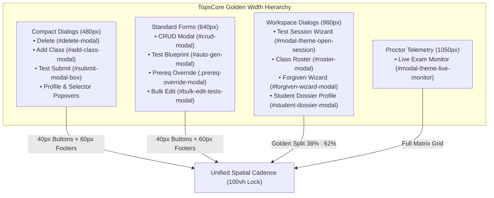

# Golden Widths Modal Architecture & Visual Normalization Plan

> **Plan Type:** Architectural Standardization & Spatial Layout Refinement  
> **Status:** [PENDING APPROVAL] User Review Required  
> **Target Scope:** 20 Active Modals / Popups across Admin Workstation and Student Dialogs  
> **Interactive Visual Simulator:** [modal_side_by_side_comparison.html](file:///C:/Users/Top/.gemini/antigravity/brain/efd8e2aa-e912-424d-ab8b-2c2d011634a0/modal_side_by_side_comparison.html)  

---

## 1. Executive Summary & Goal Description

Currently, modal dialogs across TopsCore LMS utilize a fragmented array of ad-hoc widths (**380px, 400px, 420px, 440px, 540px, 580px, 680px, 800px, 880px, 960px, 1050px**). This causes visual inconsistency, awkward content cramming on narrower popups (such as the 380px submit modal or 420px delete modal), and cramped multi-column ratios.

This plan standardizes the entire application modal ecosystem into the **Golden Widths Architecture**:
1. **Compact Dialogs (`480px`)**: Confirmation alerts, danger prompts, hardware camera checks, and single-step selectors.
2. **Standard Forms (`640px`)**: Single-column and two-tier forms (CRUD operations, curriculum blueprints, system settings, prerequisite overrides).
3. **Workspace Modals (`960px`)**: High-density wizards and rosters, with two-column dialogs strictly adopting the **Golden Split Ratio ($38\% : 62\%$)**.
4. **Standalone Telemetry Exception (`1050px`)**: Dedicated multi-column proctor exam monitor (`#modal-theme-live-monitor`).



---

## 2. User Review Required & Design Decisions

> [!IMPORTANT]
> **Key Decisions Awaiting User Confirmation:**
> 1. **Widening Narrow Modals (+40px to +100px)**: Dialogs currently at 380px (submit hazard) and 420px (delete) will widen to 480px. This permanently eliminates button jamming and cramped typography.
> 2. **Golden Split Ratio for Two-Column Wizards**: In `#modal-theme-open-session` (Test Session Unlock Wizard), the left settings panel expands from 240px ($27\%$) to 365px ($38\%$), while the right student table receives 595px ($62\%$). This gives breathing room to batch selectors and duration controls without reducing student table usability.
> 3. **Preserving 1050px for Live Proctor Telemetry**: `#modal-theme-live-monitor` remains at 1050px as an authorized exception because live exam monitoring requires 10+ columns (IP, ping, timer, student name, alarms, actions).

---

## 3. Side-by-Side Architectural Matrix (Audit of All 20 Modals)

| Golden Category | Modal / Dialog Name | File Source | Current Width | Planned Width | Visual Impact & Delta |
| :--- | :--- | :--- | :---: | :---: | :--- |
| **Compact (`480px`)** | **Test Submit Hazard Modal** | `css/test.css:1564` | `380px` | **`480px`** | **+100px**: Text questions counter (`14 / 40`) and buttons sit symmetrically. |
| | **Add Class Modal** | `css/admin.css:6208` | `400px` | **`480px`** | **+80px**: Level badge selection tiles gain spacious horizontal padding. |
| | **Delete Confirmation** | `css/admin.css:6079` | `420px` | **`480px`** | **+60px**: Danger warning text has balanced margins. |
| | **Classes Selector** | `css/dashboard.css:3286` | `440px` | **`480px`** | **+40px**: Class cards render with comfortable touch targets. |
| | **Dashboard Student Profile** | `css/dashboard.css:1341` | `440px` | **`480px`** | **+40px**: Account metadata and identity card spacing normalized. |
| | **Purge Records Modal** | `css/admin.css` | `480px` | **`480px`** | **0px**: Already compliant. |
| | **Kick Student Confirm** | `tests-access.js:726` | `480px` | **`480px`** | **0px**: Already compliant. |
| | **Recalibrate Modal** | `desk.js:710` | `480px` | **`480px`** | **0px**: Already compliant. |
| **Standard (`640px`)** | **Test Blueprint Wizard** | `auto-gen-modal.js:131` | `540px` | **`640px`** | **+100px**: Time pace inputs and passing score sliders have ample room. |
| | **Prerequisite Override** | `css/admin.css:6482` | `540px` | **`640px`** | **+100px**: Target tasks checklist table expands cleanly. |
| | **General CRUD Modal** | `css/admin.css:1243` | `580px` | **`640px`** | **+60px**: Form inputs (Program, Class, Level) gain 60px typing clearance. |
| | **Test System Settings** | `test-system-settings.js:37` | `580px` | **`640px`** | **+60px**: Answer tolerance threshold controls render with zero wrapping. |
| | **Vocab Mistake Drilldown** | `class-analytics.js:523` | `650px` | **`640px`** | **-10px**: Aligns cleanly to the 640px standard. |
| | **Bulk Edit Tests** | `css/admin.css:6248` | `680px` | **`640px`** | **-40px**: Tighter, more focused editing panel. |
| | **Level Progression Modal** | `css/dashboard.css:3757` | `680px` | **`640px`** | **-40px**: Timeline progression aligns with standard dialog bounds. |
| | **Conversation Eval Modal** | `conversation.html:248` | `640px` | **`640px`** | **0px**: Already compliant. |
| **Workspace (`960px`)** | **Class Roster Modal** | `css/admin.css:6163` | `800px` | **`960px`** | **+160px**: Student roster table comfortably fits universal leftmost sequence. |
| | **Remedial Forgiven Wizard** | `forgiven-wizard-modal.js:78`| `820px` | **`960px`** | **+140px**: Step-by-step forgiveness matrix expands across full workspace. |
| | **Student Live Answers** | `tests-access.js:786` | `850px` | **`960px`** | **+110px**: Live answer evaluation audit log renders without truncated columns. |
| | **Test Session Unlock Wizard**| `tests-access.js:364` | `880px` | **`960px`** | **+80px**: Adopts Golden Split ($38\% : 62\% \rightarrow 365\text{px} : 595\text{px}$). |
| | **Student Dossier Profile** | `css/admin.css:6089` | `900px` | **`960px`** | **+60px**: Identity card ($38\%$) and exam history tabs ($62\%$) balance. |
| | **Duplicate Resolvers (LG)** | `css/admin.css:6089` | `960px` | **`960px`** | **0px**: Already compliant. |
| **Telemetry (`1050px`)** | **Live Exam Monitoring** | `tests-access.js:555` | `1050px`| **`1050px`**| **0px**: Authorized exception for proctor real-time telemetry grid. |

---

## 4. Proposed Code Changes

### Component 1: Central UI Invariants & Rules (`.agents/rules/ui-invariants.md`, `AGENTS.md`)
- Codify §1.6 **Golden Widths Modal Architecture (`480px` / `640px` / `960px`)**.
- Codify §1.7 **Golden Split Ratio for Two-Column Dialogs ($38\% : 62\%$)**.
- Codify §1.8 **Nested Radius Harmony Formula ($R_{\text{inner}} = R_{\text{outer}} - \text{Padding}$)**.

### Component 2: Admin Styling (`css/admin.css`)
- Standardize `.modal-box-delete` and `.modal-box-add-class` to `max-width: 480px !important;`.
- Standardize `.modal-box` (general CRUD), `.bulk-edit-modal-box`, and `.prereq-override-modal` to `max-width: 640px !important;`.
- Standardize `.modal-box-roster` to `max-width: 960px !important;`.
- Add global helper utility classes: `.modal-compact` (`480px`), `.modal-standard` (`640px`), `.modal-workspace` (`960px`).

### Component 3: Student Screen Styling (`css/test.css`, `css/dashboard.css`)
- Update `css/test.css` `.modal-box-hazard` to `max-width: 480px;`.
- Update `css/dashboard.css` `.classes-selector-modal-box` and `.profile-modal-box` to `max-width: 480px !important;`.
- Update `css/dashboard.css` `.level-modal-box` to `max-width: 640px;`.

### Component 4: JS Dynamic Modules (`js/admin/`)
- Update `tests-access.js`:
  - `#modal-theme-open-session`: `max-width: 960px; grid-template-columns: 365px 1fr;` (Golden Split).
  - `#modal-student-live-answers`: `max-width: 960px;`.
- Update `auto-gen-modal.js`:
  - `auto-gen-modal`: `width: 640px;`.
- Update `forgiven-wizard-modal.js`:
  - `forgiven-wizard-modal`: `max-width: 960px;`.
- Update `class-analytics.js`:
  - `#vocab-error-drilldown-modal`: `max-width: 640px;`.

---

## 5. Verification Plan

### Automated Tests
1. **Automated Spatial Audit**:
   ```powershell
   node .agents/skills/ui-spatial-checker/scripts/check_spatial_invariants.mjs
   ```
2. **DOM Computed Styles & Header/Footer Audit**:
   ```powershell
   node scripts/test_admin_headers_footers_standardization.mjs
   ```
3. **JS Syntax Check**:
   ```powershell
   node scripts/check_all_js_syntax.cjs
   ```
4. **Full Regression Suite**:
   ```powershell
   npm.cmd test
   ```
5. **Workspace Hygiene**:
   ```powershell
   npm.cmd run check:hygiene
   ```

### Manual Verification
- Launch the interactive simulator at [modal_side_by_side_comparison.html](file:///C:/Users/Top/.gemini/antigravity/brain/efd8e2aa-e912-424d-ab8b-2c2d011634a0/modal_side_by_side_comparison.html) to inspect the side-by-side comparison across all 3 categories in the browser.
- Open `admin.html` and trigger the Delete modal, Bulk Edit modal, and Test Session Unlock wizard to verify visual stability and 100vh lock integrity.
