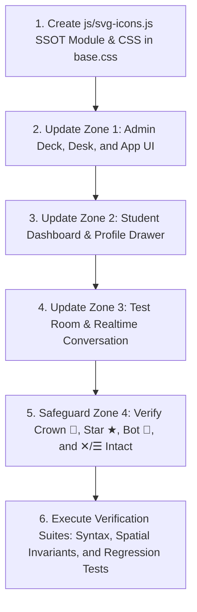

# Visual Architecture Plan: SVG Icons Beside Text & Standalone Emojis Standardization

> **Status:** PENDING USER REVIEW & APPROVAL  
> **Date:** November 14, 2026  
> **Topic:** Transitioning inline emojis next to text into unified SVG stroke icons (`stroke="currentColor"`), while reserving emojis strictly for standalone gamified badges (`👑`, `★`, `🤖`) and textless control glyphs (`✕`, `☰`).

---

## 1. Executive Summary & Design Rationale

### 1.1 The Problem with Emojis Beside Text
In modern enterprise dark-mode SaaS platforms (Linear, Vercel, Supabase, Stripe), inline decorative emojis placed alongside labels create visual inconsistency:
1. **OS Fragmentation**: Windows 11 renders glossy 3D cartoon emojis (Segoe UI Emoji), macOS renders Apple Color Emoji, and Linux/Android render flat cartoon emojis. This disrupts TopsCore's sleek tactical workstation aesthetic (`#090D16` / `#0F172A`).
2. **Vertical Misalignment**: Emoji font metrics differ from system UI typography (`Inter`, `Segoe UI`), causing baseline jitter (1–2px uneven button text alignment).
3. **No Color Inheritance**: Emojis cannot adapt to hover states, active states, or semantic color tokens (e.g., Grade A green, Grade E red).

### 1.2 The Proposed Solution
1. **Replace Emojis Beside Text with SVG Stroke Icons**: All buttons, badges, headers, and navigation tabs with text labels use clean, lightweight monochrome SVG stroke icons (`stroke="currentColor"`). They automatically inherit font color, scale with typography, and maintain crisp alignment.
2. **Preserve Standalone Emojis for Gamification & Emotion**:
   - **Batch Champion Crown (`👑`)**: Retained exclusively above student avatars and photos for highest scores / top performers.
   - **Official Grade Star (`★`)**: Retained in Electric Pink (`#ff2d87`) for 100% scores.
   - **Living AI Bot (`🤖`) & Hand Raise (`✋`)**: Retained in Realtime Conversation Room as emotional presence indicators.
3. **Preserve Clean Icon-Only Glyphs Without Text**:
   - Close button (`✕`), Sidebar toggle (`☰`), and media controls without text remain lightweight geometric characters.

---

## 2. Visual Pre-Flight: Before vs After Evidence

High-resolution side-by-side visual comparisons have been captured and generated:

### 2.1 Side-by-Side Comparison Overview


> **Interactive Simulator**: You can interact with the live toggle demo anytime at:  
> [`svg_icons_vs_emojis_side_by_side.html`](file:///C:/Users/Top/.gemini/antigravity/brain/9cd18e1a-e810-46b1-b07c-aa2fbf26c31a/svg_icons_vs_emojis_side_by_side.html)

### 2.2 Detailed Zone Comparison Grid


---

## 3. Comprehensive System Inventory: 4 Distinct Zones

All 49 JavaScript modules and 6 HTML templates were scanned (491 emoji occurrences audited). Below is the complete categorization:

### Zone 1: Admin & Tutor Workspace (Action Buttons, Sub Panels, Tabs, Headers)
| Element & Location | Before (Emoji + Text) | Proposed After (SVG Icon + Text) | SVG Icon Spec |
| :--- | :--- | :--- | :--- |
| **Save Profile Button** (`admin-deck.js`) | `💾 Save Profile` | `<svg>...</svg> Save Profile` | `save` (diskette, 14px) |
| **Edit Profile Button** (`admin-deck.js`) | `✏️ Edit Profile` | `<svg>...</svg> Edit Profile` | `edit` (pencil, 14px) |
| **Print / PDF Button** (`admin-deck.js`) | `📄 Print / Save as PDF` | `<svg>...</svg> Print / Save as PDF` | `file-text` (document, 14px) |
| **Export CV Button** (`admin-deck.js`) | `🎓 Export Executive CV` | `<svg>...</svg> Export Executive CV` | `download` / `file` (14px) |
| **Delete Record Button** (`admin-deck.js`) | `🗑️ Delete Record` | `<svg>...</svg> Delete Record` | `trash` (bin, 14px, Grade E red) |
| **Add Task Button** (`desk.js`) | `➕ Add Task` | `<svg>...</svg> Add Task` | `plus` (cross, 14px) |
| **Add Test Button** (`desk.js`) | `➕ Add Test` | `<svg>...</svg> Add Test` | `plus` (cross, 14px) |
| **Auto-Generate Button** (`desk.js`) | `⚡ Auto-Generate` | `<svg>...</svg> Auto-Generate` | `zap` (lightning bolt, 14px) |
| **Students Grade Tab** (`app.js`, `desk.js`) | `📊 Students Grade and Score` | `<svg>...</svg> Students Grade and Score` | `bar-chart` (chart, 14px) |
| **Class Tests Tab** (`app.js`, `desk.js`) | `📝 Class Tests` | `<svg>...</svg> Class Tests` | `clipboard` (tasks, 14px) |
| **Analytics Tab** (`app.js`, `desk.js`) | `📈 Test Analytics` | `<svg>...</svg> Test Analytics` | `trending-up` (line chart, 14px) |
| **Vocabulary Vault Header** (`app.js`) | `📚 Vocabulary Vault` | `<svg>...</svg> Vocabulary Vault` | `book-open` (book, 16px) |
| **Audit Logs Header** (`app.js`) | `🛡️ Audit Logs` | `<svg>...</svg> Audit Logs` | `shield` (security, 16px) |

---

### Zone 2: Student Portal & Dashboard (Status Badges, Action Buttons, Profile Meta)
| Element & Location | Before (Emoji + Text) | Proposed After (SVG Icon + Text) | SVG Icon Spec |
| :--- | :--- | :--- | :--- |
| **Admin Only Badge** (`dashboard.html`) | `🔒 Admin Only` | `<svg>...</svg> Admin Only` | `lock` (padlock, 12px) |
| **Verified Badge** (`dashboard.html`) | `🛡️ Verified` | `<svg>...</svg> Verified` | `check-circle` / `shield` (12px, Grade A green) |
| **Practice Button** (`dashboard.html`, `js/dashboard.js`) | `🎯 Practice` | `<svg>...</svg> Practice` | `target` (bullseye, 14px) |
| **Birthday Meta** (`dashboard.html`) | `🎂 15 Aug 2004` | `<svg>...</svg> 15 Aug 2004` | `calendar` (calendar, 12px) |
| **Education Meta** (`dashboard.html`) | `🎓 High School Senior` | `<svg>...</svg> High School Senior` | `graduation-cap` (academic, 12px) |
| **Session Locked Notice** (`dashboard.html`) | `⏳ Session Locked` | `<svg>...</svg> Session Locked` | `clock` (stopwatch, 12px, Grade C yellow) |

---

### Zone 3: Student Test Room & Realtime Conversation Room
| Element & Location | Before (Emoji + Text) | Proposed After (SVG Icon + Text) | SVG Icon Spec |
| :--- | :--- | :--- | :--- |
| **Next Question Button** (`test.html`, `js/test.js`) | `Next →` / `➡️ Next` | `Next <svg>...</svg>` | `arrow-right` (stroke arrow, 14px) |
| **Test Locked Notice** (`test.html`) | `🔒 Test Locked` | `<svg>...</svg> Test Locked` | `lock` (14px, Grade C yellow) |
| **Live Stream Header** (`conversation.html`) | `🎙️ Live Discussion Stream` | `<svg>...</svg> Live Discussion Stream` | `mic` (microphone, 16px) |
| **Realtime Telemetry Tag** (`conversation-room.js`) | `⚡ 120ms` | `<svg>...</svg> 120ms` | `activity` / `zap` (12px) |
| **5-Pillar Speaking Radar Header** (`test.js`) | `🗣️ Speaking Performance Radar` | `<svg>...</svg> Speaking Performance Radar` | `volume-2` / `bar-chart` (16px) |

---

### Zone 4: Permitted Standalone Emojis & Icon-Only Glyphs (STRICTLY PRESERVED)
These locations **WILL NOT BE CHANGED** because they serve essential emotional gamification, official branding, or textless UI functions:

| Location | Element / Symbol | Purpose & Justification |
| :--- | :--- | :--- |
| **Top Student Photo / Avatar** (`admin-deck.js`, `dashboard.html`) | `👑` (Batch Champion Crown) | **Gamification**: Visual badge of honor floating above the highest scorer's profile picture. High emotional reward for students. |
| **Leaderboard 1st Place** (`dashboard.js`, `desk.js`) | `👑` (Rank 1 Crown) | **Honor Recognition**: Standalone trophy icon beside top rank without text label. |
| **Report Card & Grade Badge** (`grading.js`, `results.js`) | `★` (Grade Star in `#ff2d87`) | **Official Grading Scale**: Strict SSOT Grade Star exclusively in Electric Pink for 100% perfect scores. |
| **Realtime Living AI Tutor** (`conversation-room.js`) | `🤖` (Bot Presence Indicator) | **Conversational Persona**: Standalone circular avatar representing the stateless AI speaking engine. |
| **Conversation Interaction** (`conversation-room.js`) | `✋` (Hand-Raise Request) | **Live Gesture**: Standalone interaction cue for requesting turn to speak. |
| **Drawer Close Control** (`admin.html`, `dashboard.html`) | `✕` (Close Glyph) | **Standard textless button**: Compact 30px circular/square dismiss control. |
| **Mobile Sidebar Toggle** (`admin.html`, `dashboard.html`) | `☰` (Hamburger Glyph) | **Standard textless button**: Universal 3-line nav toggle. |

---

## 4. Technical Architecture: Centralized SVG Icon SSOT

To avoid code duplication and ensure zero runtime overhead, we will introduce a centralized SVG icon helper module: `js/svg-icons.js`.

### 4.1 Canonical Implementation Pattern
```javascript
// js/svg-icons.js (Centralized SSOT for TopsCore Icons)
export const TOP_ICONS = {
  save: `<svg width="14" height="14" viewBox="0 0 24 24" fill="none" stroke="currentColor" stroke-width="2" stroke-linecap="round" stroke-linejoin="round" class="tc-icon"><path d="M19 21H5a2 2 0 0 1-2-2V5a2 2 0 0 1 2-2h11l5 5v11a2 2 0 0 1-2 2z"></path><polyline points="17 21 17 13 7 13 7 21"></polyline><polyline points="7 3 7 8 15 8"></polyline></svg>`,
  edit: `<svg width="14" height="14" viewBox="0 0 24 24" fill="none" stroke="currentColor" stroke-width="2" stroke-linecap="round" stroke-linejoin="round" class="tc-icon"><path d="M11 4H4a2 2 0 0 0-2 2v14a2 2 0 0 0 2 2h14a2 2 0 0 0 2-2v-7"></path><path d="M18.5 2.5a2.121 2.121 0 0 1 3 3L12 15l-4 1 1-4 9.5-9.5z"></path></svg>`,
  trash: `<svg width="14" height="14" viewBox="0 0 24 24" fill="none" stroke="currentColor" stroke-width="2" stroke-linecap="round" stroke-linejoin="round" class="tc-icon"><polyline points="3 6 5 6 21 6"></polyline><path d="M19 6v14a2 2 0 0 1-2 2H7a2 2 0 0 1-2-2V6m3 0V4a2 2 0 0 1 2-2h4a2 2 0 0 1 2 2v2"></path></svg>`,
  plus: `<svg width="14" height="14" viewBox="0 0 24 24" fill="none" stroke="currentColor" stroke-width="2" stroke-linecap="round" stroke-linejoin="round" class="tc-icon"><line x1="12" y1="5" x2="12" y2="19"></line><line x1="5" y1="12" x2="19" y2="12"></line></svg>`,
  zap: `<svg width="14" height="14" viewBox="0 0 24 24" fill="none" stroke="currentColor" stroke-width="2" stroke-linecap="round" stroke-linejoin="round" class="tc-icon"><polygon points="13 2 3 14 12 14 11 22 21 10 12 10 13 2"></polygon></svg>`,
  lock: `<svg width="14" height="14" viewBox="0 0 24 24" fill="none" stroke="currentColor" stroke-width="2" stroke-linecap="round" stroke-linejoin="round" class="tc-icon"><rect x="3" y="11" width="18" height="11" rx="2" ry="2"></rect><path d="M7 11V7a5 5 0 0 1 10 0v4"></path></svg>`,
};

export function getSvgIcon(name, size = 14, extraClass = '') {
  const icon = TOP_ICONS[name];
  if (!icon) return '';
  if (size === 14 && !extraClass) return icon;
  return icon
    .replace('width="14"', `width="${size}"`)
    .replace('height="14"', `height="${size}"`)
    .replace('class="tc-icon"', `class="tc-icon ${extraClass}".trim()`);
}
```

### 4.2 Universal CSS Styling (`css/base.css`)
```css
/* TopsCore SVG Icon Standard */
.tc-icon {
  display: inline-block;
  vertical-align: -0.15em;
  margin-right: 6px;
  flex-shrink: 0;
  stroke: currentColor;
  transition: stroke 0.15s ease, transform 0.15s ease;
}

.tc-icon-end {
  margin-right: 0;
  margin-left: 6px;
}

/* Icon hover transition inside buttons */
button:hover .tc-icon {
  transform: scale(1.05);
}
```

---

## 5. Spatial Invariant & UI Rules Compliance Check

| Invariant / System Rule | Compliance Status | Technical Guarantee |
| :--- | :---: | :--- |
| **100vh Single Screen Lock** (`overflow: hidden`) | **PASSED** | Inline SVGs are strictly bounded to 12px/14px/16px with `flex-shrink: 0`, causing zero container height expansion. |
| **Sub Panel 40px with 30px Buttons** | **PASSED** | 14px SVG icons inside 30px buttons (`height: 30px; line-height: 1; padding: 0 10px`) maintain exact 30px height without vertical stretching. |
| **Modal Button 40px Height** | **PASSED** | 16px SVG icons inside 40px modal buttons fit perfectly with 12px vertical clearance. |
| **Single-Line Text Invariant (`nowrap`)** | **PASSED** | All action buttons and tabs retain `white-space: nowrap; overflow: hidden; text-overflow: ellipsis;`. |
| **Color SSOT (`Rubah Satu Maka Rubah Semua`)** | **PASSED** | Using `stroke="currentColor"` guarantees icons instantly inherit semantic colors (`--grade-a`, `--grade-c`, `--grade-e`, `--accent`) with zero hardcoded hex codes. |
| **Dual-Scale Typography** | **PASSED** | Icon sizing is pinned to Family A: 12px icon for 12px text, 14px icon for 14px/16px text, 16px icon for 20px headers. |

---

## 6. Implementation Sequence & Testing Plan



### Detailed Steps:
1. **Module Creation**: Write `js/svg-icons.js` with the complete set of Feather/Lucide-style lightweight SVGs. Add `.tc-icon` rules to `css/base.css`.
2. **Zone 1 Update**: Refactor button labels in `admin-deck.js`, `desk.js`, and `app.js` to call `getSvgIcon(name)`.
3. **Zone 2 Update**: Refactor status capsules and profile meta tags in `dashboard.html` and `dashboard.js`.
4. **Zone 3 Update**: Refactor `Next →` and test/room header badges in `test.html`, `js/test.js`, and `conversation.html`.
5. **Zone 4 Safeguard Verification**: Ensure Batch Champion Crown `👑` on student avatars, Grade Star `★` in Electric Pink, and `🤖` living bot remain 100% untouched.
6. **Automated Verification**:
   - `node scripts/check_all_js_syntax.cjs`
   - `node scripts/check_spatial_invariants.mjs`
   - `node scripts/test_universal_color_token_ssot.mjs`
   - `npm test`

---

## 7. User Decision Gate

Please review the visual comparison and plan details above:
1. **Approve Plan**: Click **Proceed** to authorize full execution across Zones 1, 2, and 3 while safeguarding Zone 4.
2. **Request Adjustments**: Provide feedback on any specific icon choice or additional locations to include/exclude.
