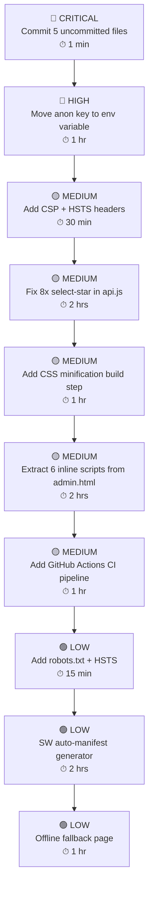

# TopsCore LMS — Full System Analysis & Maximization Suggestions

> **Analyzed:** 2026-10-28 | **Current Phase:** 165 | **Status:** Production-Active

---

## 🏆 Overall Assessment

TopsCore is a **well-architected, production-active** English LMS built on the correct stack (Static HTML + Supabase). After 165 development phases, the core engine is mature. The platform correctly handles: server-authoritative scoring, milestone progression, anti-cheat, sequential gating, live session monitoring, and a rich admin Class Hub.

**Score by domain:**

| Domain | Rating | Notes |
|---|---|---|
| Architecture | ⭐⭐⭐⭐⭐ | Correct stack, clean separation |
| Backend Security | ⭐⭐⭐⭐ | Edge Functions + RLS solid; 1 concern |
| Frontend Code Quality | ⭐⭐⭐⭐ | Very large files; minor bloat |
| Database Integrity | ⭐⭐⭐⭐⭐ | Canonical constraints, soft-delete, audit logs |
| Test Coverage | ⭐⭐⭐ | Good scripts but no formal test framework |
| Performance | ⭐⭐⭐ | Large CSS/JS bundles; no bundler/minifier |
| Git Hygiene | ⭐⭐⭐ | 5 uncommitted files; strict no-push policy active |
| Student UX | ⭐⭐⭐⭐ | Mobile-friendly; sequential locking clean |
| Admin UX | ⭐⭐⭐⭐⭐ | Class Hub matrix, live monitor, wizard — excellent |

---

## 🔴 CRITICAL / HIGH PRIORITY

### 1. Anon Key Hard-Coded in `js/supabase.js`

```javascript
// js/supabase.js line 3
export const SUPABASE_CLOUD_ANON_KEY = 'sb_publishable_L9T-SJpuAqK5291UEVhKMg_i7lvWFGB';
// line 23: full JWT: eyJhbGciOiJIUzI1NiIs...
```

**Issue:** The Supabase anon key is embedded literally in a JS file shipped to every browser and committed to git history. While Supabase anon keys are designed to be public, the risk is:
- Anyone can enumerate your Supabase API directly.
- Any RLS misconfiguration gap becomes exploitable by the public.
- It is permanently burned into git history.

**Fix:** Your code already supports `window.__ENV__` injection — make it the **primary** path and inject via Vercel/Netlify environment variables at deploy time. The hardcoded value becomes an emergency local-dev fallback only.

---

### 2. Five Uncommitted Files in Working Tree

```
 M css/dashboard.css
 M dashboard.html
 M docs/CHANGELOG.md
 M docs/CURRENT_STATE.md
 M js/dashboard.js
```

**Issue:** Phase 163–165 work (icon updates, lobby ergonomics, result-page strip) is **not committed**. If the machine fails, this is lost.

**Fix — run immediately:**
```
git add css/dashboard.css dashboard.html docs/CHANGELOG.md docs/CURRENT_STATE.md js/dashboard.js
git commit -m "feat(dashboard): lobby ergonomics, icons update [Phase 163-165]"
```

---

### 3. Eight `select('*')` Calls Remaining in `api.js`

Found on **lines 1104, 1105, 1373, 1535, 1788, 1900, 1925, 2339**.

**Issue:** Over-fetching from `attempts` and `attempt_answers` is expensive — these tables grow with every student session and increase Supabase egress costs.

**Fix example:**
```javascript
// BEFORE
sb.from('attempts').select('*').eq('id', attemptId)

// AFTER
sb.from('attempts')
  .select('id, test_id, student_id, status, score, percentage, grade, expires_at, total_questions')
  .eq('id', attemptId)
```

---

### 4. Six Inline `<script>` Blocks in `admin.html`

**Issue:** `admin.html` has 6 inline scripts (all other pages have 1–2). This:
- Prevents Content Security Policy enforcement.
- Is inconsistent with the modular architecture elsewhere.
- Makes the HTML harder to maintain.

**Fix:** Extract remaining inline logic into `js/admin/init.js` or merge into the appropriate existing module.

---

## 🟡 MEDIUM PRIORITY

### 5. CSS Bundles Are Very Large and Unminified

| File | Lines | Size |
|---|---|---|
| `admin.css` | 4,507 | **123.5 KB** |
| `dashboard.css` | 3,386 | **94.7 KB** |
| `result.css` | 1,795 | **65.2 KB** |
| `test.css` | 1,200 | **32.3 KB** |
| `style.css` | 1,323 | **31.4 KB** |

**Total: ~350 KB of unminified CSS** served raw in production. A single student on 3G downloads all of this. Minification alone typically saves **40–60%**.

**Fix:** Add a one-time build step:
```bash
npm install -D cssnano postcss postcss-cli
# package.json scripts
"build:css": "postcss css/*.css --dir dist/css --use cssnano"
```

---

### 6. JavaScript Modules Are Monolithic

| File | Lines | Size |
|---|---|---|
| `admin/app.js` | 3,669 | **205.7 KB** |
| `api.js` | 3,382 | **144.5 KB** |
| `dashboard.js` | 2,676 | **136.8 KB** |

**Issue:** Browser must parse the entire file even if only a small function is used. No tree-shaking or lazy loading is possible without a bundler.

**Fix:** Extend the dynamic `import()` pattern already used in some modals to lazy-load the Class Hub matrix, Live Monitor, and Auto-Gen wizard only when the user navigates to those sections.

---

### 7. No Content Security Policy (CSP) Header

**Issue:** `vercel.json` and `netlify.toml` set `X-Frame-Options`, `X-Content-Type-Options`, and `Referrer-Policy` — but **no CSP**. CSP is the primary defense against XSS.

**Fix — add to `vercel.json` headers:**
```json
{
  "key": "Content-Security-Policy",
  "value": "default-src 'self'; script-src 'self'; connect-src 'self' https://*.supabase.co wss://*.supabase.co; img-src 'self' data: blob:; style-src 'self' 'unsafe-inline';"
}
```

> [!WARNING]
> The 6 inline `<script>` tags in `admin.html` must be extracted first — inline scripts will violate this CSP without `'unsafe-inline'` on `script-src`.

---

### 8. No `Strict-Transport-Security` (HSTS) Header

Both `vercel.json` and `netlify.toml` are missing HSTS. This means the browser doesn't know to **always** use HTTPS, leaving the first connection vulnerable to downgrade attacks.

**Fix — add to both config files:**
```
Strict-Transport-Security: max-age=31536000; includeSubDomains
```

---

### 9. Static Asset Cache Headers Not Configured for Images/Fonts

`vercel.json` sets 1-hour cache for JS. CSS gets `no-cache`. Images and SVG have **no cache headers** defined at all.

**Fix:** Since you already use `?v=` query string busting, you can safely set long-lived cache on all static assets:
```json
{ "source": "/assets/(.*)", "headers": [{ "key": "Cache-Control", "value": "public, max-age=31536000, immutable" }] },
{ "source": "/css/(.*)",    "headers": [{ "key": "Cache-Control", "value": "public, max-age=31536000, immutable" }] }
```

---

### 10. No Formal CI Pipeline / Automated Test Suite

**Issue:** Testing is done via one-off Playwright `.mjs` scripts in `scripts/` and `scratch/`. There is no `npm test` command and no GitHub Actions workflow to guard every commit.

**Fix:**
1. Add `"test": "node scripts/check_all_js_syntax.cjs && playwright test"` to `package.json`.
2. Create `.github/workflows/ci.yml` to run on every push/PR.
3. Migrate the best verification scripts into `playwright.config.js` test suites.

---

### 11. `evaluate-test` Edge Function Is Only 142 Lines

**Issue:** The `start-test` function is 570 lines and `submit-test` is 324 lines — robust. But `evaluate-test` at only 142 lines seems underdeveloped for the 8 AI evaluation modules described in `AGENTS.md §2.11` (Point & Speak, Storytelling, Conversation, MCQ, Read Aloud, Roleplay, Speaking Performance, Vocabulary Mastery).

**Fix:** Audit `evaluate-test/index.ts` to confirm all 8 module types have server-authoritative evaluation paths. Client-side scoring should remain emergency-only.

---

### 12. Service Worker Cache List Is Manually Maintained

**Issue:** `sw.js` uses `CACHE_NAME = 'topscore-cache-option-a-v15'` with a hand-curated file list. When a new file is added or a `?v=` string changes and you forget to update `sw.js`, students get stale assets.

**Fix:** Write a simple Node build script that auto-generates the SW precache manifest by scanning all `.html`, `.css`, `.js` files — eliminating manual sync errors.

---

## 🟢 LOW PRIORITY / FUTURE IMPROVEMENTS

### 13. No `robots.txt` — Admin Panel Is Publicly Crawlable

Search engines can index `/admin.html`, `/test.html`, `/result.html`.

**Fix — create `robots.txt`:**
```
User-agent: *
Disallow: /admin.html
Disallow: /test.html
Disallow: /result.html
Allow: /index.html
```

### 14. `db_schema.sql` at Root Is Empty (0 bytes)

Confusing for new developers. Either populate with the current schema or delete it and rely solely on `supabase/migrations/` + `supabase/schema.sql`.

### 15. `wake-lock.js` Has Debug Artifacts

2 `console.log` statements and 1 TODO remain. Clean before production release.

### 16. Duplicate Seed Files (14.6 MB combined)

`supabase/data.sql` and `supabase/seed.sql` are both **7.3 MB** and appear identical. Verify and remove the duplicate to halve repository size and clone time.

### 17. No Offline Fallback Page

If a student loses network during a test, they see a raw browser error. The SW should serve a graceful offline fallback HTML with a "You are offline — your answers are saved" message.

### 18. No Image Compression Before Avatar Upload

Students can upload camera photos at full resolution (4–8 MB). There is no client-side compression in `avatar-engine.js` before the Supabase Storage upload. Add `canvas`-based compression (resize to max 400×400, quality 0.8) before upload.

---

## ✅ WHAT IS ALREADY EXCELLENT

- **Server-authoritative timer & scoring** — client cannot cheat the deadline.
- **3-tier submission fallback** — Edge Function → PostgreSQL RPC → client fallback.
- **4-layer sequential exam gating** — Edge Function + client API + lobby UI + admin whitelist.
- **Milestone progression engine** — `computeMilestoneExamMastery()` is clean and centralized.
- **Canonical grading scale** — `★, A, B, C, D, E` enforced at DB level with CHECK constraint.
- **Soft-delete everywhere** — historical data preservation is correct.
- **Live session monitor** — real-time Supabase channel, time extension, alarm inspection.
- **Auto-close stalled attempts** — `auto_close_expired_attempts()` sweeper on every page load.
- **Anti-cheat persistence** — `sessionStorage` strike counter survives F5 reload.
- **Nearly zero `console.log` leaks** — only 2 harmless ones in `class.js` and `wake-lock.js`.
- **All 39 JS files syntax-valid** — 100% pass on `check_all_js_syntax.cjs`.
- **ABCD admin navigation** — clean, well-structured, easy to extend.
- **No active BLOCKERS** — all 10 blockers resolved.

---

## 📋 Prioritized Action Plan



---

## ⚡ Quick Wins You Can Do Right Now (Under 5 Minutes Each)

| # | Action | Time |
|---|---|---|
| 1 | **Commit the 5 modified files** | 30 sec |
| 2 | **Add `robots.txt`** | 5 min |
| 3 | **Add HSTS header** to vercel.json + netlify.toml | 3 min |
| 4 | **Delete or populate empty `db_schema.sql`** | 1 min |
| 5 | **Remove `console.log` from `wake-lock.js`** | 1 min |

> [!TIP]
> The highest-impact change is the **CSS minification build step** — it reduces student page load time significantly, especially on mobile. Combined with proper `Cache-Control: immutable` headers, repeat visits become near-instant.

> [!NOTE]
> TopsCore has **no active functional blockers**. The system is production-ready. All suggestions above are security hardening, performance optimization, and code hygiene — not bug fixes.
