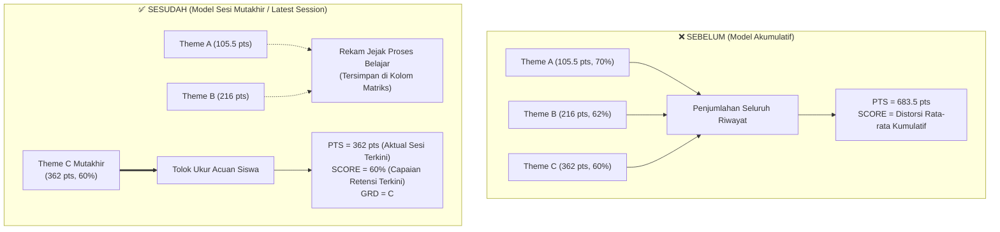

# Rencana Implementasi: Penilaian Kosakata Berbasis Sesi Tes Terbaru (Latest Attempt)

## Deskripsi Tujuan
Mengubah paradigma penilaian hasil belajar pada kelas kosakata (Vocabulary) di TopsCore:
1. **Menghapus Model Akumulasi Riwayat**: Penilaian tidak lagi didasarkan pada rata-rata kumulatif seluruh sesi ataupun penjumlahan total poin (PTS) dari tema-tema sebelumnya.
2. **Pencapaian Aktual Sesi Tes Terbaru (Latest Attempt)**: Karena penguasaan kosakata berorientasi pada retensi memori dan capaian kompetensi akhir, tolok ukur utama nilai acuan siswa di kolom ringkasan panel utama (`SCORE`, `GRD`, `PTS`) wajib merefleksikan pencapaian aktual pada **sesi tes mutakhir** yang dijadwalkan.
3. **Fungsi Riwayat Sebelumnya**: Riwayat tes sebelumnya (Theme A, Theme B, dst.) tetap terpelihara murni sebagai rekam jejak proses belajar (*learning track record*) pada kolom matriks detail dan riwayat pengerjaan siswa, tanpa mendistorsi nilai acuan kompetensi riil siswa saat ini.

---

## User Review Required

> [!IMPORTANT]
> **Perubahan Filosofi Perhitungan Poin dan Nilai Utama (`PTS` & `SCORE`):**
> 1. **Kolom PTS (Poin Utama)**: Sebelumnya, kolom `PTS` menjumlahkan seluruh poin ujian dari seluruh tema (misal: Theme A 105.5 + Theme B 216 + Theme C 362 = **683.5 pts** pada Aunul Fikri). Dengan skema baru, kolom `PTS` murni menampilkan **poin yang diperoleh pada sesi tes terbaru** (misal: Theme C = **362 pts** atau **482 pts** jika Col 30 dikerjakan), bukan akumulasi 683.5 pts.
> 2. **Kolom SCORE (% Nilai Utama) & GRD**: Merefleksikan persentase nilai capaian pada sesi tes mutakhir tersebut (misal: 60% Grade C, atau 80% Grade B), tanpa dipengaruhi rata-rata kumulatif sesi masa lalu.
> 3. **Peringkat Siswa (Leaderboard & Roster Sorting)**: Pengurutan siswa di panel utama dan leaderboard Student Lobby secara otomatis memprioritaskan performa sesi tes terbaru (`PTS Mutakhir` DESC, lalu `SCORE Mutakhir` DESC), sehingga siswa yang unggul di materi mutakhir mendapatkan apresiasi yang adil.

---

## Open Questions

> [!WARNING]
> Mohon konfirmasi dua preferensi perincian teknis berikut sebelum eksekusi:

1. **Definisi Sesi Tes Terbaru (Latest Exam Session Scope):**
   - **Opsi A (Sesi Ujian Tema Mutakhir — Direkomendasikan):** 
     Karena pada sistem jadwal ujian TopsCore ("Test Sessions" Tab 2) ujian kosakata dijadwalkan per tema (menggabungkan *Word Exam* dan *Phrase Exam* dalam satu kartu tema seperti Theme C), maka sesi terbaru menghitung capaian gabungan tema mutakhir tersebut.
     *Contoh Aunul Fikri (Theme C):* Jika Theme C terdiri dari Word Exam (362 pts / 75%) dan Phrase Exam (120 pts / 100%), maka capaian sesi mutakhirnya adalah **482 pts (80% Grade B)**.
   - **Opsi B (Tes Tunggal Paling Terakhir Dikerjakan):**
     Hanya mengambil 1 tes spesifik yang paling baru disubmit berdasarkan timestamp (misal: hanya Phrase Exam Col 30 = 120 pts, 100% ★, tanpa memperhitungkan Word Exam Col 29 yang baru dikerjakan sehari sebelumnya).
   *(Rekomendasi sistem: **Opsi A**, karena jadwal ujian mingguan kosakata TopsCore berstruktur Tema terpadu Words + Phrases).*

2. **Aturan Multiple Attempts (Pengulangan / Retake pada Tes yang Sama):**
   - Jika siswa mengulang (*retake*) tes yang sama: Apakah sistem mengambil hasil **pengerjaan paling mutakhir (Latest Attempt by date)** sesuai prinsip retensi (kemampuan saat ini), meskipun nilainya lebih rendah dari pengerjaan lama? Ataukah tetap mengambil pengerjaan terbaik (*Best Attempt*) dalam sesi tersebut?
   *(Berdasarkan arahan Anda: menggunakan **Latest Attempt** sebagai cerminan retensi terkini).*

---

## Perbandingan Sebelum vs Sesudah



### Simulasi Angka Siswa Berdasarkan Data Nyata Batch 133

| Nama Siswa | Riwayat Tema A | Riwayat Tema B | Capaian Tema C (Mutakhir) | **SEBELUM (Akumulatif)** | **SESUDAH (Sesi Mutakhir)** |
| :--- | :---: | :---: | :---: | :---: | :---: |
| **Aunul Fikri Vasli** | 105.5 pts (70%) | 216 pts (62%) | 362 pts (60%) | PTS: `683.5 pts`, SCORE: `66%` | **PTS: `362 pts`**, **SCORE: `60%`** (C) |
| **Wardatul Husna** | 127.5 pts (85%) | 226.5 pts (65%) | 304 pts (51%) | PTS: `678 pts`, SCORE: `51%` | **PTS: `304 pts`**, **SCORE: `51%`** (D) |
| **Gagan Tara Deswari** | 90 pts (60%ᴿ) | 206 pts (59%) | 332 pts (55%) | PTS: `628 pts`, SCORE: `55%` | **PTS: `332 pts`**, **SCORE: `55%`** (D) |
| **Suke Ajai** (Baru sampai B) | 92 pts (61%) | 291 pts (82%) | — (Belum buka C) | PTS: `383 pts`, SCORE: `82%` | **PTS: `291 pts`**, **SCORE: `82%`** (B) |
| **Muhammad Alfinas Pasya** | 90 pts (60%) | — | — | PTS: `90 pts`, SCORE: `60%` | **PTS: `90 pts`**, **SCORE: `60%`** (C) |
| **Rifky Ahmad** (Quiz only) | — | — | — | PTS: `0 pts`, SCORE: `—` | **PTS: `0 pts`**, **SCORE: `—`** |

---

## Rencana Perubahan Komponen

### 1. Authoritative Engine (`js/grading.js`)

#### [MODIFY] `js/grading.js`
- Memperbarui fungsi sentral `computeMilestoneExamMastery(examEntries, allClassExams)`:
  - **`totalPoints`**: Bukan lagi akumulasi `reduce(sum + e.effPoints)`, melainkan nilai poin yang diperoleh pada tema aktif mutakhir siswa (`latestAttemptedTheme.earned`).
  - **`denominator`**: Total bobot maksimal tema aktif mutakhir (`latestAttemptedTheme.maxQ`).
  - **`overallScore`**: Persentase nilai tema aktif mutakhir (`latestAttemptedTheme.scorePct`).
  - **`grade`**: Dihitung dari `overallScore` tema aktif mutakhir melalui `calculateGrade(overallScore)`.
  - **`activeThemeCode`**: Mengidentifikasi tema mutakhir siswa ('A', 'B', 'C', atau 'D').
  - **Penanganan Siswa 0-Exam**: Tetap menghasilkan `overallScore: 0`, `grade: '—'`, `totalPoints: 0` agar tidak menimbulkan skor palsu.

```javascript
// Cuplikan perubahan pada js/grading.js
export function computeMilestoneExamMastery(examEntries = [], allClassExams = []) {
  // ... (pemetaan tema tetap terstruktur) ...

  // Menentukan Tema Terakhir yang aktif dikerjakan siswa
  let latestAttemptedTheme = null;
  for (let i = themeStats.length - 1; i >= 0; i--) {
    if (themeStats[i].attempted) {
      latestAttemptedTheme = themeStats[i];
      break;
    }
  }

  let totalPoints = 0;
  let overallScore = 0;
  let grade = '—';
  let denominator = 0;

  if (latestAttemptedTheme) {
    // TOLOK UKUR ACUAN: Murni capaian sesi tes terbaru, bukan akumulasi riwayat!
    totalPoints = Math.round(latestAttemptedTheme.earned * 10) / 10;
    overallScore = latestAttemptedTheme.scorePct;
    grade = calculateGrade(overallScore);
    denominator = latestAttemptedTheme.maxQ;
  }

  return {
    totalPoints,
    overallScore,
    grade,
    denominator,
    completedExamCount,
    completedWeeklyCount: completedExamCount,
    activeThemeCode: latestAttemptedTheme?.themeCode || null,
    themeStats,
    // ...
  };
}
```

---

### 2. Admin Class Hub (`js/admin/app.js`)

#### [MODIFY] `js/admin/app.js`
1. **Pemilihan Attempt Siswa per Tes (Retake Rules)**:
   - Mengurutkan `submittedAtts` berdasarkan pengerjaan terbaru (`submitted_at` DESC) jika user memilih mode *Latest Attempt*, memastikan retensi terkini yang menjadi acuan.
2. **Kolom Ringkasan Nilai & Poin (`STUDENT DETAILS`)**:
   - Kolom `PTS` (`totalEarnedScore`): Menggunakan `mastery.totalPoints` (poin aktual sesi tes terbaru). Tooltip disesuaikan: `Poin Ujian Sesi Mutakhir: ${pts} pts (Tema ${activeThemeCode})`.
   - Kolom `SCORE` (`averageScorePct`): Menggunakan `mastery.overallScore`. Tooltip: `Nilai Sesi Mutakhir: ${score}% (Tema ${activeThemeCode})`.
   - Kolom `GRD` (`grade`): Menggunakan `mastery.grade`.
   - Kolom `PROG` (`progressPct`): Tetap menampilkan rasio penyelesaian total aktivitas belajar kurikulum.
3. **Baris Ringkasan Kelas (`★ CLASS AVERAGE`)**:
   - Rata-rata `SCORE` dihitung dari rata-rata nilai sesi mutakhir siswa.
   - Rata-rata `PTS` dihitung dari rata-rata poin sesi mutakhir siswa.
4. **Pengurutan Baris Matriks (Sorting)**:
   - Default sort `totalEarnedScore` DESC sekarang secara otomatis menyusun peringkat berdasarkan performa sesi mutakhir.

---

### 3. Student Dashboard & Lobby (`js/dashboard.js`)

#### [MODIFY] `js/dashboard.js`
1. **Hero Banner & Stat Cards**:
   - Memastikan `mastery.totalPoints` dan `mastery.overallScore` merefleksikan nilai sesi mutakhir di kartu statistik siswa.
2. **Batch Leaderboard & Juara Kelas (Crown / Champion)**:
   - Mahkota dan peringkat batch mengapresiasi siswa dengan capaian tertinggi pada materi/sesi mutakhir, mencegah distorsi di mana siswa yang menumpuk riwayat masa lalu menggeser siswa yang menguasai materi mutakhir.

---

### 4. Admin Student Roster (`js/admin/student-management.js`)

#### [MODIFY] `js/admin/student-management.js`
- Memastikan kalkulasi `SCORE`, `GRD`, dan `PTS` pada tabel master siswa konsisten 100% dengan Class Hub dan Student Dashboard.

---

## Rencana Verifikasi

### Pengujian Otomatis (Automated Tests)
1. **Pembaruan Skrip Paritas**:
   - Jalankan `node scripts/test_student_dashboard_exam_parity.mjs`
   - Jalankan `node scripts/test_batch_133_student_lobby_standings.mjs`
   - Pastikan Aunul Fikri, Wardatul Husna, Gagan Tara, Suke Ajai, Pasya, dan Rifky Ahmad terverifikasi dengan angka sesi mutakhir (bebas akumulasi masa lalu).
2. **Pemeriksaan Sintaks JS**:
   - Jalankan `npm test` atau node check di seluruh 40 file JS (40/40 syntax PASS).

### Verifikasi Manual
1. Buka `admin.html#class-hub` pada browser:
   - Periksa kolom `PTS` di bawah STUDENT DETAILS: pastikan tidak ada lagi angka akumulasi masif seperti 683.5 pts atau 678 pts, melainkan poin sesi tema mutakhir (e.g. 362 / 304 / 332 pts).
   - Periksa kolom `SCORE` dan `GRD`: pastikan sesuai dengan hasil tema mutakhir.
   - Periksa baris `★ CLASS AVERAGE`: pastikan rata-rata merefleksikan capaian sesi mutakhir.
2. Buka `dashboard.html` dengan login siswa Batch 133:
   - Periksa banner nilai, poin, dan tabel leaderboard batch: verifikasi kesesuaian nilai 100% dengan Class Hub.
