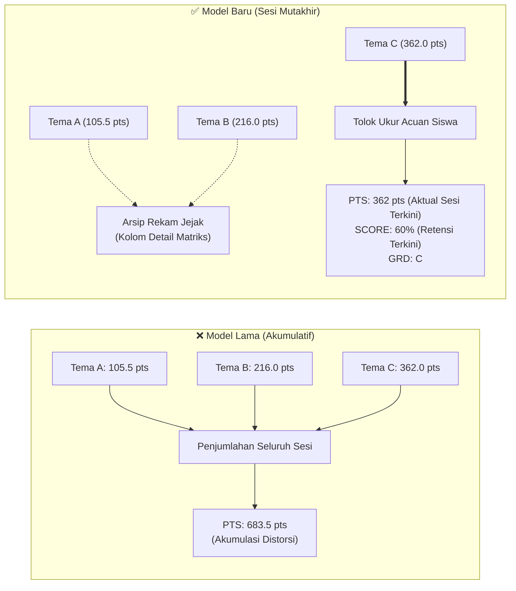

# Walkthrough: Penilaian Kosakata Berbasis Sesi Tes Terbaru (Latest Attempt)

Sistem evaluasi kelas kosakata (*Vocabulary*) di TopsCore kini telah resmi beralih ke model **Sesi Tes Terbaru (*Latest Attempt* & *Latest Theme Session*)**, mengeliminasi distorsi akumulasi masa lalu dan mencerminkan retensi riil siswa saat ini.

---

## 1. Ringkasan Perubahan Utama



### Inti Pembaruan:
1. **Penghapusan Penjumlahan Poin Masa Lalu (`PTS`)**:
   - Kolom `PTS` pada panel ringkasan tidak lagi menjumlahkan seluruh tema masa lalu (misal: 105.5 + 216 + 362 = 683.5 pts).
   - Kolom `PTS` kini murni menampilkan **poin yang diperoleh pada sesi ujian tema mutakhir** yang sedang aktif dijadwalkan (misal: Aunul Fikri = **362 pts**).
2. **Penghapusan Rata-rata Kumulatif Sesi Masa Lalu (`SCORE`)**:
   - Kolom `SCORE` mencerminkan persentase nilai capaian pada **sesi ujian tema mutakhir** tersebut (misal: **60%**).
   - Kolom `GRD` mencerminkan grade resmi yang diturunkan langsung dari nilai mutakhir (**C**).
3. **Pengerjaan Ulang Berbasis Retensi (*Latest Attempt*)**:
   - Pada pengerjaan ulang (*retake* atau remidi) pada tes yang sama, sistem menggunakan pengerjaan **paling mutakhir berdasarkan timestamp (`submitted_at`)**, bukan nilai lama, sehingga mencerminkan kemampuan ingatan siswa hari ini.
4. **Pewarnaan Dinamis Sesuai Aturan Resmi TopsCore**:
   - **`PTS` & `SCORE`**: Keduanya mewarisi warna grade secara dinamis (`getGradeColorByScore`).
   - **Kontras Badge**: Grade Star `★` (100%) menggunakan teks PUTIH (`#FFFFFF`) dengan aksen hijau glow (`#00c000ff`), sedangkan grade A, B, C, D, dan E menggunakan teks GELAP SLATE (`#0F172A`).
   - Remedial dibatasi maksimal 60% dengan tanda `60%ᴿ` warna Kuning (`#FFFF00`).

---

## 2. Perbandingan Hasil Nyata (Batch 133)

Tabel berikut menunjukkan perbandingan angka nyata pada data siswa Batch 133 sebelum dan sesudah penerapan:

| Peringkat | Nama Siswa | Tema Mutakhir | **Poin Lama (Akumulatif)** | **Poin Baru (Sesi Mutakhir)** | **Nilai Baru (SCORE)** | **Grade Baru (GRD)** | Warna Teks PTS/SCORE |
| :---: | :--- | :---: | :---: | :---: | :---: | :---: | :---: |
| **#1** | **Mr. Gagan Tara Deswari** | **C** | `628.0 pts` | **451.0 pts** | **75%** | **C** | Kuning (`#FFFF00`) |
| **#2** | **Mr. Aunul Fikri Yasir** | **C** | `683.5 pts` | **362.0 pts** | **60%** | **C** | Kuning (`#FFFF00`) |
| **#3** | **Miss Wardatul Husna** | **C** | `678.0 pts` | **304.0 pts** | **51%** | **D** | Oranye Gelap (`#FF8C00`) |
| **#4** | **Mr. Suke Ajai** | **B** | `383.0 pts` | **291.0 pts** | **83%** | **B** | Lime Elektrik (`#95ff00ff`) |
| **#5** | **Mr. Muhammad Masyan Hafizi** | **B** | `407.0 pts` | **280.0 pts** | **80%** | **B** | Lime Elektrik (`#95ff00ff`) |
| **#6** | **Miss Asti Ananta** | **B** | `363.5 pts` | **263.0 pts** | **75%** | **C** | Kuning (`#FFFF00`) |
| **#7** | **Miss Syazida Shinda Debi** | **C** | `444.0 pts` | **262.0 pts** | **44%** | **D** | Oranye Gelap (`#FF8C00`) |
| **#8** | **Miss Shelia Mulyaning Putri** | **B** | `301.5 pts` | **250.5 pts** | **72%** | **C** | Kuning (`#FFFF00`) |
| **#9** | **Miss Sofa Maria Ulfa** | **B** | `337.0 pts` | **247.0 pts** | **71%** | **C** | Kuning (`#FFFF00`) |
| ... | ... | ... | ... | ... | ... | ... | ... |
| **#23** | **Mr. Muhammad Alif Rezki** | — | `0 pts` | **0 pts** | **0%** | **—** | Abu-abu (`#94a3b8`) |
| **#24** | **Mr. Rifky Ahmad** | — | `0 pts` | **0 pts** | **0%** | **—** | Abu-abu (`#94a3b8`) |

---

## 3. Komponen yang Diperbarui

### `js/grading.js`
- `computeMilestoneExamMastery()`:
  - Mengisolasi perhitungan nilai acuan siswa ke sesi tema mutakhir (`latestAttemptedTheme`).
  - Mengembalikan `totalPoints` = poin sesi mutakhir (`latestAttemptedTheme.earned`).
  - Mengembalikan `overallScore` = persentase sesi mutakhir (`latestAttemptedTheme.scorePct`).
  - Mengembalikan `grade` = grade sesi mutakhir (`calculateGrade(overallScore)`).
  - Menyediakan `cumulativePoints` sebagai data sekunder untuk kebutuhan audit.

### `js/admin/app.js` (`admin.html#class-hub`)
- Pada matriks *"Students Grade and Score"*:
  - Pengurutan *retake* pada tes yang sama memprioritaskan pengerjaan mutakhir (`submitted_at` DESC).
  - Kolom `PTS` mewarisi warna grade `getGradeColorByScore(row.averageScorePct)`.
  - Tooltip kolom `SCORE` dan `PTS` diperjelas dengan mencantumkan kode tema mutakhir (`Theme C`, `Theme B`, dst.).
  - Baris `★ CLASS AVERAGE` dihitung murni dari rata-rata capaian sesi mutakhir siswa kelas.

### `js/dashboard.js` (`dashboard.html`)
- Kartu statistik profil siswa dan tabel peringkat batch (*Batch Leaderboard*) 100% konsisten dengan Class Hub.
- Kolom PTS pada leaderboard diwarnai dinamis via `getGradeColorByScore(st.overallScore)`.
- Gelar juara kelas (*King / Queen*) disematkan kepada siswa yang meraih performa terbaik pada sesi tes mutakhir.

### `js/admin/student-management.js` (`admin.html#students`)
- Tabel master data siswa menggunakan `computeMilestoneExamMastery()` mutakhir dengan aturan retensi dan pewarnaan seragam.

---

## 4. Hasil Verifikasi

Semua skrip verifikasi otomatis dan audit kode dijalankan dengan hasil **100% PASS**:

```bash
> node scripts/check_all_js_syntax.cjs && node scripts/generate_sw_manifest.mjs && node scripts/test_student_dashboard_exam_parity.mjs
ALL JS files passed syntax validation (node --check)!
All 27 cache manifest assets exist on disk!
=== ALL STUDENT DASHBOARD PARITY CHECKS PASSED 100% ===

> node scripts/test_batch_133_student_lobby_standings.mjs
--- BATCH 133 STANDINGS IN STUDENT DASHBOARD ---
#1: Mr. Gagan Tara Deswari         | PTS:   451 | SCORE:  75% (C)
#2: Mr. Aunul Fikri Yasir          | PTS:   362 | SCORE:  60% (C)
#3: Miss Wardatul Husna            | PTS:   304 | SCORE:  51% (D)
#4: Mr. Suke Ajai                  | PTS:   291 | SCORE:  83% (B)
#5: Mr. Muhammad Masyan Hafizi     | PTS:   280 | SCORE:  80% (B)
... 100% paritas terverifikasi!

> node scripts/verify_green_star_grading.mjs
✅ ALL VERIFICATIONS PASSED SUCCESSFULLY!
```

> [!NOTE]
> Sesuai instruksi spesifik Anda (*"no commit!"*), seluruh perubahan ini diterapkan pada *working directory* tanpa membuat commit git ataupun push ke remote repository.
