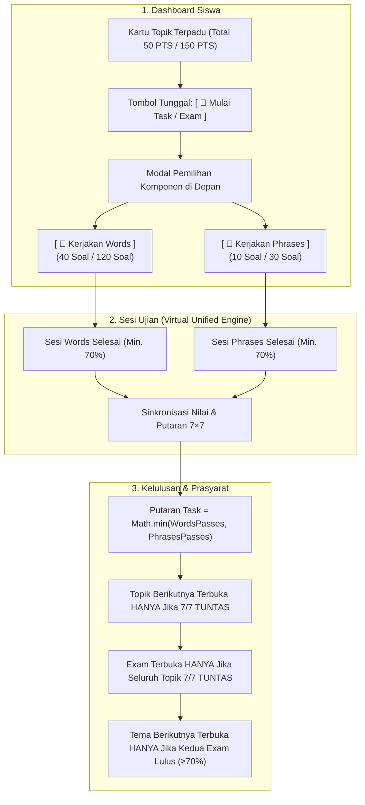

# 🏛️ Cetak Biru Arsitektur: Virtual Unified Task (50 PTS) & Exam (150 PTS) dengan Pemilihan Komponen (3rd Vocabulary)

> **Status:** FINAL SPECIFICATION (Disepakati melalui sesi `/grill-me`)  
> **Target Kelas:** `3rd Vocabulary` (Level 3) & Penyesuaian `2nd Vocabulary` (Level 2)  
> **Prinsip Utama:** Fleksibilitas siswa di depan, integritas engine penilaian di belakang, dan linearitas ketat 7×7 Repetitive Mastery.

---

## 1. Rangkuman Keputusan Desain (Design Decisions)

Berdasarkan wawancara terperinci `/grill-me`, seluruh cabang desain telah disepakati sebagai berikut:

---

## 2. Rincian Aturan Teknis & Pedagogis

### 2.1 Virtual Unified Architecture (Struktur Data & Sesi)
- **Engine Penilaian Tetap Mandiri**:
  - `Words Task`: 40 soal (Spoken), 1 pt per soal = maks. 40 PTS.
  - `Phrases Task`: 10 soal (Spoken), 1 pt per soal = maks. 10 PTS.
  - `Words Exam`: 120 soal (Written Mode dengan toleransi typo Damerau-Levenshtein), maks. 120 PTS.
  - `Phrases Exam`: 30 soal (Selection Mode / Pilihan Ganda), maks. 30 PTS.
- **Tampilan Terpadu (Unified Representation)**:
  - Siswa dan Tutor melihat **1 Topik Task** (Total 50 Soal / 50 PTS).
  - Siswa dan Tutor melihat **1 Tema Exam** (Total 150 Soal / 150 PTS).
  - Pada kelas yang hanya memiliki Words (seperti **2nd Vocabulary**), sistem otomatis mem-bypass modal pemilihan dan langsung membuka ujian tanpa pop-up.

---

### 2.2 Formula Nilai & Poin Akumulasi (Rule 2.7 Highest Score)
Nilai akhir siswa pada setiap Topik Task dan Tema Exam dihitung dari **Skor Tertinggi yang Pernah Dicapai** pada masing-masing komponen:

$$\text{Poin Terpadu} = \text{Best Points (Words)} + \text{Best Points (Phrases)}$$

$$\text{Persentase Skor} = \left( \frac{\text{Poin Terpadu}}{\text{Total Soal (50 atau 150)}} \right) \times 100\%$$

- **Contoh Task Topik 1**:
  - Poin Terbaik Words: $38 / 40$ PTS ($95\%$)
  - Poin Terbaik Phrases: $8 / 10$ PTS ($80\%$)
  - **Poin Terpadu**: $38 + 8 = \mathbf{46 / 50\ \text{PTS}}$
  - **Skor Terpadu**: $(46 / 50) \times 100\% = \mathbf{92.0\%}$ $\rightarrow$ **Grade A** (Hijau Murni `#00c000ff`).

---

### 2.3 Aturan Kelulusan 7×7 Repetitive Mastery (Synchronized Leveling)
1. **Dual-Gate Mandiri**:
   - Untuk dianggap lulus 1 ronde/putaran, **KEDUA bagian harus mencapai minimal 70%** (Words min. 28/40, Phrases min. 7/10).
   - Jika salah satu bagian gagal (misal Words $85\%$ tapi Phrases $50\%$), siswa **HANYA mengulang bagian yang gagal (Phrases)**. Nilai Words yang sudah bagus tetap tersimpan aman.
2. **Hitungan Putaran Resmi (Math.min)**:
   $$\text{Level Putaran Topik} = \min(\text{Words Passes},\ \text{Phrases Passes})$$
   - Jika Words sudah lulus 4 kali dan Phrases baru lulus 2 kali, maka progres resmi Topik tersebut adalah **2 / 7 Passes**.
   - Kartu Dashboard menampilkan status transparan:  
     `Words: 4/7 🟢 | Phrases: 2/7 🟡  ➔  Progres Topik: 2/7`

---

### 2.4 Aturan Prasyarat Linear Ketat (Linear Gating)
Sesuai arahan tegas Anda pada sesi wawancara, alur kurikulum diatur secara berurutan dan disiplin:
1. **Antar-Topik (Topic-to-Topic Gating)**:
   - Topik 2 **TIDAK AKAN TERBUKA** sebelum Topik 1 mencapai **7/7 TUNTAS** pada kedua komponen (Words & Phrases).
   - Topik 3 baru terbuka setelah Topik 2 mencapai 7/7 Tuntas.
2. **Gerbang Exam (Theme Exam Gating)**:
   - Theme Exam (Words Exam & Phrases Exam) baru akan terbuka jika **SEMUA Topik dalam tema tersebut telah mencapai 7/7 Tuntas**.
3. **Antar-Tema (Cross-Theme Gating)**:
   - Tema B (Topik 1) baru akan terbuka jika **KEDUA Exam Tema A (Words Exam DAN Phrases Exam)** telah lulus dengan nilai minimal $\ge 70\%$ (atau $\ge 60\%$ untuk remidi).

---

### 2.5 Antarmuka Pengguna (UI & Layout Parity)

#### A. Student Dashboard (`dashboard.html` & `js/dashboard.js`)
- **Tampilan Kartu**:
  - Judul: `Theme A • Topic 1: Professional Identity`
  - Badge Soal & Poin: `50 Soal • 50 PTS`
  - Progres 7×7: `Putaran 2/7 Selesai`
  - Tombol Utama: `[ 🚀 Mulai Task ]`
- **Modal Pemilihan Komponen (Component Selector Modal)**:
  - Header: *"Pilih Komponen yang Ingin Anda Kerjakan Terlebih Dahulu"*
  - Kartu Pilihan A: `[ 📝 Words Component (40 Soal) ]` — Menampilkan best score & pass count (misal: `38/40 PTS • 3/7 🟢`).
  - Kartu Pilihan B: `[ 💬 Phrases Component (10 Soal) ]` — Menampilkan best score & pass count (misal: `8/10 PTS • 1/7 🟡`).

#### B. Result Page (`result.html` & `js/result.js`)
- Menampilkan nilai dan poin dari sesi yang baru saja selesai (misal: `Words: 38/40 PTS, 95% - Grade A`).
- Menampilkan kartu ringkasan status Topik Terpadu:  
  `Status Topik: Words: 3/7 🟢 | Phrases: 1/7 🟡 (Total Topik: 46/50 PTS)`.
- Tombol aksi pintar:
  - Jika Phrases untuk ronde ini belum tuntas: tombol mengarahkan `[ 💬 Lanjut ke Phrases Task (10 Soal) ]`.
  - Jika ronde sudah seimbang/tuntas: tombol mengarahkan `[ 🏁 Kembali ke Dashboard ]`.

#### C. Admin Class Hub (`admin.html` & `js/admin/app.js`)
- **Tabel Roster Siswa (Students Grade and Score)**:
  - Kolom dibuat sangat ringkas dan rapi: `A1 Task (50p)`, `A2 Task (50p)`, `A3 Task (50p)`, `A Exam (150p)`.
  - Nilai yang ditampilkan adalah nilai terpadu: `46 PTS (92%)`.
  - Saat diklik atau di-hover, muncul popover rincian: `Words: 38/40 (95%) | Phrases: 8/10 (80%) | Passes: 2/7`.

---

## 3. Rencana Implementasi Bertahap (Execution Steps)

1. **Step 1: Gating Engine & Prerequisite Logic (`js/dashboard.js` & `supabase/functions/start-test`)**
   - Menyesuaikan fungsi verifikasi prasyarat agar Topik $N+1$ mewajibkan seluruh task Topik $N$ tuntas 7/7.
   - Mengizinkan Words dan Phrases di dalam topik/exam yang sama berjalan paralel tanpa saling mengunci.
2. **Step 2: Component Selector Modal di Student Dashboard (`js/dashboard.js`)**
   - Membuat modal pemilih komponen interaktif untuk Task dan Exam pada kelas Level 3.
   - Menerapkan auto-bypass jika kelas tidak memiliki materi Phrases (Level 2).
3. **Step 3: Skema Perhitungan Nilai Terpadu & Sinkronisasi 7×7 (`js/api.js` & `js/grading.js`)**
   - Mengimplementasikan `computeUnifiedTopicScore(wordsAttempt, phrasesAttempt)` dan sinkronisasi `Math.min`.
4. **Step 4: Pembaruan Roster Admin Class Hub (`js/admin/app.js`)**
   - Merapikan kolom nilai ke format terpadu (50 PTS / 150 PTS) lengkap dengan popover rincian.
5. **Step 5: Verifikasi E2E & Paritas**
   - Menjalankan pengujian regresi menyeluruh via test runner (`scripts/test_vocab_7x7_and_leveling_e2e.mjs`).
