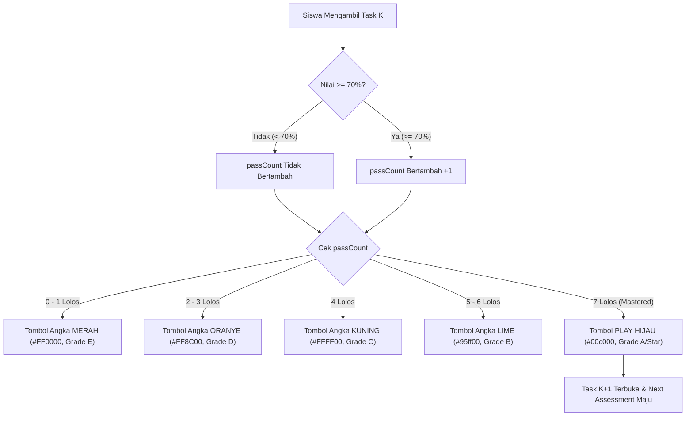

# Implementation Plan: 7×7 Repetitive Mastery Gating & Dynamic Pass Counter Action Button

## Goal Description
Memperbaiki dan menyempurnakan 2 hal mendasar pada alur belajar siswa di Dashboard Siswa (`dashboard.html`):
1. **Perbaikan Sistem 7×7 Repetitive Mastery Gating**:
   - Memastikan siswa **wajib lulus 7 kali** dengan nilai $\ge 70\%$ pada suatu Task harian sebelum Task berikutnya dapat dibuka/diakses.
   - Mengatasi akar masalah mengapa saat siswa menyelesaikan 1 task, task berikutnya langsung terbuka (bug parsing topic code `parseInt('C2') === NaN` dan pengecekan kelulusan tunggal `isPassed = score >= 70` yang melewatkan verifikasi 7 repetisi).
2. **Pembersihan Angka "40" di Section 3 & Redesain Tombol Action Section 6**:
   - **Menghilangkan angka "40"** di samping keterangan grade (`FAIL 40`): Angka ini berasal dari tombol flashcard legacy (`#btn-lobby-flashcards`) yang meng-unhide dirinya sendiri ketika ada 40 kata salah. Elemen ini dibersihkan sepenuhnya dari Section 3.
   - **Mengganti Tombol Retry di Section 6** menjadi **Badge/Icon Angka 1–7 (Progress Repetisi)** dengan warna dinamis sesuai tier grade resmi TopsCore:
     - **0 – 1 Lolos**: Warna **Merah** (`#FF0000`, Grade E)
     - **2 – 3 Lolos**: Warna **Oranye Gelap** (`#FF8C00`, Grade D)
     - **4 Lolos**: Warna **Kuning** (`#FFFF00`, Grade C)
     - **5 – 6 Lolos**: Warna **Electric Lime** (`#95ff00`, Grade B)
     - **7 Lolos**: Tombol **Play Hijau Murni** (`#00c000`, Grade A / Star) yang menandakan task telah tuntas 7×7 dan task berikutnya siap dikerjakan!

---

## User Review Required

> [!IMPORTANT]
> **Aturan 7×7 Repetitive Mastery pada Task Harian**:
> Task $K$ hanya dianggap tuntas (`completed`) apabila siswa telah mencapai minimal **7 kali lulus** dengan nilai $\ge 70\%$.
> Selama `passCount < 7`, tombol aksi di bar Next Assessment menampilkan angka capaian saat ini (`0`, `1`, `2`, `3`, `4`, `5`, atau `6`) dengan warna tier grade yang bersesuaian. Saat diklik, siswa langsung mengerjakan repetisi berikutnya. Begitu mencapai 7 kali lolos, tombol berubah menjadi **Play Hijau** untuk melangkah ke task berikutnya.

> [!NOTE]
> **Penyebab Munculnya Angka "40"**:
> Di dalam bar Section 3 (`#dashboard-grade-legend`), terdapat elemen sisa legacy `#btn-lobby-flashcards` yang di dalamnya ada `<span id="lobby-fc-count-badge">0</span>`. Fungsi `setupLobbyFlashcards` mendeteksi 40 soal yang belum benar pada attempt terakhir siswa (skor 0%), lalu menghapus class `hidden` dan mengisi angka `40` ke badge tersebut, sehingga teks di layar terbaca `FAIL 40`. Kami akan menghapus elemen sisa ini agar Section 3 murni hanya berisi deskripsi grade siswa.

---

## Proposed Changes



---

### Component 1: Pembersihan Angka "40" di Section 3

#### [MODIFY] `dashboard.html`
- Hapus tuntas `#btn-lobby-flashcards` dari dalam `#dashboard-grade-legend`:
```html
<!-- SEBELUM: -->
<div class="dashboard-grade-legend" id="dashboard-grade-legend" aria-label="Grade Achievement Status">
  <span class="achievement-status-text" id="dashboard-achievement-text"></span>
  <!-- Backward compatibility hidden items -->
  <button type="button" class="hidden" id="btn-lobby-flashcards"><span id="lobby-fc-count-badge">0</span></button>
</div>

<!-- SESUDAH: -->
<div class="dashboard-grade-legend" id="dashboard-grade-legend" aria-label="Grade Achievement Status">
  <span class="achievement-status-text" id="dashboard-achievement-text"></span>
</div>
```

#### [MODIFY] `js/dashboard.js`
- Pada fungsi `setupLobbyFlashcards`: tambahkan guard aman agar tidak mencoba meng-unhide button jika elemen sudah tidak ada di DOM, sehingga tidak mengganggu layout bar Section 3.

---

### Component 2: Perbaikan 7×7 Mastery Gating Engine

#### [MODIFY] `js/dashboard.js`
1. **Perbaikan `renderNextAssignmentHero`**:
   - Ganti fungsi penentu `isPassed(t)`:
     - Untuk **Task/Quiz**: `isPassed(t)` bernilai `true` **hanya jika** `(passCountByTest[t.id] || 0) >= targetReps` (7 kali lolos $\ge 70\%$).
     - Untuk **Exam**: `isPassed(t)` bernilai `true` jika siswa memiliki attempt lulus $\ge$ threshold exam.
   - Dengan perbaikan ini, `published.find(a => !isPassed(a))` akan tetap menetap pada Task yang belum mencapai 7 repetisi dan tidak akan lompat ke task berikutnya.

2. **Perbaikan Linear Topic Gating (Bug `parseInt('C2') === NaN`)**:
   - Di `renderClassModulesModal` (baris 1688):
     ```javascript
     // SEBELUM (BUG: 'C2' menghasilkan NaN):
     const curTopNum = parseInt(String(grp.topicCode || ''), 10);
     
     // SESUDAH (Mengambil angka di belakang huruf tema):
     const curTopNum = parseInt(String(grp.topicCode || '').replace(/^[A-Za-z]+/, ''), 10);
     ```
   - Dan pencocokan task topik sebelumnya:
     ```javascript
     if (curTopNum > 1) {
       const priorTopicNum = curTopNum - 1;
       const priorTasks = lvl.Tests.filter(t => {
         if (isExam(t)) return false;
         const tTheme = String(t.payload?.theme_code || (t.shell_code ? t.shell_code.replace(/^[0-9]+/, '').charAt(0) : '')).toUpperCase();
         if (tTheme !== grp.themeCode) return false;
         const tTopCode = String(t.payload?.topic_code || '').replace(/^[A-Za-z]+/, '');
         return parseInt(tTopCode, 10) === priorTopicNum;
       });
       // Cek apakah seluruh task topik sebelumnya sudah tuntas 7 repetisi
       for (const pt of priorTasks) {
         if ((passCountByTest[pt.id] || 0) < targetReps) {
           grpPrereqMet = false;
           grpPrereqTitle = `Topic ${grp.themeCode}${priorTopicNum} (${targetReps}/${targetReps} Passes Required)`;
           break;
         }
       }
     }
     ```

#### [MODIFY] `js/api.js` & `supabase/functions/start-test/index.ts`
- Di `startTest` (`js/api.js` baris 1321 & `start-test/index.ts` baris 144):
  - Jika tes yang menjadi prerequisite adalah **Task/Quiz** (`!isWeeklyExam(prereqTest)`): Verifikasi bahwa siswa memiliki minimal **7 attempt** dengan nilai $\ge 70\%$ (atau `is_forgiven`), bukan hanya 1 attempt!
  - Normalisasi parsing `topicNum` dengan `.replace(/^[A-Za-z]+/, '')` agar tidak `NaN`.

---

### Component 3: Redesain Tombol Action Section 6 (Pass Counter 0–7 Badge)

#### [MODIFY] `js/dashboard.js`
Di dalam `renderNextAssignmentHero`, tombol action di sebelah kanan judul task Next Assessment dirender dinamis berdasarkan `passCount`:
```javascript
// Menghitung jumlah kelulusan task saat ini (skor >= 70%)
const currentPasses = passCountByTest[nextTest.id] || 0;

if (!isTest) {
  if (currentPasses >= targetReps) {
    // 7 Lolos: Hijau Murni Play (Grade A / Star) — Siap maju ke task berikutnya
    actionButtonHtml = `
      <button type="button" class="next-test-go-btn is-pass-tier-a" title="7/7 Complete! Click to take Next Task" onclick="window.location.href='test.html?id=${nextTest.id}'">
        ${ICON_3C_GREEN_PLAY}
      </button>
    `;
  } else {
    // 0 - 6 Lolos: Badge angka 0-6 dengan warna tier grade
    let tierClass = 'is-pass-tier-e'; // default 0-1 Red
    if (currentPasses >= 5) {
      tierClass = 'is-pass-tier-b'; // 5-6 Lime
    } else if (currentPasses === 4) {
      tierClass = 'is-pass-tier-c'; // 4 Yellow
    } else if (currentPasses >= 2) {
      tierClass = 'is-pass-tier-d'; // 2-3 Orange
    }

    actionButtonHtml = `
      <button type="button" class="next-test-go-btn pass-counter-btn ${tierClass}" title="Repetition Pass ${currentPasses}/${targetReps} - Click to take repetition" onclick="window.location.href='test.html?id=${nextTest.id}'">
        <span class="pass-counter-num">${currentPasses}</span>
      </button>
    `;
  }
}
```

#### [MODIFY] `css/dashboard.css`
Styling untuk tombol angka progres repetisi:
```css
/* Pass Counter Button (Section 6) */
body.dashboard-page .next-test-go-btn.pass-counter-btn {
  width: 32px !important;
  height: 32px !important;
  border-radius: 8px !important;
  display: inline-flex !important;
  align-items: center !important;
  justify-content: center !important;
  font-family: 'Outfit', sans-serif !important;
  font-size: 1.1rem !important;
  font-weight: 900 !important;
  line-height: 1 !important;
  cursor: pointer !important;
  transition: all 0.2s ease !important;
  border: 1.5px solid transparent !important;
}

/* Tier 0-1: Red E */
body.dashboard-page .next-test-go-btn.is-pass-tier-e {
  background: rgba(255, 0, 0, 0.2) !important;
  color: #FF0000 !important;
  border-color: rgba(255, 0, 0, 0.6) !important;
  box-shadow: 0 0 10px rgba(255, 0, 0, 0.35) !important;
}

/* Tier 2-3: Orange D */
body.dashboard-page .next-test-go-btn.is-pass-tier-d {
  background: rgba(255, 140, 0, 0.2) !important;
  color: #FF8C00 !important;
  border-color: rgba(255, 140, 0, 0.6) !important;
  box-shadow: 0 0 10px rgba(255, 140, 0, 0.35) !important;
}

/* Tier 4: Yellow C */
body.dashboard-page .next-test-go-btn.is-pass-tier-c {
  background: rgba(255, 255, 0, 0.2) !important;
  color: #FFFF00 !important;
  border-color: rgba(255, 255, 0, 0.6) !important;
  box-shadow: 0 0 10px rgba(255, 255, 0, 0.35) !important;
}

/* Tier 5-6: Lime B */
body.dashboard-page .next-test-go-btn.is-pass-tier-b {
  background: rgba(149, 255, 0, 0.2) !important;
  color: #95ff00 !important;
  border-color: rgba(149, 255, 0, 0.6) !important;
  box-shadow: 0 0 10px rgba(149, 255, 0, 0.35) !important;
}

/* Tier 7: Green Play A/Star */
body.dashboard-page .next-test-go-btn.is-pass-tier-a {
  background: rgba(0, 192, 0, 0.25) !important;
  color: #00c000 !important;
  border-color: rgba(0, 192, 0, 0.7) !important;
  box-shadow: 0 0 12px rgba(0, 192, 0, 0.45) !important;
}
```

---

## Verification Plan

### Automated Tests
1. **Playwright E2E Test** (`scripts/test_7x7_gating_and_pass_button_e2e.mjs`):
   - Verifikasi bar Section 3 (`#dashboard-grade-legend`): memastikan hanya berisi kata deskripsi (misal: `FAIL`), dan **angka "40" tidak pernah muncul**.
   - Verifikasi Section 6 saat siswa memiliki:
     - 0 atau 1 lolos $\rightarrow$ Tombol menampilkan angka `0` atau `1` dengan warna merah (#FF0000).
     - 2 atau 3 lolos $\rightarrow$ Tombol menampilkan angka `2` atau `3` dengan warna oranye (#FF8C00).
     - 4 lolos $\rightarrow$ Tombol menampilkan angka `4` dengan warna kuning (#FFFF00).
     - 5 atau 6 lolos $\rightarrow$ Tombol menampilkan angka `5` atau `6` dengan warna lime (#95ff00).
     - 7 lolos $\rightarrow$ Tombol menampilkan ikon Play hijau (#00c000).
   - Verifikasi Task berikutnya: dipastikan **terkunci rapat** selama task saat ini belum mencapai 7 kelulusan $\ge 70\%$.
2. **Validasi Syntax**:
   - `node scripts/check_all_js_syntax.cjs` (42 file JavaScript harus PASS 100%).
3. **CI Test Suite**:
   - `npm test` (PASS 100%).

### Manual Verification
- Buka dashboard siswa di viewport mobile (seperti pada screenshot Anda).
- Pastikan kartu deskripsi grade (`FAIL`) bersih tanpa angka 40.
- Periksa tombol di samping judul Next Assessment: tombol berupa ikon angka dengan warna grade sesuai jumlah lulus repetisi siswa.
