# Rencana Implementasi & Laporan Analisis: Perbaikan Jumlah Soal Task, Banner Permanen (Atas & Bawah), dan Isolasi Level Kelas Siswa

## Ringkasan Eksekutif & Latar Belakang Masalah

Berdasarkan laporan, analisa kode sumber, dan 3 gambar bukti yang diberikan pengguna:
1. **Gambar 1 (`admin.html#class-hub`)**: Daftar *Class Tests* menampilkan bahwa `2nd Vocabulary A1 Words Task` terkonfigurasi dengan **40 Soal (Vault)**, sedangkan `2nd Vocabulary A Words Exam` memiliki **120 Soal (Vault)**.
2. **Gambar 2 (`test.html`)**: Saat siswa mengambil `2nd Vocabulary A1 Words Task`, sistem justru memuat **120 soal** (`0/120 Answered`), dan soal pertama yang muncul adalah *"Menarik"* yang berasal dari topik **A3 (Persuasive Speaking)**, bukan dari topik **A1 (Introduction & Delivery)**.
3. **Banner Atas & Bawah Hilang**: Di halaman `test.html`, *Banner Atas* (Brand Header TopsCore) tidak ada dan *Banner Bawah* (`TopsCore © 2026 | Created by Mr. Top`, 50px) terdorong keluar layar (terpotong ke bawah) karena konten soal melebihi batas tinggi `100dvh` pada tampilan mobile. Padahal banner atas dan bawah adalah standar permanen TopsCore di semua halaman.
4. **Gambar 3 (`dashboard.html` - Modal "Select Class")**: Siswa dengan akun Test (berada di **2nd Level / Batch 134**) membuka modal *Select Class*, namun di dalamnya muncul **`1st Vocabulary (In Progress 0%)`** di atas `2nd Vocabulary (5%)`. Munculnya kelas level 1 untuk siswa level 2 adalah kesalahan logika filter.

Berikut adalah laporan investigasi mendalam, akar masalah teknis (*root causes*), dan rencana perbaikan terstruktur.

---

## 1. Laporan Analisis & Akar Masalah (Root Cause Analysis)

### 1.1 Masalah 1: Soal Task Menjadi 120 Bukan 40
* **Lokasi Bug**: `supabase/functions/start-test/index.ts` baris 523–538.
* **Mekanisme Terjadinya**:
  1. Pada saat auto-generator membuat tes (`autoGenerateTestsHierarchy` di `js/api.js`), objek `payload` untuk tes tipe Task diisi:
     ```json
     {
       "theme_code": "A",
       "topic_code": "A1",
       "themes": ["A"],
       "total_questions": 40
     }
     ```
  2. Saat siswa memulai Task A1, frontend memanggil Edge Function `start-test`.
  3. Di dalam Edge Function `start-test/index.ts`:
     ```typescript
     // Baris 523 - 538 di supabase/functions/start-test/index.ts
     const themes = test.payload?.themes;
     if (themes && Array.isArray(themes) && themes.length > 0) {
         query = query.in("theme_code", themes); // <--- ERROR! CABANG INI DIEKSEKUSI LEBIH DULU
     } else if (isThemeTest && themeCode) {
         ...
     } else {
         if (themeCode) query = query.eq("theme_code", themeCode);
         if (topicCode) query = query.eq("topic_code", topicCode); // <--- TIDAK PERNAH DIJALANKAN!
     }
     ```
  4. Karena `test.payload.themes` bernilai `['A']`, kondisi `if (themes && Array.isArray(themes))` bernilai **TRUE**.
  5. Akibatnya, query ke tabel `vocabulary_vault` hanya memfilter `theme_code IN ('A')`, dan **sama sekali tidak memfilter `topic_code`**!
  6. Di Level 2, Tema A memiliki 3 Topik:
     * A1: Introduction & Delivery (40 kata)
     * A2: Structuring a Presentation (40 kata)
     * A3: Persuasive Speaking (40 kata)
     * **Total = 120 kata!**
  7. Edge function menarik seluruh 120 kata dari tema A, lalu menyimpannya ke `attempt_answers`. Itulah sebabnya:
     * Jumlah soal menjadi **120**.
     * Kata *"Menarik"* yang berasal dari Topik A3 muncul di dalam Task A1!
  8. *Bandingkan dengan fallback client di `js/api.js` (baris 667)* yang memeriksa `if (topicCode)` terlebih dahulu sebelum `themes`, sehingga di `js/api.js` berjalan benar 40 soal, tetapi di Edge Function yang menjadi penentu utama server-side berjalan salah 120 soal.

---

### 1.2 Masalah 2: Banner Atas dan Bawah Hilang di Halaman Ujian (`test.html`)
* **Lokasi Masalah**: `test.html` dan `css/test.css`.
* **Mekanisme Terjadinya**:
  1. **Banner Bawah (50px)**:
     * Di `test.html` baris 134, elemen `#bottom-ad-banner` ada di dalam `#fixed-bottom-area`.
     * Namun pada `body.test-page` di `css/test.css`:
       ```css
       body.test-page {
         height: 100dvh !important;
         max-height: 100dvh !important;
         overflow: hidden !important;
         display: flex !important;
         flex-direction: column !important;
       }
       ```
     * Total tinggi elemen vertikal:
       * Header (`.test-header`): 50px topbar + 54px title bar = 104px.
       * Body (`.test-body`): Kotak soal (min 80px) + Grid metadata + Kotak STT/Transkrip + Tombol Mikrofon besar.
       * Kontrol Bawah (`.test-fixed-bottom`): Navigasi Prev/Next (54px) + Progress bar (10px) + Gap sistem (20px).
       * Total tinggi konten ini melebihi tinggi layar ponsel standar (misal 667px – 800px).
     * Akibat `overflow: hidden`, `#bottom-ad-banner` (50px) **terdorong ke bawah garis lipatan layar (overflow below fold)** sehingga tidak terlihat sama sekali oleh siswa (hilang dari pandangan).
     * Ditambah lagi badge Netlify melayang di pojok kanan bawah menutupi tombol navigasi.
  2. **Banner Atas (Brand Header 50px)**:
     * Di halaman `dashboard.html` dan `result.html`, selalu terdapat `<header class="dashboard-header">` (tinggi 50px) dengan teks merek seperti `THE STUDENT'S LOBBY` atau `RESULT PAGE`.
     * Di `test.html`, brand header 50px ini tidak diikutsertakan, melainkan langsung masuk ke utility row (`[🚩 Give up!]`, avatar, timer). Standar TopsCore (DECISION-016) mewajibkan header atas 50px dan footer banner bawah 50px secara permanen di seluruh aplikasi.

---

### 1.3 Masalah 3: Akun 2nd Level Memunculkan Kelas 1st Level di Modal "Select Class"
* **Lokasi Bug**: `js/api.js` (baris 444–448) dan `js/dashboard.js` (baris 1058–1064).
* **Mekanisme Terjadinya**:
  1. Di `js/api.js`, fungsi `fetchStudentClasses(programId, institutionId, levelId)` memiliki logika:
     ```javascript
     // Baris 444-448 di js/api.js
     // Cumulative Retroactive Access: return classes whose level_number <= studentLevelNum
     return data.filter(c => {
       const cLvlNum = c.levels?.level_number;
       if (cLvlNum == null) return false;
       return cLvlNum <= studentLevelNum; // <--- ERROR! Kelas level 1 (cLvlNum = 1) ikut dikembalikan untuk siswa level 2!
     });
     ```
  2. Di `js/dashboard.js`, fungsi `renderClasses` memperparah kondisi ini dengan memasukkan kelas level lama ke dalam array `activeClasses`:
     ```javascript
     // Baris 1058-1064 di js/dashboard.js
     } else if (studentLevelNum != null && cLvlNum != null && cLvlNum < studentLevelNum) {
       c._isRetroactive = true;
       activeClasses.push(c); // <--- ERROR! Memasukkan kelas 1st Level ke activeClasses siswa 2nd Level!
       completedClasses.push(c);
     }
     ```
  3. Di `populateClassesSelectorModal(activeClasses)`:
     * Modal merender isi `activeClasses`. Karena `1st Vocabulary` dan `2nd Vocabulary` ada di dalam array, dan diurutkan secara alfabetis (A to Z), `1st Vocabulary` muncul di urutan pertama!
     * Bahkan saat halaman pertama kali dimuat, `window._selectedClassId` memilih `activeClasses[0].id` (`1st Vocabulary`) sehingga dashboard siswa 2nd level justru default ke kelas 1st level dengan progres 0%.
  4. Sesuai kontrak bisnis TopsCore (AGENTS.md Bagian 2.4 & 2.5):
     * Kelas dan Ujian terikat pada Level. Siswa Level 2 hanya berhak mengambil dan melihat kelas aktif milik **Level 2** (`2nd Vocabulary`, `2nd Storytelling`, dll.).
     * Akses ke level lain telah memiliki modul terpisah yaitu tombol `[ 🔍 View All Levels & Detailed Tests ]` (`#levels-overview-modal`). Modal pilihan kelas aktif (`Select Class`) **hanya boleh berisi kelas-kelas dari level siswa saat ini**.

---

## 2. Diagram Alur & Perbaikan Sistem

```mermaid
flowchart TD
    subgraph EdgeFunctionStartTest["1. Perbaikan start-test Edge Function"]
        A[Siswa Klik Ambil Task A1] --> B{Ada topic_code?}
        B -- Ya (Task A1) --> C[Filter topic_code in 'A1', '1']
        C --> D[Ambil tepat 40 Soal Topik A1]
        B -- Tidak (Exam Tema A) --> E[Ambil seluruh Topik A1+A2+A3 = 120 Soal]
    end

    subgraph ZeroScrollMobile["2. Perbaikan Banner Permanen test.html"]
        F[Top Banner Permanen 50px] --> G[Area Interaksi Soal flex: 1 min-height: 0]
        G --> H[Navigasi Bawah 54px + Progress 10px]
        H --> I[Bottom Banner Permanen 50px Selalu Terlihat]
    end

    subgraph LevelClassFilter["3. Perbaikan Filter Kelas dashboard.html"]
        J[Siswa Login: 2nd Level] --> K[fetchStudentClasses levelId: Level 2]
        K --> L{Level Kelas == Level Siswa?}
        L -- Ya (2nd Vocabulary) --> M[Masukkan ke activeClasses & Select Class Modal]
        L -- Tidak (1st Vocabulary) --> N[Abaikan dari activeClasses / Jangan Tampilkan]
    end
```



---

## 3. Rencana Perubahan Kode yang Diusulkan (Proposed Changes)

### Komponen A: Perbaikan Edge Function `start-test` (Masalah 1 - 40 Soal vs 120 Soal)

#### [MODIFY] `supabase/functions/start-test/index.ts`
* Ubah prioritas query pada `vocabulary_vault`:
  * Evaluasi `topicCode` terlebih dahulu sebelum `themes`.
  * Dukung kandidat kode topik fleksibel: `['A1', '1']` agar cocok dengan format database apa pun.
  * Tambahkan safety clamp: Batasi jumlah soal maksimum sesuai `test.payload?.total_questions` atau `test.total_questions` (misal 40 untuk Task, 120 untuk Exam).

```typescript
// Perbaikan pada supabase/functions/start-test/index.ts
const themeCode = test.payload.theme_code;
const topicCode = test.payload.topic_code;

let query = supabase.from("vocabulary_vault")
  .select("*")
  .is("deleted_at", null)
  .eq("target_level", levelNum)
  .range(0, 4999);

const isThemeTest = (test.category === 'EXAM' || test.category === 'TEST' || String(test.test_type).toLowerCase() === 'exam' || (test.shell_code && (test.shell_code.includes('-EXAM') || test.shell_code.includes('-TEST')))) && !topicCode;

if (topicCode) {
  // PRIORITAS 1: Jika tes adalah Task bertopik spesifik (misal A1), hanya ambil soal topik tersebut!
  if (themeCode) query = query.eq("theme_code", themeCode);
  const candidateCodes = [
    String(topicCode).toUpperCase(),
    (/^[0-9]+$/.test(String(topicCode)) && themeCode) ? `${String(themeCode).toUpperCase()}${topicCode}` : null,
    String(topicCode).replace(/^[A-Za-z]/, '')
  ].filter(Boolean);
  query = query.in("topic_code", candidateCodes);
} else if (themes && Array.isArray(themes) && themes.length > 0) {
  // PRIORITAS 2: Jika tes adalah Exam dengan daftar tema
  query = query.in("theme_code", themes);
} else if (isThemeTest && themeCode) {
  // PRIORITAS 3: Exam kumulatif tema
  const allThemes = ['A', 'B', 'C', 'D', 'E', 'F', 'G', 'H'];
  const idx = allThemes.indexOf(String(themeCode).toUpperCase());
  if (idx !== -1) {
    query = query.in("theme_code", allThemes.slice(0, idx + 1));
  } else {
    query = query.eq("theme_code", themeCode);
  }
} else if (themeCode) {
  query = query.eq("theme_code", themeCode);
}
```

* Tambahkan pemangkasan jumlah soal sesuai konfigurasi shell:
```typescript
const maxTargetQuestions = test.payload?.total_questions || test.total_questions;
if (maxTargetQuestions && Number(maxTargetQuestions) > 0 && vaultWords.length > maxTargetQuestions) {
  vaultWords = vaultWords.slice(0, Number(maxTargetQuestions));
}
```

#### [MODIFY] Pembersihan Percobaan Lama (Data Self-Healing Script)
* Buat skrip untuk membersihkan/mereset attempt `in_progress` pada student `"Test"` yang sebelumnya terlanjur digenerate dengan 120 soal untuk tes `2A1-WORDS-TASK`, sehingga saat tes dibuka kembali langsung memperoleh 40 soal yang baru dan bersih.

---

### Komponen B: Perbaikan Tampilan Banner Permanen di `test.html` (Masalah 2)

#### [MODIFY] `test.html`
1. Tambahkan Banner Atas Permanen standar TopsCore (50px):
   ```html
   <!-- Top Permanent Global Brand Header (50px) -->
   <header class="dashboard-header test-global-header" id="test-global-header">
     <div class="dashboard-header-brand" id="test-global-brand">TOPS CORE &bull; TEST ROOM</div>
     <div class="test-header-status-pill" id="test-header-status-pill">SECURE SESSION</div>
   </header>
   ```
2. Pastikan `#bottom-ad-banner` terkunci di dasar layar sebagai direct child atau flex anchor independen yang tidak bisa terdorong ke luar layar:
   ```html
   <footer id="bottom-ad-banner" class="topscore-locked-banner">
     <span class="banner-brand">TopsCore</span>&nbsp;&copy; 2026&nbsp;<span class="banner-sep">|</span>&nbsp;<span class="banner-author">Created by Mr. Top</span>
   </footer>
   ```

#### [MODIFY] `css/test.css`
1. Re-kalkulasi budget tinggi layar mobile (`100dvh` zero-scroll budget):
   * Banner Atas: 50px
   * Test Utility Row (`[🚩 Give up!]`, Avatar, Timer): 44px
   * Title Bar: 36px
   * Kontrol Bawah (Prev/Next/Count): 50px
   * Progress Bar: 8px
   * Banner Bawah: 50px
   * **Total ruang frame tetap = 238px.**
   * **Area Tengah (`.test-body` & `#test-main`): `flex: 1; min-height: 0; max-height: 100%; overflow: hidden;`**
2. Sesuaikan komponen dalam mode Speech:
   * Turunkan `min-height` kotak pertanyaan dari 80px ke rasio elastis (`flex: 2; min-height: 60px;`).
   * Tombol mikrofon dan visualizer diberi `flex: 3; min-height: 120px;`.
   * Berikan aturan `.test-fixed-bottom` dan `#bottom-ad-banner`:
     ```css
     body.test-page #bottom-ad-banner,
     body.test-page .topscore-locked-banner {
       position: static !important;
       flex-shrink: 0 !important;
       height: 50px !important;
       min-height: 50px !important;
       max-height: 50px !important;
       width: 100% !important;
       z-index: 1000 !important;
     }
     ```
   * Dengan ini, footer banner 50px dijamin **100% selalu terlihat di dasar layar** tanpa pernah terpotong ke bawah lipatan layar.

---

### Komponen C: Perbaikan Filter Kelas Level Siswa (Masalah 3 - Akun 2nd Level Menampilkan Kelas 1st Level)

#### [MODIFY] `js/api.js` (`fetchStudentClasses`)
* Ubah logika filter pada `fetchStudentClasses`:
  * Jika siswa adalah Alumni (`studentLevelNum === 0`), tetap berikan akses universal.
  * Jika siswa aktif (`studentLevelNum > 0` dan `levelId` terpasang), **hanya kembalikan kelas milik level siswa saat ini** (`cLvlNum === studentLevelNum` atau `c.level_id === levelId`).

```javascript
// Di js/api.js baris 444:
// Strict Level Isolation: Only return classes assigned to the student's current level
return data.filter(c => {
  const cLvlNum = c.levels?.level_number;
  if (cLvlNum == null) return false;
  return cLvlNum === studentLevelNum;
});
```

#### [MODIFY] `js/dashboard.js` (`renderClasses` & `populateClassesSelectorModal`)
* Hapus logika yang mendorong kelas level lama ke dalam `activeClasses`:
  ```javascript
  // Di js/dashboard.js baris 1058:
  // Hapus: activeClasses.push(c) pada cLvlNum < studentLevelNum!
  } else if (studentLevelNum != null && cLvlNum != null && cLvlNum < studentLevelNum) {
    c._isRetroactive = true;
    completedClasses.push(c); // Hanya masukkan ke completedClasses untuk riwayat / modal all-levels
    // JANGAN PUSH KE activeClasses!
  }
  ```
* Dengan perbaikan ini:
  * Siswa di 2nd Level hanya akan memiliki kelas Level 2 (`2nd Vocabulary`, `2nd Storytelling`, `Public Speaking`) di kartu utama dan di dalam modal `Select Class`.
  * `1st Vocabulary` tidak akan pernah muncul di modal pilihan kelas siswa 2nd Level.

---

## 4. Rencana Verifikasi (Verification Plan)

### Automated Tests
1. **Pemeriksaan Sintaks JS**:
   ```powershell
   node scripts/check_all_js_syntax.cjs
   ```
2. **Pemeriksaan Manifest Service Worker**:
   ```powershell
   node scripts/generate_sw_manifest.mjs
   ```
3. **Pemeriksaan CI Suite Eksisting**:
   ```powershell
   npm test
   ```
4. **Skrip Verifikasi Otomatis Terarah (`scripts/verify_phase_fixes.mjs`)**:
   * Memanggil `fetchStudentClasses` dengan `levelId` Level 2, memverifikasi hanya kelas Level 2 yang kembali (0 kelas Level 1).
   * Memanggil fungsi `startTest` untuk `2A1-WORDS-TASK` dan memverifikasi jumlah soal yang kembali tepat **40 soal**, semuanya memiliki `topic_code = 'A1'`.
   * Menjalankan Playwright / headless browser untuk mengecek `test.html` pada viewport mobile (412x915 dan 375x667):
     * Memverifikasi `#test-global-header` terlihat di atas.
     * Memverifikasi `#bottom-ad-banner` terlihat 100% di dasar layar (bounding box `top + height <= viewportHeight`).
     * Memverifikasi teks hitungan soal menampilkan `0/40 Answered`.

### Manual Verification
1. Login sebagai akun siswa di Level 2 (misal student `"Test"` atau `"Miss Isnantika Salsabila"`):
   * Buka Dashboard, klik tombol switcher kelas / buka modal `Select Class`.
   * Pastikan hanya kelas `2nd Vocabulary` (dan kelas Level 2 lainnya) yang muncul; pastikan `1st Vocabulary` **tidak muncul**.
2. Klik kelas `2nd Vocabulary`, buka `2nd Vocabulary A1 Words Task`:
   * Halaman `test.html` terbuka.
   * Periksa banner atas ("TOPS CORE • TEST ROOM").
   * Periksa jumlah soal di tombol tengah bawah: tertulis tepat **`0/40 Answered`**.
   * Periksa soal pertama yang muncul: merupakan kata dari topik *Introduction & Delivery* (Topik A1), bukan *Persuasive Speaking* (Topik A3).
   * Periksa footer banner bawah (`TopsCore © 2026 | Created by Mr. Top`): terlihat jelas dan permanen di bagian paling bawah layar tanpa perlu di-scroll.

---

## User Review Required
> [!IMPORTANT]
> Mohon konfirmasi apakah struktur banner atas di halaman `test.html` disepakati menggunakan format standard 50px header TopsCore (`TOPS CORE • TEST ROOM`) di atas utility row `[🚩 Give up!]`, atau jika Anda menginginkan tata letak teks banner tertentu.
> 
> Setelah rencana ini disetujui, eksekusi kode akan langsung dijalankan secara menyeluruh.
