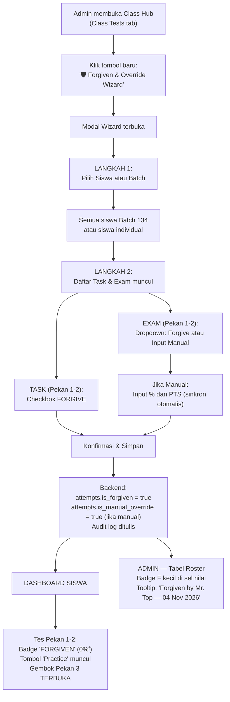

# Fitur Forgiven & Exam Manual Override — Implementation Plan

## Deskripsi

Saat ini siswa kelas **2nd Vocabulary (Level 2)** di **Batch 134 — CEC Camp** sudah berjalan selama 2 pekan tanpa menggunakan sistem TopsCore. Admin perlu cara cepat untuk membuka akses Pekan 3 bagi seluruh atau sebagian siswa, tanpa menghapus kurikulum Pekan 1 & 2 dan tanpa merusak integritas data untuk angkatan mendatang.

Fitur ini memperkenalkan sebuah **Wizard Modal** baru di Class Hub Admin yang memungkinkan:
1. **Forgiven** — Menandai Task atau Exam tertentu sebagai dimaafkan (`status: 'forgiven'`) untuk siswa yang dipilih, sehingga gate prerequisite 7×7 Mastery & Inter-Theme Exam terbuka ke Pekan berikutnya.
2. **Manual Score Input (Exam Only)** — Memasukkan nilai ujian offline ke database secara langsung (fleksibel: input % atau PTS, keduanya sinkron otomatis).
3. **Revoke** — Membatalkan aksi Forgiven, mengembalikan siswa ke kondisi normal.

---

## Keputusan Arsitektur yang Telah Disepakati

| # | Topik | Keputusan |
|---|-------|-----------|
| 1 | Dampak PROG % | Diterima: 50% PROG untuk Batch 134 yang sudah berjalan 2 pekan adalah benar secara faktual. |
| 2 | 7×7 Mastery Gate Bypass | Task `FORGIVEN` otomatis mem-bypass gate 7×7 dalam `passCountByTest`. |
| 3 | Undo/Revoke | Tersedia dalam modal yang sama. Revoke menghapus attempt FORGIVEN. |
| 4 | Nilai Manual Exam < 60% | Nilai asli disimpan apa adanya. Forgive terpisah jika threshold ingin dilewati. |
| 5 | Audit Log | Dicatat dengan nama **"Mr. Top"**, timestamp, dan keterangan aksi. Badge tooltip muncul di tabel. |
| 6 | Lokasi Tombol | Di Class Hub — toolbar atas, di samping "Buka Test Blueprint" dan "Generator Wizard". |

---

## User Review Required

> [!IMPORTANT]
> Fitur ini menambahkan kolom baru `is_forgiven BOOLEAN DEFAULT FALSE` dan `is_manual_override BOOLEAN DEFAULT FALSE` ke tabel `attempts`. Diperlukan **1 file SQL migration baru** yang akan dijalankan via Supabase Dashboard SQL Editor. Pastikan backup sudah ada sebelum menjalankan migration.

> [!WARNING]
> Status `'forgiven'` akan ditambahkan ke `CHECK CONSTRAINT` tabel `attempts`. Jika constraint lama bersifat strict, migration harus `DROP` lalu `ADD` constraint. Plan ini menggunakan pendekatan aman: `ALTER TABLE ... ADD COLUMN IF NOT EXISTS` tanpa menyentuh constraint lama (status 'forgiven' disimpan sebagai field boolean terpisah, bukan nilai status string).

> [!NOTE]
> Untuk kompatibilitas mundur, fitur ini **tidak** mengubah nilai kolom `status` yang sudah ada (misal: tidak mengubah nilai ke `'forgiven'`). Sebaliknya, Forgiven ditandai dengan flag boolean baru `is_forgiven = true` pada attempt, sehingga logika yang sudah ada tidak terpengaruh.

---

## Open Questions

> [!IMPORTANT]
> **Sudah dijawab semua melalui sesi /grill-me.** Tidak ada open question yang tersisa.

---

## Arsitektur Aliran Data



---

## Schema: Database Migration

### [NEW] `supabase/migrations/20261104120000_add_forgiven_manual_override.sql`

```sql
-- Phase 305: Forgiven & Exam Manual Override columns
-- Add two flag columns to attempts table

ALTER TABLE public.attempts
  ADD COLUMN IF NOT EXISTS is_forgiven BOOLEAN DEFAULT FALSE,
  ADD COLUMN IF NOT EXISTS is_manual_override BOOLEAN DEFAULT FALSE,
  ADD COLUMN IF NOT EXISTS forgiven_by TEXT,
  ADD COLUMN IF NOT EXISTS forgiven_at TIMESTAMPTZ,
  ADD COLUMN IF NOT EXISTS forgiven_reason TEXT;

-- Index for fast lookup (filtering forgiven attempts in roster queries)
CREATE INDEX IF NOT EXISTS idx_attempts_is_forgiven
  ON public.attempts(is_forgiven)
  WHERE is_forgiven = TRUE;

CREATE INDEX IF NOT EXISTS idx_attempts_is_manual_override
  ON public.attempts(is_manual_override)
  WHERE is_manual_override = TRUE;

-- Comment documentation
COMMENT ON COLUMN public.attempts.is_forgiven IS
  'TRUE if this attempt was administratively forgiven (excused). The student is treated as if they passed this test for prerequisite gating purposes.';
COMMENT ON COLUMN public.attempts.is_manual_override IS
  'TRUE if score was manually entered by admin/tutor (e.g., from offline exam paper).';
COMMENT ON COLUMN public.attempts.forgiven_by IS
  'Name of the admin who applied Forgiven or Manual Override (e.g., "Mr. Top").';
COMMENT ON COLUMN public.attempts.forgiven_at IS
  'Timestamp when Forgiven/Override was applied.';
COMMENT ON COLUMN public.attempts.forgiven_reason IS
  'Optional reason text shown in audit tooltip.';
```

---

## Perubahan Kode

---

### `js/api.js`

#### [MODIFY] api.js — Tambah fungsi `adminApplyForgiven` dan `adminRevokeForgiven`

Tambahkan dua fungsi baru setelah `adminOverridePrerequisitesWithRemedial`:

```javascript
/**
 * Phase 305: Forgiven & Exam Manual Override
 * Apply 'forgiven' flag to selected tests for selected students.
 * Also supports manual score input for EXAM type tests.
 *
 * @param {Object} opts
 * @param {string}   opts.classId
 * @param {string[]} opts.studentIds       - Student IDs to apply forgiven to
 * @param {Object[]} opts.testActions      - Array of { testId, action: 'forgive'|'manual', score?, percentage? }
 * @param {string}   [opts.forgivenBy]     - Admin name, default 'Mr. Top'
 * @param {string}   [opts.reason]         - Optional reason string
 */
export async function adminApplyForgiven({
  classId,
  studentIds = [],
  testActions = [],   // [{ testId, action: 'forgive'|'manual', score, percentage, totalQ }]
  forgivenBy = 'Mr. Top',
  reason = 'Pacing Adjustment'
}) {
  const sb = await getSupabase();
  if (!classId) throw new Error('classId is required');
  if (!studentIds.length) throw new Error('No students selected');
  if (!testActions.length) throw new Error('No test actions specified');

  const nowIso = new Date().toISOString();
  const inserts = [];
  const updates = [];
  const affectedSet = new Set();

  // Fetch all existing attempts for these students + tests
  const testIds = testActions.map(ta => ta.testId);
  const { data: existing, error: existErr } = await sb
    .from('attempts')
    .select('id, student_id, test_id, status, score, percentage, total_questions, is_best_score, is_forgiven, is_manual_override')
    .in('student_id', studentIds)
    .in('test_id', testIds);
  if (existErr) throw existErr;

  const byStudentTest = {};
  (existing || []).forEach(a => {
    const k = `${a.student_id}_${a.test_id}`;
    if (!byStudentTest[k]) byStudentTest[k] = [];
    byStudentTest[k].push(a);
  });

  // Fetch test metadata for totalQ calculation
  const { data: testMeta } = await sb
    .from('tests')
    .select('id, shell_code, test_type, payload')
    .in('id', testIds);
  const testMetaMap = {};
  (testMeta || []).forEach(t => { testMetaMap[t.id] = t; });

  const _gradeForScore = (pct) => {
    if (pct >= 100) return '★';
    if (pct >= 90)  return 'A';
    if (pct >= 80)  return 'B';
    if (pct >= 60)  return 'C';
    if (pct >= 30)  return 'D';
    return 'E';
  };

  for (const sId of studentIds) {
    for (const ta of testActions) {
      const { testId, action, percentage: inputPct, score: inputScore } = ta;
      const k = `${sId}_${testId}`;
      const existingAtts = byStudentTest[k] || [];
      const meta = testMetaMap[testId];
      const totalQ = Number(meta?.payload?.total_questions || (action === 'forgive' ? 40 : 120));

      if (action === 'forgive') {
        // For FORGIVE: insert or update attempt with is_forgiven = true
        // Keep original score if exists; otherwise score = 0
        const bestExisting = existingAtts.find(a =>
          ['submitted','auto_submitted','evaluated','graded'].includes(String(a.status||'').toLowerCase())
        );
        
        if (bestExisting) {
          // Update existing best attempt: add forgiven flag, keep score intact
          updates.push({
            id: bestExisting.id,
            is_forgiven: true,
            forgiven_by: forgivenBy,
            forgiven_at: nowIso,
            forgiven_reason: reason,
            updated_at: nowIso
          });
        } else {
          // Insert new attempt with 0 score, forgiven = true
          inserts.push({
            student_id: sId,
            test_id: testId,
            attempt_number: 1,
            started_at: nowIso,
            expires_at: nowIso,
            submitted_at: nowIso,
            status: 'submitted',
            score: 0,
            correct_count: 0,
            total_questions: totalQ,
            percentage: 0,
            effective_score: 0,
            grade: 'E',
            is_best_score: true,
            is_forgiven: true,
            forgiven_by: forgivenBy,
            forgiven_at: nowIso,
            forgiven_reason: reason,
            created_at: nowIso,
            updated_at: nowIso
          });
        }
        affectedSet.add(`${sId}_${testId}`);

      } else if (action === 'manual') {
        // For MANUAL: insert or update with the given score
        const pct = Math.max(0, Math.min(100, Number(inputPct) || 0));
        const sc = inputScore != null
          ? Number(inputScore)
          : Math.round(totalQ * (pct / 100) * 10) / 10;
        const grade = _gradeForScore(pct);

        const bestExisting = existingAtts.find(a =>
          ['submitted','auto_submitted','evaluated','graded'].includes(String(a.status||'').toLowerCase())
        );

        if (bestExisting) {
          updates.push({
            id: bestExisting.id,
            score: sc,
            correct_count: Math.round(sc),
            total_questions: totalQ,
            percentage: pct,
            effective_score: sc,
            grade,
            status: 'submitted',
            is_best_score: true,
            is_manual_override: true,
            is_forgiven: false,
            forgiven_by: forgivenBy,
            forgiven_at: nowIso,
            forgiven_reason: `Manual Score Input: ${pct}%`,
            updated_at: nowIso
          });
        } else {
          inserts.push({
            student_id: sId,
            test_id: testId,
            attempt_number: 1,
            started_at: nowIso,
            expires_at: nowIso,
            submitted_at: nowIso,
            status: 'submitted',
            score: sc,
            correct_count: Math.round(sc),
            total_questions: totalQ,
            percentage: pct,
            effective_score: sc,
            grade,
            is_best_score: true,
            is_manual_override: true,
            is_forgiven: false,
            forgiven_by: forgivenBy,
            forgiven_at: nowIso,
            forgiven_reason: `Manual Score Input: ${pct}%`,
            created_at: nowIso,
            updated_at: nowIso
          });
        }
        affectedSet.add(`${sId}_${testId}`);
      }
    }
  }

  // Execute inserts (chunked)
  const CHUNK = 40;
  for (let i = 0; i < inserts.length; i += CHUNK) {
    const { error } = await sb.from('attempts').insert(inserts.slice(i, i + CHUNK));
    if (error) throw error;
  }

  // Execute updates (one by one for safety)
  for (const u of updates) {
    const { id, ...fields } = u;
    const { error } = await sb.from('attempts').update(fields).eq('id', id);
    if (error) throw error;
  }

  // Audit log
  try {
    await sb.from('audit_logs').insert({
      actor_role: 'ADMIN',
      action: 'FORGIVEN_OVERRIDE',
      entity_type: 'class',
      entity_id: classId,
      new_value: {
        forgivenBy,
        reason,
        studentCount: studentIds.length,
        testCount: testActions.length,
        actions: testActions.map(ta => ({ testId: ta.testId, action: ta.action })),
        createdCount: inserts.length,
        updatedCount: updates.length
      },
      created_at: nowIso
    });
  } catch (e) {
    console.warn('[adminApplyForgiven] Audit log warning:', e);
  }

  clearAdminCache('attempts');
  clearAdminCache('tests');

  return {
    success: true,
    createdCount: inserts.length,
    updatedCount: updates.length,
    affectedCount: affectedSet.size
  };
}

/**
 * Phase 305: Revoke all Forgiven/Manual attempts for selected students + tests.
 * Removes the is_forgiven flag (or deletes synthetic attempts if score was 0).
 */
export async function adminRevokeForgiven({ classId, studentIds = [], testIds = [] }) {
  const sb = await getSupabase();
  if (!classId || !studentIds.length || !testIds.length) {
    throw new Error('classId, studentIds, and testIds are all required for revoke.');
  }

  const { data: targets, error } = await sb
    .from('attempts')
    .select('id, score, is_forgiven, is_manual_override')
    .in('student_id', studentIds)
    .in('test_id', testIds)
    .or('is_forgiven.eq.true,is_manual_override.eq.true');
  if (error) throw error;

  const toDelete = (targets || []).filter(a => a.is_forgiven && Number(a.score || 0) === 0);
  const toReset  = (targets || []).filter(a => !toDelete.includes(a));

  const nowIso = new Date().toISOString();

  if (toDelete.length > 0) {
    const { error: delErr } = await sb.from('attempts').delete().in('id', toDelete.map(a => a.id));
    if (delErr) throw delErr;
  }
  for (const a of toReset) {
    await sb.from('attempts').update({
      is_forgiven: false,
      is_manual_override: false,
      forgiven_by: null,
      forgiven_at: null,
      forgiven_reason: null,
      updated_at: nowIso
    }).eq('id', a.id);
  }

  try {
    await sb.from('audit_logs').insert({
      actor_role: 'ADMIN',
      action: 'FORGIVEN_REVOKE',
      entity_type: 'class',
      entity_id: classId,
      new_value: { studentIds, testIds, deletedCount: toDelete.length, resetCount: toReset.length },
      created_at: nowIso
    });
  } catch(e) {}

  clearAdminCache('attempts');
  return { success: true, deletedCount: toDelete.length, resetCount: toReset.length };
}
```

Export ke `window`:
```javascript
window.adminApplyForgiven = adminApplyForgiven;
window.adminRevokeForgiven = adminRevokeForgiven;
```

---

### `js/admin/app.js`

#### [MODIFY] app.js — Import fungsi baru

```javascript
// Di baris import dari '../api.js':
import { ..., adminApplyForgiven, adminRevokeForgiven } from '../api.js?v=20261104_v118';
```

#### [MODIFY] app.js — Tambah tombol di toolbar Class Hub (Class Tests tab)

Lokasi: tepat sebelum `<button id="btn-open-blueprint-from-class">` (sekitar baris 1745):

```html
<!-- SEBELUM -->
<div style="display: flex; align-items: center; gap: 8px;">
  <button id="btn-open-blueprint-from-class" ...>🗺️ Buka Test Blueprint ↗</button>
  <button id="btn-open-generator-from-class" ...>⚡ Generator &amp; Settings Wizard</button>
</div>

<!-- SESUDAH -->
<div style="display: flex; align-items: center; gap: 8px;">
  <button type="button" class="btn btn-warning btn-sm" id="btn-open-forgiven-wizard"
    style="font-size: 0.75rem; font-weight: 700; background: #d97706; border-color: #d97706; color: #fff;"
    title="Wizard Forgiven & Exam Manual Override">
    🛡️ Forgiven &amp; Override
  </button>
  <button id="btn-open-blueprint-from-class" ...>🗺️ Buka Test Blueprint ↗</button>
  <button id="btn-open-generator-from-class" ...>⚡ Generator &amp; Settings Wizard</button>
</div>
```

#### [MODIFY] app.js — `renderClassHub` — Daftarkan event listener tombol

```javascript
document.getElementById('btn-open-forgiven-wizard')?.addEventListener('click', () => {
  window._openForgivenWizard({ classId: cid, classTests, batches: allBatches, students: studentsGridData });
});
```

#### [MODIFY] app.js — Tambah fungsi `window._openForgivenWizard`

Fungsi ini membangun modal wizard 2-langkah:

**Langkah 1 (Pilih Siswa/Batch):**
- Dropdown Batch: pilih "Semua Siswa" atau batch tertentu
- Preview chip berisi nama-nama siswa yang terpilih

**Langkah 2 (Pilih Aksi per Test):**

```
┌──────────────────────────────────────────────────────────────┐
│  🛡️ Forgiven & Exam Override Wizard                     [✕] │
├──────────────────────────────────────────────────────────────┤
│  LANGKAH 2/2: Konfigurasi Tes                                │
│                                                              │
│  Siswa Terpilih: [Semua Batch 134 - 22 siswa]               │
│                                                              │
│  ── TASK (Prerequisite only) ──────────────────────────      │
│  [☑] 2nd Vocabulary A1 Words Task  [forgive] [revoke]       │
│  [☑] 2nd Vocabulary A2 Words Task  [forgive] [revoke]       │
│  [☑] 2nd Vocabulary A3 Words Task  [forgive] [revoke]       │
│  [☐] 2nd Vocabulary B1 Words Task                           │
│  ...                                                         │
│                                                              │
│  ── EXAM (Nilai Resmi) ──────────────────────────────       │
│  2nd Vocabulary A Words Exam:                                │
│    ○ Forgive (0%ᶠ)   ● Manual: [__85__%] [_102__/120 PTS]  │
│  2nd Vocabulary B Words Exam:                                │
│    ● Forgive (0%ᶠ)   ○ Manual                               │
│                                                              │
│  Alasan: [Batch 134 Pacing Adjustment (Pekan 1-2)_______]  │
│                                                              │
│  [Batalkan]              [⚡ Terapkan Sekarang →]           │
└──────────────────────────────────────────────────────────────┘
```

**Logika input sinkron Manual Exam:**
```javascript
// Ketika user mengetik di input persen:
pctInput.addEventListener('input', () => {
  const pct = parseFloat(pctInput.value) || 0;
  ptsInput.value = Math.round(totalQ * (pct / 100) * 10) / 10;
});
// Ketika user mengetik di input PTS:
ptsInput.addEventListener('input', () => {
  const pts = parseFloat(ptsInput.value) || 0;
  pctInput.value = totalQ > 0 ? Math.round((pts / totalQ) * 100 * 10) / 10 : 0;
});
```

#### [MODIFY] app.js — Render badge `ᶠ` di tabel Roster (renderAttendanceGridMatrix)

Di dalam `renderAttendanceGridMatrix`, pada setiap sel nilai attempt, tambahkan:

```javascript
// Setelah mendapatkan `att` untuk sebuah test:
const isForgiven = Boolean(att?.is_forgiven);
const isManual   = Boolean(att?.is_manual_override);
const forgivenBy = att?.forgiven_by || 'Mr. Top';
const forgivenAt = att?.forgiven_at ? new Date(att.forgiven_at).toLocaleDateString('id-ID') : '';
const reason     = att?.forgiven_reason || '';

// Di dalam HTML cell render:
const forgivenBadge = isForgiven
  ? `<sup class="asm-forgiven-sup" 
       title="Forgiven by ${forgivenBy}${forgivenAt ? ' — ' + forgivenAt : ''}${reason ? ': ' + reason : ''}"
       style="color:#f59e0b;font-weight:900;font-size:0.6em;cursor:help;">ᶠ</sup>`
  : '';
const manualBadge = isManual && !isForgiven
  ? `<sup class="asm-manual-sup"
       title="Manual Override by ${forgivenBy}${forgivenAt ? ' — ' + forgivenAt : ''}"
       style="color:#38bdf8;font-weight:900;font-size:0.6em;cursor:help;">ᴹ</sup>`
  : '';
```

---

### `js/dashboard.js`

#### [MODIFY] dashboard.js — Bypass 7×7 Gate untuk tes FORGIVEN

Lokasi: `passCountByTest` calculation loop (sekitar baris 1442–1452):

```javascript
// SEBELUM:
for (const att of attemptsRaw) {
  const eid = att.test_id || att.Test_id;
  if (!eid) continue;
  const pct = parseFloat(att.percentage ?? att.effective_score ?? 0);
  const st  = (att.status || '').toLowerCase();
  if (['submitted','auto_submitted','evaluated','graded'].includes(st)) {
    if (pct >= 70) {
      passCountByTest[eid] = (passCountByTest[eid] || 0) + 1;
    }
  }
}

// SESUDAH (tambah bypass untuk is_forgiven):
for (const att of attemptsRaw) {
  const eid = att.test_id || att.Test_id;
  if (!eid) continue;
  const pct = parseFloat(att.percentage ?? att.effective_score ?? 0);
  const st  = (att.status || '').toLowerCase();
  if (['submitted','auto_submitted','evaluated','graded'].includes(st)) {
    if (att.is_forgiven) {
      // Forgiven task counts as 7/7 passes for prerequisite gating
      passCountByTest[eid] = 7;
    } else if (pct >= 70) {
      passCountByTest[eid] = (passCountByTest[eid] || 0) + 1;
    }
  }
}
```

#### [MODIFY] dashboard.js — Bypass Inter-Theme Exam Gate untuk Exam FORGIVEN

Lokasi: `grpPrereqMet` checking loop (sekitar baris 1560–1580):

```javascript
// Di awal pengecekan prasyarat grup exam, tambahkan:
// If this exam is itself forgiven, treat as passed for inter-theme gating
const examBest = bestByTest[grp.examId]; // grp.examId = id of the exam
if (examBest?.is_forgiven) {
  grpPrereqMet = true; // Forgiven exam is treated as passed
}
```

#### [MODIFY] dashboard.js — Tampilkan badge `0%ᶠ` pada kartu tes di dashboard siswa

Lokasi: dalam `renderClassTests` / `renderTestCard` — saat mengecek attempt status:

```javascript
// Tambahkan deteksi is_forgiven pada render kartu tes:
const isForgiven = Boolean(best?.is_forgiven);
const isManual = Boolean(best?.is_manual_override);

// Jika forgiven dan skor 0, render badge khusus:
if (isForgiven && Number(best?.percentage || 0) === 0) {
  scoreDisplay = `0%<sup class="asm-forgiven-sup" style="color:#f59e0b;font-size:0.65em;" 
    title="Dimaafkan oleh Tutor — Tes ini telah dilewati untuk pacing kelas">ᶠ</sup>`;
  actionBtn = `<button class="btn btn-outline-warning btn-sm btn-practice">📖 Practice</button>`;
}
// Jika forgiven tapi siswa punya nilai asli (> 0):
else if (isForgiven && Number(best?.percentage || 0) > 0) {
  scoreDisplay = `${Math.round(best.percentage)}%<sup class="asm-forgiven-sup" style="color:#f59e0b;font-size:0.65em;" title="Dimaafkan oleh Tutor">ᶠ</sup>`;
}
// Jika manual override:
if (isManual && !isForgiven) {
  scoreDisplay += `<sup style="color:#38bdf8;font-size:0.65em;" title="Nilai diinput manual oleh Tutor">ᴹ</sup>`;
}
```

**Kartu Tes Pekan 3 (setelah Forgiven diterapkan):**
- Task A1–A3 yang di-forgive → `passCountByTest[id] = 7` → gate 7/7 terpenuhi → Exam A UNLOCKED
- Exam A yang di-forgive → diperlakukan sebagai "passed" dalam inter-theme gating → Pekan 3 (B1) TERBUKA

---

### `js/api.js` — Pastikan query attempts menyertakan kolom baru

Di semua fungsi `fetchAttempts`, `fetchStudentAttempts`, atau `loadStudentData`, tambahkan kolom `is_forgiven, is_manual_override, forgiven_by, forgiven_at, forgiven_reason` ke SELECT query.

Contoh di `loadStudentData` (dashboard):
```javascript
// SEBELUM:
.select('id, student_id, test_id, status, score, ..., is_remedial_unlocked')

// SESUDAH:
.select('id, student_id, test_id, status, score, ..., is_remedial_unlocked, is_forgiven, is_manual_override, forgiven_by, forgiven_at, forgiven_reason')
```

---

### `css/admin.css`

#### [MODIFY] admin.css — Style badge superscript ᶠ dan ᴹ

```css
/* Phase 305: Forgiven & Manual Override Badges */
.asm-forgiven-sup {
  color: #f59e0b !important;
  font-weight: 900;
  font-size: 0.6em;
  cursor: help;
  margin-left: 1px;
}
.asm-manual-sup {
  color: #38bdf8 !important;
  font-weight: 900;
  font-size: 0.6em;
  cursor: help;
  margin-left: 1px;
}

/* Wizard Modal */
#forgiven-wizard-modal .wizard-step {
  display: none;
}
#forgiven-wizard-modal .wizard-step.active {
  display: block;
}
#forgiven-wizard-modal .forgiven-task-row {
  display: flex;
  align-items: center;
  gap: 8px;
  padding: 6px 8px;
  border-bottom: 1px solid rgba(255,255,255,0.06);
  font-size: 0.8rem;
}
#forgiven-wizard-modal .forgiven-task-row:hover {
  background: rgba(255,255,255,0.03);
}
#forgiven-wizard-modal .exam-manual-row {
  padding: 10px 8px;
  border: 1px solid rgba(245,158,11,0.2);
  border-radius: 6px;
  margin-bottom: 8px;
  background: rgba(245,158,11,0.03);
}
#forgiven-wizard-modal .manual-sync-inputs {
  display: flex;
  align-items: center;
  gap: 6px;
  margin-top: 6px;
}
#forgiven-wizard-modal .manual-sync-inputs input {
  width: 70px;
  text-align: center;
  font-size: 0.85rem;
  font-weight: 700;
}
```

---

### `css/dashboard.css`

#### [MODIFY] dashboard.css — Style badge ᶠ pada kartu tes siswa

```css
/* Phase 305: Forgiven badge on student dashboard test cards */
.asm-forgiven-sup {
  color: #f59e0b;
  font-weight: 900;
  font-size: 0.6em;
  cursor: help;
}
.btn-practice {
  font-size: 0.72rem;
  padding: 3px 10px;
  border-color: rgba(245,158,11,0.5);
  color: #f59e0b;
  background: rgba(245,158,11,0.08);
  border-radius: 20px;
}
.btn-practice:hover {
  background: rgba(245,158,11,0.18);
}
```

---

## Cache Buster

Bump ke `v=20261104_v118` pada semua file yang dimodifikasi:
- `admin.html`
- `dashboard.html`
- `js/admin/app.js`
- `js/api.js`
- `js/dashboard.js`

---

## Verification Plan

### Database Migration
```sql
-- Jalankan di Supabase SQL Editor:
-- File: supabase/migrations/20261104120000_add_forgiven_manual_override.sql
-- Verifikasi:
SELECT column_name, data_type, column_default
FROM information_schema.columns
WHERE table_name = 'attempts'
  AND column_name IN ('is_forgiven', 'is_manual_override', 'forgiven_by', 'forgiven_at', 'forgiven_reason');
-- Expected: 5 rows
```

### Automated Tests
```powershell
node scripts/check_all_js_syntax.cjs
npm test
```

### Manual Verification (Step by Step)

1. **Buka `admin.html#class-hub`** → klik kelas `2nd Vocabulary`
2. **Klik tab "Class Tests"** → Pastikan tombol **"🛡️ Forgiven & Override"** muncul di toolbar atas
3. **Klik tombol** → Modal wizard terbuka, daftar siswa Batch 134 tersedia
4. **Langkah 1**: Pilih "Semua — Batch 134" → Klik "Lanjut"
5. **Langkah 2**:
   - Centang Task A1, A2, A3 → Pilih Forgive
   - Exam A Words → Pilih Manual, ketik `85%` → PTS otomatis muncul `102/120`
   - Ketik alasan: `Pacing Adjustment Batch 134 Pekan 1-2`
6. **Klik "⚡ Terapkan Sekarang"** → Toast sukses, modal tertutup
7. **Buka Roster (Attendance tab)** → Verifikasi sel A1, A2, A3 menampilkan `0%ᶠ`, dan Exam A menampilkan `85%ᴹ`
8. **Login sebagai siswa Mr. Test** (`Batch 134`) → Buka `2nd Vocabulary`
9. **Verifikasi Dashboard Siswa**:
   - Task A1–A3: Badge `FORGIVEN` (0%ᶠ), tombol Practice ada
   - Exam A: Score 85% (atau 0%ᶠ jika dipilih Forgive)
   - **Task B1 / Pekan 3: Status UNLOCKED (siap dikerjakan)**
10. **Uji Revoke**: Buka wizard lagi → Klik "Revoke" pada Task A1 → Verifikasi badge ᶠ hilang dan gembok B1 kembali menutup

### Verifikasi Audit Log
```javascript
// Di console browser admin:
const { data } = await supabase
  .from('audit_logs')
  .select('*')
  .eq('action', 'FORGIVEN_OVERRIDE')
  .order('created_at', { ascending: false })
  .limit(5);
console.table(data);
// Expected: Baris terbaru dengan forgivenBy: "Mr. Top"
```
