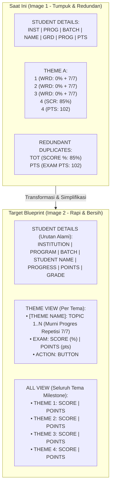

# Implementation Plan — Attendance Matrix Redesign: Theme View & All View Blueprint

Berdasarkan perbandingan langsung antara tampilan sistem saat ini (**Image 1**) dan cetak biru rancangan yang Anda buat di spreadsheet (**Image 2**), dokumen ini menyajikan analisa mendalam serta rencana implementasi teknis untuk merombak matriks absensi & nilai siswa (**Class Hub** `admin.html#class-hub?tab=attendance`) agar 100% presisi dan selaras dengan cetak biru yang Anda inginkan.

---

## 1. Analisa Komparasi: Saat Ini (Image 1) vs Target Blueprint (Image 2)

### Temuan Analisa Utama:

1. **Urutan Kolom Siswa (Student Details - Sisi Kiri)**:
   - **Saat ini (Image 1)**: `INST | PROGRAM | BATCH | STUDENT NAME | GRD | PROG | PTS`.
   - **Target Blueprint (Image 2)**: `INSTITUTION | PROGRAM | BATCH | STUDENT NAME | PROGRESS | POINTS | GRADE`.
   - *Analisa*: Urutan pada blueprint Anda jauh lebih logis dan alami dalam pedagogi belajar: **Kemajuan (Progress %)** $\rightarrow$ **Poin yang Diperoleh (Points)** $\rightarrow$ **Hasil Huruf Akhir (Grade)**.

2. **Tampilan Per Tema (THEME VIEW)**:
   - **Saat ini (Image 1)**: Kolom topik menampilkan persentase nilai bertumpuk di atas repetisi (misal: `0%ᶠ` di atas `7/7`), lalu ada kolom Exam 4 SCR & PTS, dan masih ada lagi kolom duplikat `TOT SCORE %` dan `PTS EXAM PTS`.
   - **Target Blueprint (Image 2)**:
     - Header utama: **`[THEME NAME]`** (misal: `WORKPLACE` atau `THEME A: WORKPLACE`).
     - Sub-kolom topik: **`TOPIC 1 | TOPIC 2 | TOPIC 3 | TOPIC 4 | TOPIC 5`**.
     - Isi sel topik: **Murni menampilkan progres repetisi** (misal: `7/7`, `6/6`, `1/6`, `0/6`). Persentase nilai tidak ditumpuk di sel karena drill task formatif adalah repetisi kelulusan. (Nilai detail & link hasil tetap ada di hover tooltip & klik).
     - Header utama kedua: **`EXAM`**.
     - Sub-kolom exam: **`SCORE`** (persentase) & **`POINTS`** (angka poin). Tidak ada lagi kolom duplikat `TOT` / `PTS`!
     - Header ketiga: **`ACTION`** dengan sub-kolom **`BUTTON`** untuk aksi cepat siswa (profil/hasil).

3. **Tampilan Seluruh Tema (ALL VIEW)**:
   - **Saat ini (Image 1)**: Menggabungkan berbagai kolom yang lebar sehingga memerlukan scrolling atau terlihat padat.
   - **Target Blueprint (Image 2)**:
     - Seluruh drill topik harian (`TOPIC 1..N`) **disembunyikan secara otomatis**.
     - Setiap tema ditampilkan secara konsisten berdampingan dalam 2 sub-kolom:
       - `THEME 1 NAME` $\rightarrow$ `SCORE | POINTS`
       - `THEME 2 NAME` $\rightarrow$ `SCORE | POINTS`
       - `THEME 3 NAME` $\rightarrow$ `SCORE | POINTS`
       - `THEME 4 NAME` $\rightarrow$ `SCORE | POINTS`
     - Total hanya ada 8 kolom di sisi kanan (4 tema $\times$ 2 kolom) + 7 kolom detail siswa di sisi kiri = 15 kolom total. Tampilan 100% pas di layar (*Fit Screen*), sangat bersih dan mudah dipantau tutor!

4. **Koreksi Poin & Grade Siswa (Manual Override Score)**:
   - Pada Image 1, siswa `Test` memiliki skor Exam `85%` (102 PTS), namun kolom Grade di detail siswa masih tertulis merah `E` dan `0 pts`.
   - *Penyebab*: Fungsi kalkulasi `computeMilestoneExamMastery` mengecualikan tes yang ditandai `isForgiven` tanpa mengecek apakah ada nilai `is_manual_override`. Nilai manual sah (85%) harus diakui sebagai poin riil sehingga Grade siswa tampil sebagai `B` (Lime Green `#95ff00`) sesuai Rule 2.10.

---

## 2. Usulan Solusi & Rencana Perubahan (Proposed Changes)

### Component 1: Matrix Left Columns Re-Ordering (`js/admin/app.js`)
Ubah susunan 7 kolom `STUDENT DETAILS` agar persis sesuai Image 2:
1. `instName` $\rightarrow$ Label: `INSTITUTION` (atau `INST`)
2. `progName` $\rightarrow$ Label: `PROGRAM`
3. `batch` $\rightarrow$ Label: `BATCH`
4. `displayName` $\rightarrow$ Label: `STUDENT NAME`
5. `progressPct` $\rightarrow$ Label: `PROGRESS` (menampilkan persentase progres)
6. `totalEarnedScore` $\rightarrow$ Label: `POINTS` (menampilkan angka poin bersih, misal: `75` atau `102`)
7. `grade` $\rightarrow$ Label: `GRADE` (menampilkan predikat huruf ★, A, B, C, D, E)

### Component 2: THEME VIEW Redesign (`js/admin/app.js`)
Ketika salah satu tema dipilih (`selectedTheme !== 'ALL'`, misal `THEME A`):
1. **Super Headers**:
   - `STUDENT DETAILS` (colSpan: 7)
   - `THEME NAME` (colSpan: jumlah topik formatif, misal 4 atau 5)
   - `EXAM` (colSpan: 2)
   - `ACTION` (colSpan: 1)
2. **Sub-Columns**:
   - `TOPIC 1`, `TOPIC 2`, dst:
     - Render sel: `${passCount}/${targetReps}`.
     - Tampilan bersih 1 baris, terpusat, dengan warna hijau solid (`#00c000`) jika lulus, cyan (`#38bdf8`) jika berproses, dan slate jika belum dikerjakan.
   - `EXAM SCORE`:
     - Render sel: `${examScore}%${supBadge}`.
   - `EXAM POINTS`:
     - Render sel: `${examPoints}`.
   - `ACTION BUTTON`:
     - Render sel: Tombol aksi ringkas (misal icon `👁️` untuk membuka profil/riwayat hasil siswa di modal atau tab baru).

### Component 3: ALL VIEW Redesign (`js/admin/app.js`)
Ketika filter `ALL (EXAMS ONLY)` aktif (`selectedTheme === 'ALL'`):
1. **Super Headers**:
   - `STUDENT DETAILS` (colSpan: 7)
   - Untuk setiap tema aktif ($tc \in \{A, B, C, D\}$):
     - `THEME ${tc} ${themeName}` (colSpan: 2)
2. **Sub-Columns (2 per tema)**:
   - `SCORE`: Persentase kelulusan exam tema tersebut (`row[theme_${tc}_score]%`).
   - `POINTS`: Poin exam tema tersebut (`row[theme_${tc}_total_pts]`).
3. Seluruh kolom topik harian 1, 2, 3... otomatis disembunyikan.

### Component 4: Perbaikan Nilai Manual Override pada Grade Global (`js/grading.js`)
- Perbarui `computeMilestoneExamMastery`:
  - Jika sebuah exam memiliki nilai manual override (`e.isManual` atau nilai $\ge 0$), nilai dan poinnya dihitung sebagai capaian sah akademik siswa (tidak di-nolkan).
  - Siswa dengan nilai 85% pada Exam A langsung mendapatkan predikat Grade **B** dan Points **102** pada kolom detail siswa.

---

## 3. Rencana Verifikasi (Verification Plan)

### Automated Tests
1. `node scripts/check_all_js_syntax.cjs`: Validasi 100% sintaks JS.
2. `npm test`: Jalankan unit test CI suite.
3. `scripts/test_matrix_theme_and_all_view_e2e.mjs`:
   - Buat skrip E2E Playwright otomatis baru untuk memverifikasi kedua view:
     - **Verifikasi THEME VIEW**:
       - Memastikan kolom Student Details berurutan: `PROGRESS | POINTS | GRADE`.
       - Memastikan kolom topik hanya menampilkan badge repetisi `7/7` (bersih tanpa teks tumpuk 0%).
       - Memastikan kolom EXAM hanya menampilkan `SCORE` dan `POINTS` (tidak ada duplikasi TOT).
       - Memastikan kolom `ACTION` tersedia.
       - Mengambil screenshot: `theme_view_verified.png`.
     - **Verifikasi ALL VIEW**:
       - Memastikan kolom topik harian tersembunyi.
       - Memastikan setiap tema (Theme A, B, C, D) menampilkan sepasang kolom `SCORE | POINTS`.
       - Mengambil screenshot: `all_view_verified.png`.

---

> [!IMPORTANT]
> **Konfirmasi Desain**:
> Apakah rancangan dan analisa di atas sudah sesuai dengan yang Anda maksudkan pada gambar Excel (Image 2)?
> Jika Anda menyetujui rencana ini, silakan klik tombol **Proceed** atau beri tahu saya untuk langsung memulai eksekusinya!
