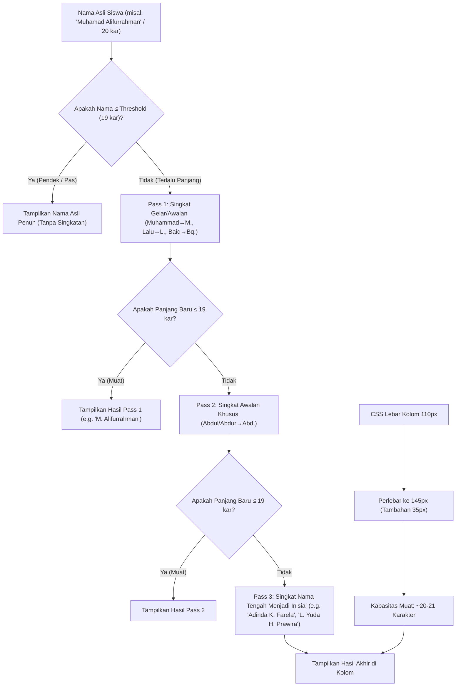

# ANALISIS & RENCANA IMPLEMENTASI: SMART CONDITIONAL STUDENT NAME ABBREVIATION & COLUMN FIT

> **Status:** PROPOSED (Menunggu Feedback & Konfirmasi User)  
> **Target Screen:** Class Hub Attendance Matrix (`admin.html#class-hub?tab=attendance`)  
> **Author:** Antigravity (Advanced Agentic Coding)  
> **Date:** 2026-11-04  

---

## 1. Analisis Masalah & Kebutuhan Pengguna

### 1.1 Masalah Saat Ini (Observasi Tangkapan Layar)
Pada tangkapan layar `media_1793786406655_5b85828c.png`, kolom **STUDENT NAME** memotong nama siswa yang panjang dengan elipsis (`...`):
- `Abdul Qoyyim Hanif Dahuri` (25 karakter) &rarr; `Abdul Qoyyim Hani...`
- `Adinda Karunia Farela` (21 karakter) &rarr; `Adinda Karunia Far...`
- `Lalu Yuda Handika Prawira` (24 karakter) &rarr; `Lalu Yuda Handika ...`
- `Muhamad Alifurrahman` (20 karakter) &rarr; `Muhamad Alifurrah...`
- `Muhammad Afyani Farobi` (22 karakter) &rarr; `Muhammad Afyani ...`
- `Muhammad Ariwil Asrori` (22 karakter) &rarr; `Muhammad Ariwil ...`

### 1.2 Akar Penyebab Teknis
1. **Lebar Kolom CSS Kaku (`col-sticky-4`)**:
   - Di `css/admin.css`: `.col-sticky-4` disetel ke `width: 110px !important; min-width: 110px !important; max-width: 110px !important;`.
   - Di `js/admin/app.js`: inner container dibatasi `max-width: 105px; overflow: hidden; text-overflow: ellipsis;`.
   - Pada ukuran font `0.75rem` (~11px-12px), ruang 105px hanya memuat sekitar **14–16 karakter**. Setiap nama dengan $\ge 17$ karakter terpotong otomatis.
2. **Ruang Layar Kosong Sangat Besar**:
   - Di mode **THEME VIEW** dan **ALL VIEW**, seluruh tabel hanya berukuran 568px – 664px.
   - Pada monitor standar laptop/desktop (1366px hingga 1920px), **lebih dari 50% lebar layar di sisi kanan kosong melompong (hitam/navy gelap)**.
   - Mengalokasikan tambahan lebar 35px – 40px untuk nama siswa **sama sekali tidak menimbulkan scrollbar horizontal** dan tabel tetap berstatus `FIT SCREEN (100% Zero-Scroll)`.

### 1.3 Inti Instruksi & Batasan Pengguna
> *"NAMA SISWA TOLONG DISUAHAKN MUNCUL LENGKAP DALAM KOLOM. KITA BISA MELAKUKAN UPAYA IDENTIFIKASISINGKATAN. MISAL MUHAMMAD/MUHAMAD/MOHAMMAHD JADI "M", LALU (GELAR DI LOMBOK) JADI L. BAIQ (GELAR) JADI "Bq." apakah bisa kita masukkan dalam sistem? tapi hanya apabila namanya terlalu panjang. kalau pendek, jangan disingkat, analisa."*

**Prinsip Kunci yang Wajib Dipatuhi:**
1. **Kondisional (Smart Threshold)**: Jika nama sudah muat di kolom (misal $\le 19$ karakter), **JANGAN disingkat sama sekali**.
   - Contoh: `Lalu Arman Maulana` (18 karakter) &rarr; Tetap `Lalu Arman Maulana`.
   - Contoh: `Lalu Nune Mubarak` (17 karakter) &rarr; Tetap `Lalu Nune Mubarak`.
   - Contoh: `Abdul Basit` (11 karakter) &rarr; Tetap `Abdul Basit`.
2. **Singkatan Cerdas Gelar & Nama Awalan**:
   - Awalan Nama Islam: `Muhammad` / `Muhamad` / `Mohammad` / `Mochammad` / `Moch.` / `Muh.` &rarr; `M.`
   - Gelar Kebangsawanan Lombok: `Lalu` &rarr; `L.`, `Baiq` &rarr; `Bq.`
   - Gelar Kebangsawanan Jawa/Umum: `Raden` &rarr; `R.`, `Raden Mas` &rarr; `R.M.`, `Raden Ajeng` &rarr; `R.A.`
   - Awalan Penghambaan (jika masih terlalu panjang): `Abdul` / `Abdur` &rarr; `Abd.`
3. **Penyingkatan Nama Tengah (Middle Name Initial)**:
   - Jika setelah penyingkatan gelar nama masih melebihi batas (atau untuk nama panjang tanpa gelar seperti `Adinda Karunia Farela`), nama tengah disingkat menjadi inisial 1 huruf dengan titik:
     - `Adinda Karunia Farela` (21 kar) &rarr; `Adinda K. Farela` (16 kar) &rarr; **Muat 100%!**
     - `Lalu Yuda Handika Prawira` (24 kar) &rarr; `L. Yuda H. Prawira` (18 kar) &rarr; **Muat 100%!**
     - `Abdul Qoyyim Hanif Dahuri` (25 kar) &rarr; `Abd. Qoyyim H. Dahuri` (20 kar) &rarr; **Muat 100%!**
4. **Data Asli Tetap Aman (Tidak Mutasi Database)**:
   - Penyingkatan ini **HANYA untuk tampilan kolom matriks**.
   - Database Supabase tetap menyimpan nama lengkap asli 100%.
   - Tooltip hover (`title="..."`) dan modal profil siswa (`#profile-${id}`) tetap menampilkan nama lengkap asli tanpa singkatan.

---

## 2. Strategi Dua Arah (Two-Pronged Approach)

Agar nama siswa tampil utuh, rapi, dan elegan tanpa elipsis, kami menerapkan sinergi dua arah:



---

## 3. Simulasi Lengkap Roster Kelas (Verifikasi Lapangan)

Berikut adalah simulasi hasil algoritma terhadap seluruh 18 siswa di kelas `2nd Vocabulary` (Batch Camp 134):

| No | Nama Lengkap Asli | Panjang Asli | Tindakan Algoritma | Nama Tampil di Kolom | Panjang Baru | Status Tampilan |
|:---:|:---|:---:|:---|:---|:---:|:---:|
| 1 | `Test` | 4 kar | $\le 19$ (Pendek) &rarr; Jangan disingkat | `Test` | 4 kar | **Muat Penuh** |
| 2 | `Abdul Basit` | 11 kar | $\le 19$ (Pendek) &rarr; Jangan disingkat | `Abdul Basit` | 11 kar | **Muat Penuh** |
| 3 | `Abdul Qoyyim Hanif Dahuri` | 25 kar | $> 19$ &rarr; Pass 2 (`Abd.`) + Pass 3 (`H.`) | `Abd. Qoyyim H. Dahuri` | 20 kar | **Muat Penuh** |
| 4 | `Adinda Karunia Farela` | 21 kar | $> 19$ &rarr; Pass 3 (Nama tengah `Karunia` &rarr; `K.`) | `Adinda K. Farela` | 16 kar | **Muat Penuh** |
| 5 | `Alfina Damayanti` | 16 kar | $\le 19$ (Pendek) &rarr; Jangan disingkat | `Alfina Damayanti` | 16 kar | **Muat Penuh** |
| 6 | `Ayya Sofyandi Mzeth` | 19 kar | $\le 19$ (Muat) &rarr; Jangan disingkat | `Ayya Sofyandi Mzeth` | 19 kar | **Muat Penuh** |
| 7 | `Cinta Laura` | 11 kar | $\le 19$ (Pendek) &rarr; Jangan disingkat | `Cinta Laura` | 11 kar | **Muat Penuh** |
| 8 | `Havvina Soleha` | 14 kar | $\le 19$ (Pendek) &rarr; Jangan disingkat | `Havvina Soleha` | 14 kar | **Muat Penuh** |
| 9 | `Isnantika Salsabila` | 19 kar | $\le 19$ (Muat) &rarr; Jangan disingkat | `Isnantika Salsabila` | 19 kar | **Muat Penuh** |
| 10 | `Lalu Arman Maulana` | 18 kar | $\le 19$ (Muat) &rarr; **Lalu TIDAK disingkat** | `Lalu Arman Maulana` | 18 kar | **Muat Penuh** |
| 11 | `Lalu Nune Mubarak` | 17 kar | $\le 19$ (Muat) &rarr; **Lalu TIDAK disingkat** | `Lalu Nune Mubarak` | 17 kar | **Muat Penuh** |
| 12 | `Lalu Yuda Handika Prawira` | 24 kar | $> 19$ &rarr; Pass 1 (`L.`) + Pass 3 (`H.`) | `L. Yuda H. Prawira` | 18 kar | **Muat Penuh** |
| 13 | `Muhamad Alifurrahman` | 20 kar | $> 19$ &rarr; Pass 1 (`Muhamad` &rarr; `M.`) | `M. Alifurrahman` | 14 kar | **Muat Penuh** |
| 14 | `Muhammad Afyani Farobi` | 22 kar | $> 19$ &rarr; Pass 1 (`Muhammad` &rarr; `M.`) | `M. Afyani Farobi` | 15 kar | **Muat Penuh** |
| 15 | `Muhammad Ariwil Asrori` | 22 kar | $> 19$ &rarr; Pass 1 (`Muhammad` &rarr; `M.`) | `M. Ariwil Asrori` | 16 kar | **Muat Penuh** |
| 16 | `Riska Fetrosia` | 14 kar | $\le 19$ (Pendek) &rarr; Jangan disingkat | `Riska Fetrosia` | 14 kar | **Muat Penuh** |
| 17 | `Sari Hikmah` | 11 kar | $\le 19$ (Pendek) &rarr; Jangan disingkat | `Sari Hikmah` | 11 kar | **Muat Penuh** |
| 18 | `Wildian Yusroni` | 15 kar | $\le 19$ (Pendek) &rarr; Jangan disingkat | `Wildian Yusroni` | 15 kar | **Muat Penuh** |

> [!NOTE]
> Perhatikan baris no. 10 dan 11: `Lalu Arman Maulana` dan `Lalu Nune Mubarak` **sama sekali tidak disingkat** karena panjangnya sudah muat di kolom ($\le 19$). Ini secara presisi memenuhi syarat utama pengguna: *"kalau pendek, jangan disingkat"*.  
> Sedangkan pada baris no. 12 (`Lalu Yuda Handika Prawira` / 24 kar), sistem otomatis menyingkat menjadi `L. Yuda H. Prawira` sehingga muat sempurna.

---

## 4. Penyesuaian Lebar Sticky Columns CSS

Dengan menambah lebar kolom nama siswa dari 110px menjadi 145px (+35px), kita menyelaraskan offset `left` kolom-kolom berikutnya di `css/admin.css`:

```css
/* 7 Sticky Student Details Columns - Optimal Zero-Scroll Layout */
#class-attendance-grid .col-sticky-1 { left: 0px !important;   width: 34px !important;  min-width: 34px !important;  max-width: 34px !important; } /* INST */
#class-attendance-grid .col-sticky-2 { left: 34px !important;  width: 44px !important;  min-width: 44px !important;  max-width: 44px !important; } /* PROGRAM */
#class-attendance-grid .col-sticky-3 { left: 78px !important;  width: 36px !important;  min-width: 36px !important;  max-width: 36px !important; } /* BATCH */
#class-attendance-grid .col-sticky-4 { left: 114px !important; width: 145px !important; min-width: 145px !important; max-width: 145px !important; } /* STUDENT NAME (diperlebar +35px) */
#class-attendance-grid .col-sticky-5 { left: 259px !important; width: 36px !important;  min-width: 36px !important;  max-width: 36px !important; } /* PROGRESS */
#class-attendance-grid .col-sticky-6 { left: 295px !important; width: 34px !important;  min-width: 34px !important;  max-width: 34px !important; } /* POINTS */
#class-attendance-grid .col-sticky-7 { left: 329px !important; width: 34px !important;  min-width: 34px !important;  max-width: 34px !important; } /* GRADE */
```

- **Total Lebar Sticky Pane**: $329\text{px} + 34\text{px} = 363\text{px}$.
- **Total Lebar Tabel di ALL VIEW**: $363\text{px} + 336\text{px} = 699\text{px}$.
- **Hasil**: 699px masih jauh di bawah lebar viewport standar (1366px / 1920px). Tabel tetap **100% Zero-Scroll** dan tampilan nama siswa menjadi sangat lega!

---

## 5. Rencana Langkah Implementasi

1. **File `js/api.js`**:
   - Implementasikan fungsi pure helper `formatMatrixStudentName(fullName, maxChars = 19)` yang mengekspor logika penyingkatan cerdas bertingkat di atas.
   - Tambahkan unit test di `tests/student-name-abbreviation.test.js` untuk menguji berbagai variasi nama (Lombok titles, Islamic titles, Middle names, short names).
2. **File `js/admin/app.js`**:
   - Di baris 3123-3129:
     - Lebar kolom diperbarui menjadi `width: '145px'`.
     - Inner wrapper `max-width: 140px;`.
     - Gunakan `formatMatrixStudentName(row.displayName || row.name, 19)` untuk teks yang dirender.
     - Tetap sertakan `title="${escapeHtml(row.displayName)}\nPIN: ${escapeHtml(row.pin)}"` agar saat kursor diarahkan ke nama, nama lengkap asli selalu muncul.
3. **File `css/admin.css`**:
   - Perbarui selector `#class-attendance-grid .col-sticky-4` hingga `.col-sticky-7` dengan nilai offset dan lebar baru.
4. **Cache Buster**:
   - Naikkan cache buster ke `v=20261104_v121` pada file yang terdampak.
5. **Verifikasi & E2E Testing**:
   - Jalankan `node scripts/check_all_js_syntax.cjs` dan `npm test`.
   - Jalankan Playwright script untuk memverifikasi DOM kolom nama siswa dan mengambil screenshot hasil rendering baru.
   - Update `docs/CHANGELOG.md` dan `docs/CURRENT_STATE.md`.

---

## 6. Pertanyaan / Konfirmasi untuk Pengguna

Sebelum kami mulai mengeksekusi kode, mohon konfirmasi beberapa hal berikut:
1. Apakah daftar singkatan di atas (`M.` untuk Muhammad/Muhamad/Mohammad, `L.` untuk Lalu, `Bq.` untuk Baiq, `Abd.` untuk Abdul/Abdur, serta penyingkatan nama tengah menjadi inisial) sudah sesuai dengan harapan Anda?
2. Apakah threshold penyingkatan $\le 19$ karakter (dengan lebar kolom 145px) sudah disetujui, di mana nama seperti `Lalu Arman Maulana` dan `Lalu Nune Mubarak` **tidak akan disingkat** karena sudah muat?

Silakan klik **Proceed** atau berikan catatan tambahan jika ada gelar atau aturan khusus lainnya yang ingin dimasukkan!
