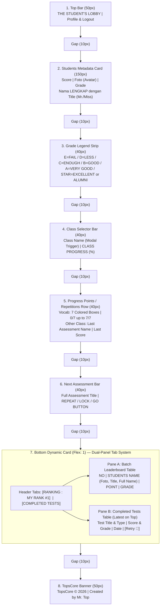

# Architectural Plan: TopsCore Student Dashboard Blueprint Alignment

> **Document Version:** `v1.1.0`  
> **Target Files:**
> - [`dashboard.html`](file:///d:/Tutor%20Tampan/TopsCore/dashboard.html)
> - [`css/dashboard.css`](file:///d:/Tutor%20Tampan/TopsCore/css/dashboard.css)
> - [`js/dashboard.js`](file:///d:/Tutor%20Tampan/TopsCore/js/dashboard.js)
> - [`css/result.css`](file:///d:/Tutor%20Tampan/TopsCore/css/result.css)
> - [`result.html`](file:///d:/Tutor%20Tampan/TopsCore/result.html)
> - [`js/result.js`](file:///d:/Tutor%20Tampan/TopsCore/js/result.js)
> 
> **Reference Wireframe:** [`media_1793787436051_eb2c68cd.png`](file:///C:/Users/ASUS/.gemini/antigravity/brain/32e9ca28-d796-4f35-afe9-223111004d95/.user_uploaded/media_1793787436051_eb2c68cd.png)

---

## 1. Executive Summary & Objective

The user provided an authoritative spreadsheet wireframe blueprint for the **TopsCore Student Dashboard (`Student's view`)** along with an explicit functional specification for **Section 7 (Bottom Dynamic Card)**:

> *"ada saya tambahkan di kolom rangking itu panel untuk completed tests, saat diklik muncul tabel completed test baik berupa task maupun exam disana, paling atas adalah yang paling terakhir dia ambil, jadi tabel di bawah itu ada dua panel, apakah kamu paham? dan siswa bisa kilik tombol retry di samping score test tersebut apabila dia mau."*

### Key Clarifications Understood:
1. **Section 7 Dual-Panel Navigation:** The header of Section 7 contains two switchable interactive tab panels:
   - **Tab 1: `RANKING : MY RANK #1`** (Batch Leaderboard / Roster Standings Table)
   - **Tab 2: `COMPLETED TESTS`** (Student's Completed Tests History Table)
2. **Completed Tests Table Requirements:**
   - **Order:** Strictly sorted descending by completion date/time (`submitted_at DESC`) — **the most recently taken test is at the very top**.
   - **Scope:** Covers **both Tasks and Exams**.
   - **Retry Button:** Positioned directly beside the test score, enabling the student to immediately retry / retake the test (`test.html?id=<testId>`).
3. **Zero-Scroll Dynamic Height:** Section 7 flexibly absorbs the remaining viewport height (`flex: 1 1 0%`), while the top sections maintain strict pixel heights with 10px uniform gaps.



---

## 2. Blueprint Height & Layout Breakdown

| Row # | Section Name | Specified Height | Left Content | Right Content | Inner Elements / Details |
|:---:|:---|:---:|:---|:---|:---|
| **1** | **Top Bar** | `50 px` | `THE STUDENT'S LOBBY` | `PROFILE ICON`, `LOGOUT ICON` | Header brand, profile modal button, logout action. |
| — | *Vertical Gap* | `10 px` | — | — | Clean separation |
| **2** | **Students Metadata Card** | `150 px` | `score` (e.g. `85%`) | `grade` (e.g. `B`) | **Center:** Photo/Avatar with Crown badge.<br>**Bottom:** Full Name with Title (`Mr.` / `Miss` / `King` / `Queen`).<br>**Top:** Institutional metadata header. |
| — | *Vertical Gap* | `10 px` | — | — | Clean separation |
| **3** | **Grade Legend Strip** | `40 px` | Full Grading Scale Predicate Legend | Official Color Accents | `E=FAIL / D=LESS / C=ENOUGH / B=GOOD / A=VERY GOOD / STAR=EXCELLENT or ALUMNI` with official TopsCore colors. |
| — | *Vertical Gap* | `10 px` | — | — | Clean separation |
| **4** | **Class Selector Bar** | `40 px` | Class Name (Click triggers modal list) | `CLASS PROGRESS` (e.g. `100%`) | Unified selector bar with book icon and dropdown caret. |
| — | *Vertical Gap* | `10 px` | — | — | Clean separation |
| **5** | **Progress Points / Repetitions Row** *(NEW)* | `40 px` | **Vocab Class:** 7 colored repetition boxes.<br>**Other Class:** Last Assessment Name. | **Vocab Class:** `0/7` up to `7/7` repetitions count.<br>**Other Class:** Last Assessment Score (`85%` / `102 PTS`). | Standalone progress row dedicated to repetition mastery. |
| — | *Vertical Gap* | `10 px` | — | — | Clean separation |
| **6** | **Next Assessment Bar** | `40 px` | Full name of next assessment based on selected class | Action Button: `REPEAT` / `LOCK` / `GO` | Full title on left; interactive status/start action on right. |
| — | *Vertical Gap* | `10 px` | — | — | Clean separation |
| **7** | **Dynamic Dual-Panel Card** | **Flex: 1 (Remaining Screen)** | **Tab 1:** `RANKING : MY RANK #1` | **Tab 2:** `COMPLETED TESTS` | **Pane 1 (Rankings):** Leaderboard roster table.<br>**Pane 2 (Completed):** History of tasks and exams with latest on top + `Retry` button beside score. |
| — | *Vertical Gap* | `10 px` | — | — | Clean separation |
| **8** | **Bottom Banner** | `50 px` | Centered text | Centered text | `TopsCore © 2026 \| Created by Mr. Top` anchored at base. |

> [!NOTE]
> Fixed vertical sum: $50 + 10 + 150 + 10 + 40 + 10 + 40 + 10 + 40 + 10 + 40 + 10 + 10 + 50 = 430\text{ px}$.  
> Viewport space above $430\text{ px}$ is seamlessly allocated to Section 7, allowing both Leaderboard and Completed Tests to scroll internally without window overflow.

---

## 3. Section 7 Dual-Panel System Implementation Details

### 3.1 Header Markup in `dashboard.html`
```html
<section id="bottom-dock-section" class="dashboard-standings-card" aria-label="Rankings and Completed Tests">
  <!-- Interactive Dual-Tab Header -->
  <div class="standings-card-header dock-tab-header">
    <button type="button" class="dock-tab-btn active" id="btn-dock-standings" role="tab" aria-selected="true" aria-controls="dock-pane-standings">
      <span class="tab-label-text">RANKING : MY RANK</span>
      <span id="dock-my-rank-number" class="rank-number-chip">#--</span>
    </button>
    <button type="button" class="dock-tab-btn" id="btn-dock-completed" role="tab" aria-selected="false" aria-controls="dock-pane-completed">
      <span class="tab-label-text">COMPLETED TESTS</span>
      <span id="dock-completed-count-badge" class="count-badge">0</span>
    </button>
  </div>

  <!-- Pane A: Batch Leaderboard Table -->
  <div id="dock-pane-standings" class="dock-tab-pane active" role="tabpanel">
    <div class="standings-table-header">
      <span class="th-col th-rank">NO</span>
      <span class="th-col th-name">STUDENTS NAME</span>
      <span class="th-col th-point">POINT</span>
      <span class="th-col th-grade">GRADE</span>
    </div>
    <div class="standings-table-wrap" id="batch-leaderboard-container">
      <!-- Populated dynamically by loadBatchLeaderboard() -->
    </div>
  </div>

  <!-- Pane B: Completed Tests Table (Latest on Top + Retry Button) -->
  <div id="dock-pane-completed" class="dock-tab-pane hidden" role="tabpanel">
    <div class="completed-table-wrap" id="completed-Tests-container">
      <!-- Populated dynamically by renderCompletedTestsBottom() -->
    </div>
  </div>
</section>
```

### 3.2 Tab Toggle & State Switching in `js/dashboard.js`
In `setupDockTabs()`:
1. Clicking `#btn-dock-standings` activates Pane A, removes `hidden`, sets `aria-selected="true"`, and saves `sessionStorage.setItem('dock_tab', 'standings')`.
2. Clicking `#btn-dock-completed` activates Pane B, removes `hidden`, sets `aria-selected="true"`, and saves `sessionStorage.setItem('dock_tab', 'completed')`.
3. Preserves the active tab on page reload/refresh (complying with rule 2.20 in `AGENTS.md`).

### 3.3 Completed Tests Rendering with Retry Button
In `renderCompletedTestsBottom(attempts, avgPct)`:
1. **Scope:** Retrieves all attempts for the student, including both Tasks (`TASK` / `QUIZ`) and Exams (`EXAM`).
2. **Sorting (Latest First):**
   ```javascript
   const sortedAttempts = validAttempts.sort((a, b) => {
     const dateA = a.submitted_at ? new Date(a.submitted_at).getTime() : 0;
     const dateB = b.submitted_at ? new Date(b.submitted_at).getTime() : 0;
     return dateB - dateA; // Descending: latest taken is at index 0
   });
   ```
3. **Row Content & Retry Button:**
   Each row displays:
   - **Test Title & Type:** Title with a pill indicator (`TASK` or `EXAM`).
   - **Date Taken:** Formatted relative or short date (e.g. `Nov 4, 18:30` or `Today`).
   - **Score & Grade:** Effective percentage (e.g., `85%` or `60%ᴿ`), dynamic PTS points, and grade chip badge (`★`, `A`, `B`, `C`, `D`, `E`).
   - **Retry Button (`btn-retry-test`):**
     Positioned directly beside the score:
     ```html
     <button type="button" 
             class="btn-retry-test" 
             title="Retry this Test" 
             onclick="event.stopPropagation(); window.location.href='test.html?id=${testId}'">
       <svg width="14" height="14" viewBox="0 0 24 24" fill="none" stroke="currentColor" stroke-width="2.5" stroke-linecap="round" stroke-linejoin="round">
         <polyline points="1 4 1 10 7 10"></polyline>
         <path d="M3.51 15a9 9 0 1 0 2.13-9.36L1 10"></path>
       </svg>
       <span>Retry</span>
     </button>
     ```
   - Clicking the row body opens `result.html?attempt_id=<attemptId>` to inspect historical evaluation.
   - Clicking the `Retry` button immediately starts a new attempt for that test (`test.html?id=<testId>`).

---

## 4. Full Page Section Alignment (Sections 1–8)

### 4.1 Section 1: Top Bar (50px)
- Left: `THE STUDENT'S LOBBY`
- Right: Profile icon button (`#view-profile-btn`) and Logout icon button (`#logout-btn`).
- Height: Strict `50px`.

### 4.2 Section 2: Students Metadata Card (150px)
- Top header: Institutional metadata (`CEC | CAMP | 134 | 3RD LEVEL`).
- 3 columns:
  - Left: Score Box (e.g. `85%`).
  - Center: Photo/Avatar with crown anchor badge.
  - Right: Grade Box (e.g. `B`).
- Bottom row: Full Student Name with Title (`Mr.` / `Miss` / `King` / `Queen`) via `applyStudentGenderUI()`.
- Height: Strict `150px`.

### 4.3 Section 3: Grade Legend Strip (40px)
- Rendered as a sleek 40px legend bar:
  `E=FAIL / D=LESS / C=ENOUGH / B=GOOD / A=VERY GOOD / STAR=EXCELLENT or ALUMNI`
- Each grade predicate is color-coded using official TopsCore colors:
  `E` (`#FF0000`), `D` (`#FF8C00`), `C` (`#FFFF00`), `B` (`#95ff00`), `A` (`#00c000`), `★` (`#00c000` with Star glow).
- Height: Strict `40px`.

### 4.4 Section 4: Class Selector Bar (40px)
- Reduced from 50px to strict `40px`.
- Left: Class icon + Active Class Name + Caret (`▾`), clicking opens `#classes-selector-modal`.
- Right: Progress percentage badge (e.g. `100%`).

### 4.5 Section 5: Progress Points / Repetitions Row (40px)
- Standalone 40px row:
  - **Vocab Class:** 7 colored boxes representing repetitions on the left, and repetition count (`0/7` up to `7/7`) on the right.
  - **Other Class (Storytelling, Conversation, etc.):** Last Assessment Name on the left, and Last Assessment Score on the right.

### 4.6 Section 6: Next Assessment Bar (40px)
- Reduced from 50px to strict `40px`.
- Left: Full assessment title for the active class.
- Right: Action button:
  - `REPEAT` (Red button) if retake / remedial.
  - `LOCK` (Yellow padlock) if locked by prerequisite.
  - `GO` (Green circle play) if ready to start.

### 4.7 Section 7: Dynamic Dual-Panel Card (Flex: 1)
- As detailed in Section 3 above, containing the switchable `RANKING : MY RANK #1` and `COMPLETED TESTS` tabs.

### 4.8 Section 8: Bottom Banner (50px)
- Anchored at bottom: `TopsCore © 2026 | Created by Mr. Top`.
- Height: Strict `50px`.

---

## 5. Dynamic Theme & Border Color Directive (Footnote Rule)

Both `dashboard.html` and `result.html` dynamically set:
```javascript
const tierTheme = GRADE_PALETTE[calculatedGrade] || GRADE_PALETTE.E;
document.documentElement.style.setProperty('--tier-color', tierTheme.color);
document.documentElement.style.setProperty('--tier-rgb', tierTheme.rgb);
document.body.setAttribute('data-tier', calculatedGrade);
```
All dashboard cards (`#welcome-banner-section`, `#dashboard-grade-legend`, `#dashboard-classes-deck`, `#dashboard-repetition-deck`, `#dashboard-next-test-deck`, `#bottom-dock-section`) dynamically inherit:
```css
border: 1px solid rgba(var(--tier-rgb), 0.35) !important;
background: radial-gradient(ellipse 90% 70% at 50% 0%, rgba(var(--tier-rgb), 0.12), transparent 75%), #0f172a !important;
box-shadow: 0 4px 14px rgba(0, 0, 0, 0.25) !important;
```

---

## 6. Execution & Verification Steps

1. **DOM Updates in `dashboard.html`:**
   - Add `<div id="dashboard-grade-legend" class="dashboard-grade-legend">` (40px).
   - Add `<section id="dashboard-repetition-deck" class="dashboard-repetition-deck">` (40px).
   - Update `#dashboard-classes-section` and `#up-next-section` to 40px classes.
   - Refactor `#bottom-dock-section` into the dual-panel structure with Tab 1 (`#btn-dock-standings`) and Tab 2 (`#btn-dock-completed`).
2. **Styling in `css/dashboard.css`:**
   - Define exact pixel heights: 50px, 150px, 40px, 40px, 40px, 40px, flex: 1, 50px.
   - Set uniform 10px vertical gaps across `.dashboard-content`.
   - Style the dual tabs in `.dock-tab-header`, `.dock-tab-btn`, `.completed-table-wrap`, and `.btn-retry-test`.
   - Ensure dynamic tier border aura applies to both panes.
3. **Logic Updates in `js/dashboard.js`:**
   - Implement `renderRepetitionMasteryRow()` to populate the 7 repetition boxes or last assessment.
   - Update `setupDockTabs()` to handle tab switching between Leaderboard and Completed Tests with state persistence.
   - Update `renderCompletedTestsBottom()` to sort descending (`submitted_at DESC`), include tasks and exams, and generate the interactive `Retry` button.
4. **Verification with Playwright E2E:**
   - Execute `node scripts/check_all_js_syntax.cjs` and `npm test`.
   - Run automated headless browser tests to:
     - Verify all 8 section bounding box heights (50, 150, 40, 40, 40, 40, flex: 1, 50).
     - Verify switching between `RANKING` and `COMPLETED TESTS` tabs.
     - Verify completed tests sorting (most recent on top).
     - Verify Retry button renders with `test.html?id=...` trigger.
     - Capture verified screenshots.
5. **Cache Buster & State Documentation:**
   - Bump cache buster to `v=20261104_v123`.
   - Update `docs/CHANGELOG.md` and `docs/CURRENT_STATE.md`.
