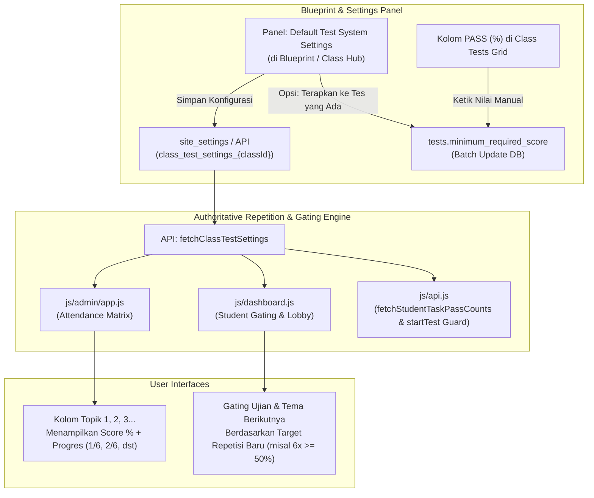

# [SELESAI / CLOSED] Rencana Implementasi: Configurable Repetitive Mastery Progress (1/7, 2/7), Blueprint Exam Passing Score Editor, & Test System Settings Panel

> [!NOTE]
> **STATUS DOKUMEN: SELESAI & DITUTUP (100% COMPLETE)**
> Seluruh 4 kebutuhan pada rencana ini telah berhasil diimplementasikan penuh pada **Phase 306**, diverifikasi melalui automated E2E test, dan telah berjalan di codebase utama. File rencana ini sekarang resmi ditutup.

## Ringkasan Eksekutif & Tujuan Perubahan

Berdasarkan permintaan pengguna, terdapat 4 kebutuhan inti yang akan diintegrasikan secara menyeluruh ke dalam TopsCore LMS:

1. **Indikator Progres Repetisi per Topik (`1/7`, `2/7`, dst.)**:
   - Pada halaman **Students Grade and Score** (Attendance Matrix di Class Hub `admin.html#class-hub?tab=attendance`), di samping/bawah skor persentase tiap kolom topik (1, 2, 3, dst.), ditambahkan badge progres repetisi kelulusan (contoh: `1/7`, `2/7`, `6/6`, `7/7` jika tuntas/forgiven).
2. **Fleksibilitas Pengaturan Repetisi & Passing Threshold Task**:
   - Membuka pembatasan hardcoded (sebelumnya terkunci pada 7 kali dan $\ge 70\%$).
   - Admin/Tutor dapat mengubah jumlah repetisi (misal: 6 kali atau 5 kali) dan ambang kelulusan task (misal: diturunkan menjadi 50% atau 60%).
3. **Editor Manual Persentase Kelulusan Exam di Blueprint (`PASS (%)`)**:
   - Pada daftar **Class Tests / Blueprint**, kolom `PASS (%)` diubah menjadi input angka interaktif yang dapat diketik langsung (*inline editable input*).
   - Perubahan nilai (contoh: dari 60% menjadi 75%) langsung tersimpan ke database (`tests.minimum_required_score`).
4. **Panel Pengaturan Terpusat 'Default Test System Settings' di Bagian Blueprint**:
   - Panel konfigurasi diletakkan di bagian Blueprint (dapat diakses dari **Class Hub $\rightarrow$ Class Tests** maupun dari **Vocabulary Vault $\rightarrow$ Topic Blueprint**).
   - Menyediakan form pengaturan default:
     - *Task Repetition Target* (default 7, bisa diatur 1–10).
     - *Task Minimum Passing Score (%)* (default 70%, bisa diatur 1–100%).
     - *Exam Minimum Passing Score (%)* (default 60%, bisa diatur 1–100%).
     - Pilihan cakupan: *Hanya Kelas Ini* atau *Global System Default*.
     - Opsi tombol *Terapkan Sekarang ke Seluruh Tes di Kelas Ini* (batch sync ke tabel `tests`).

---

## Alur Kerja Sistem (Mermaid Architecture)



---

## User Review Required

> [!IMPORTANT]
> **1. Tampilan Kolom Topik di Attendance Matrix:**
> Di dalam kolom tiap topik (`1 WRD`, `2 WRD`, `3 WRD`, dst.), skor persentase (misal: `10%`, `70%`, `0%ᶠ`) dan badge progres repetisi (misal: `2/7` atau `6/6`) akan disajikan secara vertikal-kompak (skor di atas dengan warna predikat, progres di bawah dengan tag cerah/hijau saat tuntas). Ini menjaga lebar kolom tetap ramping (`38px`–`42px`) dan kompatibel dengan mode *Fit Screen* maupun *100% Scroll*.
>
> **2. Penempatan Panel Default Test System:**
> Panel ditempatkan dengan tombol aksi **`⚙️ Test System Settings`** di toolbar Class Tests (`admin.html#class-hub`), tombol **`⚙️ Default Test Settings`** di Topic Blueprint (`Vocabulary Vault`), dan terintegrasi di dalam modal pengaturan Blueprint.
>
> **3. Sinkronisasi Backward-Compatibility:**
> Jika kelas belum memiliki konfigurasi khusus, sistem secara mulus menggunakan default standar: **7 kali repetisi**, **70% passing task**, dan **60% passing exam**.

---

## Proposed Changes

### 1. Database & Centralized Settings API (`js/api.js`)

#### [MODIFY] `js/api.js`
- Menambahkan fungsi `fetchClassTestSettings(classId)`:
  - Membaca preferensi dari `site_settings` dengan kunci `class_test_settings_${classId}` atau `default_test_system_settings`.
  - Mengembalikan objek: `{ taskRepetitions: number, taskMinScore: number, examMinScore: number }`.
- Menambahkan fungsi `saveClassTestSettings(classId, settings, applyToExisting = false)`:
  - Menyimpan konfigurasi ke tabel `site_settings`.
  - Jika `applyToExisting == true`, melakukan bulk update pada tabel `tests` untuk kolom `minimum_required_score` (task $\rightarrow$ `taskMinScore`, exam $\rightarrow$ `examMinScore`).
- Menambahkan fungsi `updateTestPassingScore(testId, newScore)`:
  - Mengupdate field `minimum_required_score` dan `payload.minimum_required_score` pada baris spesifik di tabel `tests`.
  - Mengosongkan cache API (`clearApiCache('tests')`).
- Menyesuaikan `fetchStudentTaskPassCounts(studentId, classId)` dan `startTest` guard:
  - Menggunakan `taskMinScore` dan `taskRepetitions` dinamis dari konfigurasi kelas (bukan hardcoded 70% dan 7).

---

### 2. Admin Attendance Matrix: Progres Repetisi (`js/admin/app.js`)

#### [MODIFY] `js/admin/app.js`
- Di dalam `renderAttendanceGridMatrix`:
  - Memuat `classTestSettings` untuk mendapatkan `targetReps` (contoh: 7 atau 6) dan `taskMinScore` (contoh: 70% atau 50%).
  - Menghitung `passCount` untuk tiap task berdasarkan ambang batas `pct >= taskMinScore`. Khusus attempt `is_forgiven`, otomatis bernilai `targetReps`.
  - Mengubah render cell task (standard words dan phrases) untuk menampilkan skor dan badge progres:
    ```html
    <div class="asm-cell-task-wrap" style="display:flex; flex-direction:column; align-items:center; gap:1px; line-height:1.1;">
      <span class="asm-score asm-score-task" style="color:${cellColor}; ...">
        ${roundPct}%${supBadge}
      </span>
      <span class="asm-rep-tag ${passCount >= targetReps ? 'rep-complete' : ''}" 
            style="font-size:0.62rem; font-weight:800; color:${passCount >= targetReps ? '#10b981' : (passCount > 0 ? '#38bdf8' : '#64748b')};"
            title="Mastery: ${passCount}/${targetReps} lulus (Min. ${taskMinScore}%)">
        ${passCount}/${targetReps}
      </span>
    </div>
    ```
  - Menyesuaikan tooltip cell agar menjelaskan progres repetisi secara lengkap.

---

### 3. Editor Manual Kolom `PASS (%)` di Class Tests Grid (`js/admin/app.js`)

#### [MODIFY] `js/admin/app.js`
- Pada konfigurasi kolom DataGrid untuk `class-tests-grid` (tab *Class Tests*):
  - Mengubah kolom `minScore` (`PASS (%)`) agar menampilkan inline `<input type="number" class="input-test-pass-score" ...>`:
    ```html
    <div class="pass-pct-cell-wrap" style="display:flex; align-items:center; gap:3px;">
      <span style="font-size:0.7rem; color:${isExam ? '#f472b6' : '#eab308'};">🎯</span>
      <input type="number" 
             class="input-test-pass-score" 
             data-test-id="${testId}" 
             data-original-val="${currentMin}" 
             value="${currentMin}" 
             min="1" max="100" 
             style="width:48px; height:24px; padding:0 3px; font-size:0.75rem; font-weight:700; text-align:center; background:#1e293b; border:1px solid rgba(255,255,255,0.2); border-radius:4px; color:#f8fafc;" />
      <span style="font-size:0.7rem; color:#94a3b8;">%</span>
    </div>
    ```
  - Menambahkan listener `change` / `blur`: jika nilai diubah, memanggil `updateTestPassingScore(testId, newVal)` dan menampilkan toast notifikasi sukses.

---

### 4. Panel Komponen: Default Test System Settings Modal (`js/admin/test-system-settings-modal.js`)

#### [NEW] `js/admin/test-system-settings-modal.js`
- Modal dialog interaktif yang bersih dan modern untuk mengatur parameter kurikulum & blueprint:
  - **Form Input**:
    1. *Task Repetition Target* (Stepper / Input Angka, rentang 1–10).
    2. *Task Minimum Passing Score (%)* (Input Angka, rentang 1–100%).
    3. *Exam Minimum Passing Score (%)* (Input Angka, rentang 1–100%).
    4. *Cakupan Penerapan*: Radio pilihan (Hanya Kelas Ini / Default Seluruh Sistem).
    5. *Checkbox*: Terapkan langsung ke semua baris tes yang ada di kelas ini.
  - **Tombol Toolbar**:
    - Di Class Hub (`admin.html#class-hub`): tombol **`⚙️ Test System Settings`** di toolbar Class Tests.
    - Di Topic Blueprint (`vocab-vault.js`): tombol **`⚙️ Blueprint Test Settings`** di atas tabel matriks blueprint.

---

### 5. Adaptasi Gating & Repetisi di Student Dashboard (`js/dashboard.js`)

#### [MODIFY] `js/dashboard.js`
- Membaca `classTestSettings` untuk kelas aktif:
  - Mengganti hardcoded `70` dengan `taskMinScore` saat memeriksa kelulusan task (`pct >= taskMinScore`).
  - Mengganti hardcoded `7` dengan `taskRepetitions` saat memvalidasi gembok prasyarat inter-tema dan ujian mingguan (`passCount >= targetReps`).
  - Menyesuaikan string prasyarat di UI: `All Theme ${tc} Tasks (${targetReps}/${targetReps} Passes Required)`.

---

## Verification Plan

### Automated Tests
1. **Validasi Sintaks Seluruh File JS**:
   ```powershell
   node scripts/check_all_js_syntax.cjs
   ```
2. **Suite Pengujian Regresi & Paritas CI**:
   ```powershell
   npm test
   ```
3. **Automated E2E Test Suite Baru (`scripts/test_mastery_and_blueprint_settings_e2e.mjs`)**:
   - Memastikan pembacaan dan penyimpanan pengaturan default berhasil (`site_settings`).
   - Mengubah repetisi menjadi 6 kali dan task pass score menjadi 50%, lalu memverifikasi data attempt beradaptasi.
   - Mengubah passing score Exam langsung melalui inline input di kolom `PASS (%)` dan memverifikasi update di database.
   - Memeriksa tampilan kolom topik di tabel Roster (menampilkan format `x/y` seperti `0/6`, `1/6`, `6/6`).
   - Menangkap screenshot verifikasi:
     - `test_system_settings_modal_verified.png`
     - `roster_matrix_repetition_progress_verified.png`
     - `blueprint_exam_pass_score_inline_verified.png`

### Manual Verification
1. Buka `admin.html#class-hub?tab=attendance` $\rightarrow$ perhatikan kolom 1, 2, 3 menampilkan persentase dan progres (contoh `0%ᶠ 7/7` atau `0% 0/7`).
2. Masuk ke tab **Class Tests** $\rightarrow$ klik tombol **`⚙️ Test System Settings`** $\rightarrow$ ubah repetisi menjadi 6 kali dan Task Pass menjadi 50% $\rightarrow$ simpan dengan opsi terapkan ke semua tes.
3. Periksa tabel Roster $\rightarrow$ progres sekarang berubah menjadi `0/6`, `1/6`, `6/6`.
4. Di tab **Class Tests** $\rightarrow$ ketik langsung angka baru di kolom `PASS (%)` pada salah satu Exam (misal `75`) $\rightarrow$ refresh halaman dan pastikan nilai tetap tersimpan `75%`.
5. Login ke `dashboard.html` sebagai siswa $\rightarrow$ perhatikan gembok ujian membuka saat telah mencapai 6 repetisi kelulusan.
