# Implementation Plan — Dashboard Blueprint Alignment, Exam Gating Fix, Section 5 Removal, Universal Bottom Banner & Cumulative Exam Questions Harmonization

> [!IMPORTANT]
> ## ✅ STATUS: IMPLEMENTED (SUDAH) — CLOSED / ARCHIVED
> **Implemented**: 2026-11-05 (UTC+8)
> **Active Cache Buster**: `v=20261105_v126` (Service Worker cache bumped to `v54`)
> **Verification Status**:
> - Syntax Check: 42/42 JS files PASS (`node scripts/check_all_js_syntax.cjs`)
> - Unit & Parity Tests: 100% PASS (`npm test`)
> - All 8 components verified and live in workspace files.

## Goal Description
Resolve 8 interconnected issues identified across the Student Dashboard (`dashboard.html`), Test Page (`test.html`), Result Page (`result.html`), and Admin Class Hub (`admin.html`):
1. **Exam Premature Access & "Topic null" Bug**: Identify and fix why exams (e.g., Theme A Exam / Theme D Exam) are accessible before tasks are completed, and eliminate the `Topic null` label in the class tests modal.
2. **Dashboard Blueprint Alignment**: Align card pixel heights to the user's authoritative spreadsheet blueprint (`50px` for Grade Description, `50px` for Class Selector, `50px` for Next Assessment, `50px` for Banner, `150px` for Metadata, uniform `10px` gaps).
3. **Student Score & Gradebook Parity (Rule 2.8)**: Fix student overall score and grade calculation on the dashboard so it evaluates from completed exams (e.g., Queen Isnantika Salsabila's 87% Grade B from her 74% and 99% exam results), rather than confusing curriculum progress (24%) with exam grade (Grade E).
4. **Dock Panel Header Full-Width Alignment**: Eliminate empty space on the right of the dock tabs by expanding `[ RANKING : MY RANK ]` and `[ COMPLETED TESTS ]` to equal 50%/50% width across the table card per the blueprint.
5. **Next Assessment Full Title Display & Height Estimation**: Enable multi-line display so long test titles (e.g., `2nd Vocabulary C1 Words Task - Shopping & Choosing Products`) are not truncated with ellipsis (`...`), estimating optimal height at `50px` to `54px`.
6. **Elimination of Section 5 (7 Repetition Boxes Deck)**: Completely remove the redundant 7-box repetition deck (`[✓] [2] [3]...`) as requested by the user, freeing up 50px of vertical space to match the blueprint.
7. **Permanent Bottom Banner Fix Across ALL Pages (`dashboard.html`, `test.html`, `result.html`)**: Fix why `TopsCore © 2026 | Created by Mr. Top` frequently disappears or gets pushed off-screen, anchoring it as a permanent 50px bottom footer across all three pages.
8. **Cumulative Exam Question Count (`QS`) Harmonization (Gambar 1 & Gambar 2)**: In `admin.html#class-hub?tab=tests`, Exam B was displaying `160 (Vault)` instead of cumulative `280 (Vault)` (Theme A 120 + Theme B 160). Fix the filter logic so the Class Tests table reflects the cumulative question count and matches the student score/points in Gambar 2 (e.g. 277 out of 280).

---

## User Review & Decisions

> [!IMPORTANT]
> **Root Cause of Exam Premature Access**:
> In `js/api.js`, `fetchTestsForStudentClass` omitted `shell_code` and `payload` from its database `.select(...)` statement. Consequently, in `dashboard.js`, all tests had `undefined` theme and topic codes, defaulting every test to Theme Code `'A'` and Topic Code `null`.
> - **Inter-Theme Gating** was bypassed because the system thought all exams were in Theme A (`curThemeIdx = 0`).
> - **Exam Task Gating** checked for sibling tasks with Theme `'A'`, but sibling tasks also had `undefined` codes, yielding an empty array `[]`, so the check completed instantly with 0 requirements!
> - The modal displayed `Theme A • Topic null: Review...` instead of `Theme D • Topic D4...`.
> Adding `shell_code, payload` to the query and adding fallback title regex extraction completely restores gating so exams remain locked (`🔒 Locked`) until all required tasks reach 7/7 passes.

> [!IMPORTANT]
> **Cumulative Exam Questions (Gambar 1 vs Gambar 2)**:
> In the database, Exam B (`2B-WORDS-EXAM`) already has `themes: ["A", "B"]`, `snapshot_question_count: 280`, and the student exam attempt was evaluated out of 280 points (Queen Isnantika Salsabila: 277/280 = 99%).
> However, in `js/admin/app.js` (line 1264), the `vaultCountFor` function that calculates the live `QS` column in Gambar 1 had a conflicting check:
> `if (pl.theme_code && v.theme_code !== pl.theme_code) return false;`
> This accidentally discarded all Theme A words for Exam B, forcing the count to show only Theme B (160) instead of cumulative A + B (280).
> By fixing this condition for exams, the Class Tests table will accurately project:
> - Exam A: **120 (Vault)** (Theme A: 120)
> - Exam B: **280 (Vault)** (Theme A: 120 + Theme B: 160 = 280)
> - Exam C: **480 (Vault)** (Theme A: 120 + Theme B: 160 + Theme C: 200 = 480)
> - Exam D: **640 (Vault)** (Theme A: 120 + Theme B: 160 + Theme C: 200 + Theme D: 160 = 640)
> This immediately aligns Gambar 1 with Gambar 2 without altering student historical scores.

> [!IMPORTANT]
> **Score vs Progress Parity (Rule 2.8)**:
> Currently, `computeMilestoneExamMastery` in `js/grading.js` computes:
> `overallScore = Math.round((cumulativePoints / totalCurriculumExpectedPoints) * 100)`
> It divides earned points (366) by the entire 4-theme unattempted curriculum (1,500–1,900 points), yielding **24% (Grade E: FAIL)**.
> In contrast, the student actually achieved **74%** in Theme A Exam and **99%** in Theme B Exam. In Admin Class Hub (`admin.html`), their score is properly evaluated as **87% (Grade B: Good)**.
> We align Student Dashboard with Rule 2.8:
> - **Overall Score**: Average percentage of completed exams (**87%**).
> - **Grade**: Official TopsCore Grade based on exam score (**Grade B**).
> - **Progress %**: Cumulative curriculum progress (**24%** or **50%** of milestones).
> - **Leaderboard**: Displays Points `366`, Grade `B`, and subtext `13 completed • 24% Progress`.

> [!NOTE]
> **Section 5 (7 Repetition Boxes Deck) Removed**:
> Per the user's instruction ("bagian ini tidak perlu ada" referencing `media_1793832257315_43406492.png`), Section 5 is completely purged from HTML, JS, and CSS, saving 50px vertical height.

> [!IMPORTANT]
> **Root Cause of Bottom Banner Disappearing Across ALL Pages**:
> - In `css/dashboard.css` and `css/test.css`, `#bottom-ad-banner` had `position: static !important`.
> - In `css/result.css`, `#bottom-ad-banner` had `position: sticky !important` while `#result-content` had `min-height: calc(100dvh - 100px)`.
> - Any content growth pushes static/sticky footers below 100dvh, where `overflow: hidden` on `body` clips them into invisibility.
> - **Solution**: Convert `#bottom-ad-banner` on all 3 pages to `position: fixed !important; bottom: 0; left: 0; right: 0; height: 50px; z-index: 1000;`, and add `50px` bottom spacing so content never collides.

---

## Proposed Changes

```mermaid
flowchart TD
    subgraph Bug 1: Exam Premature Access
        A["fetchTestsForStudentClass()"] -->|Missing shell_code & payload| B["t.payload = undefined"]
        B --> C["themeCode defaults to 'A'"]
        B --> D["topicCode defaults to null ('Topic null')"]
        C --> E["siblingTasks = [] (Empty array)"]
        E --> F["Gating loop bypassed -> Exam unlocked ('Mulai Exam')"]
    end
    subgraph Fix 1: Authoritative Gating
        A1["fetchTestsForStudentClass()"] -->|Select shell_code, payload| B1["t.payload populated"]
        B1 --> C1["themeCode = 'D', topicCode = 'D4'"]
        C1 --> E1["siblingTasks found (7 tasks)"]
        E1 --> F1["passCount < 7 -> Exam locked ('🔒 Locked')"]
    end
    subgraph Bug 2: Exam QS Display
        G["vaultCountFor() in app.js"] -->|Line 1264 overrides themes| H["v.theme_code === pl.theme_code ('B')"]
        H --> I["Theme A words discarded -> Exam B shows 160 QS"]
    end
    subgraph Fix 2: Cumulative QS Display
        G1["vaultCountFor() in app.js"] -->|If isTest: respect themes| H1["themes.includes(v.theme_code) ('A','B')"]
        H1 --> I1["Theme A (120) + Theme B (160) = 280 QS"]
    end
```



---

### Component 1: Fix Exam Access & Gating in Class Tests Modal (`js/api.js`, `js/dashboard.js`)

#### [MODIFY] [js/api.js](file:///d:/Tutor%20Tampan/TopsCore/js/api.js)
- In `fetchTestsForStudentClass` (line 572), add `shell_code, payload` to the query:
```javascript
  let query = sb.from('tests')
    .select('id, title, shell_code, payload, display_name, test_subtype, test_type, class_id, level_id, display_order, status, minimum_required_score, prerequisite_test_id, prerequisite_id, working_duration_minutes, schedule_mode, levels(id, name, level_number)')
    .eq('class_id', classId)
    .eq('status', 'PUBLISHED')
    .is('deleted_at', null)
    .order('display_order', { ascending: true });
```

#### [MODIFY] [js/dashboard.js](file:///d:/Tutor%20Tampan/TopsCore/js/dashboard.js)
- In `openClassLevelsModal`:
  - Enhance theme and topic code extraction with robust title regex fallback:
    ```javascript
    let tc = t.payload?.theme_code || (t.shell_code ? t.shell_code.replace(/^[0-9]+/, '').charAt(0) : null);
    if (!tc && t.title) {
      const match = t.title.match(/Theme\s+([A-D0-9]+)/i) || t.title.match(/Vocabulary\s+([A-D0-9]+)/i);
      if (match) tc = match[1].toUpperCase();
    }
    tc = (tc || 'A').toUpperCase();

    let topCode = t.payload?.topic_code != null ? String(t.payload.topic_code) : null;
    if (!topCode && t.shell_code) {
      const match = t.shell_code.match(/^[0-9]+([A-D][0-9]+)/i);
      if (match) topCode = match[1].toUpperCase();
    }
    if (!topCode && t.title) {
      const match = t.title.match(/Vocabulary\s+([A-D][0-9]+)/i);
      if (match) topCode = match[1].toUpperCase();
    }
    ```
  - Fix title rendering to prevent `Topic null`:
    ```javascript
    const displayTitle = grp.isExam
      ? `Theme ${grp.themeCode} Exam — ${resolvedThemeTitle}`
      : (grp.topicCode
          ? `Theme ${grp.themeCode} • Topic ${grp.topicCode}: ${resolvedTopicTitle}`
          : `Theme ${grp.themeCode}: ${resolvedTopicTitle}`);
    ```

---

### Component 2: Student Score & Grade Parity with Actual Results (`js/dashboard.js`)

#### [MODIFY] [js/dashboard.js](file:///d:/Tutor%20Tampan/TopsCore/js/dashboard.js)
- In student dashboard metrics and leaderboard generation:
  - Calculate `overallScore` as the student's true average score from completed exams (matching Rule 2.8 and `js/admin/app.js`):
    ```javascript
    const validExamEntries = examItems.filter(e => {
      const isPureForgivenZero = Boolean(e.isForgiven) && !e.isManual && Number(e.effPoints ?? e.points ?? 0) === 0;
      return !isPureForgivenZero;
    });
    const overallScore = validExamEntries.length > 0
      ? Math.round(validExamEntries.reduce((sum, e) => sum + Number(e.effPct ?? 0), 0) / validExamEntries.length)
      : 0;
    const grade = validExamEntries.length > 0 ? calculateGrade(overallScore) : '—';
    ```
  - Compute `progressPct` as cumulative curriculum progress:
    ```javascript
    const progressPct = totalCurriculumExpectedPoints > 0
      ? Math.round((totalPoints / totalCurriculumExpectedPoints) * 100)
      : 0;
    ```
  - In Leaderboard:
    - Display Points: `${st.totalPoints}` (e.g. `366`)
    - Display Grade Chip: `${gradeSymbol}` (e.g. `B` in Electric Lime `#95ff00`)
    - Subtext: `${st.completedCount} completed • ${hasExam ? `${st.progressPct}% Progress` : '-'}`

---

### Component 3: Dock Tab Header 50%/50% Full-Width Alignment (`css/dashboard.css`)

#### [MODIFY] [css/dashboard.css](file:///d:/Tutor%20Tampan/TopsCore/css/dashboard.css)
- Update `.dock-tab-header`:
  ```css
  body.dashboard-page .dock-tab-header,
  body.dashboard-page .standings-card-header {
    height: 38px !important;
    min-height: 38px !important;
    max-height: 38px !important;
    display: flex !important;
    align-items: stretch !important;
    justify-content: stretch !important;
    padding: 0 !important;
    gap: 0 !important;
    background: rgba(15, 23, 42, 0.85) !important;
    border-bottom: 1px solid rgba(255, 255, 255, 0.08) !important;
    flex-shrink: 0 !important;
  }
  ```
- Update `.dock-tab-btn`:
  ```css
  body.dashboard-page .dock-tab-btn {
    flex: 1 1 50% !important;
    width: 50% !important;
    background: transparent !important;
    border: none !important;
    border-bottom: 2.5px solid transparent !important;
    color: #94a3b8 !important;
    font-family: 'Outfit', sans-serif !important;
    font-size: 0.74rem !important;
    font-weight: 800 !important;
    letter-spacing: 0.05em !important;
    padding: 0 8px !important;
    display: flex !important;
    align-items: center !important;
    justify-content: center !important;
    gap: 6px !important;
    cursor: pointer !important;
    transition: all 0.2s ease !important;
    height: 100% !important;
    margin: 0 !important;
  }
  ```

---

### Component 4: Next Assessment Full Title Display & Blueprint Height Alignment (`css/dashboard.css`)

#### [MODIFY] [css/dashboard.css](file:///d:/Tutor%20Tampan/TopsCore/css/dashboard.css)
- **Blueprint Height Alignment (Image 2)**:
  - Section 3 (Grade Description Card `#dashboard-grade-legend`): increase from 40px to **50px** (`height: 50px !important; min-height: 50px !important; max-height: 50px !important;`).
  - Section 4 (Class Selector `#dashboard-class-selector`): increase from 40px to **50px** (`height: 50px !important; min-height: 50px !important; max-height: 50px !important;`).
  - Section 6 (Next Assessment Bar `#dashboard-next-assignment-hero`): increase from 40px to **50px** (`height: 50px !important; min-height: 50px !important; max-height: 50px !important;`).
- **Next Assessment Multi-line Typography**:
  - Replace single-line clipping with 2-line flexible display:
    ```css
    body.dashboard-page .next-test-title {
      font-size: clamp(11.5px, 3.2vw, 13px) !important;
      line-height: 1.25 !important;
      font-weight: 800 !important;
      color: #ffffff !important;
      white-space: normal !important;
      display: -webkit-box !important;
      -webkit-line-clamp: 2 !important;
      -webkit-box-orient: vertical !important;
      overflow: hidden !important;
      text-overflow: ellipsis !important;
      word-break: break-word !important;
      margin: 0 !important;
      flex: 1 1 auto !important;
    }
    ```

---

### Component 5: Complete Elimination of Section 5 (7 Repetition Boxes Deck) (`dashboard.html`, `js/dashboard.js`, `css/dashboard.css`)

#### [MODIFY] [dashboard.html](file:///d:/Tutor%20Tampan/TopsCore/dashboard.html)
- Remove lines 140-153 (`#dashboard-repetition-deck`), completely removing the 7-box deck from the DOM.

#### [MODIFY] [js/dashboard.js](file:///d:/Tutor%20Tampan/TopsCore/js/dashboard.js)
- Remove `renderRepetitionDeck` call or safeguard with `const deckEl = document.getElementById('dashboard-repetition-deck'); if (!deckEl) return;`.

#### [MODIFY] [css/dashboard.css](file:///d:/Tutor%20Tampan/TopsCore/css/dashboard.css)
- Delete `.dashboard-repetition-deck` CSS rules, freeing up 50px vertical height.

---

### Component 6: Universal Bottom Banner Anchoring Across ALL Pages (`css/dashboard.css`, `css/test.css`, `css/result.css`, `css/style.css`)

#### [MODIFY] [css/dashboard.css](file:///d:/Tutor%20Tampan/TopsCore/css/dashboard.css)
- Change `#bottom-ad-banner` from `position: static` to `position: fixed`:
  ```css
  body.dashboard-page .topscore-locked-banner,
  body.dashboard-page #bottom-ad-banner {
    position: fixed !important;
    left: 0 !important;
    right: 0 !important;
    bottom: 0 !important;
    width: 100% !important;
    height: 50px !important;
    min-height: 50px !important;
    max-height: 50px !important;
    display: flex !important;
    align-items: center !important;
    justify-content: center !important;
    z-index: 1000 !important;
    background: rgba(6, 11, 24, 0.95) !important;
    border-top: 1px solid rgba(56, 189, 248, 0.25) !important;
    box-shadow: 0 -2px 10px rgba(0, 0, 0, 0.4) !important;
    -webkit-backdrop-filter: blur(10px) !important;
    backdrop-filter: blur(10px) !important;
  }
  body.dashboard-page .dashboard-content {
    margin-bottom: 50px !important;
  }
  ```

#### [MODIFY] [css/test.css](file:///d:/Tutor%20Tampan/TopsCore/css/test.css)
- Change `#bottom-ad-banner` from `position: static` to `position: fixed`:
  ```css
  body.test-page .topscore-locked-banner,
  body.test-page #bottom-ad-banner {
    position: fixed !important;
    left: 0 !important;
    right: 0 !important;
    bottom: 0 !important;
    width: 100% !important;
    height: 50px !important;
    min-height: 50px !important;
    max-height: 50px !important;
    display: flex !important;
    align-items: center !important;
    justify-content: center !important;
    z-index: 1000 !important;
    background: rgba(6, 11, 24, 0.95) !important;
    border-top: 1px solid rgba(56, 189, 248, 0.25) !important;
    box-shadow: 0 -2px 10px rgba(0, 0, 0, 0.4) !important;
  }
  body.test-page {
    padding-bottom: 50px !important;
  }
  ```

#### [MODIFY] [css/result.css](file:///d:/Tutor%20Tampan/TopsCore/css/result.css)
- Change `#bottom-ad-banner` from `position: sticky` to `position: fixed`:
  ```css
  .result-page #bottom-ad-banner,
  .result-page .topscore-locked-banner {
    position: fixed !important;
    left: 0 !important;
    right: 0 !important;
    bottom: 0 !important;
    width: 100% !important;
    height: 50px !important;
    min-height: 50px !important;
    max-height: 50px !important;
    display: flex !important;
    align-items: center !important;
    justify-content: center !important;
    z-index: 1000 !important;
    background: rgba(9, 13, 22, 0.95) !important;
    border-top: 1px solid rgba(255, 255, 255, 0.08) !important;
    box-shadow: 0 -2px 10px rgba(0, 0, 0, 0.4) !important;
  }
  body.result-page {
    padding-bottom: 50px !important;
  }
  ```

---

### Component 7: Cumulative Exam Question Count (`QS`) in Admin Class Tests (`js/admin/app.js`)

#### [MODIFY] [js/admin/app.js](file:///d:/Tutor%20Tampan/TopsCore/js/admin/app.js)
- In `vaultCountFor` (line 1249–1272):
  Ensure that when `isTest` is true, it does not discard previous theme words with `v.theme_code !== pl.theme_code`:
  ```javascript
  const vaultCountFor = (r, lvlNumber) => {
    const pl = r?.payload || {};
    const isUnified = pl.category === 'unified' || pl.is_unified === true || pl.is_unified_test === true || r?.test_type === 'UNIFIED_TEST';
    const wantPhrases = pl.category === 'phrases';
    const isTest = (r?.category === 'EXAM' || r?.category === 'TEST' || String(r?.test_type).toLowerCase() === 'exam' || (r?.shell_code && (r.shell_code.includes('-TEST') || r.shell_code.includes('-EXAM'))) || r?.test_subtype?.includes('EXAM') || r?.test_subtype?.includes('TEST')) && !pl.topic_code;
    let themes = (pl.themes && Array.isArray(pl.themes) && pl.themes.length > 0) ? pl.themes : null;
    if (!themes && isTest && pl.theme_code) {
      const idx = _ALL_THEMES.indexOf(String(pl.theme_code).toUpperCase());
      themes = idx >= 0 ? _ALL_THEMES.slice(0, idx + 1) : [pl.theme_code];
    }
    return _vaultRows.filter(v => {
      if (Number(v.target_level) !== Number(lvlNumber)) return false;
      const isPhrase = _PHRASE_TYPES.includes(_norm(v.word_type));
      if (!isUnified && wantPhrases !== isPhrase) return false;
      if (isTest) {
        if (themes && !themes.includes(v.theme_code)) return false;
      } else {
        if (pl.theme_code && v.theme_code !== pl.theme_code) return false;
        if (pl.topic_code) {
          const normPlCode = (/^[A-Za-z]/.test(String(pl.topic_code))) ? String(pl.topic_code).toUpperCase() : `${String(pl.theme_code || '').toUpperCase()}${pl.topic_code}`;
          const normVCode = (/^[A-Za-z]/.test(String(v.topic_code))) ? String(v.topic_code).toUpperCase() : `${String(v.theme_code || '').toUpperCase()}${v.topic_code}`;
          if (normVCode !== normPlCode && String(v.topic_code).toUpperCase() !== String(pl.topic_code).toUpperCase()) return false;
        }
      }
      return true;
    }).length;
  };
  ```
- Also fallback `_vaultQ` to `r?.payload?.snapshot_question_count || r?.payload?.total_questions` if vault count is 0.

---

## Verification Plan

### Automated Tests
1. **Syntax Check**:
   ```bash
   node scripts/check_all_js_syntax.cjs
   ```
2. **Cumulative Questions & Admin Parity Test**:
   - Verify `vaultCountFor` produces:
     - Exam A: `120 (Vault)`
     - Exam B: `280 (Vault)`
     - Exam C: `480 (Vault)`
     - Exam D: `640 (Vault)`
   - Verify student results in Gambar 2 match:
     - Theme A Exam: 89 / 120 (74%)
     - Theme B Exam: 277 / 280 (99%)
     - Total Points: 366 pts, Grade B.
3. **E2E Playwright Diagnostic Across All Pages**:
   - `dashboard.html`:
     - Modal gating: Exam shows `🔒 Locked` when prerequisite tasks not complete.
     - Section 5 repetition deck is completely gone from the DOM.
     - Top cards match blueprint: Grade Description (50px), Class Selector (50px), Next Assessment (50px), Metadata (150px).
     - Score is 87% (Grade B).
     - Tab headers are 50%/50% width across the table.
     - Bottom banner `TopsCore © 2026 | Created by Mr. Top` is fixed at `bottom: 0` and 100% visible.
   - `test.html`:
     - Bottom banner `TopsCore © 2026 | Created by Mr. Top` is fixed at `bottom: 0` and 100% visible on standard mobile (400x800).
   - `result.html`:
     - Bottom banner `TopsCore © 2026 | Created by Mr. Top` is fixed at `bottom: 0` and 100% visible.
4. **Full Regression Suite**:
   ```bash
   npm test
   ```

### Manual Verification
- Open `http://127.0.0.1:5500/admin.html#class-hub?tab=tests`:
  - Check that Exam B shows `⚡ 280 (Vault)` instead of `160 (Vault)`.
  - Check that Exam C shows `⚡ 480 (Vault)` and Exam D shows `⚡ 640 (Vault)`.
- Open `http://127.0.0.1:5500/admin.html#class-hub?tab=attendance`:
  - Verify Queen Isnantika Salsabila has Theme A = 89 (74%), Theme B = 277 (99%), Points = 366, Grade = B.
- Open `http://127.0.0.1:5500/dashboard.html` for Queen Isnantika Salsabila:
  - Check that the repetition deck is gone.
  - Check that the bottom banner is locked and visible.
  - Check that tabs are 50%/50%.
- Open `http://127.0.0.1:5500/test.html` & `result.html`:
  - Check bottom banner is locked at the base of the screen.
