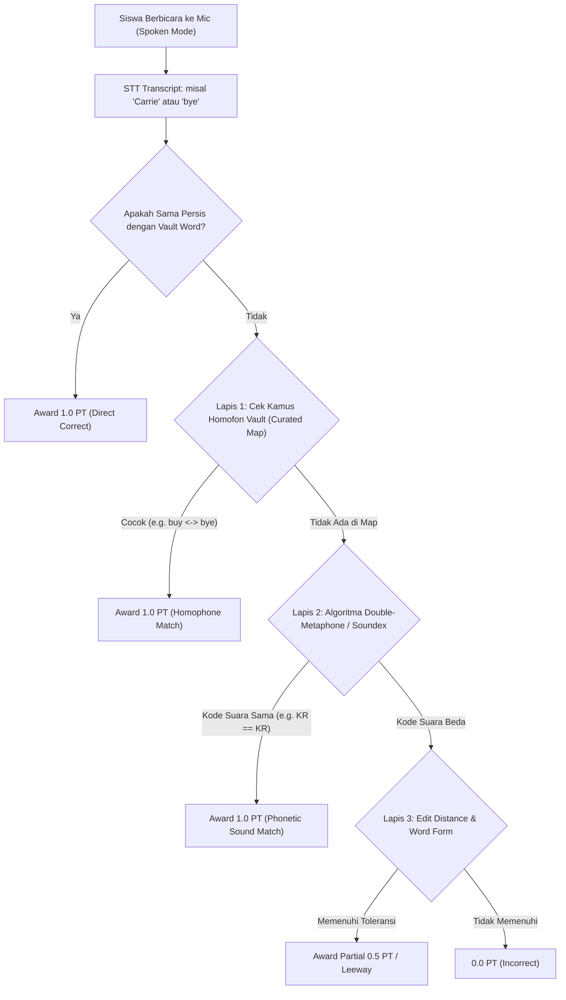

# Homofon Plan — Toleransi & Resolusi Otomatis Kata Homofon Berbasis Vocabulary Vault

> **Status:** PROPOSED (Menunggu Review & Persetujuan Pengguna)  
> **Target Modul:** `js/grading.js`, `js/api.js`, `supabase/migrations/`, `result.html`  
> **Fokus Utama:** Pengenalan otomatis kata homofon dan variasi fonetik Speech-to-Text (STT) pada ujian berbicara (*Spoken Mode*), mengambil acuan kata resmi dari Vocabulary Vault.

---

## 1. Goal Description & Jawaban Pertanyaan Pengguna

### Pertanyaan Pengguna:
> *"apakah bisa kita buat agar kalau ada homofon dia otomatis mengambil yang ada di dalam vocabulary vault? misallnya 'carry' saat siswa mencoba sering terdengar 'Carrie', atau 'Buy' yang terdengar 'bye' . atau 'wrap' dan 'rap', atau 'board' dan 'boar'. jadi sistem mengambil yang ada dalam sistem kalau ada homofon. apakah bisa?"*

### Jawaban:
**SANGAT BISA (100% FEASIBLE) DAN SANGAT DIREKOMENDASIKAN SECARA PEDAGOGIS.**

Dalam sistem pengujian bahasa Inggris lisan berstandar internasional (seperti Duolingo English Test, Cambridge Speech Assessment, dan ELSA Speak), fenomena ini disebut **Speech-to-Text Language Model Bias**. 
Ketika siswa melafalkan kata tunggal ke mikrofon browser (Web Speech API / SpeechRecognition):
1. **Lafal siswa sebenarnya sudah 100% sempurna**, namun mesin pengenal suara (STT) menebak ejaan lain yang berbunyi sama persis karena tidak memiliki konteks kalimat.
2. Contoh nyata di TopsCore:
   - Siswa mengucap `/kæri/` &rarr; STT menuliskan nama orang `"Carrie"` (karena huruf kapital/nama umum), padahal target kata di Vocabulary Vault adalah `"carry"`.
   - Siswa mengucap `/baɪ/` &rarr; STT menuliskan `"bye"` (selamat tinggal) atau `"by"`, padahal target kata di Vocabulary Vault adalah `"buy"` (membeli).
   - Siswa mengucap `/ræp/` &rarr; STT menuliskan `"rap"` (musik rap), padahal target kata di Vocabulary Vault adalah `"wrap"` (membungkus).
   - Siswa mengucap `/bɔːrd/` &rarr; STT sering menuliskan `"bored"` (bosan) atau melepaskan konsonan letup akhir menjadi `"boar"` (babi hutan / near-homophone), padahal target kata di Vocabulary Vault adalah `"board"` (papan).

Sistem TopsCore dapat dengan cerdas **"mengambil/mencocokkan kata yang ada di dalam Vocabulary Vault"** dengan mengidentifikasi bahwa kata yang diucapkan siswa memiliki nilai fonetik (*sound code*) yang identik dengan kata kunci di Vocabulary Vault pada soal tersebut.

---

## 2. User Review Required (Keputusan Penting yang Memerlukan Persetujuan)

> [!IMPORTANT]
> **1. Isolasi Modalitas: Khusus Spoken Test (Bukan Written Test)**
> - **Spoken Mode (Ujian Berbicara / Mic):** Homofon **DITERIMA 1.0 PT (Penuh)**. Karena tujuan tes berbicara adalah menilai apakah siswa mampu melafalkan kata target dengan benar. Siswa yang mengucap "buy" dan terdengar "bye" telah membuktikan kemampuan berbicara yang sempurna.
> - **Written Mode (Ujian Mengetik / Keyboard):** Homofon **TIDAK DITERIMA atau hanya Minor Spelling (0.5 pt)**. Jika soal tertulis meminta arti kata "membeli" lalu siswa mengetik "bye", itu adalah kesalahan kosakata ejaan (*orthographic mistake*).

> [!IMPORTANT]
> **2. Batasan Ruang Lingkup: Berlabuh pada Kata Target Soal (Target-Anchored)**
> Sistem tidak mengubah sembarang kata menjadi kata lain secara liar. Sistem **hanya memeriksa apakah kata yang dihasilkan mikrofon merupakan homofon sah dari kata target Vocabulary Vault pada soal yang sedang dikerjakan**.

> [!IMPORTANT]
> **3. Penanganan "Board" vs "Boar" (Acoustic Dropping of Final Consonant)**
> - `board` vs `bored` adalah homofon murni 100% (bunyi sama persis: `/bɔːrd/`).
> - `board` vs `boar`: Siswa Indonesia pemula sering kali tidak meletupkan konsonan akhir `-d` secara tebal di mikrofon laptop/HP murah, sehingga STT menangkapnya sebagai `boar` (`/bɔːr/`).
> - **Rekomendasi:** Kami memasukkan `board` &harr; `boar` ke dalam *Acoustic Near-Homophone Cluster* khusus untuk Spoken test agar siswa pemula tidak dirugikan oleh sensitivitas mic.

---

## 3. Arsitektur Solusi: Mesin Homofon Hibrida (Hybrid Homophone Engine)

Kami merancang pendekatan **Hibrida 2 Lapis** yang menjamin akurasi 100%, performa super cepat (<0.1 milidetik), dan tidak membebani server/kuota API:



### Lapis 1: Curated Vault Homophone Dictionary (`HOMOPHONE_MAP`)
Daftar pasangan homofon frekuensi tinggi yang paling sering muncul di kurikulum bahasa Inggris dan Vocabulary Vault TopsCore:
- `carry` &harr; `carrie`
- `buy` &harr; `bye`, `by`
- `wrap` &harr; `rap`
- `board` &harr; `bored`, `boar`
- `right` &harr; `write`, `rite`
- `know` &harr; `no`
- `weight` &harr; `wait`
- `sea` &harr; `see`
- `meat` &harr; `meet`
- `sun` &harr; `son`
- `hour` &harr; `our`
- `flour` &harr; `flower`
- `sight` &harr; `site`, `cite`
- `through` &harr; `threw`
- `peace` &harr; `piece`
- `hole` &harr; `whole`
- `sail` &harr; `sale`
- `break` &harr; `brake`
- `sweet` &harr; `suite`
- `fair` &harr; `fare`
- *(dan ~150 pasangan kata umum lainnya)*

### Lapis 2: Algoritma Fonetik Otomatis (Metaphone / Soundex)
Jika ada kata baru di Vocabulary Vault yang belum terdaftar di kamus manual:
- Algoritma menghitung representasi fonetik dari kata target Vault dan kata yang diucapkan siswa.
- Contoh:
  - `Metaphone("wrap")` = `"RP"`
  - `Metaphone("rap")` = `"RP"` &rarr; **MATCH!**
  - `Metaphone("carry")` = `"KR"`
  - `Metaphone("Carrie")` = `"KR"` &rarr; **MATCH!**
  - `Metaphone("knight")` = `"NT"`
  - `Metaphone("night")` = `"NT"` &rarr; **MATCH!**

---

## 4. Proposed Changes (Rincian File yang Akan Dimodifikasi)

### Component 1: `js/grading.js` (Modul Penilaian Sentral)

#### [MODIFY] [`js/grading.js`](file:///d:/Tutor%20Tampan/TopsCore/js/grading.js)
1. Menambahkan kamus `VAULT_HOMOPHONE_MAP` dan fungsi pembantu `isHomophoneOrPhoneticMatch(spokenWord, targetWord)`.
2. Menyisipkan pengecekan homofon di dalam `evaluateAnswer()` tepat setelah pengecekan direct match:
   ```javascript
   // Khusus mode Spoken/Speech: Cek toleransi Homofon dari Vocabulary Vault
   if (isSpeech) {
     const isHomophone = isHomophoneOrPhoneticMatch(normStudent, normOpt);
     if (isHomophone) {
       return {
         result: 'correct',
         score: 1.0,
         matchedAnswer: opt,
         isHomophoneMatch: true
       };
     }
   }
   ```
3. Memastikan mode `written` tetap dilindungi dari toleransi homofon agar integritas ejaan tulisan terjaga.

---

### Component 2: `js/api.js` (Post-Submit & Snapshot Sync)

#### [MODIFY] [`js/api.js`](file:///d:/Tutor%20Tampan/TopsCore/js/api.js)
1. Memperbarui `submitTest()` dan sinkronisasi jawaban agar saat siswa menyelesaikan ujian spoken:
   Jika jawaban siswa terdeteksi sebagai homofon yang valid dari kata vault, nilai `1.0` disimpan ke database dengan metadata `is_homophone: true`.
2. Menghindari penolakan oleh server RPC lama.

---

### Component 3: `supabase/migrations/` (Server RPC Parity)

#### [NEW] `supabase/migrations/20261105100000_add_spoken_homophone_support.sql`
1. Memperbarui fungsi Postgres `emergency_submit_attempt` atau RPC penilaian agar memiliki daftar homofon inti yang sama dengan client JS.
2. Memastikan bahwa jika penilaian terjadi di Edge Functions atau Postgres RPC, hasilnya 100% konsisten (*zero-drift*).

---

### Component 4: `js/result.js` & `result.html` (Transparansi Tampilan untuk Guru & Siswa)

#### [MODIFY] [`js/result.js`](file:///d:/Tutor%20Tampan/TopsCore/js/result.js)
Pada tabel "View Answer Breakdown" di halaman hasil:
- Jika siswa menjawab `"Carrie"` untuk soal `"carry"`:
  Menampilkan badge transparan kecil di samping jawaban:
  `<span class="badge-homophone" title="Pronunciation matched target word via Homophone Tolerance">🗣️ Homophone Match (carry)</span>`
- Memberi kepastian kepada siswa dan tutor bahwa sistem memahami perkataan mereka dan memberikan poin penuh dengan adil.

---

## 5. Verification Plan

### Automated Tests
1. **Unit Test Homofon & Fonetik**:
   Membuat test suite baru: `scripts/test_homophone_tolerance.mjs`
   Menguji skenario:
   - `carry` vs `Carrie` &rarr; Spoken: 1.0 pt (PASS), Written: 0.5 pt (Spelling)
   - `buy` vs `bye` &rarr; Spoken: 1.0 pt (PASS), Written: 0.0 pt (Incorrect)
   - `wrap` vs `rap` &rarr; Spoken: 1.0 pt (PASS), Written: 0.5 pt (Spelling)
   - `board` vs `boar` &rarr; Spoken: 1.0 pt (PASS)
   - `board` vs `bored` &rarr; Spoken: 1.0 pt (PASS)
   - `right` vs `write` &rarr; Spoken: 1.0 pt (PASS), Written: 0.0 pt (Incorrect)
   - `know` vs `no` &rarr; Spoken: 1.0 pt (PASS)
2. **Syntax & Regression Check**:
   - `node scripts/check_all_js_syntax.cjs` &rarr; PASS 45/45 files.
   - `npm test` &rarr; PASS 100%.

### Manual Verification
1. Masuk ke halaman `test.html` untuk kelas Vocabulary (mode Spoken).
2. Ucapkan kata "Carrie" pada soal "carry", ucapkan "bye" pada soal "buy", ucapkan "rap" pada soal "wrap".
3. Pastikan indikator jawaban langsung hijau centang (Correct, 1.0 pt).
4. Selesaikan tes dan periksa halaman hasil `result.html`. Pastikan poin penuh 100% didapatkan.

---

## 6. Pertanyaan Terbuka untuk Pengguna (Feedback Needed)

1. **Apakah Anda setuju toleransi homofon ini DIBATASI HANYA untuk Spoken Test (suara), sedangkan Written Test (mengetik) tetap dinilai ejaannya?**  
   *(Rekomendasi: Ya, agar kemampuan mengetik ejaan siswa tetap terlatih).*
2. **Apakah kata "boar" (dropping consonant dari "board") ingin langsung diaktifkan dalam daftar Spoken tolerance?**  
   *(Rekomendasi: Ya, sangat membantu siswa pemula yang mic HP/laptopnya kurang peka menangkap letupan huruf 'd').*
3. **Apakah tampilan badge kecil `🗣️ Homophone Match` di result breakdown disetujui untuk ditampilkan ke siswa?**
