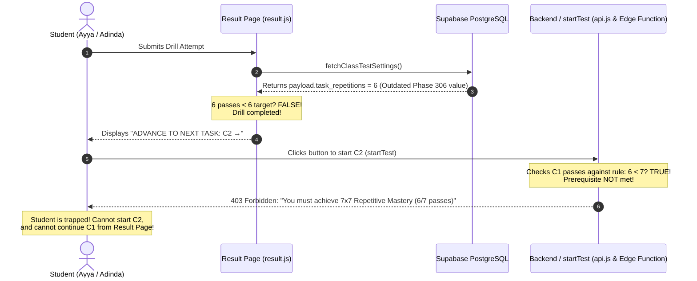

# [IMPLEMENTED] Implementation Plan — 7x7 Repetitive Mastery Alignment, Ayya & Adinda Gating Resolution, and Acoustic Homophone Engine

> **Status: [IMPLEMENTED — CONSOLIDATED INTO UNIFIED 7x7 REPETITION PLAN]**
> Fully implemented and verified in Phase 318 under `/goal`. Database harmonized to 7 repetitions, edge function & validator dynamic minimum scores deployed, acoustic homophone engine operational, and full test suite passing.

## Goal Description
Resolve student progression deadlocks where students reaching 6 task repetitions cannot advance to the next assessment, identify the exact root cause for Mr. Ayya Sofyandi Mzeth and Miss Adinda Karunia Farela, and integrate the acoustic homophone tolerance engine for spoken tests into a single unified plan for future execution.

---

## 1. Deep Diagnostic: What Happened to Ayya and Adinda?

### 1.1 The Ayya Sofyandi Incident
- **Student**: Mr. Ayya Sofyandi Mzeth (`bae52c8d-3456-4334-8f7a-7ba3c268c642`), Batch `Camp 134`, Class `2nd Vocabulary`.
- **Target Drill**: `2C1-WORDS-TASK` (*Shopping & Choosing Products*).
- **Attempt History (from database audit)**:
  1. `2026-11-04 23:32:27` — Score: `18/40` (`45%`, Grade `D`) ➔ **FAILED** (< 50%)
  2. `2026-11-04 23:50:21` — Score: `33/40` (`82.5%`, Grade `B`) ➔ **PASS 1**
  3. `2026-11-05 00:06:13` — Score: `36/40` (`90%`, Grade `A`) ➔ **PASS 2**
  4. `2026-11-05 00:19:18` — Score: `33/40` (`82.5%`, Grade `B`) ➔ **PASS 3**
  5. `2026-11-05 00:31:22` — Score: `37/40` (`92.5%`, Grade `A`) ➔ **PASS 4**
  6. `2026-11-05 00:42:33` — Score: `36/40` (`90%`, Grade `A`) ➔ **PASS 5**
  7. `2026-11-05 00:54:51` — Score: `36/40` (`90%`, Grade `A`) ➔ **PASS 6**
  8. `2026-11-05 01:09:55` — `[in_progress]` (Abandon/Stuck)
- **Qualified Passes**: Exactly **6 passes**!
- **What happened on Ayya's screen**:
  Upon submitting pass #6 at `00:54:51`, the result page checked `targetReps`. Because the database row for `2C1` stored `"task_repetitions": 6`, the result page evaluated `currentPassCount < targetReps` (`6 < 6`) as **FALSE**.
  The result page concluded that Ayya had **finished the drill**, so instead of displaying `"CONTINUE THE DRILL (6/7)"`, it rendered:
  `ADVANCE TO NEXT TASK: 2ND VOCABULARY C2 WORDS TASK - CASHIER & PAYMENT →`.
- **The Crash / Block**:
  Ayya clicked that button to start `2C2-WORDS-TASK`. The app called `startTest()`.
  The backend prerequisite check in `js/api.js` (lines 1358-1360 & 1510) and `supabase/functions/start-test/index.ts` (lines 164 & 469) strictly requires **7 passes**:
  `(passCountByTask['2C1-WORDS-TASK'] || 0) < 7`.
  Because Ayya only had 6 passes, the backend rejected Ayya with **HTTP 403 Forbidden**:
  > *"Prerequisite not completed. You must achieve 7x7 Repetitive Mastery (6/7 passes with at least 50%) on '2nd Vocabulary C1 Words Task' before starting this test."*
- **The Deadlock**:
  Ayya could not start C2 (because backend requires 7), and Ayya could not easily repeat C1 from the result page (because result page thought 6/6 was the finish line).

---

### 1.2 The Adinda Karunia Incident
- **Student**: Miss Adinda Karunia Farela (`66d73c5f-3f58-41d0-9be9-aad3158afb62`), Batch `Camp 134`, Class `2nd Vocabulary`.
- **Target Drill**: `2C1-WORDS-TASK` (*Shopping & Choosing Products*).
- **Attempt History (from database audit)**:
  1. `2026-11-04 12:45:03` — Score: `34/40` (`85%`, Grade `B`) ➔ **PASS 1**
  2. `2026-11-04 22:15:00` — Score: `0/40` (`0%`, Grade `E`) ➔ FAILED
  3. `2026-11-04 22:18:07` — Score: `0/40` (`0%`, Grade `E`) ➔ FAILED
  4. `2026-11-04 23:16:13` — Score: `6/40` (`15%`, Grade `E`) ➔ FAILED
  5. `2026-11-04 23:29:12` — Score: `36/40` (`90%`, Grade `A`) ➔ **PASS 2**
  6. `2026-11-04 23:47:12` — Score: `34/40` (`85%`, Grade `B`) ➔ **PASS 3**
  7. `2026-11-05 00:09:11` — Score: `37/40` (`92.5%`, Grade `A`) ➔ **PASS 4**
  8. `2026-11-05 00:24:29` — Score: `37/40` (`92.5%`, Grade `A`) ➔ **PASS 5**
  9. `2026-11-05 00:59:25` — Score: `37/40` (`92.5%`, Grade `A`) ➔ **PASS 6**
- **Qualified Passes**: Exactly **6 passes**!
- **What happened to Adinda**:
  At `00:59:25`, Adinda submitted her 6th pass. Just like Ayya, the result page loaded `task_repetitions = 6` from the test payload, evaluated `6 < 6` = FALSE, concluded C1 was completed, and rendered the button to advance to `2C2-WORDS-TASK`.
  When Adinda clicked that button, `startTest` checked C1 passes. Because Adinda only had 6 passes and the backend required 7, Adinda was **blocked with HTTP 403**.
  Furthermore, Adinda had attempted C2, C3, and C4 yesterday afternoon before Phase 312 was deployed (when prerequisites checked only 1 pass):
  - On `2C2`: Adinda has 2 passes.
  - On `2C3`: Adinda has 2 passes.
  - On `2C4`: Adinda has 0 passes.
  Once 7x7 repetitive gating was activated in Phase 312, Adinda was locked out of C2, C3, C4, and Exam C until each prior task achieves 7 passes.

---

### 1.3 Batch-Wide Evidence (Camp 134)
A full audit of all 18 students in Camp 134 confirms this exact pattern:
- **Students who completed $\ge$ 7 passes**: Alfina (7), Cinta Laura (9), Havvina (7), Isnantika (7), Riska (7), Sari (8), Lalu Yuda (8), Abdul Qoyyim (8) ➔ **UNLOCKED C2 SUCCESSFULLY**.
- **Students who stopped at 6 passes**: Ayya (6), Adinda (6), Muhammad Afyani (6) ➔ **TRAPPED IN DEADLOCK**.



---

## 2. Root Cause Analysis Summary

1. **Database Schema & Payload Inconsistency**:
   - In Phase 306, during configuration testing, `task_repetitions: 6` was written into `tests.payload` across all 19 tests in `2nd Vocabulary`.
   - `fetchClassTestSettings()` in `js/api.js` line 758 reads `sampleTask?.payload?.task_repetitions || 7`. Because the database row has `6`, it returns `6` instead of `7`.
2. **Result Page & Dashboard Loop Boundary**:
   - `js/result.js` lines 436 & 450 and `js/dashboard.js` line 936 use `targetReps` from `fetchClassTestSettings()`. When `targetReps == 6`, the UI transitions to "Advance" after 6 passes.
3. **Backend Validator Hardcoding**:
   - In `js/api.js` lines 1358 & 1510 and `supabase/functions/start-test/index.ts` lines 164 & 469, the prerequisite check was hardcoded to `7` (`(passCountByTask[t.id] || 0) < 7`) and minimum score was hardcoded to `70` instead of reading the dynamic `minimum_required_score` (e.g. 50% for C1/C2).

---

## 3. Acoustic Homophone Tolerance Engine (Spoken Mode)

### Problem Statement
In Spoken vocabulary tests, the browser Web Speech API / Whisper STT acoustically transcribes phonemes. Because English homophones share identical pronunciation, correct student speech is frequently transcribed as a homophone:
- Student speaks `"buy"` `/baɪ/` ➔ Mic inputs `"bye"` or `"by"` ➔ Currently marked **Incorrect (0.0 pt)**.
- Student speaks `"wrap"` `/ræp/` ➔ Mic inputs `"rap"` ➔ Currently marked **Incorrect (0.0 pt)**.
- Student speaks `"sea"` `/siː/` ➔ Mic inputs `"see"` ➔ Currently marked **Incorrect (0.0 pt)**.
- Student speaks `"hour"` `/aʊ.ər/` ➔ Mic inputs `"our"` ➔ Currently marked **Incorrect (0.0 pt)**.

### Solution Architecture
1. **Modality Isolation**: Strictly active in **Spoken tests** (`mode === 'spoken'`). Written tests (typing) require spelling precision and will NOT accept homophones.
2. **Curated Bidirectional Homophone Dictionary**: Implemented in `js/grading.js` covering high-frequency vocabulary.
3. **Question Scoring Integrity**: Awards **1.0 point (correct)** with evaluation code `homophone_match` and feedback `"Accepted spoken homophone (e.g. 'bye' for 'buy')"` per AGENTS.md Rule 2.9 and Rule 2.13.

---

## User Review Required

> [!IMPORTANT]
> **Authoritative Decision 1: Single Source of Truth for Repetitions (7x7)**:
> All Vocabulary classes will be strictly standardized to **7 repetitions** (`targetReps = 7`) across database rows (`tests.payload.task_repetitions = 7`), `site_settings` table, result page, student dashboard, and backend start-test validators.

> [!IMPORTANT]
> **Authoritative Decision 2: Dynamic Pass Threshold**:
> Backend validator will evaluate passes against `prereqTest.minimum_required_score` (e.g., 50% for C1/C2 tasks, 55% for A1, 60% for exams) instead of hardcoding `70%`.

> [!IMPORTANT]
> **Authoritative Decision 3: Acoustic Homophone Scope**:
> Homophone matching is strictly enabled for **Spoken assessment mode** only. In Written mode, spelling must be preserved.

---

## Proposed Changes

### Component 1: Database Payload & Site Settings Harmonization (`scripts/harmonize_task_repetitions_to_7.mjs`)

#### [NEW] `scripts/harmonize_task_repetitions_to_7.mjs`
- Connects to Supabase PostgreSQL.
- Upserts global and class settings into `site_settings`:
  - `key: 'default_test_system_settings'` ➔ `{"taskRepetitions": 7, "taskMinScore": 70, "examMinScore": 60}`
  - `key: 'class_test_settings_2ccf6468-1e03-41d1-b72b-1d84dcad85b2'` (2nd Vocab) ➔ `{"taskRepetitions": 7, "taskMinScore": 50, "examMinScore": 60}`
  - `key: 'class_test_settings_ab33498a-90e6-44b7-83f4-5765f964543e'` (3rd Vocab) ➔ `{"taskRepetitions": 7, "taskMinScore": 50, "examMinScore": 60}`
- Scans all rows in `tests` table and updates `payload.task_repetitions = 7`.
- Guarantees zero fallback to 6 anywhere in the system.

---

### Component 2: Unified Backend Gating Validator (`js/api.js`, `supabase/functions/start-test/index.ts`)

#### [MODIFY] [`js/api.js`](file:///d:/Tutor%20Tampan/TopsCore/js/api.js)
1. In `startTest()` (around lines 1345-1365):
   ```javascript
   // Synchronize required passes with class settings
   const testSettings = test.class_id ? await fetchClassTestSettings(test.class_id).catch(() => null) : null;
   const targetReps = Number(testSettings?.taskRepetitions) || 7;
   const reqScore = Number(prereqTest?.minimum_required_score || testSettings?.taskMinScore || 50);
   const requiredPasses = isPrereqExam ? 1 : targetReps;
   ```
2. In `startTest()` (around lines 1500-1515):
   ```javascript
   const taskMinScore = Number(test.minimum_required_score || testSettings?.taskMinScore || 50);
   (priorTaskAttempts || []).forEach(att => {
     if (att.is_forgiven) {
       passCountByTask[att.test_id] = Math.max(passCountByTask[att.test_id] || 0, targetReps);
     } else {
       const pct = att.effective_score != null ? Number(att.effective_score) : Number(att.percentage || 0);
       if (pct >= taskMinScore) {
         passCountByTask[att.test_id] = (passCountByTask[att.test_id] || 0) + 1;
       }
     }
   });
   const unmasteredTask = filteredPriorTasks.find(t => (passCountByTask[t.id] || 0) < targetReps);
   ```

#### [MODIFY] [`supabase/functions/start-test/index.ts`](file:///d:/Tutor%20Tampan/TopsCore/supabase/functions/start-test/index.ts)
- Mirror the exact same dynamic `targetReps` and `taskMinScore` validation so Supabase Cloud Edge Function enforces the identical rules.

---

### Component 3: Result Page & Student Dashboard Synchronization (`js/result.js`, `js/dashboard.js`)

#### [MODIFY] [`js/result.js`](file:///d:/Tutor%20Tampan/TopsCore/js/result.js)
- Ensure `targetReps` strictly evaluates to `7` for vocabulary classes:
  ```javascript
  const targetReps = isVocabClass ? 7 : (Number(testSettings?.taskRepetitions) || 1);
  const minScore = Number(curAsm?.minimum_required_score) || Number(testSettings?.taskMinScore) || 50;
  ```
- When Ayya or Adinda has 6 passes, the button will correctly show:
  `CONTINUE THE DRILL (6/7): 2ND VOCABULARY C1 WORDS TASK →`.
- Once they complete the 7th pass, it transitions to:
  `ADVANCE TO NEXT TASK: 2ND VOCABULARY C2 WORDS TASK →`.

#### [MODIFY] [`js/dashboard.js`](file:///d:/Tutor%20Tampan/TopsCore/js/dashboard.js)
- Ensure Section 5 renders exactly 7 repetition boxes for vocabulary classes.
- Ensure Section 6 displays the pass count `6` in Electric Lime (`#95ff00`, Grade B tier) until the 7th pass is completed, whereupon it turns into the White Forward Arrow in Green Box (`#00c000`).

---

### Component 4: Acoustic Homophone Tolerance Engine (`js/grading.js`, `js/api.js`)

#### [MODIFY] [`js/grading.js`](file:///d:/Tutor%20Tampan/TopsCore/js/grading.js)
1. Add `HOMOPHONE_MAP` constant:
   ```javascript
   export const HOMOPHONE_MAP = {
     'buy': ['bye', 'by'],
     'bye': ['buy', 'by'],
     'by': ['buy', 'bye'],
     'wrap': ['rap'],
     'rap': ['wrap'],
     'sea': ['see'],
     'see': ['sea'],
     'hear': ['here'],
     'here': ['hear'],
     'right': ['write'],
     'write': ['right'],
     'meat': ['meet'],
     'meet': ['meat'],
     'flour': ['flower'],
     'flower': ['flour'],
     'hour': ['our'],
     'our': ['hour'],
     'son': ['sun'],
     'sun': ['son'],
     'piece': ['peace'],
     'peace': ['piece'],
     'whole': ['hole'],
     'hole': ['whole'],
     'wait': ['weight'],
     'weight': ['wait'],
     'break': ['brake'],
     'brake': ['break'],
     'stair': ['stare'],
     'stare': ['stair'],
     'tail': ['tale'],
     'tale': ['tail'],
     'bare': ['bear'],
     'bear': ['bare'],
     'weather': ['whether'],
     'whether': ['weather'],
     'knight': ['night'],
     'night': ['knight'],
     'week': ['weak'],
     'weak': ['week'],
     'road': ['rode'],
     'rode': ['road'],
     'mail': ['male'],
     'male': ['mail']
   };
   ```
2. In `evaluateAnswer()`:
   ```javascript
   // Check spoken homophones strictly when mode is 'spoken'
   if (mode === 'spoken') {
     const cleanStudentWord = cleanPunctuationAndSymbols(studentAnswer).toLowerCase();
     const cleanTargetWord = cleanPunctuationAndSymbols(targetAnswer).toLowerCase();
     const homophones = HOMOPHONE_MAP[cleanTargetWord];
     if (homophones && homophones.includes(cleanStudentWord)) {
       return {
         score: 1.0,
         result: 'correct',
         feedback: 'Accepted spoken homophone',
         is_homophone: true
       };
     }
   }
   ```

#### [MODIFY] [`js/api.js`](file:///d:/Tutor%20Tampan/TopsCore/js/api.js)
- Include homophone check in the post-submission answer tolerance sync so historical and live answers benefit equally.

---

## Verification Plan

### Automated Tests
1. **Ayya & Adinda Gating Simulation**:
   `node scripts/test_ayya_adinda_gating_simulation.mjs`
   - Verify that when pass count is 6/7, `result.js` offers `"CONTINUE THE DRILL (6/7)"`.
   - Verify that when pass count is 7/7, `startTest` allows starting C2 without throwing 403.
2. **Homophone Tolerance Test**:
   `node scripts/test_homophones_spoken_mode.mjs`
   - Verify `"bye"` for `"buy"` in spoken mode scores 1.0 pt (`correct`).
   - Verify `"rap"` for `"wrap"` in spoken mode scores 1.0 pt (`correct`).
   - Verify `"bye"` for `"buy"` in written mode scores 0.0 pt (`incorrect`).
3. **Syntax Checks**:
   `node scripts/check_all_js_syntax.cjs` ➔ 45/45 JS files pass.
4. **CI Test Suite**:
   `npm test` ➔ PASS 100%.

### Manual Verification
1. **Login as Ayya Sofyandi**:
   - Open Result Page for C1 attempt.
   - Button renders `"CONTINUE THE DRILL (6/7): 2ND VOCABULARY C1 WORDS TASK →"`.
   - Take 7th repetition and score $\ge 50\%$.
   - Result page transitions to `"ADVANCE TO NEXT TASK: 2ND VOCABULARY C2 WORDS TASK →"`.
   - Clicking button opens C2 successfully without 403 error.
2. **Login as Adinda Karunia**:
   - Verify same seamless 6/7 ➔ 7/7 transition and C2 unlock.
3. **Spoken Test Homophone Check**:
   - Speak `"bye"` on `"buy"` prompt in a spoken task; verify immediate green 1.0 pt award.
