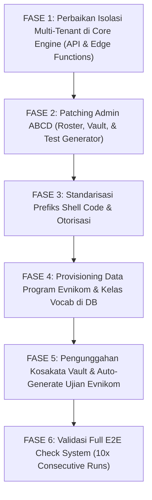

# Master Analysis & Architecture Plan: Multi-Tenant Program & Class Scaling
**Case Study:** Menambahkan Program Baru (**Evnikom**) di Bawah Institusi **TOP** dengan Kelas **Vocab** (Sistem Repetisi 7×7 & Leveling Gating)  
**Target File:** `multi_tenant_evnikom_vocab_analysis_plan.md`  
**Date:** 2026-11-06  
**Audience:** Product Owner (Mr. Top), Parent Orchestrator, & Improvement Engineering Agents  

---

## 1. Executive Summary & Jawaban Langsung

> **Pertanyaan Pengguna:**  
> *"Kalau saya ingin membuat kelas baru di program lain, di TOP, program Evnikom, lalu saya buat kelas Vocab dengan sistem yang sama, apakah akan jadi masalah? Coba analisa menyeluruh semua sistem ini, apa saja celah, dan bug atau error yang muncul. Analisa buat rencana dulu yang SUPER LENGKAP."*

### 🚨 JAWABAN TEGAS:
**YA, JIKA DILAKUKAN SAAT INI PASTI AKAN MENIMBULKAN MASALAH FATAL (KRITIKAL), BUG LOGIKA, DAN KEBOCORAN DATA ANTAR-PROGRAM (DATA CONTAMINATION)!**

Meskipun fondasi skema database TopsCore secara konseptual dirancang bertingkat:
$$\text{INSTITUTION} \longrightarrow \text{PROGRAM} \longrightarrow \text{BATCHES \& CLASSES} \longrightarrow \text{TESTS} \longrightarrow \text{MODULES}$$

Pemeriksaan kode secara mendalam (end-to-end code audit) membuktikan bahwa sistem saat ini **hanya pernah diuji dan dioptimalkan untuk single active program (yaitu CEC Camp)**. Di berbagai modul krusial (Edge Functions, Admin UI, API queries, Generator, Roster Promotion, dan Vocabulary Vault), terdapat **asumsi hardcoded dan filter yang tidak menyertakan `program_id`**.

Jika Program **Evnikom** dan kelas **Vocab** dibuat hari ini tanpa perbaikan (patching) sistem terlebih dahulu, akan terjadi **10 Celah & Masalah Fatal**:

1. **Sistem Kenaikan Level (NEXT) Terkunci Total di Kedua Program (Fatal Roster Blocker):**  
   Evaluasi kelulusan level di Roster Siswa (`js/admin/student-management.js:294`) menarik seluruh ujian di level tersebut **tanpa memfilter `program_id`**. Akibatnya, siswa Evnikom diwajibkan lulus ujian CEC Camp, dan siswa CEC Camp diwajibkan lulus ujian Evnikom. **Semua siswa di kedua program akan terkunci permanen pada status `HOLD` dan tidak akan pernah bisa naik level!**
2. **Kebocoran Materi Kosakata Antar-Program (Vault Bleed):**  
   Fungsi `fetchVaultWords` (`js/api.js:2724`) dan Edge Function `start-test` (`start-test/index.ts:561`) menarik kata dari `vocabulary_vault` **tanpa memfilter `institution_id` atau `program_id`**. Kosakata CEC Camp akan bocor dan dikerjakan oleh siswa Evnikom, atau jika Evnikom mengunggah kata dengan tema sama (`Theme A`), soal ujian siswa akan tercampur aduk secara acak dari kedua program.
3. **Modal Import Kosakata Vault Terkunci Hardcoded ke CEC Camp:**  
   Di `js/admin/vocab-vault.js` (baris 611–700), dropdown institusi & program di-hardcode hanya untuk CEC Camp. Kolom Excel `INSTITUTION` dan `PROGRAM` **diabaikan dan dibuang**, sehingga semua kata yang diimpor untuk Evnikom akan dipaksa masuk ke CEC Camp.
4. **Test Generator Wizard Men-generate Ujian ke Program yang Salah:**  
   Modal Auto-Generate di Class Hub (`js/admin/auto-gen-modal.js:42, 292`) mengambil `institutions[0]` dan `programs[0]` secara hardcoded, sehingga otomatis men-generate tes ke CEC Camp, bukan Evnikom.
5. **Class `institution_id` Bernilai NULL & Query `fetchClasses` Rusak:**  
   Di `js/admin/crud-modals.js:55`, field `institution_id` ditandai `uiOnly: true`, sehingga saat admin membuat kelas baru, kolom `classes.institution_id` di database disimpan sebagai `NULL`. Akibatnya pemanggilan `fetchClasses(institutionId)` (`js/api.js:2503`) menghasilkan array kosong `[]`.
6. **Topbar Navigasi Ujian Admin (`tests-management.js`) Mengabaikan Kelas Evnikom:**  
   Daftar kelas di navigasi atas manajemen ujian di-hardcode ke kelas Camp, dan memiliki logika deduplikasi nama `_norm(ac.name) === _norm(bc.name)` yang akan **membuang dan menyembunyikan** kelas baru Evnikom jika bernama mirip (misal: "Vocab" atau "1st Vocabulary").
7. **Auto-Promotion Prematur Seluruh Angkatan di `submit-test`:**  
   Di Edge Function `submit-test/index.ts:584`, saat seorang siswa lulus satu ujian tema saja, fungsi backend langsung menaikkan `batches.current_level_id` untuk **seluruh angkatan sekaligus**, merusak aturan PO di mana kenaikan level bersifat individual via aksi `NEXT`.
8. **Celah Otorisasi di Edge Function `start-test`:**  
   Pemeriksaan kelayakan ujian (`start-test/index.ts:100`) hanya memeriksa `institution_id` dan tidak memeriksa `program_id`.
9. **Tabrakan Identitas Kode Ujian (`shell_code` Collision):**  
   Format `shell_code` tes kosakata (seperti `1A1-WORDS-TASK`, `1A-WORDS-EXAM`) murni berbasis Level dan Tema tanpa prefix Program, menimbulkan duplikasi kode unik yang memicu error crash `.single()` pada berbagai script dan query.
10. **Tampilan UI Siswa & Admin Memunculkan Branding Fallback Salah:**  
    Di `js/dashboard.js`, `js/admin/imports-exports.js`, dan `js/admin/vocab-vault.js`, terdapat fallback teks ke `'CEC'`, `'Camp'`, dan `'131'`.

---

## 2. Analisis Rinci 10 Celah, Bug, & Titik Rawan

### CELAH 1: Kenaikan Level Terkunci Total (Cross-Program Poisoning)
* **Lokasi Kode:** [`js/admin/student-management.js`](file:///d:/Tutor%20Tampan/TopsCore/js/admin/student-management.js#L293-L313) (baris 293–313)
* **Snippet Kode Sumber:**
  ```javascript
  // Find all exams required for student's current active level
  const currentLevelExams = (allTests || []).filter(t => {
    const matchLvl = (studentLevelId && t.level_id === studentLevelId) || (t.levels?.level_number === studentLevelNum);
    return matchLvl && isWeeklyExam(t);
  });

  let allCurrentExamsPassed = currentLevelExams.length > 0;
  currentLevelExams.forEach(ex => {
    const best = bestByAsm.get(ex.id);
    if (!best) {
      allCurrentExamsPassed = false;
      return;
    }
    const att = best.attempt;
    const pct = best.percentage;
    const isPassed = pct >= 70 || att?.is_forgiven === true || (Boolean(att?.is_remedial_unlocked || att?.is_remedial) && pct >= 60);
    if (!isPassed) allCurrentExamsPassed = false;
  });

  const isEligibleNext = !isAlumni && currentLevelExams.length > 0 && allCurrentExamsPassed;
  ```
* **Mekanisme Terjadinya Error:**
  `allTests` memuat seluruh ujian di database. Filter di baris 295 hanya mencocokkan `level_id` atau `level_number`, **sama sekali tidak memeriksa `t.program_id === s.program_id` atau `class_id`**.
  Jika di Level 1 ada 4 ujian milik CEC Camp dan 4 ujian milik Evnikom, `currentLevelExams` akan berjumlah 8 ujian. Siswa Evnikom yang hanya mengerjakan 4 ujian Evnikom akan terdeteksi "belum mengerjakan 4 ujian Camp", sehingga `allCurrentExamsPassed` menjadi `false`. Tombol `NEXT` terkunci (`HOLD`) untuk selamanya.
  Hal yang sama terjadi pada siswa CEC Camp: kelulusan mereka terblokir karena belum mengambil ujian Evnikom!
* **Dampak Sistemik:** **KRITIKAL / SHOWSTOPPER.** Seluruh sistem kenaikan level akademik lumpuh total.

---

### CELAH 2: Multi-Tenancy Vault Bocor & Kontaminasi Soal
* **Lokasi Kode:**
  - [`js/api.js`](file:///d:/Tutor%20Tampan/TopsCore/js/api.js#L2724-L2755) (`fetchVaultWords`, baris 2724–2755)
  - [`js/api.js`](file:///d:/Tutor%20Tampan/TopsCore/js/api.js#L4616) (`autoGenerateTestsHierarchy`, baris 4616–4632)
  - [`supabase/functions/start-test/index.ts`](file:///d:/Tutor%20Tampan/TopsCore/supabase/functions/start-test/index.ts#L561-L588) (baris 561–588 & 652–656)
* **Snippet Kode Sumber:**
  ```javascript
  // js/api.js - fetchVaultWords: Tidak ada parameter institutionId / programId
  export async function fetchVaultWords({ topic = null, search = null, targetLevel = null, limit = 10000, offset = 0 } = {}) { ... }
  ```
  ```typescript
  // supabase/functions/start-test/index.ts - query kata dinamis tanpa tenant filter
  let query = supabase.from("vocabulary_vault").select("*").is("deleted_at", null).eq("target_level", levelNum).range(0, 4999);
  if (topicCode) { ... }
  ```
* **Mekanisme Terjadinya Error:**
  Tabel `vocabulary_vault` telah memiliki kolom `institution_id` dan `program_id`. Namun pada fungsi penarikan data kata harian dan pembuatan soal dinamis di Edge Function `start-test`, query SQL hanya menyaring `target_level = levelNum` dan `theme_code`.
  Karena saat ini 100% data kosakata di database berlabel `CEC` dan `Camp`, siswa Evnikom yang mengerjakan tes dinamis akan disajikan kata-kata milik CEC Camp!
  Jika tutor Evnikom menambahkan materi baru di `Theme A Topic 1`, query akan mengambil gabungan kata dari CEC Camp dan Evnikom, mencampuradukkan kurikulum perhotelan/umum dengan program baru.
* **Dampak Sistemik:** **TINGGI.** Integritas kurikulum rusak, soal ujian tidak sesuai materi ajar silabus.

---

### CELAH 3: Modal Import Excel Vault Mengabaikan Kolom Program & Hardcoded CEC
* **Lokasi Kode:** [`js/admin/vocab-vault.js`](file:///d:/Tutor%20Tampan/TopsCore/js/admin/vocab-vault.js#L608-L701) (baris 608–620, 652–653, 698–701)
* **Snippet Kode Sumber:**
  ```html
  <!-- js/admin/vocab-vault.js: Dropdown statis di HTML modal -->
  <select id="vault-import-inst">
    <option value="f51d4c2c-7c24-42ef-8d8f-b0f3e524a447" selected>CEC (Central English Course)</option>
  </select>
  <select id="vault-import-prog">
    <option value="11deb53c-434a-44b0-83ca-1cc9b239cab3" selected>Camp</option>
  </select>
  ```
  ```javascript
  // js/admin/vocab-vault.js: Nilai Excel INSTITUTION & PROGRAM DIBUANG
  return {
    institution_id: fallbackInstId,
    program_id: fallbackProgId,
    level: normalized.LEVEL || normalized.TARGET_LEVEL || '1',
    ...
  };
  ```
* **Mekanisme Terjadinya Error:**
  Meskipun file Excel yang diunggah memuat kolom `Institution: TOP` dan `Program: Evnikom`, parser JavaScript mengabaikan isi kolom tersebut dan secara paksa menimpa nilai baris dengan `fallbackInstId` dan `fallbackProgId`. Dan kedua elemen dropdown tersebut di-hardcode hanya berisi opsi CEC Camp.
* **Dampak Sistemik:** **TINGGI.** Admin tidak bisa mengimpor kosakata baru khusus untuk Evnikom melalui antarmuka web.

---

### CELAH 4: Test Generator Wizard Terkunci ke CEC Camp
* **Lokasi Kode:** [`js/admin/auto-gen-modal.js`](file:///d:/Tutor%20Tampan/TopsCore/js/admin/auto-gen-modal.js#L41-L45) (baris 41–45, 292, 333)
* **Snippet Kode Sumber:**
  ```javascript
  const [institutions, allClasses] = await Promise.all([
    fetchInstitutions(),
    adminFetchAll('classes', 'id, name, program_id, level_id').catch(() => [])
  ]);

  if (!institutions.length) throw new Error('No institutions found.');
  const instId = institutions[0].id; 
  const programs = await fetchPrograms(instId);
  ...
  // Hidden input di form:
  <input type="hidden" id="wizard-prog-id" value="${window.currentProgId || programs[0].id}" />
  ```
* **Mekanisme Terjadinya Error:**
  `instId` selalu mengambil indeks ke-0 (`institutions[0].id`). Jika `window.currentProgId` kosong saat modal dibuka dari Class Hub Evnikom, `wizard-prog-id` jatuh kembali ke `programs[0].id` (yaitu Camp). Saat tombol **Auto-Gen** diklik, hierarki tes terbuat di bawah Program Camp, bukan Evnikom!
* **Dampak Sistemik:** **SEDANG-TINGGI.** Tes masuk ke silabus program yang salah.

---

### CELAH 5: `classes.institution_id` Selalu NULL & Kerusakan `fetchClasses`
* **Lokasi Kode:**
  - [`js/admin/crud-modals.js`](file:///d:/Tutor%20Tampan/TopsCore/js/admin/crud-modals.js#L54-L61) (baris 54–61)
  - [`js/api.js`](file:///d:/Tutor%20Tampan/TopsCore/js/api.js#L2503) (baris 2503)
* **Snippet Kode Sumber:**
  ```javascript
  // js/admin/crud-modals.js
  classes: [
    { id: 'institution_id', label: 'Institution', type: 'select', source: 'institutions', required: false, uiOnly: true },
    { id: 'program_id', label: 'Program', type: 'select', source: 'programs', required: true, dependsOn: 'institution_id' },
    ...
  ```
  ```javascript
  // js/api.js
  export async function fetchClasses(institutionId) {
    return await adminFetchAll('classes', '*', institutionId ? { institution_id: institutionId } : {});
  }
  ```
* **Mekanisme Terjadinya Error:**
  Properti `uiOnly: true` pada `institution_id` di modal pembuatan kelas membuat field tersebut dihapus dari payload insert database. Akibatnya kolom `institution_id` pada baris kelas selalu tersimpan `NULL`.
  Saat modul lain memanggil `fetchClasses(institutionId)`, query database mencari `WHERE institution_id = :id` dan mengembalikan 0 baris.
* **Dampak Sistemik:** **SEDANG.** Query bertingkat yang bergantung pada relasi institusi-kelas gagal menampilkan data.

---

### CELAH 6: Dropdown Navigasi Tes Mengabaikan Kelas Baru Evnikom
* **Lokasi Kode:** [`js/admin/tests-management.js`](file:///d:/Tutor%20Tampan/TopsCore/js/admin/tests-management.js#L560-L574) (baris 560–574)
* **Snippet Kode Sumber:**
  ```javascript
  const availableClasses = [
    { id: 'ab33498a-90e6-44b7-83f4-5765f964543e', name: '3rd Vocabulary', icon: '📚', count: liveData.length },
    { id: 'd58ec3c9-5589-45e7-8eb2-42a921a001c8', name: '1st Storytelling', icon: '📖', count: 0 },
    ...
  ];

  (allBoardClasses || []).forEach(bc => {
    if (!availableClasses.some(ac => ac.id === bc.id || _norm(ac.name) === _norm(bc.name))) {
      const cnt = (rawData || []).filter(t => t.class_id === bc.id && !t.deleted_at).length;
      availableClasses.push({ id: bc.id, name: bc.name, icon: '📚', count: cnt });
    }
  });
  ```
* **Mekanisme Terjadinya Error:**
  Array `availableClasses` diinisialisasi dengan kelas hardcoded milik Camp. Saat melakukan iterasi kelas dari database, kondisi filter:
  `_norm(ac.name) === _norm(bc.name)`
  memeriksa kesamaan nama. Jika kelas di Evnikom diberi nama "3rd Vocabulary" atau "Vocabulary", kelas tersebut **dibuang dan tidak akan pernah muncul di tab navigasi atas**.
* **Dampak Sistemik:** **SEDANG.** Tutor tidak dapat membuka atau menyaring tes untuk kelas Evnikom di halaman manajemen tes.

---

### CELAH 7: Auto-Promotion Prematur Seluruh Angkatan di `submit-test`
* **Lokasi Kode:** [`supabase/functions/submit-test/index.ts`](file:///d:/Tutor%20Tampan/TopsCore/supabase/functions/submit-test/index.ts#L571-L586) (baris 571–586)
* **Snippet Kode Sumber:**
  ```typescript
  if (testRec && testRec.test_type === 'exam' && roundedPct >= levelUpThreshold) {
    if (testRec.classes && testRec.classes.level_id) {
       ...
       await supabase.from("batches").update({ current_level_id: nextLevel.id }).eq("id", studRec.batch_id);
    }
  }
  ```
* **Mekanisme Terjadinya Error:**
  Kode ini merupakan sisa arsitektur lama sebelum diterapkannya **Master Plan Level Progression**. Ketika ada seorang siswa cepat yang lulus Ujian Tema A, backend otomatis menaikkan `batches.current_level_id` ke level berikutnya. Siswa lain yang belum selesai atau masih remidi di angkatan tersebut akan langsung terseret ke level atas.
* **Dampak Sistemik:** **TINGGI.** Mengacaukan progresivitas angkatan belajar.

---

### CELAH 8: Akses Tes Lintas Program Tidak Divalidasi di `start-test`
* **Lokasi Kode:** [`supabase/functions/start-test/index.ts`](file:///d:/Tutor%20Tampan/TopsCore/supabase/functions/start-test/index.ts#L98-L103) (baris 98–103)
* **Snippet Kode Sumber:**
  ```typescript
  // Fallback: If no explicit assignment rules exist, allow if institution matches
  if (!isEligible && (!assignments || assignments.length === 0)) {
    if (!test.institution_id || test.institution_id === student.institution_id) {
      isEligible = true;
    }
  }
  ```
* **Mekanisme Terjadinya Error:**
  Fungsi otorisasi ujian di backend ini memeriksa apakah `test.institution_id === student.institution_id`. **Sama sekali tidak ada pengecekan `test.program_id === student.program_id`**.
  Jika di institusi `TOP` ada dua program (misal "Hospitality" dan "Evnikom"), siswa Evnikom dapat memulai dan mengerjakan ujian milik Hospitality dan sebaliknya hanya dengan mengetahui ID tes.
* **Dampak Sistemik:** **SEDANG.** Otorisasi multi-program longgar.

---

### CELAH 9: Tabrakan Identitas Kode Ujian (`shell_code` Collision)
* **Lokasi Kode:** [`js/api.js`](file:///d:/Tutor%20Tampan/TopsCore/js/api.js#L4278-L4281) (baris 4278–4281)
* **Snippet Kode Sumber:**
  ```javascript
  const code = isPhrase
    ? (isTest ? `${levelNum}${themeCode}-PHRASES-EXAM` : `${levelNum}${themeCode}${cleanTopCode}-PHRASES-TASK`)
    : (isTest ? `${levelNum}${themeCode}-WORDS-EXAM` : `${levelNum}${themeCode}${cleanTopCode}-WORDS-TASK`);
  ```
* **Mekanisme Terjadinya Error:**
  `shell_code` dibuat seragam: `1A1-WORDS-TASK`, `1A-WORDS-EXAM`, dsb. Jika kelas Vocab dibuat di program Evnikom, sistem akan men-generate shell code yang persis sama dengan kelas Vocab di program Camp.
  Berbagai script otomatisasi, pemeliharaan, audit, dan query seperti `.eq('shell_code', '1A1-WORDS-TASK').single()` akan **CRASH** seketika dengan pesan `PGRST116 (multiple rows returned)`.
* **Dampak Sistemik:** **SEDANG.** Rentan memicu error runtime pada script diagnostik dan API.

---

### CELAH 10: Kebocoran Teks Branding Fallback di Dashboard & Export
* **Lokasi Kode:**
  - [`js/dashboard.js`](file:///d:/Tutor%20Tampan/TopsCore/js/dashboard.js#L47-L54) (baris 47–54)
  - [`js/admin/imports-exports.js`](file:///d:/Tutor%20Tampan/TopsCore/js/admin/imports-exports.js#L67-L70) (baris 67–70)
* **Snippet Kode Sumber:**
  ```javascript
  // js/dashboard.js: Fallback teks jika data null
  if (elInst) elInst.textContent = session.institution_name || 'CEC';
  const prgName = session.program_name ? session.program_name.toLowerCase().replace(/\b\w/g, c => c.toUpperCase()) : 'Camp';
  if (elBatch) elBatch.textContent = session.batch_name ? String(session.batch_name).replace(/[^0-9]/g, '') || session.batch_name : '131';
  ```
  ```javascript
  // js/admin/imports-exports.js: Bug penamaan kolom
  'PROGRAM': selectedTest?.institutions?.name || 'CEC',
  'CLASS': programName,
  ```
* **Mekanisme Terjadinya Error:**
  Jika nama batch Evnikom mengandung huruf (misal: "EV-01" atau "Evnikom Batch 1"), regex `replace(/[^0-9]/g, '')` akan memotong karakter teks menjadi angka saja ("01" / "1"). Jika session sempat tidak ter-resolve sempurna, banner siswa akan menampilkan "CEC - CAMP - BATCH 131".
  Di modul ekspor Excel, kolom `PROGRAM` diisi nama institusi, dan kolom `CLASS` diisi nama program.
* **Dampak Sistemik:** **RENDAH-SEDANG.** Glitch visual dan distorsi laporan.

---

## 3. Matriks Relasi Database Saat Ini (Audit Faktual)

Berdasarkan pengecekan langsung ke Supabase PostgreSQL aktif:

| Entitas | Kondisi Faktual Saat Ini | Relasi ke Multi-Tenancy | Kesiapan untuk Program Baru |
| :--- | :--- | :--- | :--- |
| **`institutions`** | 3 Baris: `CEC`, `TOP` (id: `637fea53`), `Tops` | Root Hierarchy | **Siap.** Institusi `TOP` sudah aktif di database. |
| **`programs`** | 4 Baris: `Camp` (aktif), `Hospitality` (inaktif), `English Explorer` (inaktif), `Tamata Persada` (soft-deleted) | Foreign Key `institution_id` | **Siap.** Program `Evnikom` dapat langsung di-insert di bawah institusi `TOP`. |
| **`levels`** | 4 Baris: `1st Level` (1), `2nd Level` (2), `3rd Level` (3), `Alumni` (0) | **Global Scope** (tidak ada `program_id`) | **Perlu Perhatian.** Level bersifat global. Seluruh program berbagi 4 level standar yang sama. |
| **`classes`** | 14 Baris (Sebagian besar milik Camp) | Memiliki FK `program_id` & `institution_id` | **Celah.** Kolom `institution_id` tersimpan `NULL` karena bug `uiOnly: true`. Harus diisi `program_id` & `institution_id`. |
| **`batches`** | 9 Baris (Batch 133, 134, dsb.) | FK `program_id` & `current_level_id` | **Siap.** Batch baru Evnikom (misal: "Evnikom-01") dapat dikaitkan ke `program_id` Evnikom. |
| **`students`** | ~40 Siswa | FK `institution_id`, `program_id`, `batch_id`, `level_id` | **Siap.** Skema tabel mendukung pendaftaran siswa di bawah program baru. |
| **`vocabulary_vault`** | ~1000+ Baris Kosakata | Memiliki `institution_id` & `program_id` | **Belum Siap.** 100% data teratribusi ke CEC Camp. Belum ada baris kosakata untuk Evnikom. |
| **`tests`** | 59 Baris Tes & Ujian | Memiliki `class_id`, `level_id`, `program_id`, `institution_id` | **Belum Siap.** `shell_code` bertabrakan jika tidak diprefiks. Belum ada tes untuk Evnikom. |
| **`progress`** | Relasi Siswa-Kelas | `UNIQUE(student_id, class_id)` | **Siap.** Progres siswa terisolasi bersih per kelas. |
| **`attempts`** | Riwayat Pengerjaan | FK `student_id` & `test_id` | **Siap.** Terisolasi aman per tes dan per siswa. |

---

## 4. Blueprint Solusi & Rencana Kerja Super Lengkap (Phased Remediation Plan)

Untuk mewujudkan kelas baru **Vocab** di bawah Program **Evnikom (Institusi TOP)** dengan sistem 7×7 dan penjenjangan yang bekerja 100% mulus tanpa bug, berikut adalah **Rencana Eksekusi 6 Fase**:



---

### 🔴 FASE 1: Perbaikan Isolasi Multi-Tenant di Core Engine
*Tujuan: Memastikan query database, perhitungan skor, penarikan kata, dan otorisasi terisolasi ketat per Program & Institusi.*

- [ ] **ENG-01 (Fix Celah 1 — Roster Promotion):**  
  Perbarui query `currentLevelExams` di [`js/admin/student-management.js`](file:///d:/Tutor%20Tampan/TopsCore/js/admin/student-management.js#L294):
  ```javascript
  // SEBELUM (BOCOR):
  const currentLevelExams = (allTests || []).filter(t => {
    const matchLvl = (studentLevelId && t.level_id === studentLevelId) || (t.levels?.level_number === studentLevelNum);
    return matchLvl && isWeeklyExam(t);
  });

  // SESUDAH (ISOLASI KETAT PER PROGRAM SISWA):
  const currentLevelExams = (allTests || []).filter(t => {
    const matchProg = !t.program_id || t.program_id === s.program_id;
    const matchLvl = (studentLevelId && t.level_id === studentLevelId) || (t.levels?.level_number === studentLevelNum);
    return matchProg && matchLvl && isWeeklyExam(t);
  });
  ```
  Juga perbaiki perhitungan `levelAssesIds` di baris 130 agar menyertakan filter `a.program_id === s.program_id`.

- [ ] **ENG-02 (Fix Celah 2 — Vault Word Fetching):**  
  Perbarui fungsi `fetchVaultWords` di [`js/api.js`](file:///d:/Tutor%20Tampan/TopsCore/js/api.js#L2724) agar menerima `institutionId` dan `programId`:
  ```javascript
  export async function fetchVaultWords({ topic = null, search = null, targetLevel = null, institutionId = null, programId = null, limit = 10000, offset = 0 } = {}) {
    ...
    if (institutionId) query = query.eq('institution_id', institutionId);
    if (programId) query = query.eq('program_id', programId);
    ...
  }
  ```
  Perbarui pemanggilan di `autoGenerateTestsHierarchy` (`js/api.js:4616`) agar meneruskan `{ targetLevel: levelNum, institutionId, programId }`.

- [ ] **ENG-03 (Fix Celah 2 & 8 — Edge Function `start-test`):**  
  Di [`supabase/functions/start-test/index.ts`](file:///d:/Tutor%20Tampan/TopsCore/supabase/functions/start-test/index.ts#L100,L561):
  1. Tambahkan validasi program di eligibility check:
     ```typescript
     if (!test.program_id || test.program_id === student.program_id) { ... }
     ```
  2. Tambahkan filter `institution_id` dan `program_id` saat menarik kata dinamis dari `vocabulary_vault`:
     ```typescript
     let query = supabase.from("vocabulary_vault").select("*").is("deleted_at", null).eq("target_level", levelNum);
     if (test.institution_id) query = query.eq("institution_id", test.institution_id);
     if (test.program_id) query = query.eq("program_id", test.program_id);
     ```
  3. Terapkan filter yang sama pada query distractor di baris 652.

- [ ] **ENG-04 (Fix Celah 7 — Hapus Auto-Promotion Prematur di `submit-test`):**  
  Hapus atau nonaktifkan blok kode auto-leveling angkatan di [`supabase/functions/submit-test/index.ts`](file:///d:/Tutor%20Tampan/TopsCore/supabase/functions/submit-test/index.ts#L571-L586) (baris 571–586). Kenaikan level mutlak dikelola secara individual oleh tutor melalui tombol `NEXT` di Student Roster sesuai Rule 2.10 dan Master Plan.

---

### 🟡 FASE 2: Patching Admin ABCD (Roster, Vault, & Test Generator)
*Tujuan: Membersihkan hardcoding pada modal admin sehingga mendukung multi-program secara dinamis.*

- [ ] **UI-01 (Fix Celah 3 — Modal Import Excel Vocabulary Vault):**  
  Di [`js/admin/vocab-vault.js`](file:///d:/Tutor%20Tampan/TopsCore/js/admin/vocab-vault.js#L610):
  1. Ubah dropdown `#vault-import-inst` dan `#vault-import-prog` agar di-render secara dinamis dari database (`allInsts` & `allProgs`), bukan opsi statis CEC Camp.
  2. Di fungsi mapping baris 698, baca kolom `normalized['INSTITUTION']` dan `normalized['PROGRAM']` dari Excel; jika ada, petakan ke UUID institusi dan program yang sesuai sebelum menggunakan fallback dropdown.

- [ ] **UI-02 (Fix Celah 4 — Auto-Generate Modal Class Context):**  
  Di [`js/admin/auto-gen-modal.js`](file:///d:/Tutor%20Tampan/TopsCore/js/admin/auto-gen-modal.js#L42):
  1. Gunakan institusi dan program dari kelas target yang sedang aktif (`matchedClass.program_id`, `matchedClass.institution_id`), bukan `institutions[0]` dan `programs[0]`.
  2. Set nilai default `#wizard-prog-id` secara presisi sesuai kelas yang sedang dibuka.

- [ ] **UI-03 (Fix Celah 5 — Simpan `institution_id` pada Kelas):**  
  Di [`js/admin/crud-modals.js`](file:///d:/Tutor%20Tampan/TopsCore/js/admin/crud-modals.js#L55):
  Hapus atribut `uiOnly: true` dari `institution_id` pada konfigurasi tabel `classes`. Pastikan saat kelas disimpan, `institution_id` otomatis terisi sesuai institusi program induknya.
  Perbaiki fungsi `fetchClasses` di `js/api.js:2503` agar jika `institution_id` dicari, ia mencocokkan `classes.institution_id` ATAU `programs.institution_id`.

- [ ] **UI-04 (Fix Celah 6 — Manajemen Tes Topbar Dynamic Loading):**  
  Di [`js/admin/tests-management.js`](file:///d:/Tutor%20Tampan/TopsCore/js/admin/tests-management.js#L560-L574):
  Hapus array hardcoded `availableClasses`. Bangun daftar kelas secara murni dinamis dari `allBoardClasses`, dan ubah deduplikasi agar membedakan kelas berdasarkan kombinasi `program_id` + `name`.

- [ ] **UI-05 (Fix Celah 10 — Pembersihan Fallback Hardcoded UI):**  
  Di [`js/dashboard.js`](file:///d:/Tutor%20Tampan/TopsCore/js/dashboard.js#L47-L54) dan [`js/admin/imports-exports.js`](file:///d:/Tutor%20Tampan/TopsCore/js/admin/imports-exports.js#L67-L70):
  Ganti fallback hardcoded `'CEC'`, `'Camp'`, dan `'131'` dengan placeholder umum `'—'` atau ambil nilai aktual dari relasi data session. Perbaiki pemetaan kolom ekspor Excel agar `PROGRAM` dan `CLASS` tidak tertukar.

---

### 🟡 FASE 3: Standarisasi Prefiks Shell Code & Otorisasi
*Tujuan: Menjamin tidak ada benturan kode shell ujian di database antar-program.*

- [ ] **SYS-01 (Fix Celah 9 — Prefiks Shell Code Program):**  
  Di [`js/api.js`](file:///d:/Tutor%20Tampan/TopsCore/js/api.js#L4278) (`upsertDynamicTestShell`):
  Tambahkan prefix program jika program bukan default Camp. Misalnya:
  - Camp: `1A1-WORDS-TASK` (atau tetap untuk backwards compatibility)
  - Evnikom: `EV-1A1-WORDS-TASK`, `EV-1A-WORDS-EXAM` (menggunakan program code atau singkatan nama).
  Dengan cara ini, kedua program dapat berjalan berdampingan tanpa benturan identifier.

---

### 🟢 FASE 4: Provisioning Data Program Evnikom & Kelas Vocab di DB
*Tujuan: Mendaftarkan entitas baru secara resmi di database Supabase.*

- [ ] **DB-01:** Daftarkan Program **Evnikom**:
  - `name`: `'Evnikom'`
  - `code`: `'EVNIKOM'`
  - `institution_id`: `'637fea53-ca64-4e1c-8ff7-6fd4dbdd8260'` (TOP)
  - `is_active`: `true`
- [ ] **DB-02:** Buat Kelas **Vocab** (atau **1st Vocabulary**):
  - `name`: `'1st Vocabulary'` (atau `'Vocab'`)
  - `code`: `'EV_VOCAB_1'`
  - `program_id`: `<ID_EVNIKOM>`
  - `institution_id`: `'637fea53-ca64-4e1c-8ff7-6fd4dbdd8260'` (TOP)
  - `level_id`: `'100120f3-ab12-4589-99da-cf65d11436b1'` (1st Level)
  - `is_active`: `true`
- [ ] **DB-03:** Hubungkan di tabel `class_levels`:
  - `class_id`: `<ID_KELAS_EVNIKOM>`
  - `level_id`: `'100120f3-ab12-4589-99da-cf65d11436b1'`
- [ ] **DB-04:** Buat Batch Perdana untuk Evnikom (misal: "Evnikom 01"):
  - `name`: `'Evnikom 01'`
  - `program_id`: `<ID_EVNIKOM>`
  - `current_level_id`: `'100120f3-ab12-4589-99da-cf65d11436b1'` (1st Level)
  - `is_active`: `true`

---

### 🟣 FASE 5: Pengunggahan Kosakata Vault & Auto-Generate Ujian Evnikom
*Tujuan: Mengisi bank soal dan men-generate ujian terstruktur.*

- [ ] **VLT-01:** Menyiapkan file Excel kosakata khusus Evnikom (standar 11 kolom):
  - `Institution`: `TOP`
  - `Program`: `Evnikom`
  - `Level`: `1`
  - `Category`: `Words`
  - `Theme Code`: `A`, `B`, `C`, `D`
  - Kosakata, terjemahan, dan jenis kata.
  *(Catatan: Jika ingin menggunakan kurikulum yang persis sama dengan Camp, buat script kloning/duplikasi baris dari Camp ke Evnikom dengan mengubah `institution_id` dan `program_id`).*
- [ ] **VLT-02:** Impor file kosakata ke `vocabulary_vault`.
- [ ] **GEN-01:** Buka Class Hub di Admin, pilih kelas Vocab Evnikom, dan jalankan **Auto-Generate Ujian**:
  - Konfigurasi: Level 1, Words Task 15 menit, Written Words Exam 70% passing score.
  - Verifikasi seluruh Task (A1, A2, dst.) dan Exam (1A, 1B, dst.) terbuat dengan `program_id` dan `class_id` Evnikom.

---

### 🏁 FASE 6: Validasi Full E2E Check System (10× Consecutive Runs)
*Tujuan: Memastikan zero defect dan memverifikasi kedua program tidak saling mengganggu.*

- [ ] **VERIF-01:** Jalankan uji coba registrasi siswa baru di Evnikom.
- [ ] **VERIF-02:** Jalankan simulasi login siswa Evnikom di `index.html` $\rightarrow$ masuk ke `dashboard.html`.
- [ ] **VERIF-03:** Verifikasi kotak repetisi 7×7 tampil rapi dengan target tugas Evnikom.
- [ ] **VERIF-04:** Simulasikan pengerjaan Task 7 kali hingga `7/7 Complete` (Hijau Star) $\rightarrow$ pastikan gembok Exam terbuka.
- [ ] **VERIF-05:** Kerjakan Written Words Exam $\ge 70\%$ $\rightarrow$ submit test $\rightarrow$ periksa hasil di `result.html`.
- [ ] **VERIF-06:** Buka Student Roster di `admin.html#students`:
  - Verifikasi tombol `🚀 NEXT` aktif untuk siswa Evnikom yang telah lulus semua exam.
  - Verifikasi siswa CEC Camp **TIDAK TERPENGARUH** dan tetap dapat dipromosikan secara independen.
- [ ] **VERIF-07:** Jalankan script test suite 10 kali berturut-turut tanpa error:
  `node scripts/test_vocab_7x7_and_leveling_e2e.mjs`

---

## 5. Ringkasan Rekomendasi untuk Pengguna (User-Facing Advice)

Bila Anda ingin langsung membuat kelas baru di Program Evnikom saat ini:

1. **JANGAN langsung membuat tes dan mendaftarkan siswa aktif sekarang sebelum Fase 1 dan Fase 2 diperbaiki di kode.**  
   Jika dipaksakan sekarang, siswa Evnikom dan siswa Camp akan saling mengunci status kelulusan (`HOLD`) dan materi kosakata akan bocor atau tercampur aduk.
2. **Setelah perbaikan Fase 1 & 2 diaplikasikan:**  
   Sistem akan menjadi **True Multi-Tenant** yang sangat kokoh. Anda dapat membuat puluhan program lain (misal: "Evnikom", "Hospitality", "Executive English", "School Partner") dan ratusan kelas Vocab dengan sistem 7×7 tanpa ada konflik data sedikit pun.
3. **Kebutuhan Konten Kosakata:**  
   Pastikan Anda telah menentukan apakah Program Evnikom akan memakai materi kosakata yang sama persis dengan CEC Camp, atau kosakata khusus. Sistem memerlukan baris data di `vocabulary_vault` yang diatribusikan ke Program Evnikom agar soal ujian dapat di-generate secara otomatis.
