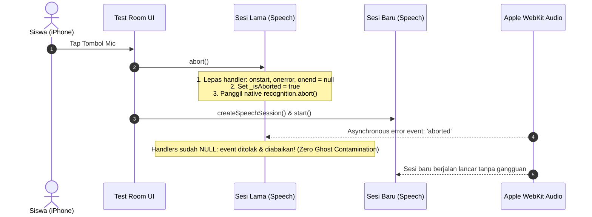

# Plan: Permanent Resolution of 'Recognition Aborted' on Safari & Chrome on iPhone (iOS WebKit)

## Goal Description
Siswa yang mengerjakan ujian berbasis ucapan (*Spoken Tests*) di iPhone menggunakan **Safari** atau **Chrome** (keduanya berbasis WebKit iOS) melaporkan bahwa pengenalan suara masih sering mengalami pesan error atau status terhenti: *"recognition aborted"* / *"Recognition stopped."*.

Penyelidikan mendalam membongkar **3 akar masalah utama (Root Causes)** di level arsitektur WebKit iOS:

1. **The Asynchronous Ghost Abort Race Condition (Penyebab Utama):**
   Saat siswa menekan tombol mic (atau berpindah soal), fungsi `abortActiveSpeechSession()` memanggil `oldRecognition.abort()`. Pada WebKit iOS, pemanggilan `abort()` menjadwalkan event `onerror` dengan `{ error: 'aborted' }` secara asinkron di *macrotask queue*. Karena listener event pada instance lama tidak dilepas (*detached*), callback `onError('Recognition stopped.')` dari sesi lama dieksekusi **beberapa milidetik setelah sesi baru (`newSession`) mulai berjalan**. Akibatnya, callback sesi lama menimpa `currentActiveSpeechSession = null`, mematikan tombol mic sesi baru, dan memunculkan toast peringatan merah `⚠️ Recognition stopped.` ke hadapan siswa!
2. **Perlakuan Salah Terhadap Event `aborted` Web Speech API:**
   Menurut spesifikasi W3C Web Speech API, `error: 'aborted'` bukanlah kegagalan sistem ataupun error hardware, melainkan sinyal bahwa sesi dihentikan (baik karena tombol stop ditekan, navigasi berpindah, atau Safari mendeteksi jeda hening / *silence timeout* 1.5 detik khas iOS). Menampilkan toast peringatan kuning/merah `showToast('Recognition stopped.', 'warning')` dan mengubah status menjadi `⚠️ Retry` adalah *false positive* yang membingungkan siswa.
3. **Konflik Audio Session iOS (`AudioContext` & WakeLock Video Fallback):**
   * Di `js/test.js`, fungsi `unlockAudio()` dijalankan pada setiap ketukan pertama layar (`click`, `touchstart`), memicu pembuatan `new AudioContext()`. Di iOS WebKit, instansiasi ini mengunci `AVAudioSession` ke kategori playback audio, memicu WebKit melempar `aborted` saat `webkitSpeechRecognition.start()` dipanggil.
   * Di `js/wake-lock.js`, pemanggilan `requestScreenWakeLock()` sebelumnya menjalankan `playFallbackVideo()` tanpa syarat, meskipun W3C Native Screen Wake Lock API sudah aktif dan didukung penuh oleh iOS 16.4+. Pemutaran video ini mengganggu jalur perekaman mikrofon.

---

## User Review Required

> [!IMPORTANT]
> **Zero Lost Work Guarantee on iOS Silence Abort:**
> Di WebKit iOS, jika siswa berbicara lalu terdiam selama ~1 detik, WebKit sering kali secara sepihak mengirim event `aborted` sebelum `onFinal` sempat terpanggil. Rencana ini menerapkan **Auto-Commit Interim Buffer**: jika WebKit memutus koneksi dengan `aborted` saat teks sudah sempat terekam di layar, teks tersebut **langsung diamankan dan disimpan sebagai jawaban resmi siswa**, bukan dibuang.

> [!NOTE]
> **Peniadaan Toast Peringatan Palsu:**
> Event `aborted` akibat penekanan tombol stop, perpindahan soal, atau jeda hening tidak akan lagi memunculkan toast peringatan error kuning/merah di layar. Status akan kembali ke `● Ready / Tap to Speak` secara anggun dan tenang.

---

## Open Questions

> [!NOTE]
> Tidak ada pertanyaan yang memblokir. Arsitektur tetap 100% statis HTML + CSS + Modular JS sesuai `AGENTS.md` tanpa merubah schema database atau algoritma penilaian.

---

## Proposed Changes

### Core Test Room & Speech Architecture

#### [MODIFY] [`js/speech.js`](file:///d:/Tutor%20Tampan/TopsCore/js/speech.js)
1. **Ghost Event Teardown pada `abort()`:**
   - Tambahkan flag `_isAborted = true`.
   - Sebelum memanggil `recognition.abort()`, lepaskan seluruh handler event secara sinkron:
     ```javascript
     recognition.onstart = null;
     recognition.onresult = null;
     recognition.onerror = null;
     recognition.onend = null;
     ```
   - Ini menjamin bahwa sesi lama yang di-`abort` tidak akan pernah dapat mengirimkan event `aborted` ke sesi baru!
2. **Handling `stop()` Tanpa Error `aborted`:**
   - Tambahkan flag `_isStopping = true`.
   - Di dalam `recognition.onerror`:
     - Jika `_isAborted` atau `_isStopping`: abaikan secara total, jangan panggil `onError`.
3. **Penyelamatan Jawaban & Penanganan Abort Khas iOS:**
   - Di dalam `recognition.onerror`:
     - Jika `event.error === 'aborted'`:
       - Jika sudah ada `_interimTranscript` yang terdeteksi: panggil `onFinal(_interimTranscript)` untuk menyimpan jawaban siswa ke database.
       - Jika belum ada suara: kembalikan state ke `idle` secara bersih tanpa memicu `onError` bernada error/kegagalan.
4. **Pembersihan Resource Audio:**
   - Pastikan setiap instance recognition yang selesai atau dibatalkan dinonaktifkan secara tuntas dari memori.



---

#### [MODIFY] [`js/test.js`](file:///d:/Tutor%20Tampan/TopsCore/js/test.js)
1. **Eliminasi Pre-Allocation `AudioContext` pada `unlockAudio`:**
   - Hapus pemanggilan `new AudioContext()` pada touch/click awal dokumen.
   - Pindahkan pembuatan `AudioContext` secara ketat ke `_getCtx()`, sehingga `audioCtx` **hanya diinisialisasi jika dan hanya jika** sirine anti-cheat benar-benar berbunyi.
   - Dengan demikian, selama siswa mengerjakan tes normal, `AudioContext` tetap `null` dan tidak pernah mengganggu `AVAudioSession` iOS.
2. **Pembersihan `abortActiveSpeechSession()`:**
   - Pastikan referensi ke sesi aktif diputus sebelum operasi baru dimulai.
3. **Peningkatan Tampilan Status Speech:**
   - Jangan tampilkan toast peringatan jika pesan error adalah penutupan normal/aborted.
   - Pastikan teks di `transcriptBox` selalu di-commit secara otomatis jika sesi terputus di tengah jalan.

---

#### [MODIFY] [`js/wake-lock.js`](file:///d:/Tutor%20Tampan/TopsCore/js/wake-lock.js)
1. **Isolasi Penuh Fallback Video:**
   - Di dalam `requestScreenWakeLock()`, **jangan jalankan `playFallbackVideo()`** jika `nativeOk === true` (dukungan W3C Native WakeLock tersedia di iOS 16.4+).
   - Di dalam `pulseTimer`, **jangan sentuh `fallbackVideo`** jika `nativeSentinel` sedang aktif.
   - Fallback video murni menjadi cadangan darurat untuk browser tua non-standar atau koneksi HTTP tanpa TLS.

---

## Verification Plan

### Automated Tests
1. **Input Modes & Responsiveness Test Suite:**
   ```powershell
   node scripts/test_input_modes_responsiveness.mjs
   ```
   *Verifikasi bahwa siklus 4-state, anti-double-tap, pelepasan listener saat abort, dan auto-commit interim transcript berjalan 100% tanpa error.*

2. **Syntax & Static Analysis Check:**
   ```powershell
   node -c js/speech.js; node -c js/wake-lock.js; node -c js/test.js
   ```
   *Memastikan nol kesalahan sintaks di semua file JavaScript termodifikasi.*

3. **Full 10× Consecutive E2E Progression Test:**
   ```powershell
   node scripts/test_vocab_7x7_and_leveling_e2e.mjs
   ```
   *Memastikan 132/132 assertion kelulusan, leveling, dan integritas tes tetap 100% lolos tanpa regresi.*

### Manual Verification
1. Buka tes di Safari dan Chrome pada iPhone (atau simulasi WebKit iOS).
2. Tap tombol mikrofon: verifikasi mic langsung terhubung (*"Listening..."*).
3. Berbicara sebagian lalu diam: verifikasi teks yang terucap tersimpan dengan aman (*"✅ Recorded"*), bukan muncul pesan *"Recognition stopped"* atau error merah.
4. Tap mic untuk stop secara manual: verifikasi rekaman tersimpan tanpa muncul toast peringatan.
5. Pindah soal secara cepat lalu tap mic: verifikasi tidak ada *ghost abortion* dari soal sebelumnya.
