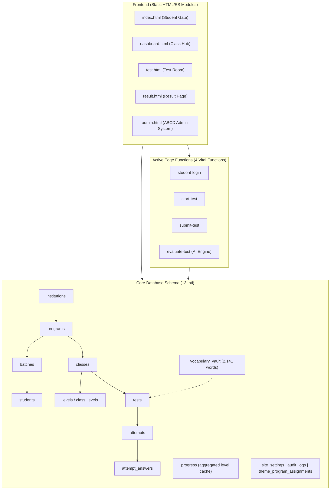

# MASTER PLAN: PEMBERSIHAN LEGACY & RASIONALISASI SISTEM — TOPSCORE LMS

> **Kode Milestone:** Phase 386 — Universal Legacy Cleanup & Codebase Rationalization  
> **Tujuan:** Menghilangkan seluruh artefak mati (*dead baggage*), merampingkan database dari 35 menjadi 13 tabel inti, menghapus 4 Edge Functions tidak terpakai, membersihkan file orphan di `js/`, mengonsolidasi folder `scripts/`, dan membersihkan root directory tanpa mengorbankan stabilitas sistem.

---

## 1. Arsitektur Target Pasca-Pembersihan



---

## 2. Rincian Objek yang Dieliminasi

| Layer | Item yang Dibuang / Dibersihkan | Kuantitas | Dampak / Risiko |
|:---|:---|:---:|:---:|
| **Database: Tabel Usang** | `subjects`, `cec_app_state`, `enrollments`, `assignments`, `class_meetings`, `class_meeting_exceptions`, `class_instances`, `professional_skills`, `user_professionals`, `work_records`, `question_usage_history`, `questions`, `test_items`, `test_results`, `test_topics`, `student_submissions` | **16 tabel** | **Nol risiko** (sudah diverifikasi 0 baris / digantikan tabel baru) |
| **Database: Lookup Statis** | `question_types` (13 baris), `word_types` (13 baris), `topics` (1 baris dummy) | **3 tabel** | **Dipertahankan sebagai read-only** untuk menjaga kompatibilitas kueri admin, tanpa penambahan dependensi baru |
| **Database: Kolom Redundan** | `tests.prerequisite_id` (duplikat), `tests.window_start/end` (100% NULL), `progress.level_status/completed_at` (100% NULL) | **5 kolom** | **Nol risiko** (kolom kanonikal sudah aktif) |
| **Database: RPC & Trigger** | `validate_student_hierarchy()`, `merge_student_import()`, `reorder_assessment()` | **3 fungsi** | **Nol risiko** (mengacu kolom/tabel yang sudah tidak ada) |
| **Edge Functions** | `duplicate-test/`, `generate-module-template/`, `import-students/`, `import-questions/` | **4 fungsi** | **Nol risiko** (frontend sudah pakai Supabase SDK) |
| **Ghost References** | Panggilan `generate-narrative` di `js/api.js` dan circuit breaker di `js/supabase.js` | **2 referensi** | **Positif** (mencegah error console / 404) |
| **JavaScript Orphan** | `js/admin/panel-c-builder.js` (657 baris) dan `js/utils/dashboard_guards.js` (70 baris) | **2 berkas** | **Nol risiko** (0 import di seluruh proyek) |
| **Folder `scripts/`** | Memindahkan ~195 skrip patch ad-hoc / scratch sekali pakai ke `scripts/archive/` | **~195 skrip** | **Positif** (memusatkan `scripts/` pada test suite resmi) |
| **Root Workspace** | 10 gambar screenshot verifikasi (`.png`), `update_session_log.mjs`, `setup-storage.sql` | **12 berkas** | **Positif** (kebersihan root workspace) |

---

## 3. Rencana Eksekusi Bertahap (Execution Phases)

### Fase 1: Pembersihan Workspace & Frontend Dead Code (Zero-Risk)
1. **Hapus berkas JavaScript orphan**:
   - `js/admin/panel-c-builder.js`
   - `js/utils/dashboard_guards.js`
2. **Bersihkan ghost reference `generate-narrative`**:
   - Hapus pemanggil fungsi di `js/api.js` (baris ~2708).
   - Hapus nama fungsi dari `KNOWN_UNDEPLOYED_FUNCTIONS` di `js/supabase.js`.
3. **Pembersihan Root Workspace**:
   - Buat direktori `docs/screenshots/` dan pindahkan 10 screenshot verifikasi PNG ke dalamnya.
   - Pindahkan `update_session_log.mjs` ke `scripts/`.
   - Hapus `setup-storage.sql` yang usang.
4. **Hapus 4 folder Edge Functions mati**:
   - `supabase/functions/duplicate-test/`
   - `supabase/functions/generate-module-template/`
   - `supabase/functions/import-students/`
   - `supabase/functions/import-questions/`
5. **Verifikasi Gate 1**:
   - `npm run test:imports` (memastikan 0 broken import).
   - `npm run test:syntax` (memastikan seluruh modul valid sintaks).

---

### Fase 2: Pengarsipan & Konsolidasi Folder `scripts/`
1. **Identifikasi Skrip Aktif**:
   Daftar skrip resmi yang dilindungi (terdaftar di `package.json`):
   - `check_all_js_syntax.cjs`
   - `generate_sw_manifest.mjs`
   - `test_student_dashboard_exam_parity.mjs`
   - `verify_green_star_grading.mjs`
   - `test_submit_and_duration.mjs`
   - `test_sequential_exam_prerequisite.mjs`
   - `verify_all_api_imports.mjs`
   - `verify_all_project_imports.mjs`
   - `verify_html_assets.mjs`
   - `verify_system_health.mjs`
   - `test_input_modes_responsiveness.mjs`
   - `test_vocab_7x7_and_leveling_e2e.mjs`
   - `open_mobile_preview.mjs`
   - `capture_all_test_types_catalog.mjs`
   - `test_unified_test_room_ratios.mjs`
   - `test_homophones_spoken_mode.mjs`
   - `test_prerequisite_deficit_guard.mjs`
   - `test_vocab_dashboard_blueprint.mjs`
   - `test_bottom_banner_universal.mjs`
   - `test_smart_distractor_engine.mjs`
2. **Buat Folder Arsip**:
   - Buat `scripts/archive/` (atau simpan di `.gitignore` jika tidak ingin di-track).
   - Pindahkan ~195 berkas patch/scratch masa lalu ke `scripts/archive/`.
3. **Perbarui Skrip Syntax Checker**:
   - Pastikan `check_all_js_syntax.cjs` memeriksa skrip aktif atau mengabaikan folder `archive`.
4. **Verifikasi Gate 2**:
   - `npm test` (menjalankan 9 sub-suite pengujian).
   - `npm run test:health` (memastikan koneksi database dan settings sehat).

---

### Fase 3: Pembersihan Kode Pendukung (Edge Functions Fallback)
1. **Audit `supabase/functions/evaluate-test/index.ts`**:
   - Bersihkan kueri fallback lama ke tabel `student_submissions` dan `test_results`.
   - Pastikan penyimpanan hasil evaluasi AI hanya diarahkan ke `attempts` dan `attempt_answers`.
2. **Verifikasi Gate 3**:
   - Test simulasi submission & evaluation via `npm run test:e2e:vocab`.

---

### Fase 4: Migrasi SQL Database (Supabase Cloud Migration)
1. **Buat Berkas Migrasi**: `supabase/migrations/20261109020000_master_legacy_cleanup.sql`.
   Isi script mencakup:
   ```sql
   BEGIN;

   -- 1. Drop tabel usang / sisa prototype (16 tabel)
   DROP TABLE IF EXISTS public.subjects CASCADE;
   DROP TABLE IF EXISTS public.cec_app_state CASCADE;
   DROP TABLE IF EXISTS public.enrollments CASCADE;
   DROP TABLE IF EXISTS public.assignments CASCADE;
   DROP TABLE IF EXISTS public.class_meetings CASCADE;
   DROP TABLE IF EXISTS public.class_meeting_exceptions CASCADE;
   DROP TABLE IF EXISTS public.class_instances CASCADE;
   DROP TABLE IF EXISTS public.professional_skills CASCADE;
   DROP TABLE IF EXISTS public.user_professionals CASCADE;
   DROP TABLE IF EXISTS public.work_records CASCADE;
   DROP TABLE IF EXISTS public.question_usage_history CASCADE;
   DROP TABLE IF EXISTS public.questions CASCADE;
   DROP TABLE IF EXISTS public.test_items CASCADE;
   DROP TABLE IF EXISTS public.test_results CASCADE;
   DROP TABLE IF EXISTS public.test_topics CASCADE;
   DROP TABLE IF EXISTS public.student_submissions CASCADE;

   -- 2. Drop fungsi RPC & triggers lama (3 fungsi)
   DROP FUNCTION IF EXISTS public.validate_student_hierarchy() CASCADE;
   DROP FUNCTION IF EXISTS public.merge_student_import(text, jsonb) CASCADE;
   DROP FUNCTION IF EXISTS public.reorder_assessment(uuid, integer, uuid) CASCADE;

   -- 3. Drop kolom duplikat & 100% NULL di tabel aktif
   ALTER TABLE public.tests DROP COLUMN IF EXISTS prerequisite_id;
   ALTER TABLE public.tests DROP COLUMN IF EXISTS window_start;
   ALTER TABLE public.tests DROP COLUMN IF EXISTS window_end;
   ALTER TABLE public.progress DROP COLUMN IF EXISTS level_status;
   ALTER TABLE public.progress DROP COLUMN IF EXISTS level_completed_at;

   -- 4. Reload PostgREST schema cache
   NOTIFY pgrst, 'reload schema';

   COMMIT;
   ```
2. **Eksekusi & Verifikasi di Cloud**:
   - Terapkan migrasi ke Supabase Cloud.
   - Jalankan script verifikasi `scripts/verify_system_health.mjs` untuk membuktikan 14 core tables tetap 100% utuh dan berfungsi normal.
3. **Verifikasi Gate 4**:
   - `npm run test:health`: PASS (14/14 tabel aktif terverifikasi).

---

### Fase 5: Final End-to-End Verification & Dokumentasi
1. **Menjalankan Seluruh Rangkaian Uji Kepatuhan**:
   - `npm run test:syntax` -> PASS
   - `npm run test:manifest` -> PASS
   - `npm run test:imports` -> PASS (semua modul JS valid)
   - `npm run test:assets` -> PASS (semua 6 HTML valid)
   - `npm run test:health` -> PASS (semua tabel database sehat)
   - `npm run test:grading` -> PASS (skala nilai resmi akurat)
   - `npm run test:prereq` -> PASS (prerequisite sequential gating aktif)
   - `npm run test:input` -> PASS (audio/speech watchdog responsif)
   - `npm run test:e2e:vocab` -> PASS (drill 7x7 evaluasi end-to-end)
   - `npm test` -> 100% PASS
2. **Pembaruan Dokumen Sumber Kebenaran**:
   - Perbarui `docs/DATABASE.md` (mencerminkan skema ramping 13 tabel).
   - Perbarui `docs/CURRENT_STATE.md` (status Phase 386 COMPLETE).
   - Catat rincian perubahan di `docs/CHANGELOG.md`.

---

## 4. Rencana Rollback (Safety Strategy)

1. **Backup Data**:
   - Tabel yang didrop semuanya berstatus 0 baris, kecuali `subjects` (6 baris peninggalan September) dan `enrollments` (44 baris lama).
   - Sebelum DROP dijalankan, ekspor snapshot data `subjects` dan `enrollments` ke berkas arsip `docs/archive/legacy_data_backup_20261109.json`.
2. **Skema Idempoten**:
   - Setiap operasi SQL menggunakan klausul `IF EXISTS` dan `CASCADE` sehingga aman jika dijalankan berulang.
3. **Isolasi Git**:
   - Seluruh perubahan file kode (`js/`, `functions/`, `scripts/`) dapat di-revert secara instan dengan `git checkout` jika ditemukan anomali sebelum deployment.
