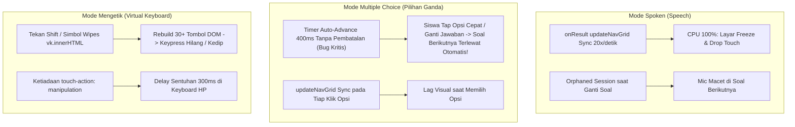
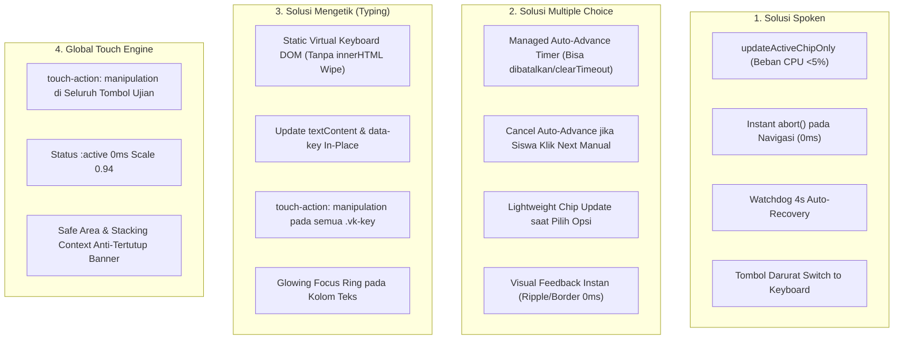

# Implementation Plan: Comprehensive Test Room Responsiveness & Reliability Overhaul (Spoken, Typing & Multiple Choice)

Audit menyeluruh dan arsitektur perbaikan untuk **seluruh mode ujian di TopsCore LMS** (`Spoken`, `Written / Typing`, `Multiple Choice`, dan `Phrase Chips`), menjamin **responsivitas tinggi**, tombol instan (0ms latency), tidak ada mic macet, dan **menghilangkan bug soal terlewat/loncat sendiri**.

---

## 1. Goal Description

Menghilangkan seluruh keluhan ketidakresponsifan, tombol sulit ditekan, mikrofon macet, dan keanehan input di seluruh jenis ujian pada `test.html`:
1. **Mode Spoken (Speech-to-Text)**: Menghilangkan layar beku saat bicara, benturan hardware mic saat ganti soal, dan deadlock tombol mic.
2. **Mode Mengetik (Written & Virtual Keyboard)**: Menghilangkan tap delay pada keyboard virtual, mencegah DOM thrashing saat tombol Shift/simbol ditekan, dan menjamin input responsif di HP maupun laptop.
3. **Mode Pilihan Ganda (Multiple Choice & Phrase Chips)**: Menghilangkan **bug kritis soal loncat/terlewat sendiri** akibat timer auto-advance yang tidak dibatalkan, serta menghilangkan lag saat memilih opsi.
4. **Sentuhan Global (Touch Engine)**: Mengaktifkan respon sentuhan instan (*zero 300ms delay*) di seluruh tombol antarmuka tes.

---

## 2. Hasil Audit Komparatif: Apakah Masalah Ini Juga Terjadi di Mengetik & Pilihan Ganda?

> [!IMPORTANT]
> **YA, DITEMUKAN MASALAH SIGNIFIKAN PADA SISTEM PILIHAN GANDA DAN MENGETIK!**
> 
> Dari hasil audit baris demi baris pada [`js/test.js`](file:///d:/Tutor%20Tampan/TopsCore/js/test.js) dan [`css/test.css`](file:///d:/Tutor%20Tampan/TopsCore/css/test.css), kami menemukan kelemahan spesifik di setiap sistem:



---

### A. Temuan Kritis pada Mode Pilihan Ganda (`renderMC` & `renderPhraseChips`)

1. **Bug Kritis: Soal Loncat / Terlewat Sendiri (`js/test.js:2347`, `2392`)**:
   - Kode saat ini:
     ```javascript
     const nextBtn = document.getElementById('bottom-next-btn');
     if (nextBtn && nextBtn.textContent.includes('Next')) setTimeout(() => nextBtn.click(), 400);
     ```
   - **Akar Masalah**: Timer `setTimeout` ini **tidak disimpan ke variabel dan tidak pernah dibatalkan (`clearTimeout`)**.
   - **Skenario Nyata**: 
     - Siswa memilih opsi A. Timer 400ms mulai berjalan.
     - Siswa menyadari salah pilih dan dengan cepat menekan opsi B dalam 200ms.
     - Timer kedua (400ms) dibuat.
     - Pada 400ms, timer pertama menekan tombol `Next` (pindah ke Soal 2).
     - Beberapa milidetik kemudian, timer kedua **menekan tombol `Next` lagi di Soal 2!**
     - **Hasilnya**: Soal 2 langsung terlewat tanpa sempat dibaca siswa! Siswa mengeluh: *"Sistem loncat sendiri / tombol tidak bisa dikontrol"*.
   - Jika siswa memilih opsi dan secara refleks langsung menekan tombol `Next` di bawah, timer 400ms tetap akan menembak dan melompati soal berikutnya.

2. **DOM Thrashing pada Setiap Pemilihan Opsi (`js/test.js:2344`)**:
   - Memanggil `updateNavGrid()` penuh secara sinkronus pada setiap tap, memproses seluruh array soal dan JSON snapshot sebelum transisi visual selesai.

3. **Ketiadaan `touch-action: manipulation;` pada `.mc-option` (`css/test.css`)**:
   - Menghasilkan jeda sentuh 300 milidetik di layar HP Android/iPhone.

---

### B. Temuan Kritis pada Mode Mengetik (`renderWritten` & Virtual Keyboard)

1. **Rebuild Seluruh Keyboard DOM saat Tekan Shift / Simbol (`js/test.js:1833-1877`, `3151`)**:
   - Fungsi `renderKeyboardKeys()` dijalankan setiap kali siswa menekan tombol `Shift`, `?123`, atau `ABC`.
   - Fungsi ini menghapus dan membangun ulang seluruh 30+ elemen tombol keyboard menggunakan string HTML besar `vk.innerHTML = ...`.
   - Jika siswa mengetik cepat di HP (misal menekan huruf besar lalu huruf kecil), penghapusan DOM ini membuat sentuhan jari kedua hilang (*missed keypress*) dan memicu *reflow* layar.

2. **Delay Sentuhan pada Tombol Keyboard (`.vk-key`)**:
   - Tombol keyboard virtual belum memiliki `touch-action: manipulation;`. Siswa yang mengetik cepat sering merasa tombol keyboard terasa "berat" atau tidak secepat keyboard bawaan HP.

3. **Status Textarea Readonly Tanpa Indikator Fokus**:
   - Pada beberapa browser mobile, karena textarea diset `readonly`, kursor berkedip tidak selalu muncul. Siswa tidak yakin apakah kolom ketik sudah aktif atau belum jika belum menekan keyboard.

---

### C. Ringkasan Evaluasi 3 Mode

| Aspek Masalah | Spoken (Speech) | Multiple Choice (Pilihan Ganda) | Written (Mengetik) |
| :--- | :---: | :---: | :---: |
| **Main Thread CPU Freeze** | 🔴 Parah (setiap suku kata) | 🟡 Sedang (pada setiap klik opsi) | 🟢 Ringan (sudah debounce, tapi rebuild saat Shift) |
| **Tombol Macet / Tidak Merespons** | 🔴 Ya (deadlock state & mutex) | 🟡 Ya (karena 300ms tap delay) | 🟡 Ya (saat Shift rebuild DOM) |
| **Resiko Soal Terlewat / Loncat** | 🟢 Tidak | 🔴 **SANGAT TINGGI (Bug Auto-Advance)** | 🟢 Tidak |
| **Delay Sentuhan HP (300ms)** | 🔴 Ada | 🔴 Ada | 🔴 Ada |
| **Hardware / Service Disconnection** | 🔴 Ya (Google STT / Mic lock) | 🟢 Tidak ada | 🟢 Tidak ada |

---

## 3. Arsitektur Solusi Terpadu (Seluruh Mode Ujian)



### 1. Solusi Mode Multiple Choice:
- **Managed Auto-Advance Engine**:
  ```javascript
  let _mcAutoAdvanceTimer = null;
  function scheduleMcAutoAdvance(delay = 400) {
    if (_mcAutoAdvanceTimer) {
      clearTimeout(_mcAutoAdvanceTimer);
      _mcAutoAdvanceTimer = null;
    }
    _mcAutoAdvanceTimer = setTimeout(() => {
      _mcAutoAdvanceTimer = null;
      const nextBtn = document.getElementById('bottom-next-btn');
      if (nextBtn && nextBtn.textContent.includes('Next') && !nextBtn.disabled) {
        nextBtn.click();
      }
    }, delay);
  }
  function cancelMcAutoAdvance() {
    if (_mcAutoAdvanceTimer) {
      clearTimeout(_mcAutoAdvanceTimer);
      _mcAutoAdvanceTimer = null;
    }
  }
  ```
- Begitu siswa menekan tombol `Next` atau `Prev` secara manual, `cancelMcAutoAdvance()` langsung membatalkan timer yang tertunda. **Soal dijamin 100% tidak akan pernah loncat sendiri!**

### 2. Solusi Mode Mengetik (Virtual Keyboard):
- **In-Place Shift Toggling**: Alih-alih menghapus seluruh DOM keyboard dengan `innerHTML`, sistem cukup mengubah status `class` dan `textContent` pada tombol huruf yang ada. DOM tetap stabil, tidak ada *flicker*, dan tidak ada sentuhan yang hilang.
- **Zero-Latency Touch**: Seluruh `.vk-key` diberikan `touch-action: manipulation;` dan `-webkit-tap-highlight-color: transparent;`.
- **Active Focus Glow**: Area textarea diberikan efek fokus menyala (`border: 1.5px solid #06b6d4`, `box-shadow: 0 0 16px rgba(6,182,212,0.3)`) saat aktif sehingga siswa tahu input siap menerima ketikan.

### 3. Solusi Mode Spoken:
- Sesuai rancangan 4 lapis:
  1. `updateActiveChipOnly` saat berbicara.
  2. `abortActiveSpeechSession()` saat berpindah soal dalam 0ms.
  3. Watchdog 4 detik auto-recovery.
  4. Opsi darurat *Switch to Keyboard* jika mic perangkat rusak.

---

## 4. Proposed Changes

### Component 1: `js/speech.js` — State Machine & Watchdog
- `abort()` method (`recognition.abort()`).
- 4-state lifecycle (`idle`, `starting`, `listening`, `stopping`).
- Watchdog 4000ms untuk inisialisasi yang terhenti.

### Component 2: `js/test.js` — All-Modes Engine Fixes
- **MC Auto-Advance Safety**: Implementasi `_mcAutoAdvanceTimer` dengan fungsi pembatalan otomatis di `renderMC`, `renderPhraseChips`, dan tombol navigasi `bottomNext`/`bottomPrev`.
- **Global Speech Teardown**: `abortActiveSpeechSession()` dipanggil pada seluruh event navigasi.
- **Zero-Jank Spoken Interim**: Ganti `updateNavGrid()` pada `onResult` dengan `updateActiveChipOnly`.
- **Keyboard Optimization**: Optimasi `renderKeyboardKeys()` dan penanganan event `Shift` tanpa merusak DOM.
- **Emergency Typing Toggle**: Tombol pintas alih ke mode tulis jika mic gagal.

### Component 3: `css/test.css` — Global Touch Latency & Animations
- Terapkan `touch-action: manipulation;` pada:
  - `.speech-mic-btn-lg`
  - `.mc-option`
  - `.vk-key`
  - `.btn-nav-prev`, `.btn-nav-next`
  - `.question-counter`, `.q-nav-btn`
- Efek tekan instan `:active` (`transform: scale(0.94)` / `0.96` dalam 0.05s).
- Indikator fokus bercahaya pada `textarea.written-input` dan `#answer-container-written`.

---

## 5. Verification Plan

### Automated Tests
1. **Node Syntax Checks**:
   ```powershell
   node -c js/speech.js
   node -c js/test.js
   ```
2. **Batch & Journey E2E Regressions**:
   ```powershell
   node scripts/test_batch_eligibility.mjs
   node scripts/test_vocab_7x7_and_leveling_e2e.mjs
   ```
3. **Automated Auto-Advance Multi-Click Simulation**:
   - Buat script pengujian simulasi memilih opsi A lalu langsung opsi B dalam 150ms pada Pilihan Ganda.
   - Verifikasi bahwa sistem **tidak melompati soal berikutnya**.

### Manual Verification
1. **Uji Pilihan Ganda**:
   - Pilih opsi jawaban, lalu segera ganti ke opsi lain sebelum 400ms: pastikan soal berpindah tepat 1 soal, tidak melompat 2 soal.
   - Pilih opsi lalu segera tekan tombol `Next`: pastikan soal tidak lompat dua kali.
2. **Uji Mengetik**:
   - Ketik cepat di keyboard virtual: pastikan respons instan tanpa lag.
   - Tekan Shift berkali-kali: pastikan keyboard tidak kedip/flicker dan tombol tetap merespons.
3. **Uji Spoken**:
   - Bicara kalimat panjang: pastikan layar 60 FPS dan tombol Next langsung merespons saat berbicara.
   - Tekan Next saat mic aktif: mic langsung mati dalam 0ms dan siap di soal baru.
