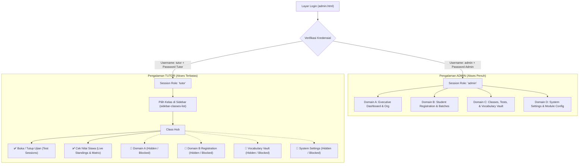

# RENCANA ARSITEKTUR & IMPLEMENTASI: ROLE TUTOR (RBAC) — TOPSCORE LMS

> **Kode Dokumen:** Implementation Plan — Multi-Role Access Control (Admin vs Tutor)  
> **Status:** Menunggu Persetujuan Pengguna (Feedback Required)

---

## 1. Goal Description

Menambahkan sistem otentikasi dan kontrol akses berbasis peran (**Role-Based Access Control / RBAC**) pada Tutor's Room (`admin.html`) sehingga platform memiliki dua jenis akun dengan batasan akses yang tegas:

1. **`ADMIN` (Super Admin / Academic Director):**
   - Memiliki akses penuh ke seluruh ABCD System:
     - `A — ADMIN` (Dashboard Eksekutif, Manajemen Institusi/Organisasi, Profil)
     - `B — BOARD` (Pendaftaran Siswa / Student Registration, CRUD Batch, Import/Export Excel)
     - `C — CLASS` (Manajemen Kurikulum, Pembuat Soal / Test Builder, Vocabulary Vault)
     - `D — DATA` (System Settings, Konfigurasi Modul AI, Audit Log Keamanan)
   - Dapat mengubah kredensial/password Admin maupun Tutor.

2. **`TUTOR` (Guru Pendamping / Pengawas Ujian):**
   - Dikhususkan untuk tutor/guru kelas di lapangan saat mengawal sesi drill dan ujian.
   - **HANYA BISA:**
     1. **Buka Tutup Ujian (`test-sessions` di Class Hub):**
        - Membuka Sesi Normal (drill / ujian utama).
        - Membuka Sesi Remidi.
        - Memasukkan Siswa Susulan (+ Late Students).
        - Memperpanjang batas waktu pengerjaan (Add Time).
        - Menutup sesi ujian (Close Session / Kunci).
     2. **Cek Nilai Siswa (`attendance` / Matrix di Class Hub):**
        - Memantau progress pengerjaan siswa secara *real-time* (In Progress / Submitted).
        - Melihat papan peringkat (*live standings*), total perolehan poin (PTS), dan skor ujian.
        - Memeriksa kartu nilai/riwayat pengerjaan soal siswa (*inspect report card*).
   - **DILARANG & DISEMBUNYIKAN (STRICTLY RESTRICTED):**
     - ❌ **Dilarang akses Domain A**: Dashboard eksekutif, setting institusi/program disembunyikan.
     - ❌ **Dilarang akses Domain B**: Halaman pendaftaran/impor/penghapusan siswa (`student-registration`) disembunyikan.
     - ❌ **Dilarang ubah Kurikulum & Vault**: Halaman Vocabulary Vault (`vocab_vault`) dan Test Builder disembunyikan.
     - ❌ **Dilarang akses Domain D**: Halaman System Settings (`settings`), konfigurasi Modul AI, dan Audit Log disembunyikan.
     - ❌ **Proteksi Rute URL**: Jika Tutor mencoba mengetik URL hash seperti `#settings`, `#dashboard`, atau `#vocab_vault`, sistem otomatis menolak akses dan mengarahkan kembali ke ruang ujian kelas.

---

## 2. User Review Required

> [!IMPORTANT]
> **Kredensial Default untuk Akun Tutor:**
> - **Username default:** `tutor`
> - **Password default:** `tutor123`
> 
> Admin dapat mengubah password Tutor ini kapan saja melalui menu **System Settings** (Pilar D), dan nilai password akan tersimpan secara terpusat di tabel database `site_settings` sehingga langsung berlaku di semua perangkat tutor tanpa perlu mengubah kode.

> [!NOTE]
> **Pilihan Akses Kelas untuk Tutor:**
> Secara default, Tutor akan dapat memilih kelas mana yang sedang diawasi melalui daftar kelas di sidebar (`sidebar-classes-list` e.g. *1st Vocabulary*, *2nd Vocabulary*, *3rd Vocabulary*). Setelah kelas dipilih, Tutor langsung masuk ke **Class Hub** dengan tab aktif **Test Sessions** (Buka/Tutup Ujian) dan **Standings** (Cek Nilai).

---

## 3. Diagram Alur & Hak Akses (RBAC Flowchart)



---

## 4. Proposed Changes

### A. Modul Session & State Management (`js/session.js`)
#### [MODIFY] `js/session.js`
- Menambahkan parameter `role` pada `setAdminSession(data)` (`'admin'` atau `'tutor'`).
- Menambahkan fungsi helper:
  - `getAdminRole()`: membaca `'admin'` atau `'tutor'`.
  - `isAdmin()`: mengembalikan `true` hanya jika role adalah `'admin'`.
  - `isTutor()`: mengembalikan `true` jika role adalah `'tutor'`.

```javascript
export function setAdminSession(data) {
  const payload = JSON.stringify({
    admin_id: data.admin_id || 'admin',
    username: data.username || 'admin',
    role: data.role || 'admin',
    authenticated_at: new Date().toISOString(),
  });
  try { sessionStorage.setItem(ADMIN_SESSION_KEY, payload); } catch (_) {}
  try { localStorage.setItem(ADMIN_SESSION_KEY, payload); } catch (_) {}
}

export function getAdminRole() {
  const session = getAdminSession();
  return session?.role || 'admin';
}

export function isTutorRole() {
  return getAdminRole() === 'tutor';
}

export function isAdminRole() {
  return getAdminRole() === 'admin';
}
```

---

### B. Otentikasi & Routing Guard (`js/admin/app.js`)
#### [MODIFY] `js/admin/app.js`

1. **Logika Login Ganda (Admin vs Tutor):**
   - Mendeteksi login sebagai `tutor`:
     - Username: `tutor` (case-insensitive).
     - Password: periksa custom tutor password dari `site_settings` / `localStorage`, atau fallback ke `tutor123`.
     - Jika cocok, panggil `setAdminSession({ admin_id: 'tutor-staff', username: user, role: 'tutor' })`.
     - Tampilkan toast sambutan: `"Welcome, Tutor! Exam Proctor Console Activated."`.

2. **Adaptasi Tampilan Berdasarkan Role (`applyRoleRestrictions`):**
   - Menambahkan class `.role-tutor` pada `document.body` jika session adalah tutor.
   - Mengubah User Chip di pojok kiri bawah:
     - Avatar: `T` (warna Indigo/Biru).
     - Nama: `Tutor`.
     - Role Label: `Exam Proctor / Monitor`.
   - **Penyembunyian Menu Sidebar:**
     - Sembunyikan Domain A (`[data-domain="admin"]`).
     - Sembunyikan Domain B (`[data-domain="board"]`).
     - Di Domain C: sembunyikan `Curriculum`, `Vocabulary Vault` (`vocab_vault`), dan tombol edit test definition. Pertahankan daftar kelas (`sidebar-classes-list`) agar tutor bisa memilih kelas ujian.
     - Sembunyikan Domain D (`[data-domain="desk"]`).

3. **Routing Guard (`loadSection`):**
   - Tentukan daftar whitelist rute yang diizinkan untuk Tutor:
     ```javascript
     const TUTOR_ALLOWED_SECTIONS = ['class-hub', 'test-access', 'tests'];
     ```
   - Jika pengguna bertindak sebagai Tutor dan mencoba membuka rute terlarang (misal `settings`, `dashboard`, `student-registration`, `vocab_vault`, `modules`):
     - Sistem langsung membatalkan navigasi.
     - Menampilkan notifikasi: `"Access Denied: Tutor role is restricted to Test Sessions and Score Inspection."`.
     - Mengarahkan rute secara otomatis ke `#class-hub?tab=test-sessions`.

4. **Pembatasan Tab di Class Hub (`renderClassHub`):**
   - Untuk Tutor, tab di header Class Hub disaring menjadi hanya:
     1. **Test Sessions** (Buka/Tutup Sesi Ujian, Tambah Susulan, Perpanjang Waktu).
     2. **Standings / Nilai** (Tabel Skor, Papan Peringkat, Rekapitulasi).
   - Tab `tests` (Class Tests / Edit Soal) dan tombol CRUD kurikulum disembunyikan.

---

### C. Manajemen Password Tutor oleh Admin (`js/admin/desk.js`)
#### [MODIFY] `js/admin/desk.js`
- Menambahkan kartu **"Tutor Access & Proctor Credentials"** di menu System Settings (Pilar D).
- Admin dapat melihat status akun Tutor dan mengganti password Tutor kapan saja.
- Tombol *"Save Tutor Password"* menyimpan password ke tabel `site_settings` (key: `tutor_password`) dan `localStorage` sebagai cache.

---

### D. Styling & Penataan Visual Role (`css/admin.css`)
#### [MODIFY] `css/admin.css`
- Menambahkan penanda visual khusus saat login sebagai Tutor (misal badge status hijau "PROCTOR MODE" pada topbar).
- Aturan CSS pengaman untuk elemen `.admin-only` agar otomatis tersembunyi jika `body.role-tutor` aktif.

---

### E. Skrip Uji Verifikasi Otomatis (`scripts/test_tutor_role_rbac.mjs`)
#### [NEW] `scripts/test_tutor_role_rbac.mjs`
- Menguji alur otentikasi Admin (`admin` / `admin123`) -> menghasilkan `role: 'admin'`.
- Menguji alur otentikasi Tutor (`tutor` / `tutor123`) -> menghasilkan `role: 'tutor'`.
- Menguji routing guard: rute yang diizinkan (`class-hub`, `test-access`) vs rute yang diblokir (`settings`, `dashboard`, `vocab_vault`, `student-registration`).
- Menguji isolasi aksi: memastikan fungsi pembuat/penghapus soal dan pendaftaran siswa menolak eksekusi saat peran adalah Tutor.

---

## 5. Verification Plan

### Automated Tests
1. **Eksekusi Test Suite Role Baru:**
   ```powershell
   node scripts/test_tutor_role_rbac.mjs
   ```
2. **Validasi Sintaks & Import Seluruh Proyek:**
   ```powershell
   npm run test:syntax
   npm run test:imports
   npm run test:health
   npm test
   ```

### Manual Verification
1. **Uji Login Sebagai Admin:**
   - Buka `admin.html` di browser.
   - Masuk dengan `admin` / `admin123`.
   - Pastikan seluruh 4 Domain (A, B, C, D) tampil lengkap, tombol tambah/edit/hapus berfungsi normal.
2. **Uji Login Sebagai Tutor:**
   - Logout dari Admin.
   - Masuk dengan `tutor` / `tutor123`.
   - Periksa sidebar: Domain A, Domain B, Vocabulary Vault, dan Domain D **hilang**.
   - Klik kelas pada sidebar (misal *3rd Vocabulary*): masuk ke Class Hub dengan tab **Test Sessions** dan **Nilai Siswa**.
   - Lakukan uji buka sesi normal / remidi: sesi berhasil dibuka.
   - Lakukan uji cek nilai siswa: skor dan riwayat attempt tampil jelas.
   - Coba ketik `#settings` pada URL browser: sistem menolak dan mengembalikan ke Class Hub dengan aman.
