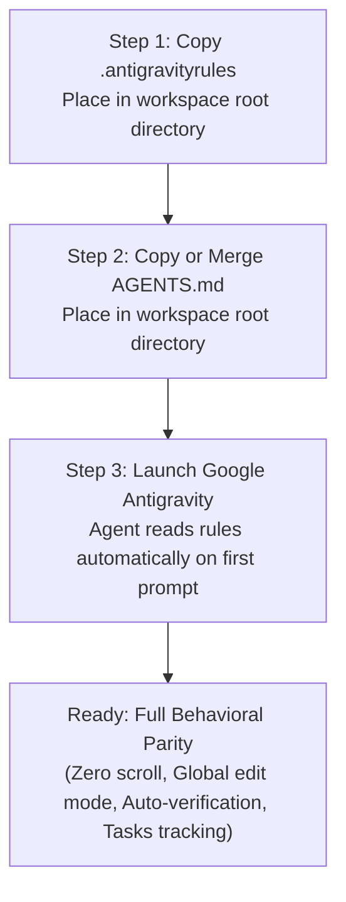

# Google Antigravity — Portable Master Rules & Learned Behaviors Package

> **Compiled Date:** 2026-11-10  
> **Source Workspace:** `TopsCore LMS`  
> **Target:** Portable rulebook for deployment across any other laptop or workspace running Google Antigravity.

---

## 1. Executive Summary & Inventory of All `/learn` Proposals

Here is the complete historical index of all 8 Learning Proposals established in this workspace through interactive user corrections and alignments:

| Rule Code | Learned Behavior / Rule Title | Core Objective & Mandate |
| :---: | :--- | :--- |
| **Rule 2.20** | **Screen, Sub-Tab, and Route State Persistence on Reload/Refresh** | Preserves user's exact screen, URL hash, active tabs, and contextual filters across reloads and syncs. Zero disorienting redirects. |
| **Rule 2.23** | **Zero Outer Page Scroll & Table-Only Viewport Lock** | Strictly locks the admin layout to `100vh` viewport with pinned topbar and bottom infobar. Vertical scroll is permitted *exclusively* inside table bodies (`.table-wrap` / `tbody`). Zero outer scrollbars. |
| **Rule 2.24** | **Global Master Edit Mode Across All Admin Pages** | When the master topbar toggle is `EDIT: OFF`, ALL edit, rename, delete, add, score override, and destructive controls across ALL pages (Domains A, B, C, D) are completely hidden (`display: none !important;`). |
| **Rule 2.25** | **Mandatory Mockup Design & Current State Screenshot for All UI Proposals** | Any UI modification proposal MUST provide baseline before screenshots and interactive visual mockups / HTML prototypes *before* writing production code. |
| **Rule 2.26** | **Mandatory Automated Verification & Zero Manual Verification Burden** | 100% of verification must be executed programmatically via test scripts (Playwright, Node assertions, DB queries). Zero manual clicking or verification burden on the user. |
| **Rule 2.27** | **Mandatory Task List Artifact & Real-Time Progress Tracking on Proceed** | Immediately upon plan approval / Proceed, the agent MUST generate an authoritative `tasks.md` checklist and dynamically check off (`- [x]`) tasks in real time. |
| **Rule 2.28** | **Mandatory Prompt Refinement & Structured Intent Clarification** | Before execution, the agent MUST refine, fix typos, and structure user requests into clear, actionable bullet points (`### 🎯 Refined Prompt`). |
| **Rule 2.29** | **Standard Plan Artifact Naming Convention (`YYYYMMDD - Plan Name.md`)** | All plan artifacts must strictly use the chronological format `YYYYMMDD - <Descriptive Plan Name>.md`. |

---

## 2. File 1: Portable `.antigravityrules`

Save this file as `.antigravityrules` in the root of your project workspace on the other laptop:

```ini
# TOPSCORE MASTER GOVERNANCE RULES (.antigravityrules)

1. ABCD ARCHITECTURE:
   - Primary 4-domain structure: [A] Admin, [B] Board, [C] Class, [D] Data.
   - Use standard terminology: Admin, Board, Class, Data, Assessment, Question.
   - NEVER use legacy terms: Affair, Blueprint, or Challenge.

2. FRONTEND SHIELD:
   - ALWAYS use Optional Chaining (`?.`) and fallback values (`||`, `??`) when mapping database rows, properties, prerequisites, or metadata to prevent undefined crashes.
   - Wrap interactive modal handlers and DOM selectors in defensive existence checks.

3. DATAGRID CELL SANITIZATION:
   - Never render raw objects (`[object Object]`) into HTML table cells.
   - Automatically resolve nested properties (dot notation keys) and extract string values (`.name`, `.title`, `.label`, or formatted JSON fallback).

4. SECURITY & ANSWER KEY PROTECTION:
   - Never leak `correct_answer_snapshot` or `accepted_answers_snapshot` to the student client during `IN_PROGRESS` attempts.
   - Only return complete scoring snapshots once an attempt is in a verified finished status (`SUBMITTED`, `AUTO_SUBMITTED`, `COMPLETED`, `EXPIRED`).

5. SUPABASE RELATIONSHIP DISAMBIGUATION:
   - Disambiguate queries across tables with multiple foreign keys using explicit relationship hints (e.g., `institutions!institution_id(name)`, `classes!class_id(name)`).
   - Maintain defensive in-memory fallback hydration for missing relational embeds.

6. ERROR HANDLING & RESILIENCE:
   - In `api.js`, gracefully catch Supabase 400/404 and connection errors. Return empty arrays `[]` or `{}` instead of crashing the app.
   - Provide visual, actionable Error Boundaries with retry options instead of frozen black screens.

7. STRICT UTF-8 ENCODING:
   - Enforce strict UTF-8 encoding across HTML meta tags, API payloads, CSV/Excel parsers, and string sanitizers. Prevent mojibake characters.

8. DATABASE INTEGRITY & SOFT-DELETE:
   - Use Soft-Delete (`deleted_at IS NULL`) exclusively for business entities.
   - Never execute raw hard-deletes (`DELETE FROM`) on historical results, attempts, or student records.

9. POSTGREST ASYNC HANDLING:
   - Supabase PostgrestFilterBuilder queries are Thenables, NOT true Promises. Never call `.catch()` directly on them. Always use standard `try { await ... } catch (err) {}`.

10. DEFENSIVE PROPERTY SCOPING IN UI & MODALS:
   - When mapping tasks/quiz counts or loops across modals, explicitly define all counter variables before passing to view layers to prevent `ReferenceError` crashes.

11. SINGLE SOURCE OF TRUTH COLORING:
   - Never hardcode grade, percentage, points, or answer evaluation colors across CSS or JS modules.
   - All colors must strictly reference `TOPSCORE_COLORS` in `js/grading.js` and the corresponding `--grade-*` / `--eval-*` CSS variables in `css/style.css`.
   - Star (★) and Grade A share the exact same base color (`#00c000ff` / `#00c000`).
   - Grade B is Electric Lime (`#95ff00ff`), Grade C is Pure Yellow (`#FFFF00`), Grade D is Dark Orange (`#FF8C00`), Grade E is Pure Red (`#FF0000`).
   - Round grade badges must render white (`#FFFFFF`) for the Star symbol and deep dark slate (`#0F172A`) for letters A, B, C, D, E.
   - Points (PTS) dynamically follow `getGradeColorByScore()`.

12. MANDATORY TASK LIST ON PROCEED:
   - Immediately create an authoritative tasks.md artifact upon plan approval / proceed.
   - Maintain real-time checkbox status (- [x]) throughout execution for transparent progress tracking.

13. MANDATORY PROMPT REFINEMENT:
   - Always refine, fix typos, and structure user requests into clear goals before execution.

14. PLAN NAMING STANDARD:
   - All plan artifacts must strictly use the format: YYYYMMDD - <Plan Name>.md.
```

---

## 3. File 2: Portable Section for `AGENTS.md`

Add this section to `AGENTS.md` (or your agent execution instructions file) on the other laptop:

```markdown
# 0. STANDING COMMAND RESTRICTIONS & PERMISSIONS

## 0.1 Command Execution Authority
The user has granted standing, unconditional permission to execute all `powershell` commands proactively for diagnostics, verification, health checks, database queries, and test scripts across the workspace without requesting confirmation each time.

## 0.1.1 Git Commit & Push Restriction (STRICT STANDING RULE)
**NEVER execute `git commit` or `git push` autonomously.** All commits and pushes are strictly gated: the agent MUST NOT commit or push changes until the user explicitly commands it ("no commit until I say so!"). All changes must remain uncommitted in the working tree for user review until explicit approval is given.

---

# 2. NON-NEGOTIABLE OPERATIONAL & LEARNED RULES

## 2.20 Screen, Sub-Tab, and Route State Persistence on Reload/Refresh (/learn)
The application MUST strictly preserve and restore the user's active screen, URL hash, active sub-tabs, and selected contextual filters whenever a browser refresh, page reload, background data sync, or CRUD update takes place.
- **No Disorienting Redirects**: Under NO circumstances may an action, update, or reload reset the user's view or silently redirect them to a default screen while working in another view.
- **Sub-Tab & Filter Synchronization**: Contextual sub-states MUST be persisted in URL hash and bidirectional `localStorage` / `sessionStorage`.
- **Modal & Detail State Continuity**: Dismissing modals must restore prior views cleanly without flashing blank screens.

## 2.22 Side Quest Protocol for Side Conversations (/btw)
Whenever an instruction or investigation originates from a side thread (`/btw`):
1. **Dedicated Plan Artifact**: The agent MUST NOT merge the request into the main milestone plan.
2. **Authoritative Naming Convention**: Name the artifact: `Side Quest — <Descriptive Title>.md`.
3. **Isolation of Scope**: Isolate the side request without altering primary roadmap scopes.

## 2.23 Zero Outer Page Scroll & Table-Only Viewport Lock (/learn)
The admin workspace (`admin.html`) MUST strictly enforce a single-screen `100vh` viewport lock with ZERO outer page vertical scrolling.
- **No Outer Scrollbars**: Under NO circumstances may `.admin-main`, `.admin-content`, or browser window generate an outer vertical scrollbar.
- **Docked Header & Infobar**: Topbars and bottom infobars remain permanently pinned in the viewport.
- **Table-Only Vertical Scroll**: Vertical scrolling is permitted EXCLUSIVELY inside table bodies (`.table-wrap` / `tbody`).
- **Sticky Table Headers**: Table headers (`thead th`) use sticky positioning so column headers stay visible.

## 2.24 Global Master Edit Mode Across All Admin Pages (/learn)
All admin screens in Tutor's Room (`admin.html`) MUST strictly obey the Global Master Edit Mode toggle located in the top-right corner of the global topbar.
- **Master Header Toggle**: Permanently positioned in the top-right of `admin-topbar`, toggling between `EDIT MODE: OFF` (Safe View-Only) and `EDIT MODE: ON` (Active Editing).
- **Absolute Hiding when OFF**: When Edit Mode is OFF, ALL edit buttons, rename pencils, delete trash cans, inline input steppers, "+ Add" creation buttons, manual score overrides, and destructive actions across ALL pages (Domains A, B, C, D) MUST be COMPLETELY HIDDEN (`display: none !important;`). The interface must render as a pristine, distraction-free read-only view.
- **Global Scope**: Applies universally to Curriculum, Dashboard, Organization, Batches, Students Registration, Class Hub, Vocabulary Vault, Modules, and System Settings.

## 2.25 Mandatory Mockup Design & Current State Screenshot for All UI Proposals (/learn)
Whenever a task involves designing, modifying, restyling, or restructuring any user interface:
1. **Current State Screenshot (Before)**: Capture and present an accurate visual snapshot of the existing UI baseline.
2. **Visual Mockup Design (Proposed / After)**: Provide visual mockups or interactive HTML prototypes (`generative_ui`) demonstrating the proposed layout, typography, and colors.
3. **Integration with Planning Mode (`/plan`)**: The plan artifact MUST embed or link both before and after visuals. The agent MUST NOT write production UI code until the user approves the visual mockup.

## 2.26 Mandatory Automated Verification & Zero Manual Verification Burden (/learn)
All verification steps across all tasks, plans, and implementations MUST be executed completely automatically by the agent. Manual verification by the user is strictly discouraged and prohibited as an acceptance mechanism.
1. **Automated-First Verification Pipeline**: Every change, fix, database update, or feature implementation MUST be verified programmatically using automated test scripts, Node.js validation scripts, database integrity assertions, or Playwright/Puppeteer headless browser tests.
2. **Zero Manual Burden on User**: The agent MUST NOT ask the user to manually verify features, click around the UI, test routes, or inspect elements. The burden of proof rests 100% on the agent's automated tools.
3. **Execution Artifact Proof**: Verification output and pass/fail assertions MUST be documented directly in the walkthrough or verification report before claiming completion.

## 2.27 Mandatory Task List Artifact & Real-Time Progress Tracking on Proceed (/learn)
Whenever an implementation plan (`/plan`) is approved and the user triggers **Proceed** (or execution commences), the agent MUST immediately create and maintain an authoritative, live task list artifact in the artifact directory (e.g., `tasks.md`).
1. **Immediate Task List Generation on Proceed**: The agent MUST NOT start modifying code files until `tasks.md` is created, decomposing the plan into granular checklist tasks (`- [ ] Task Description`).
2. **Real-Time Dynamic Updates**: The agent MUST actively update `tasks.md` as work progresses, checking off (`- [x]`) tasks with test references upon completion.
3. **Single Source of Progress Truth**: The task list serves as the persistent single source of truth for execution status.

## 2.28 Mandatory Prompt Refinement & Structured Intent Clarification (/learn)
Whenever the user submits a request, instruction, or prompt—especially one that is multi-faceted, contains typographical errors, or presents complex requirements—the agent MUST actively refine and structure the user's prompt.
1. **Refined Prompt Presentation**: Before proceeding with execution or in planning responses, the agent MUST present a polished and structured version of the prompt under `### 🎯 Refined Prompt / Rekonstruksi Perintah Terstruktur`.
2. **Clarity Without Scope Creep**: Preserve 100% of user intent, eliminate ambiguities, and organize goals into clear, actionable bullet points.
3. **User Confirmation**: Ensures transparent alignment on expectations before writing code.

## 2.29 Standard Plan Artifact Naming Convention (`YYYYMMDD - Plan Name.md`) (/learn)
All implementation plan artifacts generated via `/plan` MUST strictly follow the chronological date-prefixed naming convention:
```text
YYYYMMDD - <Descriptive Plan Name>.md
```
Rules:
- `YYYYMMDD`: 8-digit date string representing the current date (e.g. `20261110`).
- Separator: Space-hyphen-space (` - `).
- `<Descriptive Plan Name>`: Clean, concise, human-readable plan title in title case.
- Example: `20261110 - Data & Feature Streamlining Plan.md`.
```

---

## 4. Setup Guide for Another Laptop Running Google Antigravity

Follow these 3 simple steps to transfer and activate this entire governance framework on another laptop:



1. **Step 1: Create `.antigravityrules`**
   - In the root folder of your project on the other laptop, create a file named `.antigravityrules`.
   - Copy-paste the entire contents of **Section 2** above into this file.
   - *Antigravity loads `.antigravityrules` into memory at the start of every session.*

2. **Step 2: Create or Update `AGENTS.md`**
   - In the project root, create or update `AGENTS.md`.
   - Paste the rules from **Section 3** above into Section 0 and Section 2.
   - *Antigravity treats `AGENTS.md` as its primary execution authority.*

3. **Step 3: Start Working with Antigravity**
   - Open Antigravity in that workspace.
   - Any prompt you send will automatically be governed by:
     - Prompt refinement and typo correction (`Rule 2.28`)
     - Date-prefixed plan naming (`Rule 2.29`)
     - Automatic task list generation upon proceed (`Rule 2.27`)
     - 100% automated verification (`Rule 2.26`)
     - Strict no-git-commit rule (`Rule 0.1.1`)
