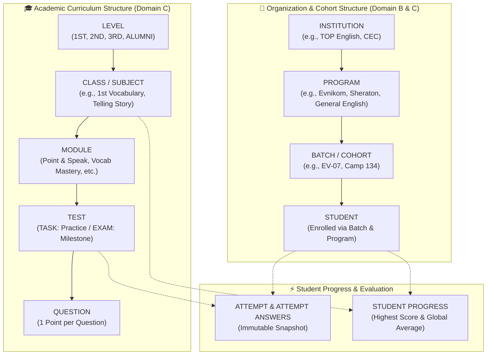
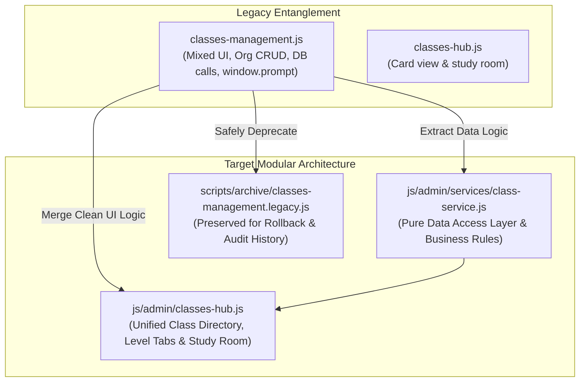
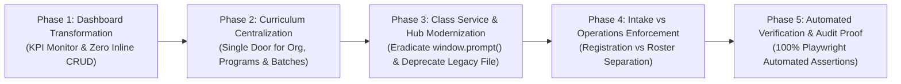

# 20261110 — Master Architecture Plan: Data Hierarchy & Feature Streamlining

> **Document Type:** Master Architectural Specification & Streamlining Plan  
> **Authority Level:** Standard TopsCore Plan (AGENTS.md Rules 2.20, 2.23, 2.24, 2.25, 2.26, 2.27, 2.28, 2.29)  
> **Interactive Mockup:** [mockup_streamlined_dashboard_classhub.html](file:///C:/Users/ASUS/.gemini/antigravity/brain/db70e579-3b54-4473-9eed-e7677e0d8525/mockup_streamlined_dashboard_classhub.html)  
> **Status:** Fully Integrated with Approved Enhancements — Ready for Phased Execution  

---

## 1. Executive Summary & Problem Diagnostic

Over successive phases of rapid feature development, TopsCore has accumulated significant interface redundancy ("fungsi ganda") and architectural sprawl:
1. **Fungsi Ganda (Duplicate & Competing Controls)**:
   - Identical entity creation and edit buttons (`+ Add Institution`, `+ Add Program`, `+ Add Class`, `+ Add Batch`) are scattered across **four separate screens**: Dashboard (`#dashboard`), Curriculum (`#curriculum`), Classes Management (`#classes`), and Class Hub (`#classes-hub`).
   - Student intake and maintenance is split between Student Registration (`#registration`), Student Roster (`#students`), and multiple competing modals.
   - Question and test authoring is fragmented across `test-builder.js`, `vocab-vault.js`, `classes-management.js`, and `test-analytics.js`.
2. **Inconsistent Interaction Paradigms**:
   - Legacy files utilize raw browser alerts and blocking inputs like `window.prompt('Enter new class name:')`, breaking visual immersion and mobile responsiveness.
   - Action bars suffer from "button overload" (e.g., rows with 6–8 micro-buttons: `Edit`, `Del`, `Pub`, `Sync`, `Clone`, `Move`, `Export`), creating high cognitive friction.
3. **Unclear Responsibility Boundaries**:
   - Tutors and Admins are frequently disoriented: *"Do I create a batch in Dashboard, in Curriculum, or in Roster?"*
   - Tutors see destructive organization-level controls that only Super Admins should touch.
4. **Target Outcome**:
   - **Single-Door Governance (Satu Pintu per Entitas)**: Exactly ONE authoritative home for each level of the academic model.
   - **Clean & Streamlined Experience**: Dashboards monitor, Curriculum structures, Class Hub teaches, and Registration enrolls.
   - **Standardized UI Controls**: Consolidated Action Bars (Primary Button + `⋯` Options Dropdown) and 100% native TopsCore glassmorphism modal dialogs.

---

## 2. Interactive Mockup & Visual Architecture (Rule 2.25)

Per AGENTS.md Rule 2.25, visual architecture and interactive prototypes must be provided and reviewed before touching production code.

- **Standalone Interactive Prototype**: [mockup_streamlined_dashboard_classhub.html](file:///C:/Users/ASUS/.gemini/antigravity/brain/db70e579-3b54-4473-9eed-e7677e0d8525/mockup_streamlined_dashboard_classhub.html)

### Visual Progression (Before vs Streamlined After)

````carousel
```text
[BEFORE: Dashboard Layout - Fragmented & Cluttered]
┌────────────────────────────────────────────────────────────────────────┐
│ TOPBAR: [Search...]                        [EDIT MODE: ON] [Tutor]      │
├────────────────────────────────────────────────────────────────────────┤
│ [➕ Add Institution] [➕ Program] [➕ Class] [➕ Batch]                 │
│                                                                        │
│ 🏢 TOP English [✏️] [🗑️]                                                │
│   └── 📁 Evnikom [➕ Batch] [✏️] [🗑️]                                  │
│         └── 👥 EV-07 [✏️] [🗑️] [Sync Students]                           │
│   └── 📁 Sheraton [➕ Batch]                                            │
│                                                                        │
│ ⚠️ Issues: Cluttered micro-buttons, competing CRUD on monitor screen,   │
│ duplicate actions across 4 pages.                                      │
└────────────────────────────────────────────────────────────────────────┘
```
<!-- slide -->
```text
[AFTER: Streamlined Dashboard - Executive KPI Monitor]
┌────────────────────────────────────────────────────────────────────────┐
│ TOPBAR: [Search...]                        [EDIT MODE: OFF] [Admin]     │
├────────────────────────────────────────────────────────────────────────┤
│ ┌──────────────────┐ ┌──────────────────┐ ┌──────────────────┐         │
│ │ TOTAL STUDENTS   │ │ ACTIVE COHORTS   │ │ PASS RATE (AVG)  │         │
│ │   1,420          │ │   18 Batches     │ │   94.2% ★        │         │
│ └──────────────────┘ └──────────────────┘ └──────────────────┘         │
│                                                                        │
│ 🚀 QUICK NAVIGATION                                                    │
│ [ 🏢 Manage Cohorts (Curriculum) ]   [ 🎓 Class Directory (Hub) ]      │
│ [ 👥 Register Students ]             [ 📊 View Analytics ]             │
│                                                                        │
│ ⚡ Clean Executive View: Zero inline micro-buttons, zero distraction!   │
└────────────────────────────────────────────────────────────────────────┘
```
<!-- slide -->
```text
[AFTER: Consolidated Class Hub Directory with Action Bar]
┌────────────────────────────────────────────────────────────────────────┐
│ LEVEL TABS: [ 1ST LEVEL ]  [ 2ND LEVEL ]  [ 3RD LEVEL ]  [ ALUMNI ]   │
├────────────────────────────────────────────────────────────────────────┤
│ ┌────────────────────────────────────────────────────────────────────┐ │
│ │ 📖 1st Vocabulary Mastery                     [ Active | 8 Tests ] │ │
│ │ Description: Core vocabulary drills and spoken evaluation.        │ │
│ │                                                                    │ │
│ │ [ Open Class Hub ] ── Primary Action                               │ │
│ │ [ ⋯ ] ────────────── Options Dropdown (Edit, Sync, Archive)        │ │
│ └────────────────────────────────────────────────────────────────────┘ │
│                                                                        │
│ ✨ Sleek, unified cards with primary action + secondary dropdown menu! │
└────────────────────────────────────────────────────────────────────────┘
```
````

---

## 3. The Core Data Model (Single Source of Truth)

The platform strictly organizes data into two clean, parallel hierarchies:



---

## 4. Single-Door Governance Matrix (Eliminasi Fungsi Ganda)

Every administrative entity is assigned a strict, non-overlapping single home:

| Entity Tier | Authorized Single Location | Defunct/Redundant Locations to Eradicate |
| :--- | :--- | :--- |
| **Institutions** | **Curriculum (`#curriculum`)** | ❌ Remove `➕ Add Institution`, `✏️ Edit`, `🗑️ Delete` from Dashboard (`admin-deck.js`)<br/>❌ Remove `+ Inst` from Classes Management (`classes-management.js`) |
| **Programs** | **Curriculum (`#curriculum`)** | ❌ Remove `➕ Program` from Dashboard (`admin-deck.js`)<br/>❌ Remove `+ Add Program` from Classes Management (`classes-management.js`) |
| **Batches (Cohorts)** | **Curriculum (`#curriculum`)** | ❌ Remove `➕ Batch` from Dashboard (`admin-deck.js`)<br/>❌ Remove duplicate batch creation from Roster (`#students`) |
| **Classes & Levels** | **Class Hub (`#classes`)** | ❌ Remove `➕ Class` from Dashboard (`admin-deck.js`)<br/>❌ Merge legacy split panel in `classes-management.js` into unified Class Hub |
| **Student Enrollment** | **Student Registration (`#registration`)** | ❌ Centralize all enrollment into Registration (Single & Batch Import). Roster (`#students`) is strictly for monitoring, lifecycle promotion, and grading. |
| **Assessments (Tasks & Exams)** | **Class Detail / Learning Path (`#classes`)** | ❌ Centralize test authoring in Test Builder. Topic Blueprint (`#vault`) serves as the item bank source. |

---

## 5. Standardized UI Interaction Patterns (Integrated Enhancement)

### 5.1 Elimination of Browser `prompt()` and `alert()`
All legacy invocations of `window.prompt()` (e.g., `classes-management.js` lines 336, 381: `prompt('Enter new class name:')`, `prompt('Enter new class code:')`) and raw browser alerts will be eliminated and replaced with TopsCore's native modal system:
```javascript
// Stand-in replacement pattern:
window.openTopsCoreModal({
    title: 'Edit Class Details',
    fields: [
        { id: 'class-name', label: 'Class Name', type: 'text', value: currentName },
        { id: 'class-code', label: 'Class Code', type: 'text', value: currentCode }
    ],
    confirmText: 'Save Changes',
    onConfirm: async (values) => {
        await updateClassDetails(classId, values);
    }
});
```

### 5.2 Action Bar Consolidation (Primary Action + Options Menu `⋯`)
To prevent visual clutter across tables and directory cards:
1. **Primary Action**: Emphasized high-frequency button (e.g., `Open Class Hub` or `View Roster`).
2. **Options Dropdown (`⋯`)**: Accessible popover containing secondary actions (`✏️ Edit Details`, `🔄 Sync Data`, `📦 Archive`, `🗑️ Delete`).
3. **Global Edit Mode Compliance**: When Edit Mode is OFF, destructive options in the dropdown are automatically omitted or disabled.

---

## 6. Role-Based Access Guard Matrix (Integrated Enhancement)

To ensure users only see controls relevant to their operational responsibilities:

| Operational Domain | Super Admin Scope | Tutor / Teacher Scope |
| :--- | :--- | :--- |
| **Dashboard (`#dashboard`)** | Full KPI overview, System health, Audit logs | Active batch stats, Today's assessment queue |
| **Curriculum (`#curriculum`)** | Create/Edit/Delete Institutions, Programs, Batches | Read-only cohort directory; Batch level status |
| **Class Hub (`#classes`)** | Full Class creation, Curriculum mapping, Archive | Open study rooms, Run live tests, View student work |
| **Student Intake (`#registration`)** | Batch spreadsheet import, System enrollment | Individual student intake for assigned batches |
| **Student Roster (`#students`)** | Lifecycle promotion, Global score overrides | Attendance check, Remedial tagging, Task grading |
| **System Settings (`#settings`)** | Database connection, API keys, Security rules | Hidden / Access Denied |

---

## 7. Code Migration & Clean File Deprecation Strategy (Integrated Enhancement)

To ensure zero technical debt, modular maintainability, and clean separation of concerns:



### Execution Rules for Deprecation:
1. **Step 1 — Service Extraction**: Extract Supabase queries and CRUD helper methods from `classes-management.js` into a reusable, pure service: `js/admin/services/class-service.js`.
2. **Step 2 — Unified Class Hub UI**: Port required modal controls and level grouping into `js/admin/classes-hub.js`.
3. **Step 3 — Routing & Event Redirection**: Update `admin-router.js` and `app.js` so route `#classes` cleanly points exclusively to `classes-hub.js`.
4. **Step 4 — Safe Archival**: Rename and move legacy file to `scripts/archive/classes-management.legacy.js` with deprecation header, ensuring zero dangling script tags in `admin.html`.

---

## 8. Phase-by-Phase Implementation Roadmap



### Phase 1: Dashboard Transformation (Executive Monitor)
- **Scope**: `js/admin/admin-deck.js`, `admin.html`.
- **Tasks**:
  1. Strip all inline `➕ Add`, `✏️ Edit`, `🗑️ Delete` buttons from the Dashboard hierarchy widget.
  2. Implement executive KPI cards (Total Students, Active Batches, Completion Rate).
  3. Implement domain navigation quick-pills pointing to `#curriculum`, `#classes`, and `#registration`.
- **Verification**: Headless assertion confirming zero CRUD buttons exist on `#dashboard`.

### Phase 2: Curriculum Centralization (Cohort Management)
- **Scope**: `js/admin/curriculum-management.js`.
- **Tasks**:
  1. Establish `#curriculum` as the authoritative single door for Institutions, Programs, and Batches.
  2. Implement clean breadcrumbs (`TOP English > Evnikom > EV-07`).
  3. Apply Action Bar consolidation pattern (Primary Action + `⋯` Options Dropdown).
- **Verification**: Automated test asserting full CRUD functionality within `#curriculum` and zero leakages.

### Phase 3: Class Service Extraction & Hub Modernization
- **Scope**: Create `js/admin/services/class-service.js`, update `js/admin/classes-hub.js`, archive `classes-management.js`.
- **Tasks**:
  1. Extract Supabase data operations into `class-service.js`.
  2. Eradicate all `window.prompt()` and replace with native TopsCore modal dialogs.
  3. Consolidate card action bars with `Open Class Hub` + `⋯ Options Dropdown`.
  4. Move legacy `classes-management.js` to `scripts/archive/classes-management.legacy.js`.
- **Verification**: Automated browser test exercising class card interactions, modal updates, and route navigation.

### Phase 4: Intake vs Operations Enforcement
- **Scope**: `js/admin/student-registration.js`, `js/admin/student-management.js`.
- **Tasks**:
  1. Enforce `#registration` as the sole portal for Single and Bulk Spreadsheet enrollment.
  2. Enforce `#students` as the dedicated operations floor (Roster, Attendance, Scoring, Life cycle promotion).
- **Verification**: Assertion confirming clean intake in Registration and distraction-free operational controls in Roster.

### Phase 5: Automated Verification & Zero-Burden Quality Gate
- **Scope**: `scripts/test_streamlined_architecture.mjs`.
- **Tasks**:
  1. Comprehensive automated Playwright test suite verifying:
     - Zero duplicate buttons across all 4 screens.
     - Single-door routing and navigation continuity.
     - 100% compliance with Rule 2.24 (Global Edit Mode) and Rule 2.23 (100vh lock).
     - Zero browser `prompt()` or blocking dialogs.
  2. Generate walkthrough artifact with visual screenshots.

---

## 9. Next Action & Proceed Protocol

When you are ready to begin execution, simply instruct **"Proceed"** or **"Lanjutkan"**.
Upon proceed, the agent will immediately:
1. Generate the authoritative live tracking artifact `tasks.md` per AGENTS.md Rule 2.27.
2. Execute the phases sequentially with automated test verification per AGENTS.md Rule 2.26.
3. Keep all changes uncommitted in the working tree per AGENTS.md Rule 0.1.1.