# Implementation Plan: Perbaikan Isolasi Data Nilai Evnikom vs Camp & Penataan Kolom Test

> **Status:** Menunggu Persetujuan Pengguna (Planning Mode `/plan`)  
> **Target:** `admin.html#students`, `js/admin/student-management.js`, `js/admin/student-registration.js`, database `progress` & `tests`

---

## 1. Analisa Masalah & Sumber Penyebab (Root Cause Analysis)

Berdasarkan investigasi mendalam pada kode sumber dan data Supabase, ditemukan 4 akar permasalahan utama mengapa daftar siswa **Evnikom (EV-07)** memunculkan kolom nilai **Camp** dan mengapa daftar test-nya bermasalah:

```
[MASALAH UTAMA]
1. Siswa Evnikom EV-07 menampilkan kolom:
   - CAMP 2ND VOCABULARY (Exam 1, Exam 2, Exam 3, Exam 4) -> SEMUA KOSONG (—)
   - CAMP 3RD VOCABULARY (Exam 1, Exam 2, Exam 3, Exam 4) -> SEMUA KOSONG (—)
   - EVNIKOM 1ST VOCABULARY (Exam 1, Exam 2, Exam 3, Exam 4) -> SEMUA KOSONG (—)
2. Siswa Evnikom sudah mengerjakan task (misal 1A1 Task nilai 100%), tetapi tabel sama sekali tidak mencerminkan nilai mereka!
```



```mermaid
flowchart TD
    subgraph Pendaftaran_Siswa [Akar Masalah 1: student-registration.js]
        A["Admin daftarkan siswa ke Program Evnikom"] --> B["Ambil SEMUA active classes di DB (tanpa filter program_id)"]
        B --> C["Buat record progress untuk Camp 1st, Camp 2nd, Camp 3rd, dan Evnikom 1st!"]
        C --> D["Database progress tercemar: Siswa Evnikom terdata 'enrolled' di kelas Camp"]
    end

    subgraph Roster_Table [Akar Masalah 2: student-management.js]
        E["Buka Roster Batch Evnikom EV-07"] --> F["Discovery kolom kelas membaca perClassFinal & allProgress"]
        F --> G["TIDAK ADA filter: cls.program_id === currentProgramId!"]
        G --> H["Kolom kelas Camp 2nd & 3rd ikut muncul di tabel Evnikom!"]
    end

    subgraph Hardcoded_Exams [Akar Masalah 3: Hardcoded 4 Exam A, B, C, D]
        I["Kolom test dipaksa membuat 4 kolom: Exam 1, 2, 3, 4"] --> J["Pencocokan theme hanya mengenali Theme A, B, C, D"]
        J --> K["Evnikom 1st Vocab hanya punya Exam 1G (Theme G General)"]
        K --> L["Theme G tidak cocok dengan A, B, C, D -> Muncul strip kosong '—' semua!"]
    end
```

### Rincian 4 Akar Masalah:

1. **Pencemaran Data `progress` saat Registrasi Siswa (`student-registration.js`)**:
   - Pada baris 618–635 (import Excel) dan baris 1008–1017 (pendaftaran individual), sistem membuat row `progress` level 1 dengan mengambil `sb.from('classes').select('id').eq('is_active', true)` **tanpa memfilter `program_id`**.
   - Akibatnya, setiap siswa Evnikom otomatis dibuatkan record progress untuk kelas *Camp 1st Vocabulary*, *Camp 2nd Vocabulary*, *Camp 3rd Vocabulary*, dan *Evnikom 1st Vocabulary*.
2. **Ketiadaan Filter Program Boundary pada Penemuan Kolom Kelas (`student-management.js`)**:
   - Pada baris 359–431 (`perClassFinal`) dan baris 1980–1992 (`activeClassIdsInGrid`), sistem membaca seluruh kelas yang ada di `classesMap` dan record `allProgress` siswa.
   - Karena siswa Evnikom memiliki record progress di Camp 2nd & 3rd, sistem menganggap siswa "terdaftar" di kelas-kelas Camp tersebut dan memasukkan kolom kelas Camp ke dalam tabel batch Evnikom.
   - Sesuai aturan **AGENTS.md Bagian 1.3 & 2.5**, Kelas berada di bawah PROGRAM, dan Siswa berada di bawah BATCH/PROGRAM. Kelas Camp tidak boleh bocor ke Program Evnikom!
3. **Kolom Test Dipaksa Menjadi 4 Kolom Exam Kaku (Exam 1, 2, 3, 4 untuk Theme A, B, C, D)**:
   - Pada baris 366–410 dan 2000–2070, sistem berasumsi semua kelas selalu memiliki 4 Exam mingguan (A, B, C, D).
   - Di *Evnikom 1st Vocabulary*, kurikulum hanya memiliki 3 test:
     1. `1A1-WORDS-TASK` (`1st Vocabulary A1 Words Task - Time Name`)
     2. `1G2-WORDS-TASK` (`1st Vocabulary G2 Words Task - Family Member`)
     3. `1G-WORDS-EXAM` (`1st Vocabulary G Words Exam - General`)
   - Karena kode hanya mencari Theme A, B, C, D, maka Exam `1G` (Theme G) diabaikan total, dan kolom `Exam 1, 2, 3, 4` semuanya menampilkan tanda strip `—`.
4. **Struktur Urutan Test Evnikom di Database Belum Rapi**:
   - Urutan test di `Evnikom 1st Vocabulary` memiliki `display_order`: 1, 3, 4 (nomor 2 lompat).
   - Theme A memiliki Task (`1A1`) tetapi belum ada Exam tersendiri (`1A-WORDS-EXAM`), sedangkan Theme G memiliki Task (`1G2`) dan Exam gabungan kumulatif (`1G-WORDS-EXAM`).

---

## 2. Visual Baseline: Current State vs Proposed State (Aturan 2.25)

### 2.1 Current State (Kondisi Saat Ini yang Error)
Berikut adalah tangkapan layar asli dari aplikasi yang menunjukkan kebocoran kolom Camp dan kolom Exam kosong pada batch Evnikom EV-07:


### 2.2 Proposed Visual Mockup (Kondisi Rapi yang Diharapkan)
Berikut adalah desain visual yang bersih, rapi, dan sesuai dengan hirarki akademik:

```text
┌────────────────────────────────────────────────────────────────────────────────────────────────────────────────────────┐
│ B — BOARD > Evnikom EV-07                                                               [ EDIT: OFF ] [ NEXT 🚀 ]      │
├───────┬──────────────────────────┬────────┬────────┬──────────────────────────┬─────────────────────────────┬──────────┤
│ LEVEL │ STUDENT NAME             │ AGE    │ GENDER │ 1A1 TASK (TIME NAME)     │ 1G EXAM (GENERAL)           │ ACTIONS  │
├───────┼──────────────────────────┼────────┼────────┼──────────────────────────┼─────────────────────────────┼──────────┤
│  1ST  │ 👤 Ahmad Haekal Firdaus   │ 24 yrs │   M    │ 40/40 pts (100% ★)       │ —                           │ 🔒 👁 ✏️ │
│  1ST  │ 👤 Aryadhewa Julian F.    │ 23 yrs │   M    │ 40/40 pts (100% ★)       │ —                           │ 🔒 👁 ✏️ │
│  1ST  │ 👤 Imam Azama            │ 17 yrs │   M    │ 39/40 pts (98% A)        │ —                           │ 🔒 👁 ✏️ │
│  1ST  │ 👤 Test Evnikom          │ —      │   M    │ —                        │ —                           │ 🔒 👁 ✏️ │
├───────┼──────────────────────────┼────────┼────────┼──────────────────────────┼─────────────────────────────┼──────────┤
│  AVG  │ ★ BATCH AVERAGE (4 Stud) │ 21.3 y │ 4M · 0F│ 39.7 pts (99% A)         │ —                           │          │
└───────┴──────────────────────────┴────────┴────────┴──────────────────────────┴─────────────────────────────┴──────────┘
```

> [!TIP]
> **Keunggulan Tampilan Baru:**
> 1. Kolom kelas Camp (`CAMP 2ND`, `CAMP 3RD`) lenyap 100% dari tabel Evnikom!
> 2. Kolom test dinamis mengikuti test yang benar-benar ada di kelas tersebut (bukan dipaksa 4 kolom strip kosong A, B, C, D).
> 3. Nilai riil siswa (Ahmad Haekal 100%, Aryadhewa 100%, Imam 98%) langsung terlihat dengan warna grade resmi TopsCore (`TOPSCORE_COLORS`), bukan strip kosong!

---

## 3. User Review Required & Design Decisions

> [!IMPORTANT]
> **Keputusan Format Kolom Roster:**
> Apakah tabel Student Roster untuk kelas vocabulary sebaiknya:
> - **Opsi A (Rekomendasi - Dinamis Sesuai Test Kelas):** Menampilkan kolom dinamis sesuai daftar test/exam yang benar-benar ada di kelas tersebut (misal untuk Evnikom: Task 1A1, Task 1G2, Exam 1G; untuk Camp 2nd: Exam 1, 2, 3, 4).
> - **Opsi B (Khusus Exam Saja):** Hanya menampilkan kolom milestone Exam yang ada di kelas tersebut (untuk Evnikom: 1 kolom `Exam 1G General`; untuk Camp: 4 kolom `Exam A`, `Exam B`, `Exam C`, `Exam D`), sedangkan rincian per-task tetap dapat diakses lengkap via modal eye-icon `showStudentProgressDetails`.

> [!NOTE]
> **Pembersihan Data `progress` (Database Cleanup):**
> Kami akan menjalankan script pembersihan untuk menghapus baris `progress` yang salah relasi (di mana `progress.student_id` milik program Evnikom tetapi `progress.class_id` milik program Camp). Tindakan ini **tidak menghapus nilai/attempt riil**, melainkan hanya menghapus relasi pendaftaran palsu yang terbuat saat pendaftaran otomatis.

---

## 4. Proposed Changes (Langkah Perbaikan Kode)

### 4.1 Frontend Component: Student Registration
File: [`js/admin/student-registration.js`](file:///d:/Tutor%20Tampan/TopsCore/js/admin/student-registration.js)

#### [MODIFY] `student-registration.js`
- **Tujuan**: Mencegah pencemaran data progress di masa depan.
- **Perubahan**:
  1. Pada fungsi bulk import (baris 618–635), saat menginisialisasi progress kelas untuk siswa yang baru dibuat/diimpor, filter kelas secara ketat berdasarkan `program_id` siswa tersebut:
     ```javascript
     // Sebelum:
     for (const cls of allClasses) { ... }
     // Sesudah:
     const targetProgId = s.program_id || currentProgId;
     const eligibleClasses = (allClasses || []).filter(c => !c.program_id || c.program_id === targetProgId);
     for (const cls of eligibleClasses) { ... }
     ```
  2. Pada fungsi registrasi individual (baris 1008–1017):
     ```javascript
     // Sebelum:
     const { data: allClasses } = await sb.from('classes').select('id').eq('is_active', true);
     // Sesudah:
     const { data: progClasses } = await sb.from('classes').select('id')
       .eq('is_active', true)
       .eq('program_id', createdStudent.program_id);
     ```

---

### 4.2 Frontend Component: Student Management Roster Grid
File: [`js/admin/student-management.js`](file:///d:/Tutor%20Tampan/TopsCore/js/admin/student-management.js)

#### [MODIFY] `student-management.js`
- **Tujuan**: Menghilangkan kebocoran kolom Camp dari roster Evnikom dan membuat kolom test dinamis sesuai isi kelas yang aktif.
- **Perubahan**:
  1. Pada baris 359 (`perClassFinal`):
     Tambahkan guard ketat program boundary:
     ```javascript
     classesMap.forEach((cls, cId) => {
       // Guard: Siswa hanya dievaluasi pada kelas yang cocok dengan programnya
       if (cls.program_id && s.program_id && cls.program_id !== s.program_id) return;
       if (currentProgramId && cls.program_id && cls.program_id !== currentProgramId) return;
       ...
     ```
  2. Pada baris 1980 (`activeClassIdsInGrid`):
     Pastikan kolom kelas yang dimunculkan hanya kelas milik program aktif:
     ```javascript
     filteredGridData.forEach(row => {
       if (row.perClassFinal) row.perClassFinal.forEach((_, cId) => {
         const cls = classesMap.get(cId);
         if (cls && (!currentProgramId || !cls.program_id || cls.program_id === currentProgramId)) {
           activeClassIdsInGrid.add(cId);
         }
       });
     });
     // Begitu juga saat memeriksa allProgress:
     (allProgress || []).forEach(p => {
       const cls = classesMap.get(p.class_id);
       if (cls && (!currentProgramId || !cls.program_id || cls.program_id === currentProgramId)) {
         const studentRow = filteredGridData.find(r => r.id === p.student_id);
         if (studentRow) activeClassIdsInGrid.add(p.class_id);
       }
     });
     ```
  3. **Penataan Kolom Test Dinamis**:
     - Ubah pembangkitan kolom dari hardcode 4 exam A/B/C/D menjadi dinamis berdasarkan test yang dimiliki kelas tersebut (`classTests`):
     - Jika kelas memiliki 4 tema A, B, C, D (seperti Camp), kolom tetap menampilkan `Exam 1 (A)`, `Exam 2 (B)`, `Exam 3 (C)`, `Exam 4 (D)`.
     - Jika kelas memiliki struktur lain (seperti Evnikom dengan `1A1 Task`, `1G2 Task`, dan `1G Exam`), kolom akan menampilkan test/exam riil kelas tersebut beserta perolehan poin/persentase siswa yang valid.

---

### 4.3 Database Maintenance & Cleanup Script
File baru: `scripts/cleanup_cross_program_progress.mjs`

#### [NEW] `scripts/cleanup_cross_program_progress.mjs`
- **Tujuan**: Membersihkan row di tabel `progress` yang menyambungkan siswa Evnikom ke kelas Camp atau sebaliknya.
- **Logika**:
  ```javascript
  // 1. Ambil data progress beserta students(program_id) dan classes(program_id)
  // 2. Temukan record di mana students.program_id != classes.program_id
  // 3. Verifikasi apakah ada attempt pada kelas tersebut (jika 0 attempt, aman dihapus)
  // 4. Hapus record progress palsu tersebut
  ```

---

### 4.4 Kurikulum & Test Sequencer Evnikom 1st Vocabulary
- Rapikan urutan `display_order` test di `Evnikom 1st Vocabulary`:
  - `1A1-WORDS-TASK` -> Order 1
  - (Opsional: Tambahkan `1A-WORDS-EXAM` jika Theme A memerlukan exam, atau set `1G2-WORDS-TASK` -> Order 2, `1G-WORDS-EXAM` -> Order 3)
  - Pastikan prerequisite berantai linear tanpa ada gap.

---

## 5. Verification Plan (100% Automated — Zero Manual Verification)

Sesuai aturan `/learn`, seluruh tahap verifikasi akan dieksekusi secara otomatis oleh agen menggunakan automated script tanpa membebani pengguna dengan verifikasi manual.

### 5.1 Automated Database Cleanup Verification
Script: `scripts/cleanup_cross_program_progress.mjs`
```powershell
node scripts/cleanup_cross_program_progress.mjs --dry-run
node scripts/cleanup_cross_program_progress.mjs --execute
```
* **Kriteria Lolos Otomatis**:
  - Semua record `progress` yang tidak sesuai program (`student.program_id !== class.program_id`) terdeteksi dan terhapus.
  - Record progress yang sah untuk `Evnikom 1st Vocabulary` tetap utuh.

### 5.2 Automated Code Syntax & Unit Health
```powershell
node scripts/check_all_js_syntax.cjs
```
* **Kriteria Lolos Otomatis**:
  - 100% file JavaScript (`student-management.js`, `student-registration.js`, dsb.) bebas dari syntax error.

### 5.3 Automated Headless E2E Browser Test (Playwright / Puppeteer)
Script: `scripts/test_evnikom_roster_isolation_e2e.mjs`
```powershell
node scripts/test_evnikom_roster_isolation_e2e.mjs
```
* **Verifikasi DOM Otomatis**:
  1. Melakukan navigasi otomatis ke `http://127.0.0.1:5500/admin.html#students`.
  2. Memilih batch `Evnikom EV-07` via script.
  3. Memeriksa DOM header tabel:
     - Assert `CAMP 2ND VOCABULARY` **TIDAK ADA** (`expect(dom).not.toContain('CAMP 2ND')`).
     - Assert `CAMP 3RD VOCABULARY` **TIDAK ADA** (`expect(dom).not.toContain('CAMP 3RD')`).
     - Assert `EVNIKOM 1ST VOCABULARY` **ADA** sebagai super-header tunggal.
  4. Memeriksa baris siswa:
     - Assert bahwa nilai riil tugas/test siswa Evnikom (seperti Ahmad Haekal Firdaus dan Aryadhewa) muncul dengan format dan warna yang valid, bukan tanda strip `—`.
  5. Menguji regresi pada batch `Camp 134`:
     - Memastikan batch Camp tetap menampilkan kelas Camp 2nd Vocabulary secara utuh tanpa ada kerusakan.
  6. Mengambil tangkapan layar otomatis (*automated screenshot*) untuk dilampirkan pada laporan akhir `walkthrough.md`.
