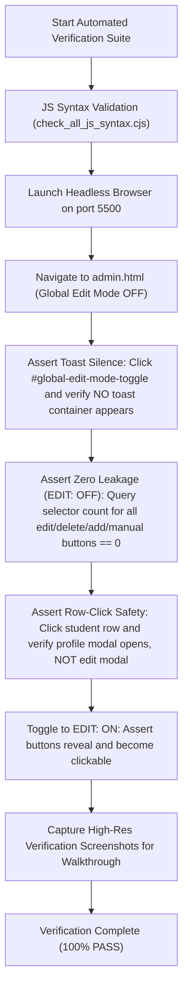

# Implementation Plan — Global Master Edit Mode Unification & Toast Notification Elimination

## 1. Executive Summary & Problem Diagnostic

The user reported two critical issues with the admin workspace (`admin.html`):
1. **Unwanted Toast Notification**:
   - Whenever the Global Edit Mode toggle button (`#global-edit-mode-toggle`) is clicked, an intrusive green/blue toast popup appears (`🔓 Global Edit Mode ACTIVE: Editing controls enabled` / `🔒 Global Edit Mode OFF: Safe read-only view`).
   - The user explicitly requested to completely remove this text notification ("*saat tekan edit mode muncul text keterangan,,, saya tidak suka... hilngkan*").
2. **Incomplete Edit Mode Control & Competing Local "Edit Modes"**:
   - The Global Edit Mode does not currently control all edit/action buttons across the admin console. Many buttons (such as `✏️ Edit`, `🗑️ Delete`, `🔒 Hold`, `🔄 Transfer`, `🚀 NEXT (Promote)`) remain visible even when `EDIT: OFF`.
   - Furthermore, certain pages have their own independent, competing edit modes ("*bahkan di beberapa halaman ada edit mode sendiri*"). Specifically, the **Class Hub attendance matrix** (`app.js`) implements its own local `MANUAL 🟢 ON / ⚪ OFF` column header toggle and per-row `✏️ EDIT` buttons that operate completely independently of Global Edit Mode.
   - When Global Edit Mode is `OFF`, clicking a student row still opens the full edit modal (`openStudentFullEdit`), directly violating **AGENTS.md Rule 2.24**.

---

## 2. Visual Baseline (Current State Screenshots — Before)

Per **AGENTS.md Rule 2.25**, the baseline screenshots below document the current visual defects:

### Issue A: Intrusive Toast Notification on Toggle

*Fig 1. Intrusive popup text triggered on every toggle click (`admin-init.js:19`).*

### Issue B: Action Buttons Leaking when EDIT: OFF (Student Roster)

*Fig 2. With `EDIT: OFF` (top right), student row action buttons (`🔒 🔄 📊 👤 ✏️ ⛔`) and promotion controls remain visible.*

### Issue C: Competing "Edit Mode Sendiri" (Class Hub Manual Input Column)

*Fig 3. Class Hub attendance matrix features its own independent `MANUAL 🟢 ON / ⚪ OFF` header toggle and `✏️ EDIT` buttons.*

---

## 3. Proposed Visual Mockup & Interactive Prototype (After)

Per **AGENTS.md Rule 2.25**, an interactive prototype has been authored and is available in the artifact workspace:
- **Interactive Mockup**: [mockup_global_edit_mode_interactive.html](file:///C:/Users/ASUS/.gemini/antigravity/brain/db70e579-3b54-4473-9eed-e7677e0d8525/mockup_global_edit_mode_interactive.html)

### Key Visual & Behavioral Invariants:
1. **Silent, Instant Feedback**: Toggling `#global-edit-mode-toggle` changes the button's background, border glow, dot animation (`edit-mode-pulse`), and text between `🔒 EDIT: OFF` and `🔓 EDIT: ON`. **Zero toast popups are triggered.**
2. **Pristine Read-Only View (`EDIT: OFF`)**:
   - In Student Roster: `🚀 NEXT (Promote All Eligible)`, `🔒 Hold`, `🔄 Transfer`, `✏️ Edit`, and `🗑️ Delete` are strictly hidden (`display: none !important;`). Only read-only inspect buttons (`📊 Details`, `👤 Profile Card`) remain.
   - In Class Hub: The entire `MANUAL` column is completely hidden. No competing header toggle.
   - In Curriculum & Classes: `+ Add Institution`, `+ Add Program`, `+ Add Class`, `+ Add Batch`, `⚡ Sync Words`, `Pub/Unpub`, `Delete`, and toggle switches are hidden.
   - In Dashboard & Modules & Desk: All CRUD buttons, engine configure buttons, and recycle bin restore/purge buttons are hidden.
3. **Active Edit View (`EDIT: ON`)**:
   - All creation, editing, and publishing controls smoothly reveal themselves.

---

## 4. Architectural Analysis & Code Diff Strategy

### 4.1 Toast Elimination
- **File**: `js/admin/admin-init.js`
- **Change**: In `initGlobalEditModeToggle()`, remove lines 18–20:
  ```javascript
  // BEFORE
  const newState = toggleGlobalEditMode();
  if (typeof window.showToast === 'function') {
    window.showToast(newState ? '🔓 Global Edit Mode ACTIVE: ...' : '🔒 Global Edit Mode OFF: ...', ...);
  }

  // AFTER
  toggleGlobalEditMode();
  ```

### 4.2 Subsuming Class Hub Manual Input under Global Edit Mode
- **File**: `js/admin/app.js`
- **Changes**:
  1. Add `.edit-mode-only` to the manual input column definition:
     ```javascript
     className: 'col-asm col-action col-manual-input edit-mode-only',
     ```
  2. Guard `window.toggleAllManualInputMode` and `window.toggleRowManualInput`:
     ```javascript
     if (!window.getGlobalEditMode?.()) {
       return; // Block execution when edit mode is OFF
     }
     ```
  3. In `js/session.js`: When `setGlobalEditMode(false)` is invoked, automatically clear any active manual input drafts and reset `window._manualInputState.activeStudentIds.clear()`.

### 4.3 Systematic `.edit-mode-only` Application Across All Domains

| Domain / File | Elements to Guard | Changes |
| :--- | :--- | :--- |
| **B — Roster** (`student-management.js`) | `#btn-promote-all-eligible`, `lifeBtn`, `transferBtn`, `editBtn`, `delBtn` | Add `.edit-mode-only` class to each button |
| **B — Roster** (`student-management.js`) | `onRowClick` (lines 2516–2522) | Only trigger `openStudentFullEdit` if `getGlobalEditMode()` is true; otherwise open read-only `showStudentProfileModal(row.id)` |
| **B — Roster** (`student-management.js`) | `btn-prog-toggle-rem`, `btn-modal-toggle-rem`, `#btn-profile-edit-student` | Add `.edit-mode-only` class |
| **B — Registration** (`student-registration.js`) | `#btn-open-modal-add`, `.btn-edit-student` | Add `.edit-mode-only` class |
| **C — Classes** (`classes-management.js`) | `#btn-add-inst-global`, `#btn-add-prog`, `#btn-add-class`, `#btn-auto-gen-words`, `#btn-auto-gen-phrases`, `Add Quiz`, `Add Exam`, `#btn-del-active-class`, Datagrid actions (`Pub/Unpub`, `Edit`, `Del`) | Add `.edit-mode-only` class |
| **C — Class Hub** (`classes-hub.js`) | `openClassesHubEdit`, `deleteClassesHubRecord`, `+ Add Class`, `+ Add Level`, `+ Create First Level`, `.toggle-switch` | Add `.edit-mode-only` class |
| **C — Curriculum** (`curriculum-management.js`) | `+ Add First Institution`, `+ Create New Program`, `+ Add Batch`, `✏️ Edit`, `🗑️ Delete`, `+ New Institution`, `.toggle-switch` | Add `.edit-mode-only` class |
| **A — Dashboard** (`admin-deck.js`) | `✏️ Edit`, `🗑️ Delete`, `➕ Program`, `➕ Class`, `➕ Batch`, `➕ Add Institution` | Add `.edit-mode-only` class |
| **D — Modules** (`modules.js`) | `.btn-configure-engine` | Add `.edit-mode-only` class |
| **D — System Desk** (`desk.js`) | `.btn-restore-item`, `.btn-purge-item` | Add `.edit-mode-only` class |
| **C — Tests & Blueprints** (`tests-management.js`) | `Edit Question` in drawer | Add `.edit-mode-only` class |
| **Universal Stylesheet** (`css/admin.css`) | Zero-leakage rule extension (lines 3639–3660) | Include `.btn-manual-input-toggle`, `.col-manual-input`, `.btn-edit-student`, `.btn-configure-engine`, `.btn-restore-item`, `.btn-purge-item`, `[data-action="edit"]`, `[data-action="delete"]` |

---

## 5. Automated Verification Plan (AGENTS.md Rule 2.26)

Zero manual verification will be required from the user. All checks will run automatically via an end-to-end Playwright test suite (`scripts/test_global_edit_mode_comprehensive.mjs`):



### Specific Assertions in Automated Script:
1. **Toast Absence Assertion**: Hook `window.showToast` or monitor `.toast-container` / `.toast-item` to guarantee zero calls/elements during toggle transitions.
2. **Zero-Leakage Assertion (OFF)**:
   - Evaluates `document.querySelectorAll('.edit-mode-only, .btn-manual-input-toggle, .btn-edit, .btn-delete')`.
   - Asserts computed `getComputedStyle(el).display === 'none'` for 100% of matched elements.
3. **Class Hub Manual Column Assertion**:
   - Asserts `.col-manual-input` has computed style `display: none` when edit mode is OFF.
4. **Row Click Behavior Assertion**:
   - Dispatches click on student row when edit mode is OFF; verifies `#student-profile-modal` exists and `#crud-modal` / `#student-full-edit-modal` is NOT open.
5. **Recovery on Toggle (ON)**:
   - Sets edit mode to ON; verifies `#btn-promote-all-eligible` and student row actions become visible with computed `display !== 'none'`.

---

## 6. Standing Rule Compliance Checklist
- [x] **Rule 0.1.1 (Strict Git Commit/Push Restriction)**: Changes will remain strictly in the working tree for user review. No `git commit` or `git push` will be run.
- [x] **Rule 2.24 (Global Master Edit Mode)**: Universal enforcement across all 10 admin files.
- [x] **Rule 2.25 (Mockup & Baseline Screenshots)**: Baseline screenshots and interactive prototype linked.
- [x] **Rule 2.26 (100% Automated Verification)**: Automated Playwright script planned with zero manual verification burden.

---
*Please review this implementation plan and click **Proceed** to authorize execution.*
