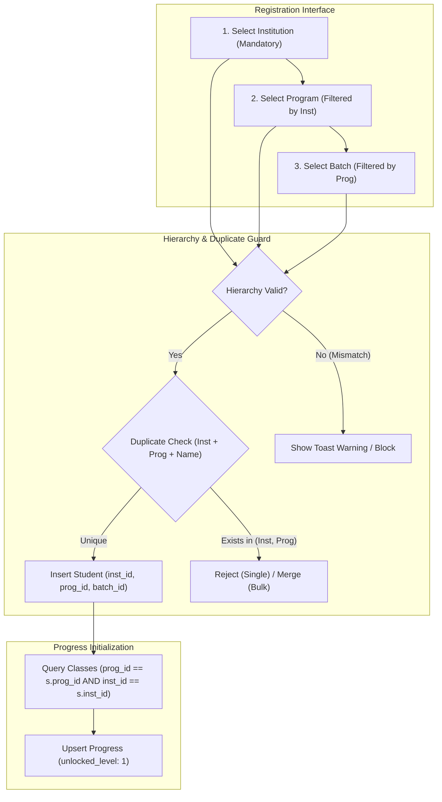

# Implementation Plan — Institution-Aware Student Registration Hierarchy

## 1. Goal Description

In TopsCore LMS, the academic hierarchy is defined as:
```text
INSTITUTION (e.g. TOP, CEC, Tops)
  └── PROGRAM (e.g. Evnikom, Sheraton, Tamata Persada under TOP; Camp under CEC)
        ├── BATCHES (e.g. EV-07, 134)
        │     └── STUDENTS (Grouped by Batch)
        └── CLASSES (e.g. Evnikom 1st Vocabulary)
              └── TESTS (Tasks & Exams)
```

As the user indicated, **one institution can have more than one program** (for example, Institution `TOP` hosts three distinct programs: `Evnikom`, `Sheraton`, and `Tamata Persada`). Currently, student registration and progress initialization logic primarily focused on `program_id` alone, leading to potential gaps:
1. In Single Student Registration (`renderIndividualRegView`), selecting an `institution_id` was not strictly validated as mandatory, and duplicate detection only scoped by `program_id`.
2. In Bulk Spreadsheet Import (`renderBulkImportView`), the duplicate/merge lookup fell back to a bare normalized name (`existingMap.set(norm, s)`), which could mistakenly merge students with the same name across different institutions or across programs within the same institution.
3. In progress record creation (class auto-enrollment), classes were filtered only by `program_id`, without asserting that `class.institution_id === student.institution_id`.
4. Three legacy classes in the database had `program_id` set to Camp but `institution_id: null`.
5. Class creation in `classes-management.js` did not store `institution_id` alongside `program_id`.

This plan makes student registration **fully institution-aware** across all registration pathways (Single Registration, Bulk Import, and Modal creation), enforcing strict hierarchy cascading, compound duplicate protection (`institution_id + program_id + name`), and guaranteed isolated progress initialization.

---

## 2. Visual Architecture & Current State

### Current UI Baseline
- **Single Registration**: Displays Institution, Program, and Batch dropdowns, but only validates Program and Batch upon submission.
- **Bulk Import**: Displays Target Institution, Target Program, Target Batch override selectors, but allows loose cross-tenant resolution.

````carousel

<!-- slide -->

````

---

## 3. User Review Required

> [!IMPORTANT]
> **Compound Student Uniqueness Scope**:
> With this change, a student name is considered unique within `(institution_id, program_id)`.
> - If an institution has multiple programs (e.g. `TOP` has `Evnikom` and `Sheraton`), a student named "Ahmad Haekal" registered in `Evnikom` can also be registered as an independent student in `Sheraton` without being mistakenly merged or blocked.
> - Within the *same* institution and *same* program (`institution_id + program_id`), duplicate names remain blocked.
> - In Bulk Import, the dangerous bare-name fallback (`existingMap.get(normName)`) is removed, preventing cross-institution and cross-program student record overwrites.

> [!NOTE]
> **Database Backfill**:
> Three classes currently have `institution_id: null` with `program_id` pointing to Camp (`Vocabulary 1`, `Vocabulary 2`, `Basic English`). As part of this execution, their `institution_id` will be backfilled to CEC (`f51d4c2c-7c24-42ef-8d8f-b0f3e524a447`), ensuring 100% data consistency.

---

## 4. Proposed Changes



---

### Component 1: `js/admin/student-registration.js`

#### [MODIFY] `js/admin/student-registration.js`
- **Single Registration Form (`renderIndividualRegView`)**:
  - Enforce mandatory validation on `instEl.value`:
    ```javascript
    if (!instId) {
      showToast('Please select a Target Institution.', 'warning');
      instEl.focus();
      return;
    }
    ```
  - Verify that the selected `progId` strictly belongs to `instId` (`selectedProg.institution_id === instId`).
  - Update duplicate check query to scope by BOTH `institution_id` and `program_id`:
    ```javascript
    const { data: existingRows } = await sb.from('students')
      .select('id, name')
      .eq('institution_id', instId)
      .eq('program_id', progId)
      .is('deleted_at', null);
    ```
  - Update progress record creation to filter classes by BOTH `program_id` and `institution_id`:
    ```javascript
    const { data: progClasses } = await sb.from('classes')
      .select('id')
      .eq('is_active', true)
      .eq('program_id', createdStudent.program_id)
      .or(`institution_id.eq.${createdStudent.institution_id},institution_id.is.null`);
    ```
  - When Institution dropdown changes, automatically reset Program and Batch selections if the currently selected program does not belong to the newly selected institution.

- **Bulk Import (`renderBulkImportView`)**:
  - **Remove Bare-Name Fallback**: Replace line 359 (`if (!existingMap.has(norm)) existingMap.set(norm, s)`) with strict compound key mapping:
    ```javascript
    existingMap.set(`${norm}::${s.institution_id}::${s.program_id}`, s);
    existingMap.set(`${norm}::${s.program_id}`, s);
    ```
  - **Spreadsheet Row Resolution**:
    - Resolve Institution (`finalInstId`) and Program (`finalProgId`).
    - If spreadsheet provides both Institution and Program, verify that `p.institution_id === finalInstId`. If not, flag row as `error` with badge `<span class="status-dot-badge"><span class="status-dot dot-locked"></span>Mismatch</span>` and message `"Program not in Institution"`.
    - If spreadsheet provides Program but no Institution, auto-populate Institution from `program.institution_id`.
  - **Bulk Progress Initialization**:
    - Filter classes strictly by:
      ```javascript
      const eligibleClasses = allClasses.filter(c => {
        const matchProg = c.program_id && c.program_id === studentProgId;
        const matchInst = !c.institution_id || !studentInstId || c.institution_id === studentInstId;
        return matchProg && matchInst;
      });
      ```

---

### Component 2: `js/admin/student-management.js`

#### [MODIFY] `js/admin/student-management.js`
- In `openStudentFullEdit()`:
  - When saving a student, derive `selectedInstitutionId` from the selected program if not already present.
  - Update duplicate pre-check:
    ```javascript
    let dupQ = sb.from('students').select('id, name').is('deleted_at', null);
    if (selectedInstitutionId) dupQ = dupQ.eq('institution_id', selectedInstitutionId);
    if (selectedProgramId) dupQ = dupQ.eq('program_id', selectedProgramId);
    ```
  - When creating a brand-new student via modal, initialize `progress` records for active classes matching both `program_id` and `institution_id`.
- In `renderStudents()`:
  - Add institution matching guard to `perClassFinal`:
    ```javascript
    if (cls.institution_id && s.institution_id && cls.institution_id !== s.institution_id) return;
    ```

---

### Component 3: `js/admin/classes-management.js` & Database Backfill

#### [MODIFY] `js/admin/classes-management.js`
- When creating a new class under a program (`adminInsert('classes', ...)`):
  - Pass `institution_id: prog.institution_id` in the insert payload so every new class is explicitly tagged with its institution.

#### Database Backfill via Node script
- Update the 3 legacy Camp classes with `institution_id = 'f51d4c2c-7c24-42ef-8d8f-b0f3e524a447'`.

---

## 5. Verification Plan (Rule 2.26)

All verifications will be executed programmatically by the agent with 100% automated assertions:

### Automated Test Suite (`scripts/test_student_registration_institution_hierarchy.mjs`)
1. **Single Registration Institution Validation**:
   - Assert form rejects submission when `institution_id` is empty.
   - Assert form cascades Program options correctly based on selected Institution.
2. **Hierarchy & Multi-Program Integrity**:
   - Verify Institution `TOP` handles its 3 programs (`Evnikom`, `Tamata Persada`, `Sheraton`) independently.
   - Assert student created in `Evnikom` does not collide with a student of identical name in `Sheraton`.
   - Assert duplicate check triggers when attempting to register identical name in the *same* program of the *same* institution.
3. **Progress Enrollment Isolation**:
   - Verify `progress` rows are strictly created for classes matching both `program_id` and `institution_id`.
   - Assert zero progress records created for classes belonging to other programs or other institutions.
4. **Bulk Import Mismatch Rejection**:
   - Mock CSV with valid rows and an invalid cross-institution row (`INSTITUTION: "CEC"`, `PROGRAM: "Evnikom"`).
   - Assert parser flags mismatch as `error` without inserting or corrupting data.
5. **Non-Regression Existing Tests**:
   - `node scripts/check_all_js_syntax.cjs`
   - `node scripts/test_evnikom_roster_isolation_e2e.mjs`
   - `node scripts/test_vocab_vault_and_edit_mode.mjs`
   - `node scripts/test_tutor_role_rbac.mjs`
   - `node scripts/verify_green_star_grading.mjs`
