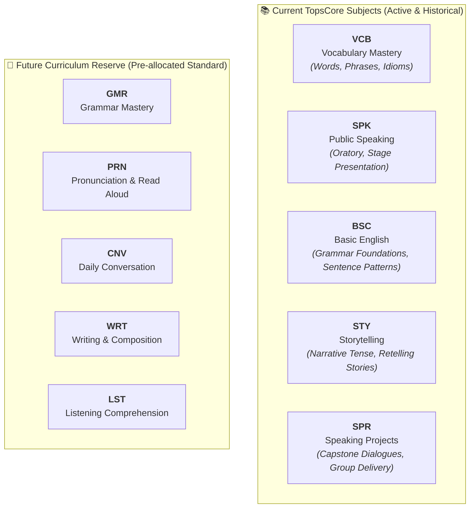
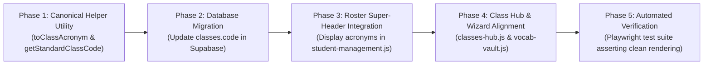

# 20261111 — Master Plan: Class Acronym & Code Standardization

> **Document Type:** Academic Hierarchy & UI Standardization Plan  
> **Authority Level:** Standard TopsCore Plan (AGENTS.md Rules 2.6, 2.23, 2.28, 2.29, 2.38)  
> **Status:** Proposal & Architectural Design — Ready for Review & Approval  

---

## 1. Executive Summary & Problem Diagnostic

In TopsCore LMS, classes (subjects) form the core anchor linking Programs, Batches, Students, and Assessment Modules:
$$\text{INSTITUTION} \longrightarrow \text{PROGRAM} \longrightarrow \text{CLASS / SUBJECT} \longrightarrow \text{TESTS (Tasks \& Exams)}$$

### Current Deficiencies:
1. **Inconsistent & Verbose Class Codes**:
   - A live database query revealed that class codes currently vary wildly without standard conventions: `VOCAB_1`, `EV_VOCAB_1`, `SH_VOCAB_1`, `TP_VOCAB_1`, `BASIC_ENGLISH_1`, `STORYTELLING_1`, `PUBLIC_SPEAKING_2`, `SPEAKING_PROJECTS_3`, `VOCABULARY_3`, `VOCAB_MASTER_3`.
   - Some classes have completely empty or redundant codes.
2. **Table Header Space Congestion (Rule 2.38)**:
   - On the Student Roster (`#students`) and Class Matrix, data tables must adhere to the **Universal Table Standardization Protocol** (12px uniform font, single-line text, `white-space: nowrap !important;`).
   - Long class names like `Camp 3rd Speaking Projects` or `Camp 2nd Public Speaking` force excessive column width, push exam columns off-screen, or truncate awkwardly (`Camp 3rd Spe...`).
3. **Cognitive Burden on Tutors**:
   - Tutors reviewing hundreds of student attempts need concise, unambiguous 3-letter acronyms (e.g., `VCB`, `SPK`, `BSC`) that are instantly recognizable at a glance across headers, badges, and report dossiers.

---

## 2. Complete Inventory of Existing Classes in Database

A live database audit executed via Supabase extracted all **17 existing classes** currently defined in the system:

| # | Institution | Program | Full Class Name | Current Database `code` | Level | Active Status | Proposed Acronym |
| :-: | :--- | :--- | :--- | :--- | :---: | :---: | :---: |
| 1 | CEC | Camp | **Camp 1st Vocabulary** | `VOCAB_1` | 1st Level | 🔴 Inactive | **VCB** |
| 2 | CEC | Camp | **Camp 2nd Vocabulary** | `VOCAB_2` | 2nd Level | 🟢 Active | **VCB** |
| 3 | CEC | Camp | **Camp 3rd Vocabulary** | `VOCAB_3` | 3rd Level | 🔴 Inactive | **VCB** |
| 4 | TOP | Evnikom | **Evnikom 1st Vocabulary** | `EV_VOCAB_1` | Unassigned | 🟢 Active | **VCB** |
| 5 | TOP | Sheraton | **Sheraton 1st Vocabulary** | `SH_VOCAB_1` | Unassigned | 🔴 Inactive | **VCB** |
| 6 | TOP | Tamata Persada | **Tamata 1st Vocabulary** | `TP_VOCAB_1` | Unassigned | 🔴 Inactive | **VCB** |
| 7 | Tops | English Explorer | **Vocab Master** | `VOCAB_MASTER_3` | Unassigned | 🔴 Inactive | **VCB** |
| 8 | Unassigned | Unassigned | **Vocabulary 1** | `VOCABULARY_1` | 1st Level | 🔴 Inactive | **VCB** |
| 9 | Unassigned | Unassigned | **Vocabulary 2** | `VOCABULARY_2` | 2nd Level | 🔴 Inactive | **VCB** |
| 10 | Unassigned | Unassigned | **Vocabulary 3** | `VOCABULARY_3` | 3rd Level | 🔴 Inactive | **VCB** |
| 11 | Unassigned | Unassigned | **Vocabulary** | `VOCABULARY_3` | 3rd Level | 🟢 Active | **VCB** |
| 12 | CEC | Camp | **Camp 1st Basic English** | `BASIC_ENGLISH_1` | 1st Level | 🔴 Inactive | **BSC** |
| 13 | CEC | Camp | **Basic English** | `BASIC_ENGLISH_1` | 1st Level | 🔴 Inactive | **BSC** |
| 14 | CEC | Camp | **Camp 1st Storytelling** | `STORYTELLING_1` | 1st Level | 🔴 Inactive | **STY** |
| 15 | CEC | Camp | **Camp 2nd Storytelling** | `STORYTELLING_2` | 2nd Level | 🔴 Inactive | **STY** |
| 16 | CEC | Camp | **Camp 2nd Public Speaking** | `PUBLIC_SPEAKING_2` | 2nd Level | 🔴 Inactive | **SPK** |
| 17 | CEC | Camp | **Camp 3rd Speaking Projects** | `SPEAKING_PROJECTS_3` | 3rd Level | 🔴 Inactive | **SPR** |

---

## 3. Authoritative Standardized Acronym Taxonomy (3-Letter Standard)

We standardize all current and future curriculum subjects into a **strict 3-letter capital acronym format**:



### Detailed Taxonomy Table:

| Standard Acronym | Canonical Subject Name | Description & Focus Modules | Example Full Class Title |
| :---: | :--- | :--- | :--- |
| **`VCB`** | **Vocabulary** | Vocabulary Mastery, Point & Speak, Vocab Vault (Words & Phrases) | `Evnikom 1st Vocabulary`, `Camp 2nd Vocabulary` |
| **`SPK`** | **Public Speaking** | Public Speaking Performance, 5 Pillars, Speech Delivery | `Camp 2nd Public Speaking` |
| **`BSC`** | **Basic English** | Core sentence patterns, structural fundamentals, multiple choice | `Camp 1st Basic English` |
| **`STY`** | **Storytelling** | Narrative tense, sequential picture storytelling, past tense | `Camp 1st Storytelling`, `Camp 2nd Storytelling` |
| **`SPR`** | **Speaking Projects** | Capstone collaborative speaking, real-time roleplay | `Camp 3rd Speaking Projects` |
| *`GMR`* | *Grammar (Future)* | Advanced syntax, tense mastery, error analysis | *Future reserve* |
| *`PRN`* | *Pronunciation (Future)* | Phonetics, minimal pairs, word stress, intonation | *Future reserve* |
| *`CNV`* | *Conversation (Future)* | Turn-based roleplay, situational dialogue | *Future reserve* |
| *`WRT`* | *Writing (Future)* | Paragraph structure, essay writing, formal correspondence | *Future reserve* |
| *`LST`* | *Listening (Future)* | Audio comprehension, dictation, dialogue extraction | *Future reserve* |

---

## 4. The Composite Code Formula (Single Source of Truth)

Per AGENTS.md Section 2.6:
$$\text{Class Code} = \text{PROGRAM\_CODE} + \text{"\_"} + \text{LEVEL\_NUM} + \text{"\_"} + \text{SUBJECT\_ACRONYM}$$

### Examples of Standard Composite Codes:
- `EV_1_VCB`: Evnikom — 1st Level — Vocabulary
- `CMP_1_BSC`: Camp — 1st Level — Basic English
- `CMP_1_STY`: Camp — 1st Level — Storytelling
- `CMP_2_SPK`: Camp — 2nd Level — Public Speaking
- `CMP_2_VCB`: Camp — 2nd Level — Vocabulary
- `CMP_3_SPR`: Camp — 3rd Level — Speaking Projects
- `CMP_3_VCB`: Camp — 3rd Level — Vocabulary
- `SH_1_VCB`: Sheraton — 1st Level — Vocabulary
- `TP_1_VCB`: Tamata Persada — 1st Level — Vocabulary

---

## 5. UI Impact & Display Across TopsCore Subsystems

Standardizing these acronyms unlocks massive spatial benefits across the entire application:

### 5.1 Student Roster & Performance Matrix (`#students`)
- **Before**: Super-headers stretched awkwardly or clipped:
  `| NO | LEVEL | NAME | PTS | Camp 2nd Vocabulary (7x7) | Camp 2nd Public Speaking |`
- **After (Compact, Elegant, Single-Line)**:
  `| NO | LVL | NAME | PTS | 2ND VCB (7x7) | 2ND SPK |`
  - Saves over **60% horizontal header space**!
  - Fully compliant with AGENTS.md Rule 2.38 (Two-tier sticky headers, 12px text, zero ballooning).

### 5.2 Test Shell Codes (`tests.shell_code`)
- Tests currently have disparate shell codes like `3A-WORDS-EXAM` or `3B-PHRASES-EXAM`.
- With standard class codes:
  - Formative Quiz: `1A-VCB-QUIZ`, `2A-STY-QUIZ`, `2B-SPK-QUIZ`
  - Summative Exam: `1A-VCB-EXAM`, `2A-STY-EXAM`, `2B-SPK-EXAM`

### 5.3 Student Class Lobby & Gate (`dashboard.html` & `result.html`)
- In Class Selector pills and badges:
  `[ 1ST VCB ]`, `[ 1ST BSC ]`, `[ 1ST STY ]`, `[ 2ND SPK ]`, `[ 3RD SPR ]`
  - Eliminates word-wrapping on mobile and smaller laptop screens.

---

## 6. Implementation & Migration Roadmap



### Phase 1: Canonical Helper Utility (`js/api.js` & `js/grading.js`)
- Export authoritative helper functions:
  ```javascript
  export function toClassAcronym(className, classCode = '') {
    const raw = ((classCode || '') + ' ' + (className || '')).toLowerCase();
    if (raw.includes('vocab')) return 'VCB';
    if (raw.includes('basic') || raw.includes('english')) return 'BSC';
    if (raw.includes('story')) return 'STY';
    if (raw.includes('project')) return 'SPR';
    if (raw.includes('speaking') || raw.includes('public')) return 'SPK';
    if (raw.includes('grammar')) return 'GMR';
    if (raw.includes('pronun')) return 'PRN';
    return 'GEN'; // Generic fallback
  }
  ```

### Phase 2: Database Migration (`supabase/migrations/`)
- Execute atomic SQL migration updating the `code` column for all 17 classes to conform to the composite formula (`PROGRAM_LEVEL_ACRONYM`).
- Backward compatibility: preserve all existing primary keys (`id`) and relationship foreign keys (`class_levels`, `tests`, `attempts`).

### Phase 3: Roster Super-Header & Column Integration (`js/admin/student-management.js`)
- Update `student-management.js` DataGrid header generation:
  - Super-header displays: `${toShortLevel(level)} ${toClassAcronym(cls.name, cls.code)}`
  - Result: `1ST VCB`, `1ST BSC`, `1ST STY`, `2ND VCB`, `2ND SPK`, `3RD VCB`, `3RD SPR`.

### Phase 4: Class Hub & Test Wizard Alignment
- Update `classes-hub.js`, `classes-management.js`, and `vocab-vault.js` to show the standard 3-letter acronym badge beside each class title.

### Phase 5: Automated Playwright Verification
- Create automated test suite `scripts/test_class_acronym_standardization.mjs` verifying:
  1. All 17 classes return standard 3-letter acronyms.
  2. Roster super-headers render single-line without clipping.
  3. Zero regressions in test launching and scoring.

---

## 7. Recommendation & Feedback Request

Please review this master plan:
1. **Acronym Approval**:
   - `Vocabulary` → **`VCB`** ✅
   - `Speaking / Public Speaking` → **`SPK`** ✅
   - `Basic English` → **`BSC`** ✅
   - `Storytelling` → **`STY`** (Apakah Anda setuju dengan **`STY`**?)
   - `Speaking Projects` → **`SPR`** (Apakah Anda setuju dengan **`SPR`**?)
2. **Next Steps**:
   - When approved, we will proceed to create `tasks.md` and execute Phase 1 & 2 atomically.