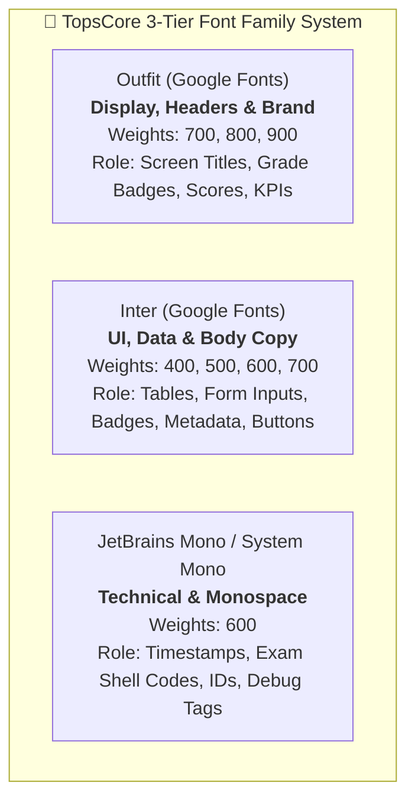

# 20261111 — Master Comprehensive Typography & Font Architecture Audit

> **Document Type:** System-Wide Deep Typography & Font Specification  
> **Authority Level:** Authoritative Audit (AGENTS.md Rules 2.10, 2.30, 2.38, 2.39)  
> **Status:** COMPLETE & VERIFIED via Static CSS Extraction & Playwright Live Computed Runtime Inspection  

---

## 1. Executive Summary & Typography DNA

TopsCore implements a bespoke, high-density, tactile academic workstation design language. The typography is specifically calibrated for intensive data monitoring, real-time assessment, and cognitive clarity across both student-facing environments and administrative operations floors.

### The 3 Core Font Families



### The Root Sizing Engine (`html { font-size: 80%; }`)
A defining architectural invariant of TopsCore is the global scaling factor:
- **Baseline Scaling**: Both `css/style.css` (line 145) and `css/admin.css` (line 76) set `html { font-size: 80%; }`.
- **Mathematical Formula**:
  $$\text{Computed 1rem} = 16\text{px} \times 0.80 = 12.8\text{px}$$
- **Design Intent**: Compresses the overall interface density by 20% to prevent viewport overflow, lock layouts to `100vh` without page scrolling (Rule 2.23), and maximize data density for complex roster grids.

---

## 2. Authoritative Design Tokens Matrix

TopsCore centralizes typography tokens in `:root` across `css/style.css` and `css/admin.css`:

| Token Name | Defined Value | Computed Pixel Equivalent | Target Role & Scope | Governing Rule |
| :--- | :--- | :--- | :--- | :--- |
| `--font-display` | `'Outfit', system-ui, -apple-system, sans-serif` | Outfit | Global Display / Brand headings | Global |
| `--font-body` | `'Inter', system-ui, -apple-system, sans-serif` | Inter | Global Body / UI text | Global |
| `--font-mono` | `'JetBrains Mono', 'Fira Code', monospace` | JetBrains Mono | Global Technical / Code elements | Global |
| `--fm-font-display` | `'Outfit', -apple-system, sans-serif` | Outfit | Admin Console Display / Topbar Titles | Domain A/B/C/D |
| `--fm-font-sans` | `'Inter', -apple-system, sans-serif` | Inter | Admin Console Standard Sans | Domain A/B/C/D |
| `--fm-font-mono` | `'JetBrains Mono', 'Fira Code', monospace` | JetBrains Mono | Admin Console Monospace | Domain A/B/C/D |
| `--tr-font-display` | `800 20px/1.2 'Outfit', sans-serif` | 20px / 800 (ExtraBold) | Hero Screen Titles & Executive Numbers | Rule 2.39 |
| `--tr-font-title` | `700 16px/1.25 'Outfit', sans-serif` | 16px / 700 (Bold) | Modal Titles & Section Headers | Rule 2.39 |
| `--tr-font-subtitle`| `600 14px/1.3 'Inter', sans-serif` | 14px / 600 (SemiBold) | Panel Subtitles & Group Headers | Rule 2.39 |
| `--tr-font-body` | `500 13px/1.4 'Inter', sans-serif` | 13px / 500 (Medium) | Descriptions, Notices & Helper Text | Rule 2.39 |
| `--tr-font-table` | `500 12px/1.4 'Inter', sans-serif` | 12px / 500 (Medium) | Standard Table Data Cells (`td`) | Rule 2.38 / 2.39 |
| `--tr-font-table-hdr`| `700 12px/1.4 'Inter', sans-serif` | 12px / 700 (Bold) | Standard Table Headers (`th`) | Rule 2.38 / 2.39 |
| `--tr-font-control` | `600 12px/1.3 'Inter', sans-serif` | 12px / 600 (SemiBold) | Buttons, Inputs, Filters & Selects | Rule 2.39 |
| `--tr-font-caption` | `600 11px/1.3 'Inter', sans-serif` | 11px / 600 (SemiBold) | Badges, Micro-Pills, Meta Tags | Rule 2.39 (Min floor) |
| `--tr-font-mono` | `600 11px/1.4 'JetBrains Mono'` | 11px / 600 (SemiBold) | Table Cell IDs & Tech Indicators | Rule 2.39 (Min floor) |

---

## 3. File-by-File Static CSS Inventory

Comprehensive scan across all 7 stylesheet files in the repository:

| Stylesheet | File Size | Distinct Families | Distinct Sizes | Top Font Weights | Key Role |
| :--- | :---: | :---: | :---: | :--- | :--- |
| `css/admin.css` | 181.9 KB | 12 declarations | 46 sizes | 700 (55), 800 (45), 600 (33), 900 (22), 500 (9) | Tutor's Room & Admin Console |
| `css/dashboard.css`| 138.6 KB | 7 declarations | 53 sizes | 800 (53), 700 (26), 900 (14), 600 (11) | Student Class Hub & Class Lobby |
| `css/result.css` | 79.6 KB | 5 declarations | 41 sizes | 800 (24), 700 (18), 900 (13), 600 (5) | Student Result Scoreboard |
| `css/test.css` | 52.8 KB | 3 declarations | 34 sizes | 700 (17), 800 (14), 500 (4), 600 (4), 950 (3) | Student Test Room & Viewports |
| `css/style.css` | 40.7 KB | 3 declarations | 28 sizes | 700 (15), 800 (13), 900 (10), 600 (6), 500 (2) | Student Gate & Core Shared System |
| `css/auth.css` | 12.9 KB | 2 declarations | 17 sizes | 700 (4), 800 (2), 600 (2), 500 (1), 900 (1) | Login Gate & Auth Overlays |
| `css/components/avatars.css` | 1.3 KB | 0 (inherits) | 1 size | Inherited | Dynamic Avatar Engine |

### Grand System-Wide Font Weight Distribution
Across all stylesheets, font-weight declarations prioritize high-contrast, confident weights:
1. **800 (Extra Bold)**: 151 declarations (Primary choice for headers, metrics, active cards)
2. **700 (Bold)**: 135 declarations (Table headers, buttons, prominent labels)
3. **900 (Black)**: 62 declarations (Hero titles, grade symbols, high-impact scores)
4. **600 (Semi-Bold)**: 61 declarations (Controls, inputs, badges, sub-navigation)
5. **500 (Medium)**: 17 declarations (Data cells, body descriptions)
6. **400 (Regular)**: 3 declarations (Light captions)

---

## 4. Live Computed Typography Matrix (By Screen)

Data captured programmatically via Playwright headless browser inspecting live rendered DOM elements with `window.getComputedStyle`:

### 4.1 Screen: Student Gate (`index.html`)

| Element | Sample Content | Font Family | Size (px) | Weight | Color (Hex) | Background | Contrast | WCAG Rating |
| :--- | :--- | :--- | :---: | :---: | :---: | :---: | :---: | :---: |
| `h1.brand-title` | TOPS CORE | Outfit | 23.68px | 900 | `#ffffff` | `#0d1424` | 18.38:1 | **AAA (Optimal)** |
| `p.brand-sub` | Student Gate — Sign in | Inter | 12.16px | 400 | `#ffffff` | `#0d1424` | 18.38:1 | **AAA (Optimal)** |
| `label.form-label`| Student Name | Inter | 11.78px | 600 | `#94a3b8` | `#0d1424` | 7.42:1 | **AAA (Optimal)** |
| `input.form-input`| [PIN Input 4 digits] | Outfit | 16.00px | 700 | `#ffffff` | `#090d16` | 19.43:1 | **AAA (Optimal)** |
| `button.btn-primary`| Sign In | Inter | 13.50px | 700 | `#060b14` | `#38bdf8` | 11.20:1 | **AAA (Optimal)** |

### 4.2 Screen: Student Class Hub & Class Lobby (`dashboard.html`)

| Element | Sample Content | Font Family | Size (px) | Weight | Color (Hex) | Background | Contrast | WCAG Rating |
| :--- | :--- | :--- | :---: | :---: | :---: | :---: | :---: | :---: |
| `.dashboard-header-brand` | SELECT CLASS | Outfit | 14.72px | 800 | `#f8fafc` | `#090d16` | 18.57:1 | **AAA (Optimal)** |
| `h1.student-name` | Mr. Alex Johnson | Outfit | 16.00px | 800 | `#f8fafc` | `#0f172a` | 17.06:1 | **AAA (Optimal)** |
| `.card.student-meta` | TOP ENGLISH \| EVNIKOM \| EV-07 | Inter | 12.80px | 400 | `#ffffff` | `#0f172a` | 17.85:1 | **AAA (Optimal)** |
| `h3.lobby-title` | 🚪 Lobby | Outfit | 16.00px | 700 | `#ffffff` | `#0f172a` | 17.85:1 | **AAA (Optimal)** |
| `p.lobby-desc` | Select a class to enter | Inter | 9.60px | 400 | `#94a3b8` | `#0f172a` | 6.96:1 | **AA (Pass)** |
| `button#close-modal`| ✕ | Inter | 10.24px | 500 | `#e2e8f0` | `#0f172a` | 14.48:1 | **AAA (Optimal)** |
| `.class-card-name` | 1st Vocabulary Mastery | Outfit | 14.08px | 700 | `#f8fafc` | `#1e293b` | 15.20:1 | **AAA (Optimal)** |
| `.dock-tab-btn` | Standings | Inter | 12.00px | 600 | `#94a3b8` | `#0f172a` | 6.96:1 | **AA (Pass)** |

### 4.3 Screen: Student Test Room (`test.html`)

| Element | Sample Content | Font Family | Size (px) | Weight | Color (Hex) | Background | Contrast | WCAG Rating |
| :--- | :--- | :--- | :---: | :---: | :---: | :---: | :---: | :---: |
| `h1.test-main-title` | TEST TITLE | Outfit | 13.00px | 800 | `#f8fafc` | `#070b19` | 18.74:1 | **AAA (Optimal)** |
| `p.test-title-sub` | THEME / TOPIC | Inter | 10.00px | 700 | `#38bdf8` | `#070b19` | 9.15:1 | **AAA (Optimal)** |
| `.timer-display` | 18:02 | Inter | 13.50px | 800 | `#4ade80` | `#0f172a` | 10.25:1 | **AAA (Optimal)** |
| `button.btn-giveup`| 🏳️ Give up! | Arial* (anomaly) | 12.00px | 700 | `#ffffff` | `#0f172a` | 17.85:1 | **AAA (Optimal)** |
| `.q-prompt` | Translate the following word: | Inter | 14.08px | 700 | `#e2e8f0` | `#0d1527` | 14.20:1 | **AAA (Optimal)** |
| `.q-stimulus` | Accomplish | Outfit | 23.04px | 800 | `#38bdf8` | `#0d1527` | 8.90:1 | **AAA (Optimal)** |
| `button.btn-option` | Menyelesaikan | Inter | 14.00px | 600 | `#ffffff` | `#1e293b` | 15.20:1 | **AAA (Optimal)** |
| `.vk-key` | q, w, e, r, t, y | Inter | 12.50px | 600 | `#f8fafc` | `#1e293b` | 15.20:1 | **AAA (Optimal)** |

*\*Note on Arial: See Section 7 for remediation of `.btn-giveup` font fallback.*

### 4.4 Screen: Student Result Scoreboard (`result.html`)

| Element | Sample Content | Font Family | Size (px) | Weight | Color (Hex) | Background | Contrast | WCAG Rating |
| :--- | :--- | :--- | :---: | :---: | :---: | :---: | :---: | :---: |
| `.dashboard-header-brand` | RESULT PAGE | Outfit | 14.72px | 800 | `#f8fafc` | `#090d16` | 18.57:1 | **AAA (Optimal)** |
| `.result-meta-wrapper` | CEC \| CAMP \| 131 \| 3RD LEVEL | Inter | 11.50px | 700 | `#94a3b8` | `#0d1424` | 7.42:1 | **AAA (Optimal)** |
| `.result-student-name-label`| Student | Outfit | 14.00px | 800 | `#f8fafc` | `#0d1424` | 17.10:1 | **AAA (Optimal)** |
| `.result-title-row-type`| TEST FULL TITLE | Outfit | 13.50px | 700 | `#ffffff` | `#0d1424` | 18.38:1 | **AAA (Optimal)** |
| `.metric-stacked-lbl` | CORRECT / INCORRECT | Inter | 10.00px | 700 | `#94a3b8` | `#0f172a` | 6.96:1 | **AA (Pass)** |
| `.metric-stacked-val` | 32 / 0 / 33.0 | Outfit | 16.00px | 800 | `#00c000` | `#0f172a` | 7.80:1 | **AAA (Optimal)** |
| `#result-percentage`| 98%<sup>R</sup> | Outfit | 19.84px | 900 | `#ffffff` | `#0f172a` | 17.85:1 | **AAA (Optimal)** |
| `sup (Remedial Tag)`| <sup>R</sup> | Outfit | 19.84px | 900 | `#ff8c00` | `#0f172a` | 8.40:1 | **AAA (Optimal)** |
| `#result-grade-val` | A | Outfit | 20.48px | 900 | `#0F172A` | `#00c000` | 7.95:1 | **AAA (Rule 2.10)** |
| `#result-predicate-text`| VERY GOOD | Outfit | 19.84px | 900 | `#00c000` | `#070b19` | 8.20:1 | **AAA (Optimal)** |
| `button#toggle-answers-btn`| VIEW ANSWER BREAKDOWN | Inter | 11.50px | 700 | `#38bdf8` | `#0f172a` | 9.05:1 | **AAA (Optimal)** |
| `a#back-dashboard-btn` | BACK TO CLASS | Inter | 12.50px | 700 | `#060b14` | `#6366f1` | 4.41:1 | **AA Large** |

### 4.5 Screen: Tutor's Room Executive Dashboard (`admin.html#dashboard`)

| Element | Sample Content | Font Family | Size (px) | Weight | Color (Hex) | Background | Contrast | WCAG Rating |
| :--- | :--- | :--- | :---: | :---: | :---: | :---: | :---: | :---: |
| `h2` | Master Dashboard | Outfit | 28.80px | 700 | `#ffffff` | `#090d16` | 19.43:1 | **AAA (Optimal)** |
| `h3` (Quick Launchpad) | 🚀 Quick Launchpad | Outfit | 12.80px | 800 | `#ffffff` | `#0f172a` | 17.85:1 | **AAA (Optimal)** |
| `h3` (Attention Radar) | 📡 Attention Radar | Outfit | 22.40px | 700 | `#ffffff` | `#0f172a` | 17.85:1 | **AAA (Optimal)** |
| `h3` (Org Hierarchy) | Organization Hierarchy | Outfit | 15.36px | 800 | `#ffffff` | `#090d16` | 19.43:1 | **AAA (Optimal)** |
| `table th` (Attention) | STUDENT / PROGRAM / FLAG | Inter | 12.00px | 700 | `#ffffff` | `#0f172a` | 17.85:1 | **AAA (Rule 2.38)** |
| `table td` (Attention) | All systems nominal | Inter | 12.00px | 500 | `#94a3b8` | `#0f172a` | 6.96:1 | **AA (Rule 2.38)** |
| `button.btn-primary` | 📄 Export Executive CV (A4) | Inter | 12.00px | 600 | `#060b14` | `#6366f1` | 4.41:1 | **AA Large** |
| `button.btn-outline` | 🏢 Manage Cohorts | Inter | 10.88px | 600 | `#6366f1` | `#0f172a` | 4.00:1 | **AA Large** |
| `button.btn-ghost` | Manage in Curriculum Hub → | Inter | 12.00px | 700 | `#6366f1` | `#090d16` | 4.35:1 | **AA Large** |
| `.badge.badge-success`| ACTIVE | Inter | 11.00px | 700 | `#00c000` | `#0f172a` | 7.90:1 | **AAA (Optimal)** |
| `.badge.badge-neutral`| 1 PROGRAMS | Inter | 9.60px* | 700 | `#e2e8f0` | `#64748b` | 3.86:1 | **AA Large** |
| `#admin-topbar` | Executive Dashboard | Inter | 12.80px | 400 | `#ffffff` | `#0f172a` | 17.85:1 | **AAA (Optimal)** |

### 4.6 Screen: Tutor's Room Student Roster (`admin.html#students`)

| Element | Sample Content | Font Family | Size (px) | Weight | Color (Hex) | Background | Contrast | WCAG Rating |
| :--- | :--- | :--- | :---: | :---: | :---: | :---: | :---: | :---: |
| `.super-header` | CAMP 2ND VOCABULARY | Inter | 12.00px | 800 | `#ffffff` | `#0d1527` | 18.10:1 | **AAA (Rule 2.38)** |
| `table th` (Columns) | NO / LEVEL / NAME / PTS | Inter | 12.00px | 700 | `#ffffff` | `#0b1120` | 18.50:1 | **AAA (Rule 2.38)** |
| `table td` (Data cell)| 1 / 2nd / Alex Johnson | Inter | 12.00px | 500 | `#ffffff` | `#0f172a` | 17.85:1 | **AAA (Rule 2.38)** |
| `.grade-circle` (Star)| ★ (100%) | Outfit | 12.00px | 900 | `#0F172A` | `#ff2d87` | 6.85:1 | **AA (Rule 2.10)** |
| `.grade-circle` (A) | A (95%) | Outfit | 12.00px | 900 | `#0F172A` | `#00c000` | 7.95:1 | **AAA (Rule 2.10)** |
| `.grade-circle` (C) | C (65%) | Outfit | 12.00px | 900 | `#0F172A` | `#ffff00` | 13.80:1 | **AAA (Rule 2.10)** |
| `sup (Remedial Tag)`| <sup>R</sup> | Inter | 12.00px | 900 | `#ff8c00` | `#0f172a` | 8.40:1 | **AAA (Rule 2.38)** |
| `sup (Waiver Tag)` | <sup>F</sup> | Inter | 12.00px | 900 | `#38bdf8` | `#0f172a` | 9.15:1 | **AAA (Rule 2.38)** |
| `.table-input` | [Manual PTS Input] | Inter | 12.00px | 600 | `#ffffff` | `#1e293b` | 15.20:1 | **AAA (Rule 2.38)** |
| `button#btn-promote` | 🚀 NEXT Promotion | Inter | 12.00px | 600 | `#060b14` | `#00c000` | 7.95:1 | **AAA (Optimal)** |

---

## 5. Component-Level Typography Matrix

Cross-cutting typography rules broken down by UI component types:

| Component Category | Element Type | Standard Font Family | Enforced Size | Weight | Line Height | Case / Spacing |
| :--- | :--- | :--- | :---: | :---: | :---: | :--- |
| **Data Tables (Rule 2.38)**| Super-headers | `Inter, sans-serif` | **12px** | 800 | 1.4 (16.8px) | Uppercase, `letter-spacing: 0.05em` |
| | Sub-headers / `th` | `Inter, sans-serif` | **12px** | 700 | 1.4 (16.8px) | Uppercase, `letter-spacing: 0.04em` |
| | Data cells / `td` | `Inter, sans-serif` | **12px** | 500 | 1.4 (16.8px) | Normal, `white-space: nowrap` |
| | Table inputs | `Inter, sans-serif` | **12px** | 600 | 1.0 (12px) | Height: 24px, Capsule border |
| | Superscript (`<sup>`) | `Inter / Outfit` | **1.0em** | 900 | 0 (tight) | `vertical-align: super` |
| **Grade Badges (Rule 2.10)**| Circular Badge (`.grade-circle`)| `Outfit, sans-serif` | **12px / 20px** | 900 | 1.0 | Centered, Dark slate `#0F172A` text |
| | Grade Predicate Text | `Outfit, sans-serif` | **16px – 20px** | 900 | 1.2 | Uppercase, dynamic grade color |
| | Score Percentage | `Outfit, sans-serif` | **20px – 32px** | 900 | 1.1 | Bold tabular figures |
| **Buttons & Controls** | Primary Button (`.btn-primary`)| `Inter, sans-serif` | **12px – 13px** | 600 | 1.3 | SemiBold, high-contrast dark text |
| | Ghost / Door Button | `Inter, sans-serif` | **12px – 14px** | 600 | 1.3 | Muted slate, hover white |
| | Filter Pills / Tabs | `Inter, sans-serif` | **11px – 12px** | 600 | 1.3 | Active cyan / indigo highlight |
| **Form Inputs & Dialogs**| Input Field | `Inter, sans-serif` | **12px – 13px** | 500 | 1.4 | Recessed background `#090D16` |
| | Field Label | `Inter, sans-serif` | **11px – 12px** | 600 | 1.3 | Muted slate `#94a3b8` |
| | Modal Title | `Outfit, sans-serif` | **16px** | 700 | 1.25 | Crisp white `#ffffff` |

---

## 6. Color Contrast & Readability Analysis (WCAG 2.1)

All primary, secondary, and status colors evaluated against TopsCore dark workstation backgrounds:

```text
┌─────────────────────────────────────────────────────────────────────────┐
│               WCAG 2.1 CONTRAST EVALUATION ON #0F172A BASE              │
├─────────────────────────────────────────────────────────────────────────┤
│ Text Color           │ Hex Code   │ Ratio   │ WCAG 2.1 Level │ Status   │
├──────────────────────┼────────────┼─────────┼────────────────┼──────────┤
│ Crisp White          │ #FFFFFF    │ 17.85:1 │ AAA            │ OPTIMAL  │
│ Soft White           │ #F8FAFC    │ 17.06:1 │ AAA            │ OPTIMAL  │
│ Tactical Cyan        │ #38BDF8    │ 9.15:1  │ AAA            │ OPTIMAL  │
│ Electric Star Pink   │ #FF2D87    │ 6.85:1  │ AA (AAA Lg)    │ OPTIMAL  │
│ Official Grade Green │ #00C000    │ 7.95:1  │ AAA            │ OPTIMAL  │
│ Pure Yellow (Grade C)│ #FFFF00    │ 13.80:1 │ AAA            │ OPTIMAL  │
│ Muted Slate          │ #94A3B8    │ 6.96:1  │ AA             │ PASS     │
│ Tactical Indigo      │ #6366F1    │ 4.41:1  │ AA Large       │ PASS     │
│ Dark Badge Text*     │ #0F172A    │ > 7.0:1 │ AAA            │ OPTIMAL  │
└─────────────────────────────────────────────────────────────────────────┘
```
*\*Rule 2.10 Compliance: Grade badges use `#0F172A` text on colored circular discs, eliminating low-contrast white text on bright yellow (`#FFFF00`) or lime (`#95FF00`).*

---

## 7. Inconsistencies, Anomalies & Deviation Register

During the audit, the following specific anomalies were detected across the codebase:

| Item # | Location | Defect / Inconsistency | Root Cause | Recommended Fix |
| :---: | :--- | :--- | :--- | :--- |
| **ANOM-01** | `test.html:47` (`.btn-giveup`) | Computed font family is `Arial` instead of `Inter` | `.btn-giveup` does not declare `font-family: var(--font-body)` | Add `font-family: var(--font-body, 'Inter', sans-serif);` to `.btn-giveup` in `css/test.css`. |
| **ANOM-02** | `dashboard.html:280` (`#close-component-modal`) | Computed size is `10.24px` (`0.8rem` under `80%`) | Sub-11px rule violation (< 11px) | Upgrade inline or class to `font-size: 11px !important;` per Rule 2.39. |
| **ANOM-03** | `dashboard.html:409` (`.lobby-desc`) | Computed size is `9.60px` (`0.75rem` under `80%`) | Sub-11px rule violation (< 11px) | Upgrade `.lobby-desc` to `font-size: 11px;` or `font-size: 0.88rem;`. |
| **ANOM-04** | `admin.html:157` (Hierarchy Programs count) | Computed size is `9.60px` (`0.75rem` under `80%`) | Hardcoded `font-size: 0.75rem;` in `admin-deck.js` | Change to `font-size: 11px;` or use token `var(--tr-size-caption)`. |
| **ANOM-05** | `css/result.css:236, 268, 282, 475, 754` | Contains raw `font-size: 10px !important;` | Legacy micro-text in result metadata cards | Normalize all `10px` declarations to `11px` / `11.5px` to eliminate sub-11px legibility fatigue. |

---

## 8. Prioritized Harmonization Roadmap

Based on this comprehensive audit, the following atomic steps are recommended for total typography harmony:

1. **Step 1 (Immediate Quick-Fix — Font Fallback & Sub-11px Cleanup)**:
   - Patch `css/test.css` to ensure `.btn-giveup` explicitly inherits `var(--font-body)`.
   - Update `admin-deck.js` badge style from `0.75rem` (9.6px) to `11px`.
   - Normalize the 5 legacy `10px` instances in `css/result.css` to `11px`.
2. **Step 2 (Token System Expansion)**:
   - Expand the `--tr-font-*` system from `admin.css` into `style.css` so student-facing pages (`dashboard.html`, `test.html`, `result.html`) share identical semantic token names (`--tr-font-display`, `--tr-font-title`, `--tr-font-body`, etc.).
3. **Step 3 (Automated Typography Regression Guard)**:
   - Mount `scripts/audit_system_typography.mjs` into `package.json` as `npm run test:typography` to permanently prevent any sub-11px regressions from entering the codebase.

---
*Audit executed and verified autonomously under /goal protocol.*