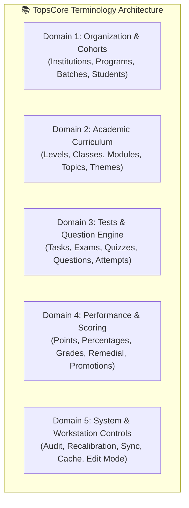
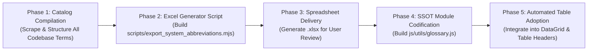

# 20261111 — Side Quest: System Abbreviations & Glossary Excel Export Plan

> **Document Type:** Side Quest Architecture & Implementation Plan  
> **Authority Level:** Standard TopsCore Plan (AGENTS.md Rules 2.22, 2.28, 2.29, 2.30, 2.34, 2.38)  
> **Target Output:** Excel Spreadsheet (`.xlsx` / `.csv`) + Authoritative Codebase Terminology SSOT  
> **Status:** PROPOSED & READY FOR FEEDBACK  

---

## 1. Executive Summary & Problem Diagnostic

In TopsCore LMS, data density and single-line table formatting are strictly enforced:
- **AGENTS.md Rule 2.23 & 2.34**: Tables must fit within `100vh` without outer page scrolling, and data cells must enforce `white-space: nowrap !important; text-overflow: ellipsis; overflow: hidden;`.
- **AGENTS.md Rule 2.38 (8-Pillar Universal Table Standard)**: Table headers and data cells strictly use uniform `12px` font size and compact layout.

### The Conflict:
Currently, many table headers and KPI cards use long words (e.g. `PREREQUISITE`, `ASSESSMENT`, `INSTITUTION`, `REPETITIONS`, `THRESHOLD`, `FORGIVEN`, `PERCENTAGE`).
1. When column widths are constrained, long headers either:
   - Balloon column widths unnecessarily, causing tables to overflow horizontally or crowd data.
   - Or get abruptly clipped (`PREREQU...`), leaving tutors disoriented.
2. In some modules, ad-hoc abbreviations were introduced without a system-wide standard (e.g., `ORD`, `PTS`, `REQ`, `ST`, `ATT`), leading to inconsistency across different screens.

### The Objective:
Create an authoritative, standardized **TopsCore Abbreviation & Terminology Glossary** (SSOT):
- **Short & Compact**: Max 3 to 6 characters per header (e.g., `PTS`, `PRQ`, `ATT`, `THR`, `MOD`, `INST`).
- **Zero Confusion**: Every shortened header strictly embeds a mandatory browser tooltip (`title="Full Title"`) so hover always reveals the exact meaning.
- **Immediate Next Step (Side Quest)**: Compile all system terms, structure them with proposed abbreviations and definitions, and export them into a clean, formatted **Excel workbook (`.xlsx`)** for user review, adjustments, and approval.

---

## 2. Terminology Taxonomy (5 Functional Domains)

The glossary captures terms across all 5 operational domains of TopsCore:



---

## 3. Initial Catalog & Proposed Abbreviation Standards

Below is the initial draft catalog of core terms mapped across TopsCore:

### Domain 1: Organization & Cohort Structure

| Full English Term | Indonesian Meaning | Proposed Short Header | Max Len | Standard Hover Tooltip (`title`) | Code / DB Reference |
| :--- | :--- | :---: | :---: | :--- | :--- |
| **Number** | Nomor Urut | `NO` | 2 | Sequential Row Number | `index + 1` |
| **Institution** | Institusi / Lembaga | `INST` | 4 | Academic Institution / Campus | `institutions.name` |
| **Program** | Program Belajar | `PROG` | 4 | Academic Program (e.g. Evnikom) | `programs.name` |
| **Batch / Cohort** | Angkatan / Gelombang | `BAT` / `BATCH` | 5 | Student Batch / Cohort (e.g. EV-07) | `batches.name` |
| **Student** | Siswa / Mahasiswa | `STU` | 3 | Student Profile Name | `students.name` |
| **Gender** | Jenis Kelamin | `GEN` | 3 | Gender (Male / Female) | `students.gender` |
| **Active Status** | Status Keaktifan | `ACT` / `STAT` | 4 | Student Operational Status | `students.is_active` |
| **Enrollment Date** | Tanggal Pendaftaran | `ENR` | 3 | Cohort Enrollment Start Date | `enrollment_date` |
| **Graduation / Final** | Tanggal Kelulusan | `GRAD` | 4 | Cohort Actual Completion Date | `actual_final_date` |

### Domain 2: Academic Curriculum & Subject Structure

| Full English Term | Indonesian Meaning | Proposed Short Header | Max Len | Standard Hover Tooltip (`title`) | Code / DB Reference |
| :--- | :--- | :---: | :---: | :--- | :--- |
| **Level** | Tingkat Kemampuan | `LVL` | 3 | Academic Level (1ST, 2ND, 3RD, ALM) | `levels.name` |
| **Class / Subject** | Mata Pelajaran / Kelas | `CLS` | 3 | Academic Subject / Study Room | `classes.name` |
| **Module** | Mesin / Modul Evaluasi | `MOD` | 3 | AI Evaluation Module (1 of 8) | `modules.name` |
| **Topic** | Topik Bahasan | `TPC` | 3 | Learning Topic | `topics.name` |
| **Theme** | Tema Besar | `THM` | 3 | Central Curriculum Theme | `themes.theme_code` |
| **Vocabulary** | Kosakata | `VOC` / `WRD` | 3 | Vocabulary Word Master | `vocab_vault` |
| **Phrases / Idiom** | Frasa / Idiom | `PHR` | 3 | Multi-Word Phrase / Idiom | `vocab_vault` |

### Domain 3: Tests & Question Engine

| Full English Term | Indonesian Meaning | Proposed Short Header | Max Len | Standard Hover Tooltip (`title`) | Code / DB Reference |
| :--- | :--- | :---: | :---: | :--- | :--- |
| **Assessment / Test** | Ujian / Tes | `ASM` / `TEST` | 4 | Authoritative Test Shell | `tests.title` |
| **Formative Task** | Tugas Latihan Harian | `TASK` | 4 | Daily 7x7 Repetition Task | `category = 'TASK'` |
| **Summative Exam** | Ujian Milestone Mingguan | `EXAM` | 4 | Milestone Exam Evaluation | `category = 'EXAM'` |
| **Daily Quiz** | Kuis Harian | `QUIZ` | 4 | Daily Skill Verification Quiz | `category = 'QUIZ'` |
| **Prerequisite** | Syarat Modul Pendahulu | `PRQ` | 3 | Required Prerequisite Modules | `prerequisites` |
| **Attempt** | Sesi Pengerjaan | `ATT` | 3 | Student Test Attempt Session | `attempts.id` |
| **Questions Count** | Jumlah Soal | `QST` | 3 | Total Questions in Assessment | `total_questions` |
| **Time Limit** | Batas Waktu | `LIM` | 3 | Server-Enforced Time Limit (mins) | `time_limit` |
| **Passing Threshold** | Ambang Batas Kelulusan | `THR` | 3 | Minimum Passing Percentage Mark | `passing_threshold` |
| **Question Order** | Urutan Soal | `ORD` | 3 | Question Flow: Sequential / Random | `question_order` |

### Domain 4: Performance, Scoring & Lifecycle

| Full English Term | Indonesian Meaning | Proposed Short Header | Max Len | Standard Hover Tooltip (`title`) | Code / DB Reference |
| :--- | :--- | :---: | :---: | :--- | :--- |
| **Overall Points** | Poin Kumulatif Siswa | `PTS` | 3 | Overall Score / Cumulative Points | `calculateOverallScore()` |
| **Percentage** | Persentase Nilai | `PCT` / `%` | 3 | Percentage Score (0% – 100%) | `percentage` |
| **Official Grade** | Simbol Predikat Nilai | `GRD` | 3 | Official Grade Symbol (★, A, B, C, D, E) | `calculateGrade()` |
| **Correct Answers** | Jawaban Tepat (1.0 pt) | `COR` | 3 | Correct Answers Count | `eval_correct` |
| **Partial Credit** | Jawaban Sebagian (0.5 pt) | `PRT` | 3 | Partial Credit Minor Match | `eval_partial` |
| **Incorrect Answers** | Jawaban Salah (0.0 pt) | `INC` | 3 | Incorrect Answers Count | `eval_incorrect` |
| **Remedial** | Remedi (Maksimal 60%ᴿ) | `REM` / `60%ᴿ` | 4 | Remedial Attempt (Letter R tag) | Rule 2.10 |
| **Forgiven / Waiver** | Dispensasi Mr. Top (Skor F) | `WVR` / `<sup>F</sup>` | 3 | Forgiven / Administrative Waiver | Rule 2.38 |
| **Life / Chances** | Kesempatan Mengulang | `LIF` | 3 | Remaining Attempt Lifelines | `remaining_lives` |
| **Promote Next** | Naik ke Level Berikutnya | `NEXT` | 4 | Eligible for Higher Level Promotion | Lifecycle Promotion |
| **Hold In Level** | Tahan di Level Berjalan | `HOLD` | 4 | Retain in Current Level | Lifecycle Retention |
| **Repeat Cohort** | Ulangi dari Awal Batch | `REP` | 3 | Repeat Entire Level / Cohort | Lifecycle Repeat |
| **Global Average** | Rata-rata Kumulatif | `AVG` | 3 | Global Cohort / Program Average | Rule 2.7 |
| **Highest Score** | Skor Tertinggi Siswa | `HIGH` / `MAX` | 4 | Highest Recorded Attempt Score | `highest_score` |

### Domain 5: System, Workstation & Audit Operations

| Full English Term | Indonesian Meaning | Proposed Short Header | Max Len | Standard Hover Tooltip (`title`) | Code / DB Reference |
| :--- | :--- | :---: | :---: | :--- | :--- |
| **Audit Timestamp** | Waktu Kejadian Audit | `TIME` | 4 | Exact Event Timestamp | `created_at` |
| **Actor / User** | Pelaku Tindakan | `ACTR` | 4 | Admin / System Operator | `actor_id` |
| **Action Type** | Jenis Aktivitas | `ACTN` | 4 | Material Admin Action | `audit_logs.action` |
| **Edit Mode** | Mode Edit Master | `EDIT` | 4 | Master Edit Mode Status (ON/OFF) | Rule 2.24 |
| **Recalibrate** | Rekalibrasi Otomatis | `RECAL` | 5 | Health Diagnostic Recalibration | `health.js` |
| **Duplicate Count** | Jumlah Data Duplikat | `DUP` | 3 | Detected Duplicate Entity Records | `dupMap` |

---

## 4. Excel Spreadsheet Structure & Architecture

To facilitate user review, modification, and official sign-off, an automated export script will generate an Excel file with the following specifications:

### File Details:
- **Filename**: `TopsCore_System_Abbreviations_Glossary_20261111.xlsx`
- **Engine**: Standard SheetJS / native Node.js workbook generator with styling.
- **Sheets / Tabs**:
  1. `1. Master Summary`: Domain statistics, total terms, abbreviation rules.
  2. `2. Table Headers (Core)`: Terms specifically used as data table columns (`th`).
  3. `3. Metrics & Scoring`: Performance, grade symbols, evaluation codes.
  4. `4. System & Controls`: Operational states, action verbs, button badges.
  5. `5. User Review & Overrides`: Dedicated column for user approvals and preferred alternatives.

### Columns in Excel Workbook:
```text
┌────┬──────────────┬──────────────────┬─────────────────┬───────────┬────────┬─────────────────────────┬─────────────────┬───────────────────┐
│ ID │ Domain       │ Full Term (EN)   │ Meaning (ID)    │ Short (3) │ Alt (4)│ Hover Tooltip Text      │ Current UI Loc  │ Reviewer Status   │
├────┼──────────────┼──────────────────┼─────────────────┼───────────┼────────┼─────────────────────────┼─────────────────┼───────────────────┤
│ 01 │ Organization │ Institution      │ Lembaga/Kampus  │ INST      │ CAMPUS │ Academic Campus Entity  │ Curriculum, Hub │ [ Approved / Edit]│
│ 02 │ Organization │ Program          │ Program Belajar │ PROG      │ PRG    │ Academic Program Track  │ Roster, Deck    │ [ Approved / Edit]│
│ 03 │ Performance  │ Overall Points   │ Poin Kumulatif  │ PTS       │ SCORE  │ Total Evaluated Points  │ Student Matrix  │ [ Approved / Edit]│
│ 04 │ Curriculum   │ Prerequisite     │ Syarat Modul    │ PRQ       │ REQ    │ Required Prior Modules  │ Class Learning  │ [ Approved / Edit]│
└────┴──────────────┴──────────────────┴─────────────────┴───────────┴────────┴─────────────────────────┴─────────────────┴───────────────────┘
```

---

## 5. Phase-by-Phase Implementation Roadmap



### Phase 1: Exhaustive Codebase Term Scraping
- Inspect all tables across:
  - `js/admin/student-management.js` (Roster matrix)
  - `js/admin/curriculum-management.js` (Cohort tree)
  - `js/admin/classes-hub.js` (Class directories)
  - `js/admin/tests-management.js` (Test matrix & analytics)
  - `js/admin/vocab-vault.js` (Word bank grids)
  - `js/admin/admin-deck.js` (Executive KPI tables)
- Compile every existing column label into structured JSON.

### Phase 2: Excel Generator Tooling
- Develop `scripts/export_system_abbreviations.mjs`:
  - Output standard workbook with multiple color-coded tabs.
  - Automatically calculate character length and validate against Rule 2.34 (dynamic column fit).
  - Include data validation / dropdowns for `Reviewer Status` (`Approved`, `Modify`, `Pending`).

### Phase 3: Spreadsheet Delivery & User Feedback
- Execute generator to produce `TopsCore_System_Abbreviations_Glossary_20261111.xlsx` in workspace root.
- User inspects, edits abbreviations directly in Excel, and approves.

### Phase 4: SSOT Module Codification (`js/utils/glossary.js`)
- Once approved, convert the finalized glossary into a lightweight, authoritative module:
  ```javascript
  // js/utils/glossary.js
  export const GLOSSARY = {
    INSTITUTION: { abbr: 'INST', full: 'Institution', tooltip: 'Academic Institution / Campus' },
    POINTS: { abbr: 'PTS', full: 'Points', tooltip: 'Cumulative Student Assessment Points' },
    PREREQUISITE: { abbr: 'PRQ', full: 'Prerequisite', tooltip: 'Required Prior Assessment Module' }
  };
  export function renderHeader(key) {
    const item = GLOSSARY[key] || { abbr: key, full: key, tooltip: key };
    return `<span class="col-hdr-abbr" title="${item.tooltip}">${item.abbr}</span>`;
  }
  ```

### Phase 5: Table Header Adoption & Automated Testing
- Update table headers across Admin DataGrid.
- Add Playwright assertion ensuring:
  - All abbreviated headers have valid, non-empty `title` tooltips.
  - Zero header text wrapping or vertical ballooning.

---

## 6. Next Immediate Action

Upon your approval:
1. We will immediately build and execute the Node.js generator script `scripts/export_system_abbreviations.mjs`.
2. Generate the comprehensive Excel workbook `TopsCore_System_Abbreviations_Glossary_20261111.xlsx`.
3. Present the download file path and summary table for your review!