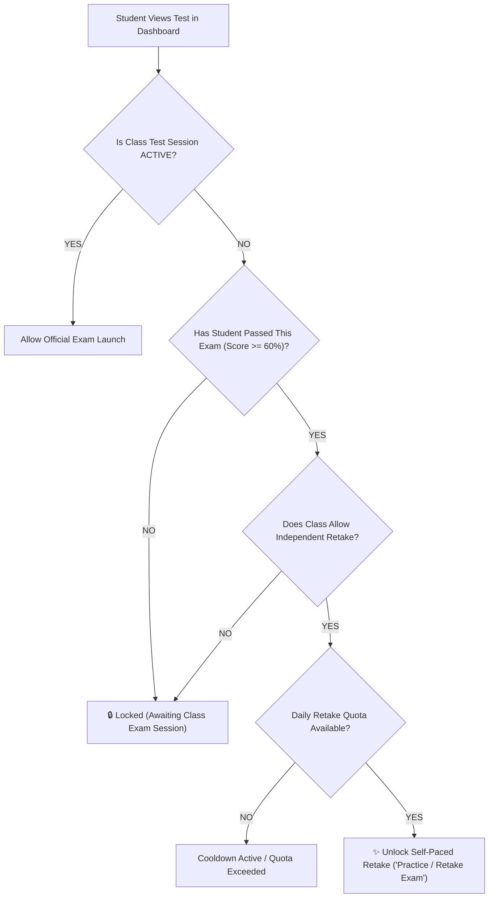

# 20261112 — Independent Retake and Self-Paced Exam Mode for Passed Students

> **Status:** PROPOSED (Ready for Review & Implementation)  
> **Date:** 2026-11-12  
> **Author:** Antigravity AI  
> **Target Subsystems:** `js/dashboard.js`, `js/test.js`, `js/admin/app.js`, `supabase/functions/start-test`, `supabase/functions/submit-test`

---

## 1. Executive Summary & Goal

### 1.1 Problem Statement
Currently, all exams (`test_type: 'exam'`) in TopsCore are strictly gated by scheduled class test sessions (`test_sessions`). If an admin or tutor has not opened an active live session (`status === 'ACTIVE'`), students see a locked exam icon (🔒) and cannot launch the exam attempt, regardless of whether they have passed previous requirements or already passed the exam itself.

Students who have successfully passed an exam with a passing score ($\ge 60\%$) frequently wish to:
1. Practice their skills independently outside class hours (*Latihan Mandiri / Drill*).
2. Retake the exam to improve their grade toward Grade A (90%+) or Star (100%) (*Score Improvement / Perbaikan Nilai*).

### 1.2 Objective
Enable students who have already achieved a passing grade ($\ge 60\%$) on a specific exam to initiate self-paced independent retakes at any time outside scheduled exam sessions, governed by configurable class-level settings (time duration, score overwrite policy, and optional frequency limits).

---

## 2. Key Architecture & Business Rules Alignment

1. **Rule 2.7 & Rule 2.10 (Report Cards & Grading Scale)**:
   - When score policy is set to **`HIGHEST_SCORE`** (default TopsCore invariant), an independent retake that scores higher than previous attempts will update the student's authoritative grade in report cards and the class grade matrix.
   - If the student scores lower during a practice retake, the historical highest score is preserved and never downgraded.
   - When score policy is set to **`PRACTICE_ONLY`**, the attempt is logged with `is_practice: true` and never modifies official report card grades.
2. **Rule 2.15 (Attempts)**:
   - Page refresh resumes active self-paced attempts seamlessly.
   - Network drops do not generate duplicate attempts. Double-submission remains strictly idempotent.
3. **Rule 2.16 (Server-Authoritative Timer)**:
   - The countdown timer displayed on the student screen is UI-only.
   - The server / Edge Function validates the deadline (`attempt.started_at + duration_minutes`) upon submission.

---

## 3. Detailed Technical Design

### 3.1 Access Control & Gating Decision Flow



### 3.2 Database & Settings Schema Extensions

In `class_settings` or `tests.payload`:
```json
{
  "allow_independent_retake": true,
  "retake_duration_minutes": 20,
  "retake_score_policy": "HIGHEST_SCORE",
  "max_retakes_per_day": 0
}
```
- `allow_independent_retake` (boolean, default: `true`): Enables independent exam taking for students who scored $\ge 60\%$.
- `retake_duration_minutes` (integer, default: same as original test duration, e.g. 15 or 20 min).
- `retake_score_policy` (`"HIGHEST_SCORE"` | `"PRACTICE_ONLY"`): Determines whether higher retake scores upgrade the grade matrix.
- `max_retakes_per_day` (integer, default: `0` for unlimited).

### 3.3 Student Dashboard UI States (`js/dashboard.js`)

| Scenario | Prior Score | Active Session? | UI Display / Button | Action |
|:---|:---:|:---:|:---|:---|
| First-time exam | None | No | 🔒 `Session Locked` (Greyed out) | Cannot launch |
| First-time exam | None | Yes | ▶️ `Start Exam` (Green CTA) | Launches official attempt |
| Failed student | 45% | No | 🔒 `Session Locked (Remedial)` | Awaiting tutor remedial session |
| Passed student | 75% | No | 🔁 `Self-Paced Retake` (Amber/Cyan CTA) | Launches independent attempt |
| Passed student | 100% (★) | No | 🎯 `Practice Mode` (Electric Pink CTA) | Launches practice attempt |

### 3.4 Backend Security Validation (`supabase/functions/start-test`)

When `start-test` receives an attempt initiation request outside an active `test_session`:
1. Query historical completed attempts for `(student_id, test_id)`.
2. Check `MAX(score) >= 60%`.
3. If `< 60%` or no attempts exist, throw HTTP 403: `"Exam is locked. Requires active class test session or prior passing grade."`
4. If $\ge 60\%$, create attempt record with:
   - `attempt_type: 'SELF_PACED_RETAKE'`
   - `deadline_at: NOW() + interval 'X minutes'`

---

## 4. Phased Implementation Plan

### Phase 1: Configuration & Settings UI
- Add "Allow Independent Retake" toggle and "Retake Duration" input in Admin Class Test Settings modal.
- Store configuration in class test metadata.

### Phase 2: Backend Edge Function Security Guard
- Update `supabase/functions/start-test/index.ts` to allow self-paced attempts for verified passed students.
- Update `supabase/functions/submit-test/index.ts` to implement the configured score policy (`HIGHEST_SCORE` vs `PRACTICE_ONLY`).

### Phase 3: Student Dashboard Gating & Visual Cues
- Update `js/dashboard.js` gating logic to detect passed students and replace the padlock 🔒 with the self-paced retake CTA.
- Display clear badge: `"Independent Practice Mode — 20 Min Timer"`.

### Phase 4: Automated Verification Suite
- Write automated test script `scripts/verify_independent_exam_retake.mjs` verifying:
  1. Failed students cannot launch outside session.
  2. Passed students can launch outside session.
  3. Server enforces deadline upon submit.
  4. Highest score updates matrix while lower score is ignored.

---

## 5. Verification & Acceptance Criteria
- [ ] Students with score $< 60\%$ are strictly locked out when no active session is running.
- [ ] Students with score $\ge 60\%$ see active "Retake / Practice" CTA and can launch independently.
- [ ] Server validates time window and rejects submissions beyond deadline.
- [ ] Class average and student grade matrix correctly preserve the highest score.
- [ ] 100% automated test pass rate with zero syntax errors.

