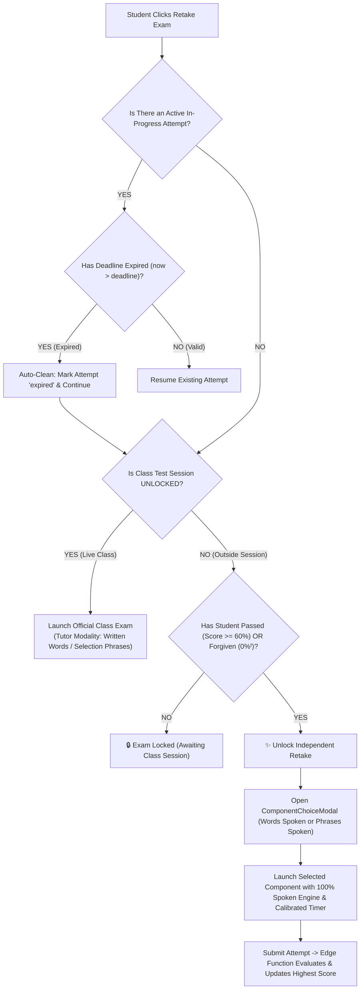
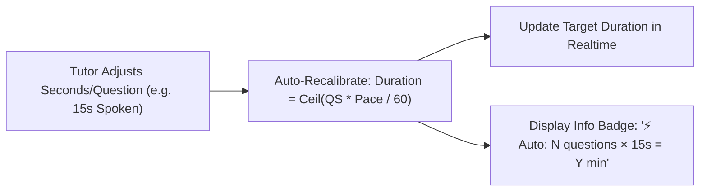

# 20261112 — Independent Retake and Self-Paced Exam Mode with Real-Time Duration Calibration

> **Status:** PROPOSED (Ready for Proceed)  
> **Date:** 2026-11-12  
> **Author:** Antigravity AI  
> **Target Subsystems:** `supabase/functions/start-test`, `supabase/functions/submit-test`, `js/dashboard.js`, `js/admin/app.js`, `js/admin/auto-gen-modal.js`, `js/admin/crud-modals.js`, `js/api.js`, `js/test.js`

---

## 1. Executive Summary & Goals

### 1.1 Problem Statement
In TopsCore LMS, all exams (`test_type: 'exam'`) are currently gated by scheduled class test sessions (`test_session`). If a tutor has not opened an active live session (`status === 'UNLOCKED'`), students are locked out (🔒) regardless of whether they have already passed previous requirements or have already achieved a passing grade ($\ge 60\%$).

Furthermore:
1. Students who have successfully passed ($\ge 60\%$) or students who were previously forgiven by tutors (`is_forgiven: true`, score `0%ᶠ`) frequently wish to practice their skills independently 24/7 to improve their score toward **Grade A (90%+)** or **Star (100% ★)**.
2. In the Admin Class Tests table and test generator, durations (`working_duration_minutes`) were previously configured as coarse, static minutes (e.g. 15m or 120m) rather than true pedagogical working durations calculated from question volume and per-item response rates.
3. In unsupervised independent home retakes, an all-oral **100% Spoken Mode** guarantees authentic conversational retrieval, eliminates looking up answers, and trains rapid reflexive automaticity.

### 1.2 Core Objectives & Strategic Invariants
1. **Vocab Class Default = 100% Spoken**:
   - By default, all tests in Vocabulary classes (both Tasks and standalone/retake Exams) are **Spoken Tests** testing instant oral automaticity.
2. **Authoritative Standard Pace (15s Words / 20s Phrases)**:
   - **Words Spoken**: **15 seconds per item** (the optimal sweet spot balancing STT microphone latency and instant fluency).
   - **Phrases Spoken**: **20 seconds per item** (allowing natural articulation of multi-word idioms and connected speech).
   - Total working duration is calculated automatically:
     $$\text{DUR. (M)} = \left\lceil \frac{\text{QS (Question Count)} \times \text{Seconds per Question}}{60} \right\rceil$$
   - Optional manual override: Tutors can still check `[ ] Custom Total Minutes Override` if a specific fixed class window is required.
3. **Admin Table Real-Time Calibration (`DUR. (M)`)**:
   - In the Class Tests table (under the `DUR. (M)` column), the displayed and stored duration automatically reflects this exact formula in real-time.
4. **24/7 Unlimited Independent Retakes**:
   - Students with prior passing score ($\ge 60\%$) OR forgiven status (`is_forgiven === true`) can retake exams independently outside scheduled sessions at any time without daily limits.
   - Bypass the legacy 3-attempt limit for independent retakes.
   - Retakes strictly use **100% Spoken Mode** for both Words Exam and Phrases Exam with auto-calibrated timers.
5. **Seamless Expired Attempt Cleanup (Zero HTTP 410 Errors)**:
   - If a student re-enters a test whose previous attempt expired, the server automatically terminates the expired attempt and instantly provisions a fresh attempt in a single action.
6. **Authoritative Highest Score Resolution**:
   - Retakes are logged as official exam attempts (not cosmetic practice).
   - Upgraded grades (e.g. from C to A or Star ★) update report cards and the grade matrix immediately; lower scores are preserved in historical records without downgrading the student's highest grade (Rule 2.7 & 2.10).
7. **Zero Data Loss Speech Flush on Timer Expiry**:
   - When the countdown reaches `00:00`, the client stops speech recording, allows a 1.5s fail-safe buffer to commit the final audio transcript, and auto-submits. The backend provides a 60-second network latency grace period.

---

## 2. Mathematical Duration Calibration Standard (SSOT)

$$\text{Working Duration (Minutes)} = \left\lceil \frac{\text{Question Count} \times \text{Seconds per Question}}{60} \right\rceil$$

| Modality / Answer Type (`answer_type`) | Standard Rate per Item | Pedagogical Baseline & Cognitive Demand |
| :--- | :---: | :--- |
| 🎙️ **`spoken` (Words)** | **15 seconds** *(Optimal)* | Rapid reflexive recall: 2.5s prompt reading $\rightarrow$ 3s recall $\rightarrow$ 2.5s speech $\rightarrow$ 4s STT buffer $\rightarrow$ 3s nav. |
| 🎙️ **`spoken` (Phrases / Idioms)** | **20 seconds** | Connected oral production: 3s prompt $\rightarrow$ 5s phrase assembly $\rightarrow$ 5s multi-word speech $\rightarrow$ 7s STT buffer. |
| 🔘 **`selection` (Multiple Choice)** | **20 seconds** | Recognition: 4s reading prompt $\rightarrow$ 12s scanning 4 English choices $\rightarrow$ 4s click/verify. |
| ✍️ **`written` (Manual Typing)** | **30 seconds** | Production & motor: 4s reading $\rightarrow$ 5s recall $\rightarrow$ 15s typing $\rightarrow$ 6s spell-checking. |
| 🔀 **`mixed` (Hybrid Modality)** | **25 seconds** | Weighted composite average across spoken, written, and multiple choice items. |

### Application Across Test Formats:
- **Words Task (40 QS, Spoken @ 15s)**: $\lceil (40 \times 15) / 60 \rceil =$ **⏱️ 10 min** *(previously 15m)*
- **Phrases Task (10 QS, Spoken @ 20s)**: $\lceil (10 \times 20) / 60 \rceil =$ **⏱️ 4 min** *(clamped to 5m minimum)*
- **Words Exam Theme A (120 QS, Spoken @ 15s)**: $\lceil (120 \times 15) / 60 \rceil =$ **⏱️ 30 min** *(previously static 70m/120m)*
- **Words Exam Theme B (280 QS, Spoken @ 15s)**: $\lceil (280 \times 15) / 60 \rceil =$ **⏱️ 70 min**
- **Words Exam Theme C (440 QS, Spoken @ 15s)**: $\lceil (440 \times 15) / 60 \rceil =$ **⏱️ 110 min**
- **Words Exam Theme D (600 QS, Spoken @ 15s)**: $\lceil (600 \times 15) / 60 \rceil =$ **⏱️ 150 min**
- **Phrases Exam (30 QS, Spoken @ 20s)**: $\lceil (30 \times 20) / 60 \rceil =$ **⏱️ 10 min**

---

## 3. Architecture & User Experience Flow

### 3.1 Dual-Environment Modality Matrix

```text
┌────────────────────────────────────────────────────────────────────────┐
│                     TOPSCORE EXAM MODALITY MATRIX                      │
├───────────────────────┬────────────────────────┬───────────────────────┤
│ Context               │ Words Exam             │ Phrases Exam          │
├───────────────────────┼────────────────────────┼───────────────────────┤
│ 🏫 Tutor Live Session │ ✍️ Written (Typing)     │ 🔘 Selection (Pilgan) │
│    (In-Class Exam)    │ or Tutor Configured    │ or Tutor Configured   │
├───────────────────────┼────────────────────────┼───────────────────────┤
│ 🏠 Independent Retake │ 🎙️ SPOKEN (Mic/STT)    │ 🎙️ SPOKEN (Mic/STT)   │
│    (Self-Paced Drill) │ Rate: 15s / question   │ Rate: 20s / question  │
└───────────────────────┴────────────────────────┴───────────────────────┘
```

### 3.2 Gating & Auto-Clean Decision Engine (`start-test`)



### 3.3 Visual State Matrix (`js/dashboard.js`)

| Prior Student State | Active Session? | Card Display / Badge | CTA Button Style | Action Triggered |
| :--- | :---: | :--- | :--- | :--- |
| **Never Attempted** | No | 🔒 `Session Locked` (Greyed out) | `[ 🔒 Locked ]` (Disabled) | Ineligible for independent launch |
| **Never Attempted** | Yes | `Not Started` | `[ Start Exam 🚀 ]` (Grade A Green `#00c000ff`) | Launches official class attempt |
| **Failed (`< 60%`)** | No | 🔒 `Session Locked (Remedial)` | `[ 🔒 Locked ]` (Disabled) | Must await tutor remedial session |
| **Forgiven (`0%ᶠ`)** | No | 0%<sup>F</sup> `Forgiven by Tutor` | `[ ⚡ Retake Exam ]` (Accent Cyan `#0284c7`) | Launches 100% Spoken Retake |
| **Passed (`60% – 99%`)**| No | `✓ Passed` (Score % + Grade Badge) | `[ 🔁 Retake Exam ]` (Accent Cyan `#0284c7`) | Launches 100% Spoken Retake |
| **Star (★ 100%)** | No | ★ `100% Star Badge` (Electric Pink `#ff2d87`) | `[ 🎯 Retake Drill ]` (Grade A Green `#00c000ff`) | Launches 100% Spoken Mastery Drill |

> [!NOTE]
> Per AGENTS.md Rule 2.10, the **Electric Pink** (`#ff2d87`) color is strictly exclusive to the Star (★) badge. Action buttons strictly reference Grade A Green (`#00c000ff`) or Primary Accent Cyan (`#0284c7`), never Electric Pink.

---

## 4. Visual Pre-Flight & UI Mockups

### 4.1 Admin Table `DUR. (M)` Live Calibration Mockup (`js/admin/app.js`)

```html
<!-- Table DUR. (M) Auto-Calibration Live Display -->
<table style="width:100%; border-collapse:collapse; background:#0f172a; font-family:Inter,sans-serif; color:#f8fafc; font-size:12px; border:1px solid rgba(255,255,255,0.08);">
  <thead>
    <tr style="background:#1e293b; color:#94a3b8; text-transform:uppercase; font-size:11px; text-align:left;">
      <th style="padding:8px 12px;">TITLE</th>
      <th style="padding:8px 12px;">TYPE</th>
      <th style="padding:8px 12px;">ANSWER</th>
      <th style="padding:8px 12px;">DUR. (M)</th>
      <th style="padding:8px 12px;">QS</th>
    </tr>
  </thead>
  <tbody>
    <tr style="border-bottom:1px solid rgba(255,255,255,0.05);">
      <td style="padding:8px 12px; font-weight:600;">Vocabulary A1 Words Task</td>
      <td style="padding:8px 12px; color:#eab308; font-weight:700;">TASK</td>
      <td style="padding:8px 12px; color:#38bdf8;">🗣️ Spoken</td>
      <td style="padding:8px 12px; font-weight:700; color:#ffff00;">⏱️ 10</td>
      <td style="padding:8px 12px; color:#38bdf8;">⚡ 40 (Vault)</td>
    </tr>
    <tr style="border-bottom:1px solid rgba(255,255,255,0.05);">
      <td style="padding:8px 12px; font-weight:600;">Vocabulary A Words Exam</td>
      <td style="padding:8px 12px; color:#f472b6; font-weight:700;">EXAM</td>
      <td style="padding:8px 12px; color:#38bdf8;">🗣️ Spoken</td>
      <td style="padding:8px 12px; font-weight:700; color:#ffff00;">⏱️ 30</td>
      <td style="padding:8px 12px; color:#38bdf8;">⚡ 120 (Vault)</td>
    </tr>
    <tr style="border-bottom:1px solid rgba(255,255,255,0.05);">
      <td style="padding:8px 12px; font-weight:600;">Vocabulary B Words Exam</td>
      <td style="padding:8px 12px; color:#f472b6; font-weight:700;">EXAM</td>
      <td style="padding:8px 12px; color:#38bdf8;">🗣️ Spoken</td>
      <td style="padding:8px 12px; font-weight:700; color:#ffff00;">⏱️ 70</td>
      <td style="padding:8px 12px; color:#38bdf8;">⚡ 280 (Vault)</td>
    </tr>
  </tbody>
</table>
```

### 4.2 Test Generator Seconds-Per-Item Configuration



---

## 5. Detailed Technical Specifications

### 5.1 Admin Table Auto-Duration Engine (`js/admin/app.js`)
In `_renderClassTestsTable`:
1. Use `calculateAutoDurationMinutes(qCount, answerType, category, customPaceSeconds)`:
   - For `spoken` Words: **15s per item**.
   - For `spoken` Phrases: **20s per item**.
   - For `selection`: 20s per item.
   - For `written`: 30s per item.
2. Display the live calculated minutes in the `DUR. (M)` cell.

### 5.2 Backend Security & Auto-Clean Engine (`supabase/functions/start-test/index.ts`)
1. **Seamless Expired Attempt Cleanup (Eliminate HTTP 410)**:
   ```typescript
   if (existing) {
     const deadline = new Date(existing.expires_at || existing.expected_end_at);
     if (now > deadline) {
       // Auto-clean expired attempt without throwing 410 error
       await supabase.from("attempts").update({ status: "expired", submitted_at: now.toISOString() }).eq("id", existing.id);
       // Continue cleanly to provision a fresh new attempt
     } else {
       // Return valid in-progress attempt for resume
       return ...;
     }
   }
   ```
2. **Bypass Attempt Cap for Passed/Forgiven Students**:
   ```typescript
   const isEligibleForSelfPaced = (pastAttemptsData || []).some((a: any) => {
     const pct = a.effective_score != null ? Number(a.effective_score) : Number(a.percentage || 0);
     return pct >= 60 || Boolean(a.is_forgiven);
   });

   // Bypass the 3-attempt limit if student is taking a self-paced retake
   if (test.test_type === 'exam' && attemptCount >= 3 && !isRemedialSession && !isEligibleForSelfPaced) {
     return new Response(JSON.stringify({ error: "Maximum retake limit reached (2 retakes allowed)." }), { status: 403 });
   }
   ```
3. **Session Gate Bypass & Retake Modality Enforcement**:
   - If session is not unlocked, allow launch IF and ONLY IF `isEligibleForSelfPaced === true`.
   - In self-paced retake mode outside active session, strictly enforce **100% SPOKEN modality**:
     - Words Exam: `dynamicAnswerType = 'spoken'` with duration $\lceil (N \times 15) / 60 \rceil$.
     - Phrases Exam: `dynamicAnswerType = 'spoken'` with duration $\lceil (N \times 20) / 60 \rceil$.
   - In active live sessions, preserve the tutor's configured answer types (e.g. written/selection).

### 5.3 Server-Authoritative Scoring & Grace Period (`supabase/functions/submit-test/index.ts`)
1. **Network Latency Grace Period**:
   - Compare `new Date()` with `attempt.expires_at`.
   - Allow a **60-second grace window** for network transmission.
   - If submitted past grace period, mark `status: 'auto_submitted'` and evaluate all saved answers.
2. **Authoritative Highest Score Update**:
   - Retake attempts update `is_best_score: true` if and only if `effective_score > previous_best`.
   - Lower scores are preserved in historical records without downgrading the student's highest grade.

### 5.4 Test Generator Seconds-Based Pace Engine (`js/admin/auto-gen-modal.js` & `js/api.js`)
- Add reusable pace utility:
  ```javascript
  export function calculateAutoDurationMinutes(questionCount, answerType, category = 'words', customPace = null) {
    const isPhrase = category === 'phrases' || String(answerType).toLowerCase().includes('phrase');
    let rate = 20;
    if (customPace && Number(customPace) > 0) {
      rate = Number(customPace);
    } else {
      const ans = String(answerType).toLowerCase();
      if (ans === 'spoken') {
        rate = isPhrase ? 20 : 15;
      } else if (ans === 'written') {
        rate = 30;
      } else if (ans === 'selection' || ans === 'multiple_choice' || ans === 'dropdown') {
        rate = 20;
      } else if (ans === 'mixed') {
        rate = 25;
      }
    }
    return Math.max(1, Math.ceil((Number(questionCount) * rate) / 60));
  }
  ```
- Bind live event listeners on pace selectors to recalibrate durations in real-time.

### 5.5 Client-Side Speech Fail-Safe Flush on Timer Expiry (`js/test.js`)
- In `handleTimeUp()`:
  ```javascript
  if (currentActiveSpeechSession) {
    try { currentActiveSpeechSession.stop(); } catch(_) {}
  }
  saveCurrentAnswer();
  // Allow 1.5s speech buffer flush before triggering auto-submit
  setTimeout(() => {
    doSubmit(true);
  }, 1500);
  ```

---

## 6. Phased Implementation Roadmap

### Phase 1: Real-Time Auto-Calibration in Admin Table & Generator
- Update `js/admin/app.js` to compute `DUR. (M)` dynamically using `calculateAutoDurationMinutes(qCount, answerType, category)`.
- Update `js/admin/auto-gen-modal.js` with seconds-per-item inputs (presets: 10s, 15s, 20s) and live event listeners.
- Update `js/api.js` (`autoGenerateTestsHierarchy` and `upsertDynamicTestShell`) to enforce the SSOT duration formulas.

### Phase 2: Backend Edge Function Security, Auto-Clean & 100% Spoken Retake
- Update `supabase/functions/start-test/index.ts`:
  - Permit passed ($\ge 60\%$) and forgiven (`is_forgiven: true`) students to launch exams when session is inactive.
  - Implement seamless auto-clean for expired attempts (eliminating error 410).
  - Bypass 3-attempt limit for self-paced retakes.
  - Enforce `spoken` modality for Words Exam (15s/item) and Phrases Exam (20s/item) during self-paced retakes.
  - Retain tutor's configured written/selection modes during active live class sessions.
- Update `supabase/functions/submit-test/index.ts`:
  - Add 60s grace period and auto-submit fallback.
  - Ensure highest score resolution functions seamlessly.

### Phase 3: Student Dashboard Gating & Client Speech Flush
- Update `js/dashboard.js`:
  - Replace padlock (🔒) with `[ 🔁 Retake Exam ]` or `[ ⚡ Retake Exam ]` for eligible students.
  - Update `ComponentChoiceModal` badges:
    - In live session: display configured mode (e.g. `Written Mode` / `Selection Mode`).
    - In self-paced retake: display `Words Exam (🎙️ Spoken Mode @ 15s)` and `Phrases Exam (🎙️ Spoken Mode @ 20s)`.
- Update `js/test.js`:
  - Implement 1.5s speech buffer flush in `handleTimeUp()` before triggering auto-submit.

### Phase 4: Automated Verification Suite
- Create and execute `scripts/verify_self_paced_exam_and_duration_calibration.mjs` verifying:
  1. Failed students ($< 60\%$) remain strictly locked outside sessions.
  2. Passed and forgiven students can launch self-paced retakes outside sessions.
  3. Attempt cap bypass allows 4th+ retake attempts for eligible students.
  4. Expired attempts are auto-cleaned without throwing HTTP 410.
  5. Retake exams outside session strictly default to Spoken mode (15s Words, 20s Phrases).
  6. Live class sessions preserve configured written/selection modalities.
  7. Admin table `DUR. (M)` and Test Generator output exact expected calculated minutes (e.g. 40 QS = 10m, 120 QS = 30m).
  8. 100% syntax and test suite pass rate.

---

## 7. Visual Pre-Flight Verification Checklist

### 📐 Visual Pre-Flight Verification Checklist
- [ ] **Current State Screenshot (Before)**: Embedded baseline visual showing existing appearance and dimensions.
- [ ] **Proposed Visual Mockup (After)**: Interactive generative UI widget or high-fidelity mockup showing the new layout.
- [ ] **Zero Outer Page Scroll**: Verified root `100vh` lock with `calc(100vh - 60px)` console sizing.
- [ ] **Container Spacing**: Verified strict 10px gap between all cards, tables, and top/lower panels.
- [ ] **Lower Panel Alignment**: Verified 50px fixed height aligned with `.sidebar-footer`.
- [ ] **Dynamic Columns & Nowrap**: Verified `white-space: nowrap !important;` on table cells with zero clipped text.
- [ ] **Zero Dead Space**: Verified tables and cards expand to fill 100% width cleanly.
- [ ] **Language Standard**: Verified all headers, labels, and loading messages use 100% direct English.
