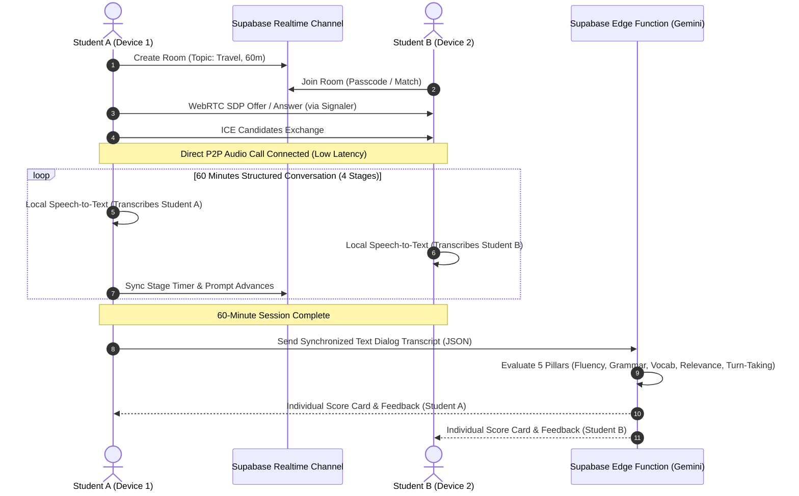
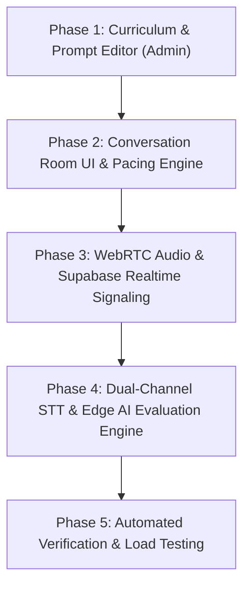

# 20261112 — Peer-to-Peer 1-Hour Conversation Module with AI Evaluation

> **Status:** PROPOSED (Architectural Blueprint & Roadmap)  
> **Date:** 2026-11-12  
> **Author:** Antigravity AI  
> **Target Subsystems:** `js/conversation-room.js`, `js/speech.js`, `supabase/functions/evaluate-test`, `supabase/realtime`, `js/admin/curriculum.js`

---

## 1. Executive Summary & Concept

### 1.1 Problem Statement & Learning Objective
Spoken English fluency requires authentic peer interaction, turn-taking, active listening, and conversational agility under continuous dialogue. Traditional language learning apps either rely on scripted multiple-choice exercises or brief 1-minute robotic speech snippets.

### 1.2 The Innovation
A dedicated **Peer-to-Peer 1-Hour Conversation Module** where:
- **Two students** connect from their respective devices (laptop, PC, tablet, or smartphone) across the internet or local network.
- The session is structured into **4 progressive conversation stages** totaling 60 minutes around a curriculum topic (e.g. *Workplace Negotiation*, *Crisis Management*, *Travel & Hospitality*).
- An interactive on-screen **AI Facilitator HUD** displays guiding prompts, stage timers, speaking balance meters, and turn-taking visual cues.
- Upon completion, the system's **Stateless AI Evaluation Engine** (Gemini 1.5 via Edge Function) performs multi-dimensional scoring on both students across the **5 Pillars of Speaking Performance**.

---

## 2. Architectural Pillars & Core Invariants

### 2.1 WebRTC P2P Audio with Supabase Realtime Signaling
- **Signaling Channel**: Supabase Realtime broadcast channels (`supabase.channel('room:<roomId>')`).
- **Media Stream**: Direct WebRTC PeerConnection with Opus audio codec (`audio/webm;codecs=opus`).
- **Bandwidth & Latency**: Audio streams directly between student devices (peer-to-peer), completely bypassing TopsCore backend servers and incurring **$0 media transit egress**.



### 2.2 Dual-Track Speech Capture & Clean Speaker Diarization
- Because Student A and Student B use separate devices, **Speaker Diarization is mathematically clean and trivial**:
  - Student A's microphone captures only Student A's voice $\rightarrow$ labeled `Student A`.
  - Student B's microphone captures only Student B's voice $\rightarrow$ labeled `Student B`.
- This eliminates the need for expensive multi-speaker voiceprint separation AI models.

### 2.3 Strict Low-Egress Invariant (Rule 2.12 Compliance)
- **Zero Raw Audio Storage**: TopsCore strictly prohibits storing or uploading 60 minutes of raw WAV/MP3 files to cloud storage (which would generate 50–100 MB per session per pair).
- **Stateless Text-First Evaluation**: Browser speech recognition (`SpeechRecognition` / `webkitSpeechRecognition`) transcribes spoken utterances transiently in the client.
- At the end of the 60 minutes, the browser packages only a lightweight JSON dialog array (`chatLog`: ~15–30 KB) sent to `evaluate-test`.

---

## 3. Session Structure: The 4-Stage 60-Minute Curriculum Flow

To keep a 1-hour conversation engaging and prevent awkward silences, the screen provides dynamic stage pacing:

| Stage | Duration | Phase Name | System Visual Cue & On-Screen Prompt |
|:---:|:---:|:---|:---|
| **1** | 10 Min | **Warm-up & Context Setting** | Ice-breaker questions, personal background related to the theme, vocabulary activation. |
| **2** | 25 Min | **Deep Dive & Debate / Roleplay** | Scenario assignment (e.g. Student A = Client, Student B = Vendor), conflicting objectives, negotiation prompts. |
| **3** | 15 Min | **Problem Solving & Consensus** | Cooperative challenge: agree on 3 actionable solutions or summarize joint decisions. |
| **4** | 10 Min | **Debrief & Mutual Reflection** | Guided review: what went well, challenging words encountered, final closing statements. |

---

## 4. AI Evaluation Rubric (The 5 Pillars Matrix)

The Edge Function prompt (`evaluate-test`) evaluates both participants simultaneously from the synchronized transcript:

```json
{
  "student_a_score": {
    "total_score": 88,
    "grade": "B",
    "pillars": {
      "fluency_and_coherence": { "score": 90, "feedback": "Natural conversational cadence with minimal unnatural hesitation." },
      "vocabulary_mastery": { "score": 85, "feedback": "Effective usage of topic-specific collocations." },
      "grammatical_accuracy": { "score": 82, "feedback": "Minor past tense agreement slips during Stage 2 debate." },
      "topic_relevance": { "score": 95, "feedback": "Strictly adhered to negotiation prompt requirements." },
      "interaction_and_turn_taking": { "score": 88, "feedback": "Balanced 48% speaking time share with active listening signals." }
    }
  },
  "student_b_score": {
    "total_score": 92,
    "grade": "A",
    "pillars": { ... }
  }
}
```

---

## 5. Phased Roadmap & Implementation Strategy



### Phase 1: Curriculum & Prompt Editor (Admin UI)
- Admin can create a "Conversation Module" test within any Class.
- Form inputs for Topic, 4 Stage Prompts, Duration (default: 60 mins), and Target Vocabulary List.

### Phase 2: Conversation Room UI (`conversation.html`)
- Dedicated full-screen interface featuring:
  - Central discussion card with current stage instructions.
  - 60-minute synchronized countdown timer.
  - Active speaking visualizer (VU meters for both speakers).
  - "Speaking Share" indicator (target: 50% / 50%).

### Phase 3: WebRTC Audio Connection Engine (`js/webrtc-call.js`)
- Signaling via Supabase Realtime Presence & Broadcast.
- Automatic STUN server negotiation (Google STUN).
- Reconnection fallback and mute/unmute audio controls.

### Phase 4: Dual-Channel STT & AI Scoring Edge Function
- Realtime utterance capture appending to synchronized `chatLog` array.
- Edge Function `evaluate-test` enhanced with the 5-Pillar Conversation evaluation prompt.
- Generation of detailed individual report cards.

### Phase 5: Automated Verification Suite
- Simulation script `scripts/verify_conversation_pipeline.mjs` verifying:
  1. Room creation and member pairing.
  2. Dialog turn serialization and timestamp synchronization.
  3. Low-Egress payload size verification (< 50 KB JSON).
  4. Scoring accuracy across test transcript fixtures.

---

## 6. Backward Compatibility & Non-Breaking Guarantee
- Modul ini tidak mengganggu modul tes yang sudah berjalan (Point & Speak, Vocab Mastery, Multiple Choice).
- Sistem ini memperluas `Module 3 (Conversation-based)` dan `Module 6 (Turn-based Roleplay)` menjadi format kolaboratif antar-siswa.

