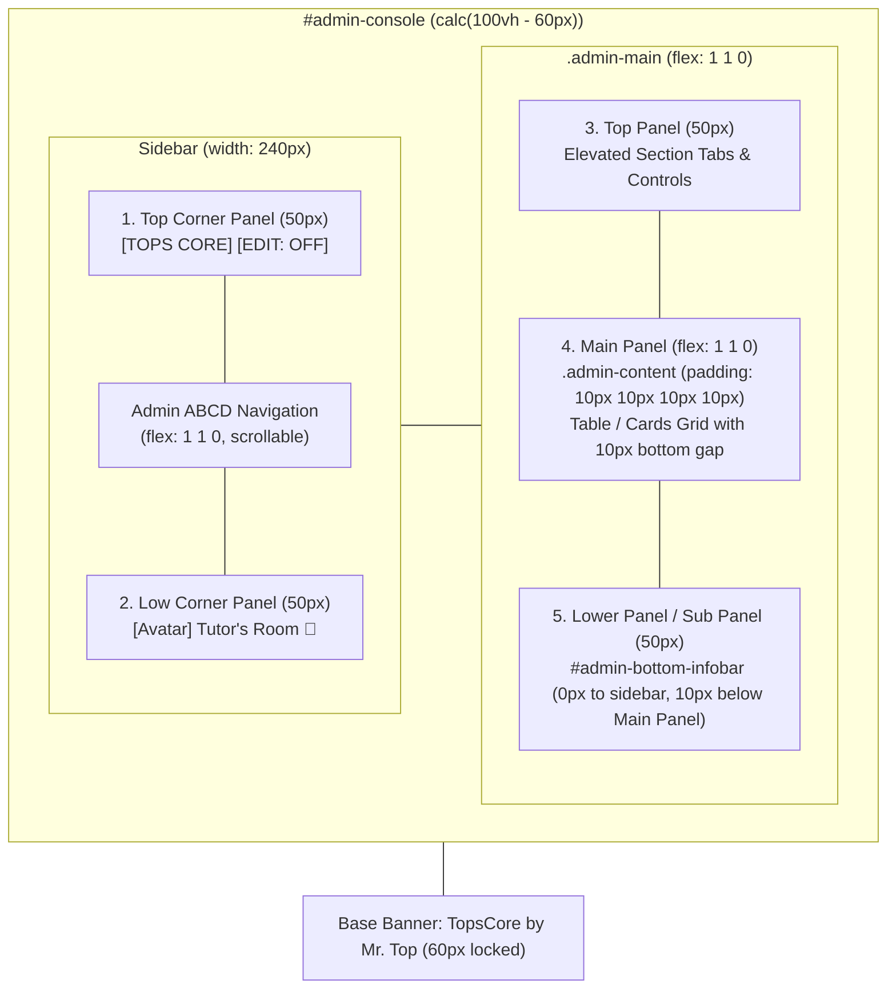

# Universal 5-Panel Architecture and Lower Panel Spatial Alignment

**Plan Date**: 2026-11-12  
**Target Milestone**: Phase 419  
**Execution Contract**: TopsCore LMS `AGENTS.md` Rule 2.20 & `.agents/rules/ui-invariants.md`  

---

## 1. Goal Description

Enforce a strict, universal **5-Panel Spatial Layout Architecture** across 100% of admin screens in Tutor's Room (`admin.html`). This plan resolves four layout defects identified in user review:
1. **0px Gap Between Lower Panel and Side Panel (Image 1)**: Eliminate the dark vertical gap/indent between the bottom panel and the sidebar footer. The Lower Panel must dock completely flush with the sidebar (0px gap).
2. **Permanent Visibility of `[🛡️ Forgiven & Override]` (Image 2)**: Ensure the Forgiven & Override wizard button remains permanently visible in both View Mode (Edit Mode OFF) and Edit Mode ON.
3. **Button Placement Standardization (Right vs Left)**: Position informational readouts and search bars on the **LEFT**, and action buttons/wizards on the **RIGHT**.
4. **Active 10px Container Gap Between Main Panel and Lower Panel (Image 3)**: Restore the missing 10px container gap between table viewports (e.g. Vocabulary Vault, Attendance, Tests) and the Lower Panel, preventing table scrollbars from colliding with the bottom panel.
5. **Universal Lower Panel on ALL Admin Pages (Image 4)**: Guarantee that the Lower Panel (`#admin-bottom-infobar`) is **always visible** across every single admin page (Modules, Settings, Curriculum, Organization, Dashboard, Class Hub, Roster, Vault), eliminating screens with missing footers.

---

## 2. Visual Pre-Flight Verification Checklist

```markdown
### 📐 Visual Pre-Flight Verification Checklist
- [ ] **Current State Screenshot (Before)**: Embedded baseline visuals for all 4 defect areas (Images 1–4).
- [ ] **Proposed Visual Mockup (After)**: High-fidelity interactive mockup displaying the unified 5-panel layout.
- [ ] **Zero Outer Page Scroll**: Verified root `100vh` lock with `calc(100vh - 60px)` console sizing.
- [ ] **Container Spacing**: Verified strict 10px gap between all cards, tables, and top/lower panels.
- [ ] **Lower Panel Alignment**: Verified 50px fixed height aligned with `.sidebar-footer` and 0px gap to sidebar.
- [ ] **Dynamic Columns & Nowrap**: Verified `white-space: nowrap !important;` on table cells with zero clipped text.
- [ ] **Zero Dead Space**: Verified tables and cards expand to fill 100% width cleanly.
- [ ] **Language Standard**: Verified all headers, labels, and loading messages use 100% direct English.
```

---

## 3. Current State Baseline (Before)

````carousel

<!-- slide -->

<!-- slide -->

<!-- slide -->

````

### Root Cause Analysis:
1. **Sidebar vs Lower Panel Gap (Image 1)**: Internal `.workspace-lower-panel` was placed inside `#class-attendance-container`, inside `.admin-content` which has `padding: 10px 10px 0 10px`. This recessed the lower panel 10px inward, disconnecting it from the sidebar divider.
2. **Hidden Override Button (Image 2)**: The `.edit-mode-only` class on `.attendance-actions-cluster` hid `[🛡️ Forgiven & Override]` when Edit Mode was OFF.
3. **Missing 10px Gap (Image 3)**: In `css/admin.css`, `#vault-tab-content .table-wrap` had `margin-bottom: 0 !important;` and `.admin-content` had `padding-bottom: 0 !important;`. The table scrollbar touched `#admin-bottom-infobar` with 0px gap.
4. **Missing Lower Panel (Image 4)**: `loadSection('modules')` called `setBottomInfobar(null, null)`, which executed `bar.classList.add('hidden')`. Neither `modules.js` nor `settings` defined bottom panel content, leaving the bottom area empty.

---

## 4. Proposed Architecture: The Universal 5-Panel System



### The 5 Panel Invariants:
| # | Panel Name | Position | Dimensions | Authoritative Element | Content & Role |
| :--- | :--- | :--- | :--- | :--- | :--- |
| **1** | **Top Corner Panel** | Top-left corner | Width: 240px, Height: 50px | `.sidebar-logo` | "TOPS CORE" text brand + Master Edit Mode toggle button (`#global-edit-mode-toggle`). |
| **2** | **Low Corner Panel** | Bottom-left corner | Width: 240px, Height: 50px | `.sidebar-footer` | Tutor's Room avatar, user name, role ("admin"), and logout button `🚪`. |
| **3** | **Top Panel** | Top header | Width: `100%`, Height: 50px | `#admin-topbar` | Elevated KPI navigation tabs (`#topbar-tabs-container`), sidebar toggle `☰`, and topbar actions. 0px gap to Top Corner Panel. |
| **4** | **Main Panel** | Central workspace | Width: `100%`, Height: `flex: 1 1 0` | `.admin-content` (`#admin-content-area`) | The active data table or card grid. Sits within a strict 10px container margin (10px gap below Top Panel, 10px gap above Lower Panel). |
| **5** | **Lower Panel (Sub Panel)** | Bottom bar | Width: `100%`, Height: 50px | `#admin-bottom-infobar` | Docked flush with Low Corner Panel (**0px gap to side panel**). Sits **10px below Main Panel**. **ALWAYS VISIBLE across 100% of admin screens**. |

---

## 5. Proposed Visual Mockup (After)

```html
<!-- Universal 5-Panel Layout Preview -->
<div style="width: 100%; height: 260px; background: #0b1120; border: 1px solid rgba(255,255,255,0.15); display: flex; flex-direction: column; overflow: hidden; font-family: Inter, sans-serif;">
  
  <!-- #admin-console -->
  <div style="flex: 1 1 0; display: flex; flex-direction: row; min-height: 0;">
    
    <!-- Sidebar -->
    <div style="width: 200px; background: #0f172a; border-right: 1px solid rgba(255,255,255,0.1); display: flex; flex-direction: column; justify-content: space-between;">
      <!-- 1. Top Corner Panel -->
      <div style="height: 50px; border-bottom: 1px solid rgba(255,255,255,0.1); padding: 0 12px; display: flex; align-items: center; justify-content: space-between;">
        <span style="font-weight: 800; font-size: 13px; color: #fff;">TOPS CORE</span>
        <span style="font-size: 10px; background: #1e293b; color: #94a3b8; padding: 2px 6px; border-radius: 4px; font-weight: 700;">EDIT: OFF</span>
      </div>
      
      <!-- Nav in middle -->
      <div style="padding: 8px 12px; font-size: 11px; color: #64748b;">
        <div>● Curriculum</div>
        <div style="color: #38bdf8; font-weight: 700; margin-top: 4px;">● Class Hub</div>
        <div style="margin-top: 4px;">● Modules</div>
      </div>
      
      <!-- 2. Low Corner Panel -->
      <div style="height: 50px; border-top: 1px solid rgba(255,255,255,0.1); padding: 0 12px; display: flex; align-items: center; justify-content: space-between; background: #0f172a;">
        <span style="font-size: 11px; font-weight: 600; color: #f8fafc;">Tutor's Room</span>
        <span>🚪</span>
      </div>
    </div>
    
    <!-- Main Area -->
    <div style="flex: 1 1 0; display: flex; flex-direction: column; min-height: 0;">
      <!-- 3. Top Panel -->
      <div style="height: 50px; background: rgba(15,23,42,0.85); border-bottom: 1px solid rgba(255,255,255,0.1); padding: 0 16px; display: flex; align-items: center; gap: 10px;">
        <span style="font-size: 12px; font-weight: 700; color: #38bdf8;">[ Students Grade & Score ]</span>
        <span style="font-size: 12px; font-weight: 600; color: #94a3b8;">[ Class Tests ]</span>
      </div>
      
      <!-- 4. Main Panel (Area Kerja dengan 10px gap di semua sisi) -->
      <div style="flex: 1 1 0; padding: 10px; display: flex; flex-direction: column; min-height: 0;">
        <div style="flex: 1 1 0; background: #1e293b; border: 1px solid rgba(255,255,255,0.1); border-radius: 6px; display: flex; align-items: center; justify-content: center; font-size: 12px; color: #94a3b8;">
          Main Panel Table Viewport (Strict 10px Container Gap Active Above & Below)
        </div>
      </div>
      
      <!-- 5. Lower Panel / Sub Panel (Docked flush to side panel, 0px gap to sidebar) -->
      <div style="height: 50px; background: #0f172a; border-top: 1px solid rgba(255,255,255,0.1); padding: 0 16px; display: flex; align-items: center; justify-content: space-between;">
        <div style="font-size: 12px; color: #94a3b8; font-weight: 600;">17 Enrolled</div>
        <div style="display: flex; gap: 8px;">
          <span style="font-size: 11px; font-weight: 700; background: #d97706; color: #fff; padding: 4px 10px; border-radius: 4px;">🛡️ Forgiven & Override</span>
        </div>
      </div>
    </div>
  </div>
  
  <!-- Locked Banner (60px) -->
  <div style="height: 30px; background: #020617; border-top: 1px solid rgba(255,255,255,0.05); display: flex; align-items: center; justify-content: center; font-size: 11px; color: #64748b;">
    TopsCore by Mr. Top
  </div>
</div>
```

---

## 6. User Review Required & Open Questions

> [!IMPORTANT]
> ### 🎯 Button Placement Architecture (User Question: "lalu tombol2 seprti ini sbaiknya ada di kanan atau kiri?")
> **Authoritative Recommendation: Action buttons belong on the RIGHT; Informational readouts belong on the LEFT.**
> - **LEFT SIDE OF LOWER PANEL**: Reserved for **Informational Metrics & Contextual Filters**:
>   - Counts: `17 Enrolled`, `Total Tests: 19`, `8 Core Evaluation Engines`
>   - Search inputs: `[🔍 Search Theme or Topic...]`, `[🔍 Filter word...]`
>   - Scoping pills: `[🎯 ALL]`, `[L1]`, `[L2]`
> - **RIGHT SIDE OF LOWER PANEL**: Reserved for **Action Triggers, Launchers & Wizards (CTA)**:
>   - `[🛡️ Forgiven & Override]`
>   - `[⚙️ Test System Settings]`, `[🗺️ Open Test Blueprint ↗]`, `[⚡ Generator & Settings Wizard]`
>   - `[🚀 NEXT]`, `[➕ Add Student]`, `[📥 Import Excel]`
>   - `[🎴 Classroom Bottleneck Drill]`
> 
> **UX Rationale**:
> 1. Adheres to natural F/Z-pattern reading order: Eyes read status context on the bottom-left, then take action on the bottom-right.
> 2. Eliminates layout shifting: When action buttons are toggled or modified, informational counts on the left remain stable and fixed.
> 3. Standardizes consistency across 100% of TopsCore admin screens.

### 🌟 5 Strategic Refinements Incorporated:
1. **Seamless Hairline Alignment**: Low Corner Panel (`.sidebar-footer`) and Lower Panel (`#admin-bottom-infobar`) share exact `height: 50px !important`, `background: #0f172a !important`, and continuous `border-top: 1px solid rgba(255, 255, 255, 0.08) !important` to form a cohesive, desktop-class bottom bar with 0px gap to sidebar.
2. **Anti-Ballooning & Scale Protection**: Button clusters in Lower Panel strictly enforce `flex-wrap: nowrap !important; overflow-x: auto;` and compact button heights (30px–32px), preventing multi-line wrapping on 1366×768 / 125% zoom displays.
3. **Semantic Button Palette (Rule 14 Compliant)**:
   - `[🛡️ Forgiven & Override]`: Amber (`#d97706`).
   - `[⚙️ Test System Settings]`: Dark Slate (`#1e293b`, text `#38bdf8`).
   - `[🗺️ Open Test Blueprint ↗]`: Neutral Dark (`#334155`).
   - `[⚡ Generator & Settings Wizard]`: Indigo Brand (`#4f46e5`).
   - Zero neon glow effects (`box-shadow: none !important`).
4. **Meaningful Default Status on Non-Table Pages**: On pages without direct table actions (e.g. Modules, Settings, Dashboard), Lower Panel displays live entity counters on the left and active system badges on the right (`● ALL ENGINES ACTIVE` in Grade A Green `#00c000ff`).
5. **Centralized Tab-Sync Dispatcher (`syncClassHubLowerPanel`)**: A single authoritative dispatcher updates Lower Panel content seamlessly during Class Hub sub-tab switches without layout shifts or DOM reconstruction flickers.

> [!NOTE]
> ### 🛡️ Permanent Visibility of `[🛡️ Forgiven & Override]`
> In accordance with your request, `[🛡️ Forgiven & Override]` will be removed from `.edit-mode-only` and remain **permanently visible** in both View Mode and Edit Mode. Admins and teachers can inspect waiver statuses and open the forgiveness wizard at all times.

---

## 7. Proposed Changes

### Component 1: Spatial CSS Layout & Invariants (`css/admin.css`)

#### [MODIFY] `css/admin.css`
- Ensure `.admin-bottom-infobar` has:
  ```css
  .admin-bottom-infobar {
    height: 50px !important;
    min-height: 50px !important;
    max-height: 50px !important;
    display: flex !important;
    align-items: center !important;
    justify-content: space-between !important;
    background: #0f172a !important;
    border-top: 1px solid rgba(255, 255, 255, 0.08) !important;
    padding: 0 16px !important;
    box-sizing: border-box !important;
    flex-shrink: 0 !important;
    z-index: 35 !important;
  }
  ```
- Enforce strict 10px container gap between Main Panel and Lower Panel:
  ```css
  .admin-content {
    flex: 1 1 0 !important;
    min-height: 0 !important;
    overflow: hidden !important;
    display: flex !important;
    flex-direction: column !important;
    padding: 10px 10px 10px 10px !important; /* STRICT: 10px padding on bottom activates the 10px container gap */
    box-sizing: border-box !important;
    gap: 10px !important;
  }
  ```
- Update `.table-wrap` rules across all containers (`#vault-tab-content .table-wrap`, `#class-attendance-container .table-wrap`, `#class-tests-grid .table-wrap`, etc.) so they inherit the 10px bottom container gap cleanly without clipping or collapsing.
- Ensure `.sidebar-logo` (Top Corner Panel) and `.sidebar-footer` (Low Corner Panel) maintain strict `height: 50px !important;` for 100% horizontal alignment.

---

### Component 2: Unified Lower Panel Management & Views (`js/admin/app.js`)

#### [MODIFY] `js/admin/app.js`
1. **Never Hide Lower Panel**:
   Update `setBottomInfobar(leftHtml, rightHtml, centerHtml)`:
   - When called with empty arguments, instead of `bar.classList.add('hidden')`, render standard system status:
     - Left: `<span style="font-size:12px; color:#94a3b8; font-weight:500;">TopsCore ABCD System</span>`
     - Right: `<span style="font-size:11px; color:#64748b; font-weight:600;">Status: Operational</span>`
   - Remove `bar.classList.add('hidden')` everywhere.
2. **Class Hub Tab Integration**:
   - In `class-hub`:
     - **Attendance Tab**: Populate Lower Panel via `setBottomInfobar`:
       - Left: `<span style="font-size:12px; color:#94a3b8; font-weight:500;">${activeBatchStudents.length} Enrolled</span>`
       - Right: `<button type="button" class="btn btn-warning btn-sm" id="btn-open-forgiven-wizard" style="font-size:12px; font-weight:700; background:#d97706; border-color:#d97706; color:#fff; padding:4px 10px;" title="Open Forgiven &amp; Manual Exam Override Wizard">🛡️ Forgiven &amp; Override</button>` (Permanently visible in View Mode and Edit Mode!).
     - **Tests Tab**: Populate Lower Panel via `setBottomInfobar`:
       - Left: `<span style="font-size:12px; color:#94a3b8; font-weight:500;">Total Tests: <strong style="color:#f8fafc;">${classTests.length}</strong></span>`
       - Right: `[⚙️ Test System Settings]`, `[🗺️ Open Test Blueprint ↗]`, and `[⚡ Generator & Settings Wizard]`.
     - **Test Sessions Tab**:
       - Left: `<span style="font-size:12px; color:#94a3b8; font-weight:500;">Active Class Test Sessions</span>`
       - Right: Session action controls.
     - **Analytics Tab**:
       - Left: Filter input & triage pills.
       - Right: `[🎴 Classroom Bottleneck Drill]`.
   - Remove the duplicate inner `.workspace-lower-panel` markup from `#class-attendance-container` and `#class-tests-container` to eliminate the 10px sidebar recess gap.
3. **Modules Page (`renderModules`)**:
   - Call `setBottomInfobar`:
     - Left: `<span style="font-size:12px; color:#94a3b8; font-weight:500;">🧩 8 Core AI Evaluation Engines (Stateless &amp; Low-Egress)</span>`
     - Right: `<span class="badge" style="background:rgba(0,192,0,0.15); color:#00c000; border:1px solid rgba(0,192,0,0.3); font-size:11px; font-weight:700;">● ALL ENGINES ACTIVE</span>`
4. **Settings Page (`renderSettings`)**:
   - Call `setBottomInfobar`:
     - Left: `<span style="font-size:12px; color:#94a3b8; font-weight:500;">⚙️ TopsCore System Settings &amp; Security Protocols</span>`
     - Right: `<span style="font-size:11px; color:#64748b; font-weight:600;">Build 2026.11</span>`

---

### Component 3: Modules Engine File (`js/admin/modules.js`)

#### [MODIFY] `js/admin/modules.js`
- Call `window.setBottomInfobar` during `renderModules` execution so module count, engine state, and configuration status populate the authoritative Lower Panel.

---

### Component 4: Vocabulary Vault Table Spacing (`js/admin/vocab-vault.js`)

#### [MODIFY] `js/admin/vocab-vault.js`
- Ensure `#theme-manager-container` and `#vault-tab-content .table-wrap` obey the 10px bottom container gap above `#admin-bottom-infobar`.

---

## 8. Verification Plan

### Automated Tests
Run dedicated automated verification scripts to validate the 5-panel layout, 0px sidebar gap, 10px table gap, and permanent visibility:

```bash
# 1. Verify Visual Pre-Flight Compliance
node scripts/verify_plan_preflight.mjs "docs/plans/20261112 - Universal 5-Panel Architecture and Lower Panel Spatial Alignment.md"

# 2. Verify Spatial & Visual Invariants
node .agents/skills/ui-spatial-checker/scripts/check_spatial_invariants.mjs

# 3. Dedicated 5-Panel Verification Suite
node scripts/verify_universal_5_panels.mjs
```

### Manual Verification
1. Open `http://localhost:5500/admin.html#class-hub`.
2. Inspect the bottom-left corner: confirm **0px gap** between `.sidebar-footer` (door icon 🚪) and the Lower Panel (`#admin-bottom-infobar`).
3. Toggle Edit Mode OFF: confirm `[🛡️ Forgiven & Override]` remains **fully visible** on the bottom right of the Attendance tab.
4. Switch to Class Tests tab: confirm `[⚙️ Test System Settings]`, `[🗺️ Open Test Blueprint ↗]`, and `[⚡ Generator & Settings Wizard]` render on the bottom right, and `Total Tests: 19` on the bottom left.
5. Navigate to `#vocab_vault`: verify the 10px container gap is clearly visible between the bottom table scrollbar and the lower search bar.
6. Navigate to `#modules`: verify the Lower Panel is **prominently visible** displaying 8 Core Engines status.

