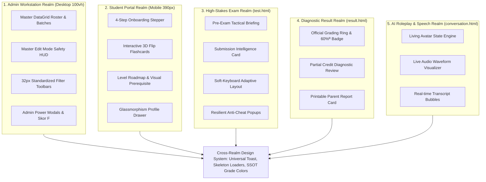

# 🎨 Analisis Komprehensif Pengembangan UI TopsCore
**TopsCore LMS — Comprehensive Multi-Realm UI/UX Strategic Architecture & Development Roadmap**  
*Date: 2026-11-13 | Context: Post-Phase 444 Admin Compact Redesign | Governance: AGENTS.md & UI Invariants*

---

## 1. Executive Summary & Taksonomi Realm UI TopsCore

Setelah sukses menuntaskan **Phase 444 (Admin UI Compact Redesign: 40px Topbar & Lower Panel, 11px Table Typography, Clean Sidebar)** serta **Phase 446 (Popups & Modals Wave 1)**, seluruh antarmuka TopsCore kini memiliki pondasi spasial yang sangat kokoh.

Namun, TopsCore bukan sekadar aplikasi web tunggal; aplikasi ini memiliki **dua arsitektur psikologi pengguna yang sangat berbeda**:
1. **Admin Workstation Realm (Desktop Desktop-First / 100vh Lock)**: Tempat admin/tutor bekerja berjam-jam mengolah data tabular padat (Excel-like datagrids, 40px panels, fast inline editing, high density, keyboard navigation).
2. **Student & Exam Realm (Mobile-First / Touch Ergonomics 390px)**: Tempat siswa belajar dan mengerjakan ujian berisiko tinggi melalui smartphone mereka (thumb-friendly tap targets, focus state tanpa distraksi, zero accidental submits, instant visual feedback).

Dokumen ini memetakan seluruh area pengembangan antarmuka pengguna (UI) yang belum tersentuh atau berpotensi ditingkatkan secara signifikan ke dalam **5 Realm Strategis**.

---

## 2. Realm 1: Admin Workstation Realm (Desktop Command Center)

### 2.1 Penyelesaian Arsitektur Master DataGrid (§TABLE-FLEX-PRIMARY)
*Saat ini:* **Vocabulary Vault** (`#vault-table`) dan **Theme Manager** (`#theme-manager-flat-table`) telah berhasil dimigrasi ke standar §TABLE-FLEX-PRIMARY dengan resizer memori dan zero horizontal scroll. Namun, tabel-tabel utama lainnya masih menggunakan layout lama:
- **Student Roster Table (`student-management.js`)**: Tabel daftar siswa masih memiliki kolom nama yang rentan tertekan saat viewport mengecil. Perlu ditetapkan kolom `STUDENT NAME` sebagai **Flex Primary (`min-width: 200px`)** dengan kolom metadata (NIS/PIN, Level, Batch, Status, Actions) fixed pixel.
- **Batches & Classes Hub Table (`classes-management.js`)**: Nested accordion / tree grid perlu kalibrasi lebar fixed agar indentasi hirarki rapi dan tidak melompat ketika row di-expand.

### 2.2 Master Edit Mode "Safety HUD" & Status Bar
*Masalah:* Saat ini, ketika tombol "Master Edit Mode" diaktifkan di panel bawah, seluruh cell tabel berubah menjadi input editable (`.vault-edit-input`, dropdown, action delete button muncul). Namun, **tidak ada visual persistent banner** yang mencolok di bagian atas layar untuk mengingatkan admin bahwa mereka sedang dalam mode edit langsung database.
*Solusi UI:*
- Hadirkan **Floating Safety HUD / Amber Glow Top Strip** di bawah topbar saat Master Edit Mode = ON (`border-top: 2px solid var(--grade-c);`).
- Tambahkan badge berkedip halus: `⚠️ MASTER EDIT MODE ACTIVE — Click anywhere to save, ESC to exit`.
- Tambahkan pintasan keyboard universal: `Ctrl + S` / `Cmd + S` untuk save batch, dan tombol "Exit Edit Mode" yang jelas di header.

### 2.3 Standarisasi Toolbar Filter & Pencarian ke 32px
*Kondisi:* Topbar dan Lower Panel telah dikunci pada **40px**. Namun, toolbar sekunder (baris filter di atas tabel yang berisi dropdown program, batch selector, search input, dan date picker) memiliki tinggi yang bervariasi antara 28px, 34px, dan 38px di berbagai modul.
*Solusi UI:*
- Kunci seluruh elemen kontrol filter (`input[type="text"]`, `select`, `.btn-filter`) pada **tinggi 32px seragam** dengan font size 11px.
- Gunakan rounded pill radius `4px` konsisten, background dark slate `#151D2F`, border `rgba(255,255,255,0.08)`, dan hover state `#1E293B`.

### 2.4 Admin Power Modals & Skor F Dispensation Authorizer (Wave 4)
*Kebutuhan:*
- Menggantikan raw browser `prompt()` pada pemberian **Skor F (Forgiven)** dengan modal resmi:
  - Chip pilihan alasan instan: `Dispensasi Sakit`, `Force Majeure`, `Audio Glitch`, `Prerogatif Tutor`.
  - Input teks justifikasi wajib dengan counter karakter.
  - Tampilan visual warna tema **Grade C Yellow** (`#ffff00`) sesuai Rule 2.10.
- Standarisasi `#crud-modal` (Create/Edit Test, Create Class, Create Batch):
  - Sticky header 40px dengan breadcrumb judul.
  - Sticky footer 40px dengan tombol aksi Cancel (abu-abu) vs Save (Grade A Green).
  - Konten tengah `overflow-y: auto` dengan tata letak grid 2 kolom rapi.

---

## 3. Realm 2: Student Learning Portal Realm (Mobile 390px)

### 3.1 Onboarding Multi-Step Wizard Flow (Wave 1)
*Masalah:* Saat siswa baru pertama kali login, sistem memunculkan 4 modal terpisah secara terputus-putus (Gender Setup, Birthday Setup, Education Setup, Photo Setup) tanpa indikator progres.
*Solusi UI:*
- Satukan keempatnya ke dalam **4-Step Visual Stepper Wizard** (`dashboard.html`):
  - Indikator langkah di atas modal: `● ○ ○ ○ (Step 1 of 4: Profil Diri)`.
  - Transisi slide horizontal antar langkah yang mulus (CSS hardware-accelerated).
  - Tombol aksi jelas: `← Kembali` dan `Lanjut →`.
- Tuntaskan pembersihan mojibake yang masih tersisa di template HTML (`🎓` topi toga pada modal pendidikan, `👑` mahkota di hero student).

### 3.2 Interactive 3D Flip Flashcards Retention Engine (Wave 3)
*Kebutuhan:* Fitur latihan mandiri kosakata (Vocabulary Vault Student Mode) membutuhkan pengalaman belajar yang taktil:
- Kartu kosakata berukuran mobile (`perspective: 1000px`, `transform-style: preserve-3d`):
  - **Front Card**: English Word (bold 22px), Phonetic pronunciation guide (`/əˈkʌm.plɪʃ/`), audio listen button, dan Word Type chip (`Verb`, `Noun`).
  - **Back Card (saat di-tap)**: Terjemahan bahasa Indonesia, contoh kalimat, dan antonim/sinonim.
- Tombol evaluasi mandiri di bawah kartu:
  - Merah Grade E: `❌ NEED PRACTICE` (kartu diulang nanti).
  - Hijau Grade A: `✓ MASTERED!` (kartu ditandai lulus).
- Counter kartu dengan JetBrains Mono: `CARD 04 / 20`.

### 3.3 Visual Level Roadmap & Prerequisite Milestone Tree
*Kondisi:* Daftar kelas dan tes di dashboard siswa saat ini berbentuk kartu vertikal datar.
*Peningkatan UI:*
- Transformasikan tampilan kelas menjadi **Visual Learning Path (Roadmap/Milestone Tree)**:
  - Node level terkunci (`🔒 Level 2: Locked - Selesaikan Task 1 & 2 di Level 1`).
  - Node level aktif dengan pulse glow (`Level 1: In Progress - 85% Selesai`).
  - Node selesai dengan Grade Badge emas/hijau (`★ Passed`).
- Memberikan kepuasan visual psikologis *gamification* bagi siswa yang memicu motivasi belajar.

### 3.4 Student Profile & Achievement Glassmorphism Drawer
*Peningkatan UI:*
- Mengubah modal profil yang kaku menjadi **Slide-up/Slide-out Glassmorphism Drawer**:
  - Avatar foto siswa dengan frame cincin glowing sesuai grade rata-rata.
  - Rincian streak kehadiran harian (`🔥 5 Days Streak`).
  - Total Points akumulasi (`PTS 1,450`).
  - Formulir ganti PIN pribadi langsung di dalam drawer tanpa berpindah halaman.

---

## 4. Realm 3: High-Stakes Exam Room Realm (`test.html`)

### 4.1 Exam Pre-Submission Intelligence Modal (Wave 2)
*Masalah:* Saat ini, ketika siswa menekan tombol "Submit Exam", konfirmasi yang muncul hanya dialog sederhana *"Are you sure you want to submit?"*. Siswa sering tidak sengaja mengumpulkan ujian padahal ada soal yang belum terjawab.
*Solusi UI:*
- Bangun **Pre-Submit Inspection Card**:
  - Kartu ringkasan live sebelum submit:
    - `✓ Soal Terjawab: 36 / 40` (Badge Grade A Hijau).
    - `⚠️ Belum Terjawab: 4 Soal` (Badge Grade E Merah dengan tombol berkedip).
  - Dua tombol aksi strategis:
    - Tombol Sekunder: `🔍 PERIKSA SOAL KOSONG` (langsung membuka popup matriks dan melompat ke soal pertama yang belum dijawab).
    - Tombol Primer: `KUMPULKAN & KUNCI JAWABAN 🔒` (memerlukan konfirmasi tahan 2 detik untuk mencegah ketidaksengajaan).

### 4.2 Tactical Pre-Exam Focus & Hardware Briefing Card
*Peningkatan UI:*
- Sebelum timer berjalan, tampilkan modal briefing taktis:
  - Checklist otomatis kesiapan hardware: `Microphone Ready 🎙️`, `Audio Speaker Tested 🔊`, `Internet Stable 📶`.
  - Ringkasan aturan ujian: *"Ujian berlangsung 20 menit, dilarang berpindah aplikasi/tab."*
  - Tombol mulai besar: `SAYA SIAP, MULAI UJIAN 🚀`.

### 4.3 Mobile Soft-Keyboard Adaptive Answering Layout
*Tantangan Teknis:* Pada smartphone, ketika siswa mengetik jawaban pada modul *Spelling / Typing*, virtual keyboard (Android/iOS) muncul dan menutupi 50% tinggi layar, seringkali menutupi pertanyaan audio atau tombol "Next Question".
*Solusi UI:*
- Terapkan `dvh` (Dynamic Viewport Height) dan `visualViewport API` pada `css/test.css`.
- Saat keyboard aktif, perkecil visual audio player menjadi pill ramping di atas, pertahankan input text dan tombol navigasi selalu terlihat di atas keyboard (*sticky input bar*).
- Matikan `autocorrect="off"`, `autocapitalize="off"`, `spellcheck="false"` pada input tes bahasa Inggris agar tidak membocorkan jawaban atau mengubah kata siswa.

### 4.4 Resilient Anti-Cheat & Offline Graceful UI
*Peningkatan UI:*
- Jika siswa secara tidak sengaja menerima telepon atau notifikasi sistem yang memicu `visibilitychange`:
  - Jangan langsung gagalkan ujian secara destruktif!
  - Tampilkan modal peringatan berwibawa: `⚠️ PERINGATAN INTEGRITAS: Anda meninggalkan layar ujian. Pelanggaran 1 dari 3 tercatat di sistem.`
  - Jika internet terputus di tengah ujian: tampilkan banner kuning di atas (`Koneksi offline. Jawaban Anda tersimpan lokal dan akan disinkronkan saat online kembali`).

---

## 5. Realm 4: Diagnostic Result & Report Card Realm (`result.html`)

### 5.1 Official Grading Ring & Remedial 60%ᴿ Badge Polish
*Kepatuhan:* Mengacu pada AGENTS.md Rule 2.10:
- Lingkaran skor besar (*Score Ring SVG*) dengan warna otoritatif:
  - 100%: Electric Pink (`#ff2d87`) dengan simbol `★`.
  - 90–99%: Pure Green (`#00c000`) dengan simbol `A`.
  - 80–89%: Electric Lime (`#95ff00`) dengan simbol `B`.
  - 60–79%: Pure Yellow (`#ffff00`) dengan simbol `C`.
  - 30–59%: Dark Orange (`#ff8c00`) dengan simbol `D`.
  - 0–29%: Pure Red (`#ff0000`) dengan simbol `E`.
- Indikator Remedial: Tanda `60%ᴿ` yang rapi di samping persentase skor, mengindikasikan batas atas nilai remedial.

### 5.2 Granular Answer Review & Audio Diagnostic Card
*Peningkatan UI:*
- Tampilan rincian soal setelah ujian selesai:
  - Accordion per nomor soal.
  - Kode warna jelas: Hijau (Benar), Merah (Salah), Kuning (Parsial / Minor Spelling Error `0.5 pts`).
  - Pembanding teks: `Jawaban Anda` vs `Kunci Jawaban yang Diterima`.
  - Catatan toleransi AI: misal *"Toleransi Damerau-Levenshtein 1 karakter: minor spelling"*.
  - Pemutar audio perbandingan untuk modul speaking/pronunciation.

### 5.3 Clean Printable / Parent-Facing Report Card
*Peningkatan UI:*
- Tombol `📄 CETAK RAPOR RESMI / SIMPAN PDF`:
  - CSS `@media print` yang dioptimasi untuk ukuran A4 vertikal:
    - Menghilangkan navigasi, background hitam, dan tombol-tombol interaktif.
    - Menampilkan kop resmi institusi, nama siswa, tanggal, kelas, grade badge, dan grafik radar kemampuan (Vocabulary, Grammar, Fluency, Pronunciation).

---

## 6. Realm 5: AI Roleplay & Speech Engine Realm (`conversation.html`)

### 6.1 Living Avatar State Engine
*Peningkatan UI:*
- Pada modul Turn-based Roleplay AI:
  - Avatar tutor AI interaktif dengan 4 status visual yang jelas:
    1. `IDLE` (bernapas perlahan, siap mendengarkan).
    2. `LISTENING` (lingkaran gelombang suara merespons desibel suara siswa).
    3. `THINKING` (pulse tactical blue halus saat LLM memproses respons).
    4. `SPEAKING` (animasi bibir/gelombang audio saat TTS berbicara).

### 6.2 Real-time Transcript Bubbles & Pronunciation Pinpointing
*Peningkatan UI:*
- Gelembung percakapan gaya chat modern dengan auto-scroll halus.
- Kata-kata yang diucapkan siswa mendapatkan highlight warna real-time:
  - Kata terucap sempurna: teks putih standar.
  - Kata salah lafal (*mispronounced*): digarisbawahi merah halus dengan opsi klik untuk mendengar lafal yang benar.

---

## 7. Cross-Realm Design System & Micro-Interactions

### 7.1 Universal Toast Notification Engine (Eradikasi Native `alert()`)
*Kondisi:* Saat ini masih terdapat sisa pemanggilan `window.alert()` atau `window.confirm()` di beberapa berkas legacy.
*Solusi UI:*
- Bangun **Universal Glassmorphism Toast Engine** di `js/api.js` atau modul terpusat:
  - `showToast(message, 'success' | 'error' | 'warning' | 'info')`:
    - Muncul di pojok kanan bawah (desktop) atau tengah atas (mobile).
    - Auto-dismiss dalam 3.5 detik dengan progress bar horizontal.
    - 100% mematuhi SSOT Rule 2.10 (Error = Grade E Red, Warning = Grade C Yellow, Success = Grade A Green).

### 7.2 Skeleton Screen Loading States
*Peningkatan UI:*
- Menggantikan spinner loading tradisional dengan **Skeleton Shimmer Placeholders** pada saat memuat tabel data berat (Vocabulary Vault, Student Roster, Riwayat Nilai).
- Memberikan kesan rendering instan dan mengurangi persepsi *waiting time* bagi pengguna.

---

## 8. Prioritas Eksekusi & Roadmap Pengembangan

Untuk memastikan implementasi berjalan terarah tanpa mengganggu stabilitas sistem yang telah berjalan, berikut adalah rekomendasi tahapan prioritas:

| Prioritas | Fase | Target UI | Estimasi Dampak | Kompleksitas |
| :---: | :---: | :--- | :---: | :---: |
| 🥇 **P1** | **Phase 448** | **Exam Pre-Submission Intelligence & Alert Eradication (`test.html`)** Mencegah siswa salah kumpul ujian dan membersihkan 5 `alert()` browser. | ⭐⭐⭐⭐⭐ *(Kritis)* | Rendah - Sedang |
| 🥈 **P2** | **Phase 449** | **Student Onboarding 4-Step Stepper & Mojibake Eradication (`dashboard.html`)** Pengalaman pertama siswa baru yang mulus tanpa modal terpisah-pisah. | ⭐⭐⭐⭐ *(Tinggi)* | Sedang |
| 🥉 **P3** | **Phase 450** | **Admin Skor F Authorizer & 32px Toolbar Filter Standardization** Mengganti `prompt()` di admin dan merapikan toolbar pencarian tabel. | ⭐⭐⭐⭐ *(Tinggi)* | Sedang |
| 4 | **Phase 451** | **Student Roster §TABLE-FLEX-PRIMARY DataGrid Migration** Menuntaskan standarisasi tabel daftar siswa agar sejalan dengan Vault. | ⭐⭐⭐ *(Penting)* | Sedang |
| 5 | **Phase 452** | **Interactive 3D Flip Flashcards Retention Engine** Gamifikasi belajar kosakata mandiri untuk siswa. | ⭐⭐⭐ *(Fitur Unggulan)* | Menengah |
| 6 | **Phase 453** | **Living Avatar & Audio Waveform di AI Roleplay (`conversation.html`)** Modernisasi modul AI Speaking. | ⭐⭐⭐ *(Estetika)* | Menengah |

---

## 9. Rekomendasi Langkah Selanjutnya

Pengguna dipersilakan memilih area mana yang ingin diprioritaskan terlebih dahulu:
1. **Opsi A (Rekomendasi Utama: High-Stakes Exam Intelligence - Phase 448)**:
   - Fokus pada `test.html`: Hadirkan Pre-Submit Intelligence Modal (ringkasan soal terjawab vs belum terjawab + 1-click jump), briefing sebelum ujian, dan bersihkan sisa `alert()` browser.
2. **Opsi B (Student Mobile Onboarding & Wizard Flow - Phase 449)**:
   - Fokus pada `dashboard.html`: Hadirkan 4-Step Onboarding Stepper Wizard, bersihkan semua sisa mojibake, dan perbaiki tata letak kartu profil.
3. **Opsi C (Admin Power Tools & Toolbar Polish - Phase 450)**:
   - Fokus pada `admin.html`: Hadirkan Skor F Dispensation Modal, standarisasi toolbar filter 32px, dan Master Edit Mode Safety HUD.

