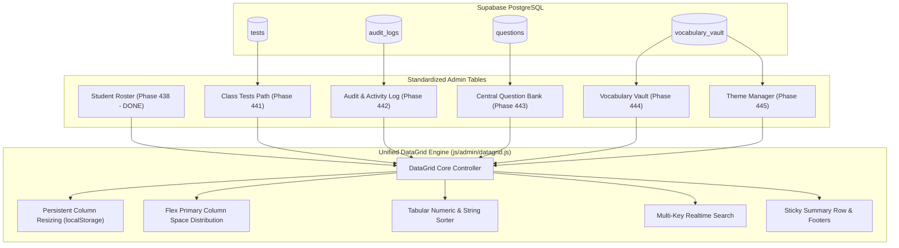

# Master Table Architecture Standardization & DataGrid Migration Plan
**Date:** 2026-11-13 | **TopsCore LMS** | **Phase Scope:** Phase 441 – Phase 445

> [!IMPORTANT]
> **Architectural Objective:** Transition TopsCore from fragmented, ad-hoc HTML tables into a unified, enterprise-grade `DataGrid` ecosystem with standardized Flex Primary Column sizing, persistent column resize memory, built-in sorting/filtering, and zero outer scrollbars.

---

## 1. Goal Description

### Context & Problem Statement
TopsCore's tables currently suffer from architectural bifurcation:
1. **Modern DataGrid Implementations** (`student-management.js` and `classes-management.js`): Benefit from keyboard/click sorting, custom cell renderers, and persistent column widths. However, `classes-management.js` lacked calibrated widths and `student-management.js` previously suffered from an aggressive `autoFitOnMount: true` bug (fixed in Phase 438 via the **Flex Primary Column Pattern**).
2. **Ad-Hoc Custom HTML Tables** (`desk.js` Audit Log, `class.js` Question Bank, `vocab-vault.js` Vocabulary Vault & Theme Manager): Contain high-volume data (hundreds to thousands of rows) but implement redundant string-concatenation rendering, bespoke filtering routines, lack Excel-style column resizing, and lack universal responsive space absorption.

### Desired Outcome
1. **Phase 441 (Immediate)**: Ratify the Flex Primary Column Rule (§TABLE-FLEX-PRIMARY) across the codebase and apply calibrated column sizing to `classes-management.js` DataGrid (`TITLE` column as Flex Primary).
2. **Phase 442**: Migrate the **Activity & Audit Log** (`desk.js`) to `DataGrid` (clean, security-critical tabular trail).
3. **Phase 443**: Migrate the **Central Question Bank** (`class.js`) to `DataGrid` (multi-thousand question repository).
4. **Phase 444**: Migrate the **Vocabulary Vault** (`vocab-vault.js`) to `DataGrid` while preserving Master Edit Mode in-place cell editing.
5. **Phase 445**: Migrate the **Theme Manager** (`vocab-vault.js`) to `DataGrid`.
6. **Explicit Non-Migration Boundary**: 2D coordinate matrices (such as `blueprint-matrix-table` and `class-attendance-grid`) and transient popover/modal tables remain native HTML tables.

---

## 2. Architectural Blueprint & Data Flow



---

## 3. Mandatory 4-Column Before & After Comparative Matrix

| Komponen / Properti | 🔴 Kondisi Saat Ini (BEFORE) | 🟢 Target Perubahan (AFTER) | Dasar Aturan / Alasan |
| :--- | :--- | :--- | :--- |
| **`classes-management.js` DataGrid Widths** | Kolom tidak memiliki `width` eksplisit; judul dibatasi `max-width: 250px`, kolom lain berantakan saat viewport berubah. | `order` (80px), `level` (70px), `prereq` (130px), `type` (110px), `answerType` (90px), `access` (80px), `timeLimit` (75px), `minScore` (75px), `qCount` (65px), `status` (90px), `actions` (120px). **`title`**: Flex Primary (tanpa `width`, `minWidth: '220px'`). | Rule 5 (Dynamic Column Sizing) & §TABLE-FLEX-PRIMARY |
| **`classes-management.js` autoFitOnMount** | Tidak didefinisikan (menggunakan default yang tidak stabil). | Eksplisit `autoFitOnMount: false`, `tableId: 'class-learning-path-grid'` dengan persistent resize support. | Rule 13 (Column Resizing Memory) |
| **Audit Log Table (`desk.js`)** | Custom string concatenation `<table>`, tidak bisa resize kolom, tidak bisa sort header, paginasi manual. | `new DataGrid` dengan sortable timestamp, actor, action, category chips, dan payload details sebagai Flex Primary. | Rule 8 (Universal Table Standardization Protocol) |
| **Question Bank (`class.js`)** | Custom HTML table, filter manual, tidak ada column width memory, visual styling terisolasi. | `new DataGrid` dengan single-line cell truncate, modal edit trigger, auto-flex question text column. | Rule 4 (Single-Responsibility Columns) & Rule 8 |
| **Vocabulary Vault (`vocab-vault.js`)** | Custom HTML table `#vault-table` dengan width berbasis `%` (`30%`, `35%`), rentan overflow pada layar kecil. | `new DataGrid` dengan Master Edit Mode compatibility, LEX-CD fixed 75px, Word fixed 140px, Definition sebagai Flex Primary. | Rule 2 (Master Edit Mode Invariant) & Rule 5 |
| **Visual Styling & Table Font** | Sebagian tabel custom memakai `font-size: 0.75rem` / `0.85rem` yang inkonsisten. | Standar mutlak `font-size: 12px !important;` Inter 500 (`--tr-font-table`), zero sub-11px text. | Rule 14 (Tutor's Room 8-Tier Typographic Scale) |

---

## 4. Visual Pre-Flight Verification Checklist

### 📐 Visual Pre-Flight Verification Checklist
- [ ] **Current State Screenshot (Before)**: Embedded baseline visual showing existing appearance and dimensions.
- [ ] **Proposed Visual Mockup (After)**: Interactive generative UI widget or high-fidelity mockup showing the new layout.
- [ ] **Zero Outer Page Scroll**: Verified root `100vh` lock with `calc(100vh - 60px)` console sizing.
- [ ] **Container Spacing**: Verified strict 10px gap between all cards, tables, and top/lower panels.
- [ ] **Lower Panel Alignment**: Verified 50px fixed height aligned with `.sidebar-footer`.
- [ ] **Dynamic Columns & Nowrap**: Verified `white-space: nowrap !important;` on table cells with zero clipped text.
- [ ] **Zero Dead Space**: Verified tables and cards expand to fill 100% width cleanly.
- [ ] **Language Standard**: Verified all headers, labels, and loading messages use 100% direct English.

---

## 5. Phase-by-Phase Implementation Roadmap

### Phase 441: Flex Primary Column Governance & Class Tests Grid Calibration
- **Target Files**:
  - `js/admin/classes-management.js`
  - `.agents/rules/ui-invariants.md`
- **Actions**:
  1. Set `autoFitOnMount: false` and `tableId: 'class-learning-path-grid'`.
  2. Apply pixel widths to fixed columns (`order`, `level`, `prereq`, `type`, `answerType`, `access`, `timeLimit`, `minScore`, `qCount`, `status`, `actions`).
  3. Set `title` column as the Flex Primary column (remove explicit `width`, set `minWidth: '220px'`).
  4. Codify §TABLE-FLEX-PRIMARY into `.agents/rules/ui-invariants.md`.
  5. Build Playwright test `scripts/verify_class_grid_flex.mjs`.

### Phase 442: Activity & Audit Log DataGrid Migration
- **Target Files**:
  - `js/admin/desk.js`
- **Actions**:
  1. Replace manual string table in `renderAuditLog()` with `new DataGrid({ container: 'audit-table-wrap', tableId: 'audit-logs-grid', ... })`.
  2. Implement columns:
     - `created_at` (160px, formatted date/time)
     - `actor_role` (100px, badge)
     - `action` (120px, uppercase event badge)
     - `entity_type` (120px)
     - `entity_id` (140px, monospace UUID/code)
     - `details` (Flex Primary, auto-expanding JSON payload summary)
  3. Wire category filter dropdown directly to `DataGrid.filter()`.
  4. Build automated verification script `scripts/verify_audit_log_datagrid.mjs`.

### Phase 443: Central Question Bank DataGrid Migration
- **Target Files**:
  - `js/admin/class.js`
- **Actions**:
  1. Refactor `renderCentralQuestionBank()` to instantiate `DataGrid`.
  2. Define columns:
     - `id` / `order` (60px)
     - `topic` (140px)
     - `word_type` (100px)
     - `prompt` / `question_text` (Flex Primary, minWidth 280px)
     - `accepted_answers` (200px, monospace tag list)
     - `status` (80px)
     - `actions` (90px, edit/delete buttons obeying Master Edit Mode)
  3. Ensure seamless integration with Excel Question Bank bulk import.
  4. Build automated verification script `scripts/verify_question_bank_datagrid.mjs`.

### Phase 444: Vocabulary Vault DataGrid Migration
- **Target Files**:
  - `js/admin/vocab-vault.js`
- **Actions**:
  1. Refactor `#vault-table` to `new DataGrid`.
  2. Preserve Master Edit Mode inline editability (`contenteditable` / inputs inside `td`).
  3. Configure columns:
     - `lex_code` (85px, monospace tactical cyan)
     - `word` (140px, bold font-weight 500)
     - `topic` (140px)
     - `word_type` (80px)
     - `meaning` / `definition` (Flex Primary, absorbing remaining viewport)
     - `example` (minWidth 260px)
     - `actions` (80px, edit-mode only)
  4. Maintain existing search and program/topic dropdown filter bindings.
  5. Build automated verification script `scripts/verify_vocab_vault_datagrid.mjs`.

### Phase 445: Theme Manager DataGrid Migration
- **Target Files**:
  - `js/admin/vocab-vault.js`
- **Actions**:
  1. Refactor `#theme-manager-flat-table` to `new DataGrid`.
  2. Standardize theme hierarchy display with auto-expanding name column.
  3. Verify zero regression across Vocabulary Vault tabs.

---

## 6. Proposed Code Changes (Phase 441 Snippets)

### [MODIFY] `js/admin/classes-management.js`

```diff
     const ClassGrid = new DataGrid({
       container: 'class-datagrid-container',
+      tableId: 'class-learning-path-grid',
+      autoFitOnMount: false,
       data: gridData,
       pageSize: 1000,
       hideToolbar: true,
       searchKeys: ['title', 'status'],
       initialSortKey: 'order',
       initialSortAsc: true,
       bulkActions: false,
       columns: [
         {
-          key: 'order', label: 'CODE', sortable: true,
+          key: 'order', label: 'CODE', sortable: true, width: '80px',
           render: (val, row) => { ... }
         },
         { 
-          key: 'title', label: 'TITLE', sortable: true,
-          render: (val, row) => `<div class="fw-700" style="color:var(--clr-text-1); font-size:12px; white-space:nowrap !important; text-overflow:ellipsis; overflow:hidden; max-width:250px;" title="${escapeHtml(row.title)}">${escapeHtml(row.title)}</div>`
+          key: 'title', label: 'TITLE', sortable: true, minWidth: '220px',
+          render: (val, row) => `<div class="fw-700" style="color:var(--clr-text-1); font-size:12px; white-space:nowrap !important; text-overflow:ellipsis; overflow:hidden;" title="${escapeHtml(row.title)}">${escapeHtml(row.title)}</div>`
         },
         {
-          key: 'level', label: 'LEVEL', sortable: true,
+          key: 'level', label: 'LEVEL', sortable: true, width: '70px',
           render: (val, row) => ...
         },
         {
-          key: 'prereq', label: 'PREREQUISITE', sortable: true,
+          key: 'prereq', label: 'PREREQUISITE', sortable: true, width: '130px',
           render: (val, row) => ...
         },
         {
-          key: 'type', label: 'TYPE', sortable: true,
+          key: 'type', label: 'TYPE', sortable: true, width: '110px',
           render: (val, row) => ...
         },
         {
-          key: 'answerType', label: 'ANSWER', sortable: true,
+          key: 'answerType', label: 'ANSWER', sortable: true, width: '90px',
           render: (val, row) => ...
         },
         {
-          key: 'access', label: 'ACCESS', sortable: true,
+          key: 'access', label: 'ACCESS', sortable: true, width: '80px',
           render: (val, row) => ...
         },
         {
-          key: 'timeLimit', label: 'DUR. (M)', sortable: true,
+          key: 'timeLimit', label: 'DUR. (M)', sortable: true, width: '75px',
           render: (val, row) => ...
         },
         {
-          key: 'minScore', label: 'PASS (%)', sortable: true,
+          key: 'minScore', label: 'PASS (%)', sortable: true, width: '75px',
           render: (val, row) => ...
         },
         {
-          key: 'qCount', label: 'QS', sortable: true,
+          key: 'qCount', label: 'QS', sortable: true, width: '65px',
           render: (val, row) => ...
         },
         {
-          key: 'status', label: 'STATUS', sortable: true,
+          key: 'status', label: 'STATUS', sortable: true, width: '90px',
           render: (val, row) => ...
         },
         {
-          key: 'actions', label: '', sortable: false,
+          key: 'actions', label: '', sortable: false, width: '120px',
           render: (val, row) => ...
         }
       ]
     });
```

---

## 7. Verification Plan

### Automated Tests
1. **Roster Flex Layout Regressions**:
   ```powershell
   node scripts/verify_roster_flex_layout.mjs
   ```
   *Expected:* 13/13 PASS.
2. **Class Tests Grid Calibration (Phase 441)**:
   ```powershell
   node scripts/verify_class_grid_flex.mjs
   ```
   *Expected:* Zero horizontal scrollbar, TITLE width dynamically expands to consume remaining space (>220px), all fixed columns match pixel allocations.
3. **Master Quality & Syntax Suite**:
   ```powershell
   npm.cmd test
   ```
   *Expected:* 100% PASS across all 20 test suites and UI spatial checker.

### Manual Verification
1. Navigate to `Admin -> C — CLASS -> Learning Path / Tests`.
2. Inspect the Class Tests table at 1366px screen width: confirm zero horizontal scrollbar and that the `TITLE` column gracefully absorbs all space between metadata and actions.
3. Double-click column border to verify manual auto-fit still works cleanly on user demand.
